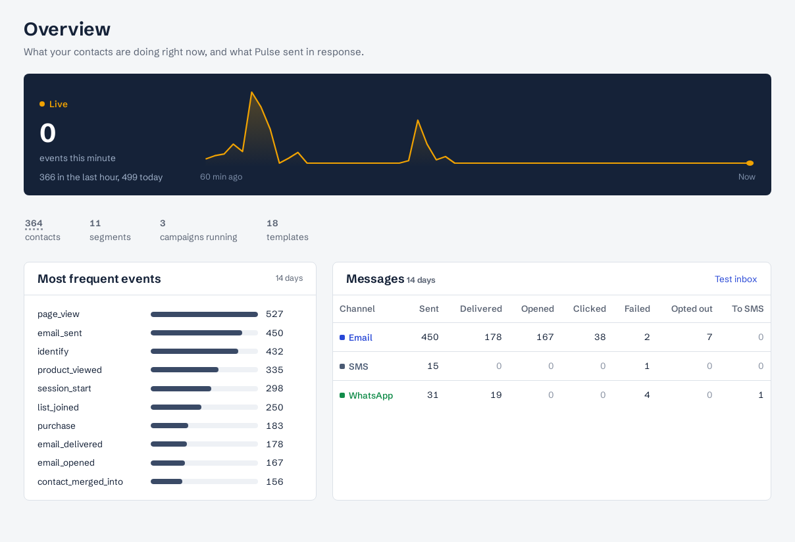
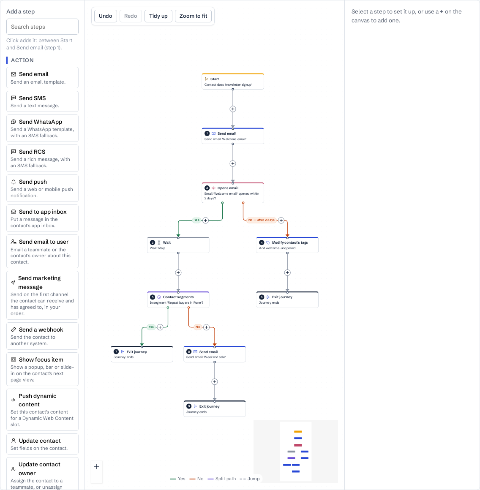
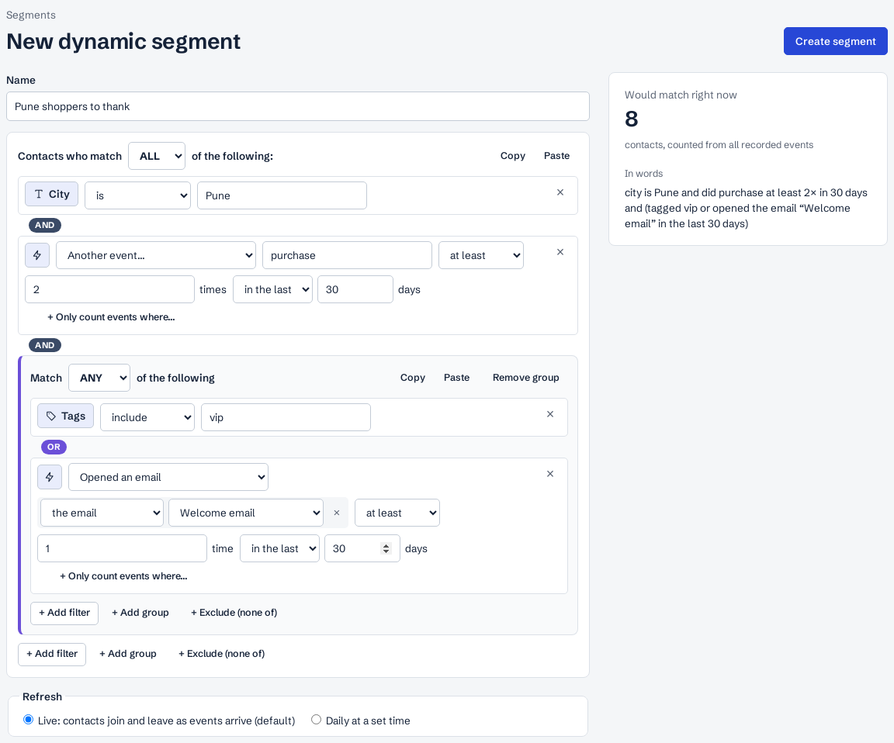

# Pulse

Pulse is a self-hosted, multi-tenant marketing automation platform that works in real time. It
keeps your contacts and what they do on your website and apps, puts them into segments as soon as
they qualify, and reaches them with one-time, triggered and automation campaigns over email, SMS,
WhatsApp, RCS, push and an in-app inbox, plus pop-ups and personalised content on your website. It
is one Go binary with the React web app built in, running on Kafka, ClickHouse, Postgres and Redis;
an event moves a contact into a segment and starts a campaign within seconds instead of waiting for
a scheduled job, and it is designed for 10 to 100 million contacts. Many workspaces (brands,
clients or teams) share one installation, and your customer data stays on your servers.

Pulse is free software: the platform is AGPL-3.0 and the SDKs you embed in your apps are MIT (see
[License](#license)).



<table>
<tr>
<td width="50%"></td>
<td width="50%"></td>
</tr>
<tr>
<td>The step builder for triggered and automation campaigns</td>
<td>Segments with live counts</td>
</tr>
</table>

## What it does

**Audience**
- **Contacts** with any custom fields, anonymous visitors that become known contacts (history kept),
  duplicate merge, companies, lifecycle stages, tags and lead scoring.
- **Contacts list** with filters as plain questions (*did an event between two dates*, *got a
  campaign and opened it*, *reachable by WhatsApp*…) or typed in the search box, columns, CSV export,
  and "save as segment". Every count in the app opens the list of exactly those contacts.
- **Segments** that update in real time: contact fields, events with counts, time windows and
  property filters (`items[].code`), other segments, nested ALL / ANY / NONE groups, or static lists.
- **Events** with typed schemas (properties, required fields, allowed values), checked as they
  arrive; you can describe an event before your code sends it.
- **Contact page**: reach on each channel and why not, devices, campaigns, messages with their
  outcome and reason, purchases and the full event history.

**Campaigns**
- **One-time** (to segments, once or repeating, with A/B tests, send deadlines and each contact's
  own time zone), **triggered** (when someone does something) and **automation** (when someone
  joins a segment) campaigns, in one Campaigns list with tags and filters.
- A visual builder for triggered and automation campaigns: waits, conditions, decisions on opens,
  clicks and replies, A/B splits with automatic winners, goals, webhooks, field and tag updates,
  CRM pushes, and steps for forms, assets, pages, points, stages and owners.
- Personalisation from contact fields and the event that started the campaign
  (`{{event.product_name}}`), with defaults and formats; the channel chosen by condition (Indian
  numbers by SMS, others by WhatsApp); consent, frequency caps and quiet hours on every send.
- Exact audience estimates after exclusions, consent, reachability and caps, before you send.

**Channels and delivery**
- Email over any SMTP service (one-click settings for Amazon SES, SendGrid, Mailgun, Postmark,
  Brevo, Microsoft 365, Gmail…), with tracking, unsubscribe, interactive AMP emails and
  attachments; SMS, WhatsApp and RCS (Twilio, MSG91, Gupshup, Meta, Google RBM) with SMS fallback;
  Firebase and web push; an in-app inbox.
- Any other gateway through a custom HTTP connection: paste the API's curl or Postman examples and
  Pulse fills it in, including a login step that fetches a token.
- Several providers per channel: choose one per campaign, step or test send; sending limits per
  provider (messages per second and per day) and per workspace.
- Delivery reports, bounces and complaints linked to the right campaign and contact, with a
  reason for every message that didn't go out.

**Website and apps**
- A web SDK (page views, identify, events, pop-ups, content slots, web push, the inbox) and Android,
  iOS and Flutter SDKs (in-app messages, push, inbox).
- Focus items (pop-ups, bars, slide-ins) and personalised website content by audience, forms
  (multi-page, file uploads), landing pages and downloadable assets.

**Analytics**
- An Overview with live activity and what needs attention; campaign reports with funnels and
  failure reasons; dashboards for users (DAU / MAU), campaigns and products; funnels, cohorts,
  revenue attribution and a report builder; a live event feed.

**Administration and security**
- Teams with custom roles, an audit log, single sign-on (OIDC) and two-step sign-in with an
  authenticator app (optional, or required for everyone or chosen roles and people).
- Settings for every automatic behaviour (data retention, retries, schedules, default limits),
  privacy tools (delete a contact, download their data) and encrypted secrets.
- Integrations: HubSpot, Salesforce, Shopify, Zapier / Make, outbound webhooks, and Facebook and
  Google Ads audiences kept in sync with segments.

## Run it

You need Docker with Compose v2, GNU make, `git`, about 8 GB of free memory and the ports below.
Go isn't required: when it isn't installed, the make targets run it inside the `golang` image.
From the root of a fresh clone of this repository:

```bash
make up        # builds Pulse and starts Kafka, ClickHouse, Postgres, Redis, Mailpit, Keycloak and Pulse (all roles, web app included)
make seed      # a demo workspace with data (sign-in details: deploy/dev-seed.md)
```

The first `make up` builds the image and takes a few minutes. Then open http://localhost:7080 and
sign in with the demo workspace's details from [deploy/dev-seed.md](deploy/dev-seed.md), or create
a workspace at http://localhost:7080/signup (the local stack allows sign-up; a production
installation doesn't unless you turn it on).

| Service | URL |
|---|---|
| Pulse web app and API | http://localhost:7080 |
| Mailpit (every email sent locally) | http://localhost:18025 |
| Keycloak (local single sign-on) | http://localhost:8180 |
| ClickHouse HTTP | http://localhost:18123 (user and password `pulse`) |

```bash
make test      # Go unit tests (no infrastructure needed)
make e2e       # end-to-end tests against the running stack
make it        # segment compiler agreement test against ClickHouse
make load ARGS="-scenario month -contacts 5000000"   # load test (see Sizing below)
make docs-shots  # retake the documentation screenshots from the running app
make docs-check  # check every link, image and anchor in the docs (needs Node.js 22.12+)
make down      # stop the stack
cd web && npm install && npm run dev     # web app with hot reload on :5173 (Node.js 22.12+); npm test runs its tests
```

The local stack uses development passwords and keys from `deploy/docker-compose.yml`; don't expose
it to a network. For production (separate roles, secrets, scaling, backups, TLS) see
[Installation](docs/developer/01-installation.md).

## Documentation

- **[Tutorials](docs/tutorials/README.md)**: 20 step-by-step guides for marketers, with screenshots,
  from [Getting started](docs/tutorials/01-getting-started.md) to
  [channels](docs/tutorials/04-channels.md), [campaigns](docs/tutorials/14-campaigns-hub-and-one-time-campaigns.md),
  [personalisation](docs/tutorials/13-personalising-messages.md) and
  [analytics](docs/tutorials/10-analytics.md).
- **[Developer guides](docs/developer/README.md)**: [installation](docs/developer/01-installation.md),
  [configuration](docs/developer/02-configuration.md), the [API](docs/developer/03-api.md), the
  [web SDK](docs/developer/04-web-sdk.md), [mobile SDKs](docs/developer/05-mobile-sdks.md),
  [webhooks and integrations](docs/developer/06-webhooks-and-integrations.md),
  [architecture and extending](docs/developer/07-architecture-and-extending.md),
  [contributing and testing](docs/developer/08-contributing-and-testing.md).
- **Design and product**: [architecture](docs/architecture.md) (with the load test results),
  [product overview](docs/product.md) (every feature and its limits), and
  [how it compares](docs/comparison.md) with other open-source and SaaS products.

## How it works

```
 websites, apps, servers ──► API ──► Kafka events.raw ──► profile (identity, fields: Postgres)
                                                              │
                                                              ▼
                                                      Kafka events.enriched
                         ┌────────────────────────────┬───────┴──────────┬──────────────────────┐
                         ▼                            ▼                  ▼                      ▼
                 chsink → ClickHouse        segments (Redis bitmaps   journeys (campaign     webhooks,
                 (event log, analytics)      + ClickHouse backfill)    steps, timers)         integrations
                                                      │                  │
                                                      └──────► dispatch (email, SMS, WhatsApp, RCS, push, inbox)
```

Every role is the same binary (`pulse api`, `pulse segments`, `pulse dispatch`…, or `pulse all`),
so each scales on its own. One person's events stay in order (Kafka is keyed by contact); segment
membership lives in Redis bitmaps for instant checks and counts; the event history lives in
ClickHouse for windows, backfills, reports and dashboards. Details:
[architecture](docs/architecture.md).

## Sizing

Measured on one 12-core / 31 GB workstation running **everything**: Kafka, ClickHouse, Postgres,
Redis, Pulse (`pulse all`) and the load generator, next to other software. These numbers are a
floor. Details: [load test](docs/architecture.md#18-performance-and-the-load-test).

**The month scenario** (`make load ARGS="-scenario month ..."`) creates the contacts, then sends a
whole month of website traffic as fast as the API takes it. Each page view carries 2 events (the
page view and one more), spread over the last 30 days.

| Run | Contacts | Visitors / page views a month | Events | Ingest (HTTP, 0 failures) | Event → segment change during the burst |
|---|---|---|---|---|---|
| Full | 5M in 1 m 28 s (56,700 ev/s) | 2M / 10M | 20M in 4 m 49 s (69,200 ev/s) | 0 failed | p50 28 s, p95 100 s |
| Half | 2.5M in 36 s (69,100 ev/s) | 1M / 5M | 10M in 2 m 27 s (68,300 ev/s) | 0 failed | p50 19 s, p95 69 s |

- **Ingest isn't the limit.** The API took about 68k events a second both times. Processing (the
  profile and segment roles, all on the same 12 cores) ran at about 11–14k events a second, so a
  backlog builds during a burst like this and the segment lag above is that backlog.
- **Real traffic is far gentler.** A month of 10M page views at 2 events each is 20M events, about
  8 events a second on average, or perhaps 80 a second at a busy peak. One small Pulse instance
  keeps that at sub-second latency (p50 26–180 ms in the steady-rate runs of the [load test](docs/architecture.md#18-performance-and-the-load-test)).
- **Peak use during the half run:** Pulse 6 cores (3 on average) and 630 MB; Redis 1.6 cores;
  ClickHouse 1.7 GB; Postgres 1.4 GB; Kafka 1.2 GB.
- **Redis memory follows recent events.** Each event leaves two duplicate-check keys for 24 hours
  (about 110 B each), and each contact keeps one counter per event type with a field per day for a
  year (about 100 B plus about 12 B a day). Because the test pushed a month into a few minutes, every event's
  check keys were alive at once: Redis grew by 3.3 GB. The half run's processing was stopped after 10 minutes, at 8.3M of 12.5M events,
  because the shared machine ran out of memory. Spread over a real month, the check keys stay
  near one day's events.
- **Storage:** ClickHouse keeps about 42 bytes per event on disk (38M events in 1.5 GB). Postgres
  needs roughly 0.7 KB per contact with its indexes.

### Example: 5M contacts, 2M visitors and 10M page views a month (20M events)

| Service | CPU | Memory | Disk | Why |
|---|---|---|---|---|
| Pulse (2 instances, for failover) | 2 vCPU each | 1 GB each | — | about 8 events a second on average; a burst like the test needs about 6 cores to keep up in real time |
| Redis 7.4+ | 2 vCPU | 8 GB (16 GB if many contacts are active every day) | snapshot | counters for active contacts, about 1.4M check keys a day, segment bitmaps (about 0.6 MB each) |
| Postgres | 4 vCPU | 8 GB | 50 GB SSD | about 4 GB for 5M contacts, plus campaigns, journeys and audit |
| ClickHouse | 4 vCPU | 8 GB | 20 GB SSD a year | about 0.9 GB of events a month |
| Kafka (3 brokers in production) | 2 vCPU each | 4 GB each | 20 GB each | 7 days of events, replicated 3 times |

For about 10× the traffic, run the roles as separate deployments (`pulse api`, `pulse profile`,
`pulse segments`…), raise the Kafka partition count, and give Redis its own cores. The [load test](docs/architecture.md#18-performance-and-the-load-test)
section lists what limits come next.

## Configuration

Every setting is a `PULSE_*` environment variable; the [configuration guide](docs/developer/02-configuration.md)
lists them all with their defaults. Never run the development `deploy/docker-compose.yml` on a server
(it publishes ports and uses default passwords and keys). In production set at least:

| Variable | What for |
|---|---|
| `PULSE_SECRET_KEY` | 64 hex characters that encrypt stored secrets, sign-in state and signed links |
| `PULSE_PUBLIC_URL` | The https address people reach Pulse at (sign-in, tracking and unsubscribe links) |
| `PULSE_PAGES_URL` | A separate origin for landing pages, forms and downloads, ideally on its own registrable domain |
| `PULSE_PG_DSN`, `PULSE_CH_ADDR`, `PULSE_REDIS_ADDR`, `PULSE_KAFKA_BROKERS` | Where the databases and Kafka are |
| `PULSE_EMAIL_RATE`, `PULSE_SMS_RATE`, … | Messages per second per workspace and channel (defaults 200 email, 100 SMS) |
| `PULSE_ALLOW_SIGNUP` | Off by default: workspaces are created with `PULSE_ADMIN_TOKEN`. Turn it on only behind a CAPTCHA or on a private network |

## API in one minute

Against the local stack (the examples use `jq` to read IDs from the answers):

```bash
# A workspace and its server API key (the dev admin token is in deploy/docker-compose.yml)
KEY=$(curl -s -X POST localhost:7080/v1/tenants -H 'Authorization: Bearer dev-admin-token' \
  -d '{"name":"Acme"}' | jq -r .api_key)
H="Authorization: Bearer $KEY"

# A template, a segment and an automation campaign that emails people who join it
TPL=$(curl -s -X POST localhost:7080/v1/templates -H "$H" -d '{"name":"welcome","channel":"email",
  "subject":"Welcome {{contact.first_name | default:\"friend\"}}","html":"<p>Hi {{contact.first_name}}</p>"}' | jq .id)
SEG=$(curl -s -X POST localhost:7080/v1/segments -H "$H" -d '{"name":"Delhi buyers","rule":{"all":[
  {"attr":"city","op":"eq","value":"Delhi"},{"event":"purchase","op":"gte","count":1,"days":7}]}}' | jq .id)
JRN=$(curl -s -X POST localhost:7080/v1/journeys -H "$H" -d '{"name":"welcome","graph":{
  "trigger":{"type":"segment_entered","segment_id":'$SEG'},"entry":"send",
  "nodes":{"send":{"type":"send_email","template_id":'$TPL',"next":"done"},"done":{"type":"exit"}}}}' | jq .id)
curl -s -X POST localhost:7080/v1/journeys/$JRN/activate -H "$H"

# Events: the email arrives in Mailpit (http://localhost:18025) within seconds
curl -s -X POST localhost:7080/v1/events -H "$H" -d '{"events":[
  {"external_id":"u1","name":"identify","email":"u1@example.com","attrs":{"city":"Delhi","first_name":"Asha"}},
  {"external_id":"u1","name":"purchase","props":{"amount":499}}]}'
curl -s localhost:7080/v1/contacts/u1 -H "$H"   # the profile and its segments
```

The full API, with every route, is in the [API guide](docs/developer/03-api.md).

Some contact fields are kept by Pulse itself (tags, points, stage, consent, company, owner…) and
change only through their own APIs and events: see
[profiles and reserved attributes](docs/architecture.md#7-identity-resolution-and-profiles).

## Repository layout

```
cmd/pulse/          the binary: one role per argument (migrate, api, profile, chsink, segments, journeys, dispatch,
                    webhooks, integrations, all) and `replay-dlq <topic>`
cmd/seed/           demo workspaces (`make seed`, `make docs-seed`); cmd/loadgen/: the load generator (`make load`)
internal/api/       the HTTP API
internal/segment/   segment rules: Go evaluator, ClickHouse SQL compiler, Redis bitmaps
internal/segengine/ streaming membership, backfill and sweep
internal/journey/   campaign graphs, the executor, triggers and timers
internal/dispatch/  sending on every channel: idempotency, rate limits, quotas, consent, caps, quiet hours, fallback
internal/providers/ email, SMS, WhatsApp, RCS and push providers and the custom HTTP gateway
internal/profile/   identity resolution and field merging
internal/chsink/    events into ClickHouse
internal/...        reach, bounces, integrations, AMP, on-site, analytics, automation settings, maintenance
internal/store/     Postgres and ClickHouse stores
migrations/         SQL, embedded in the binary
web/                the web app (React + TypeScript, Vite), embedded in the binary, and the web SDK
sdks/               Android (Kotlin), iOS (Swift) and Flutter SDKs
test/e2e/           end-to-end tests against the running stack
deploy/             the development compose stack, Keycloak realm and test accounts (dev-seed.md)
docs/               tutorials, developer guides, architecture, product overview, comparison and the screenshot scripts
```

## Limitations

The full, current list is under [Honest limits at a glance](docs/product.md#honest-limits-at-a-glance). The ones most
likely to matter:

- The provider and integration adapters are tested against mock servers; check each with a real
  account before relying on it (Gupshup's endpoints especially).
- Plain SMTP relays, Gmail, FCM and web push don't report deliveries, so those show "—".
- Contacts don't leave an automation campaign when they leave its segment; add a condition or a
  goal instead.
- The Android and iOS SDKs have not been run on devices, and the iOS SDK has not yet been built
  with Xcode (its core logic is tested on Linux).
- Postgres row-level security isn't enabled; workspaces are kept apart in every query instead.

## Contributing

Bug reports, fixes, docs and new provider adapters are welcome. Read [CONTRIBUTING.md](CONTRIBUTING.md)
for how to set up, test and send a change; the details are in
[contributing and testing](docs/developer/08-contributing-and-testing.md).

## Security

Please don't report security problems in public issues. Use GitHub's private vulnerability
reporting as described in [SECURITY.md](SECURITY.md).

## License

Pulse uses two licenses:

- **The platform** (the server, the web app and everything else, unless a folder says otherwise)
  is free software under the [GNU Affero General Public License v3.0](LICENSE) (AGPL-3.0). You may
  use, change and share it. If you change it and let people use it over a network (for example as
  a hosted service), you must offer them the source of your changed version under the same license.
- **The SDKs** you embed in your own websites and apps are under the [MIT License](sdks/android/LICENSE),
  so using them never puts your website's or app's code under the AGPL:
  [Android](sdks/android/LICENSE), [iOS](sdks/ios/LICENSE), [Flutter](sdks/flutter/pulse_sdk/LICENSE),
  the [web SDK](web/src/sdk/LICENSE) and the [scripts your pages load](web/public/sdk/LICENSE)
  (the web SDK bundle, landing page and service worker scripts).
