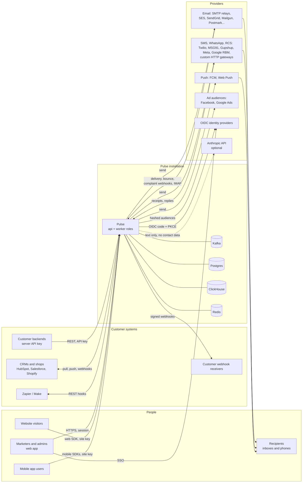
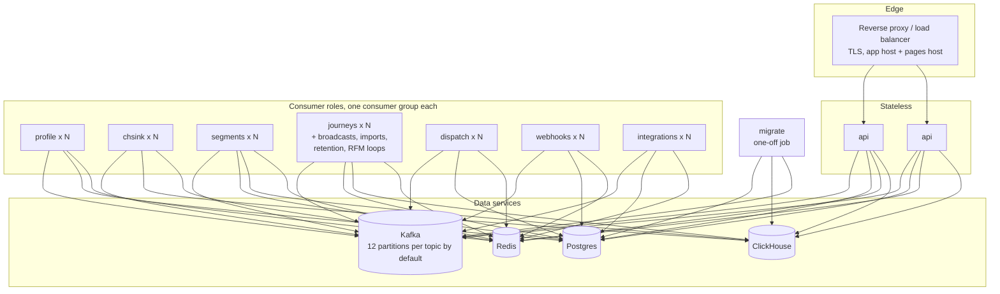
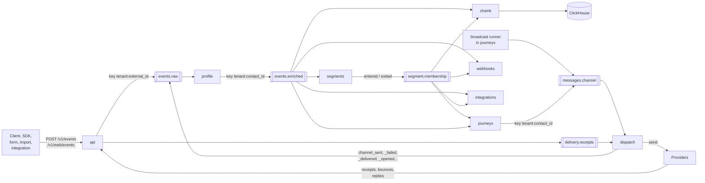
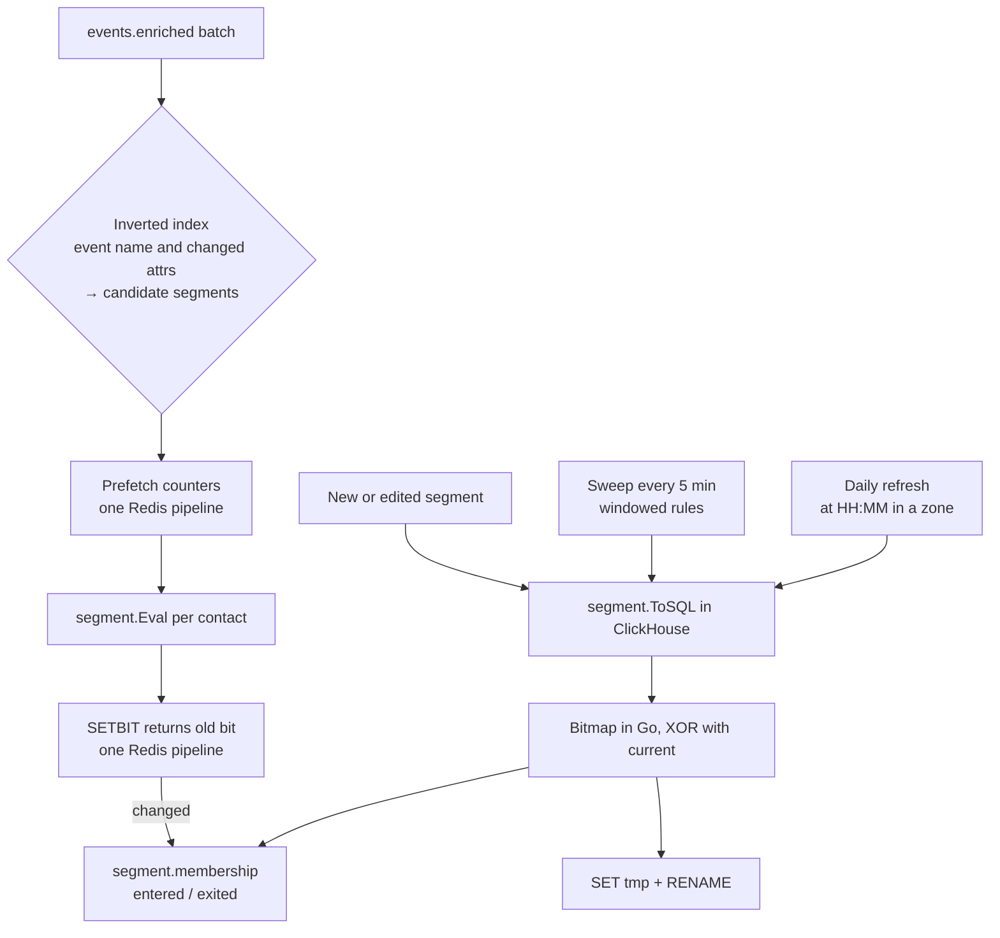
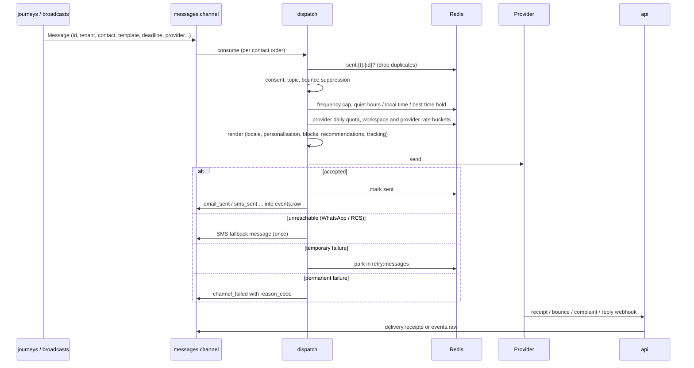
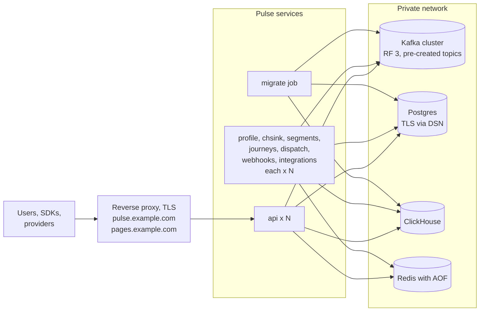

# Pulse architecture

This document describes how Pulse is built: what it is for, how its parts fit together, where data
lives and why, how it stays correct and fast, how it is secured and operated, and where its limits
are. It is written for engineers, architects and technology leaders reviewing the system, and it
describes the code as it is in this repository, not plans.

Companion documents:

- [Product overview](product.md): what Pulse does for marketers, feature by feature.
- [Developer documentation](developer/README.md): [installation](developer/01-installation.md),
  [configuration](developer/02-configuration.md), [API](developer/03-api.md),
  [web SDK](developer/04-web-sdk.md), [mobile SDKs](developer/05-mobile-sdks.md),
  [webhooks and integrations](developer/06-webhooks-and-integrations.md),
  [code map and extension recipes](developer/07-architecture-and-extending.md),
  [contributing and testing](developer/08-contributing-and-testing.md).
- [Tutorials](tutorials/README.md): the app, step by step, with screenshots.

**Naming.** The app calls scheduled sends to a segment **one-time campaigns** and graph-based
automations **triggered campaigns** (started by an event or a form) or **automation campaigns**
(started by joining a segment). The code, the API and this document keep the internal names:
`broadcast` for the first, `journey` for the other two. A *workspace* is a tenant (`tenant_id` in
the code).

---

## Contents

1. [Goals and non-goals](#1-goals-and-non-goals)
2. [System context](#2-system-context)
3. [One binary, many roles](#3-one-binary-many-roles)
4. [An event, end to end](#4-an-event-end-to-end)
5. [Storage](#5-storage)
6. [Multi-tenancy and isolation](#6-multi-tenancy-and-isolation)
7. [Identity resolution and profiles](#7-identity-resolution-and-profiles)
8. [Segmentation engine](#8-segmentation-engine)
9. [Campaigns: journeys and broadcasts](#9-campaigns-journeys-and-broadcasts)
10. [Delivery](#10-delivery)
11. [Content and personalisation](#11-content-and-personalisation)
12. [Website and app engagement](#12-website-and-app-engagement)
13. [Analytics and reporting](#13-analytics-and-reporting)
14. [Integrations and webhooks](#14-integrations-and-webhooks)
15. [Security](#15-security)
16. [Privacy and compliance](#16-privacy-and-compliance)
17. [Reliability](#17-reliability)
18. [Performance and the load test](#18-performance-and-the-load-test)
19. [Operations](#19-operations)
20. [Testing strategy](#20-testing-strategy)
21. [Known limits and trade-offs](#21-known-limits-and-trade-offs)
22. [Roadmap candidates](#22-roadmap-candidates)

---

## 1. Goals and non-goals

### Goals

- **Real time.** An event should move a contact into a segment and start a campaign within
  seconds, not on a periodic batch. The cost of handling one event must not grow with the size of
  the database: an event re-evaluates only the segments that reference that event or the
  attributes it changed, for that one contact.
- **Scale.** 10 to 100 million contacts per workspace and 10,000 to 100,000 events per second per
  installation, by scaling each stage of the pipeline on its own.
- **Multi-tenant.** Many workspaces share one installation, with tenant isolation in every key,
  query and cache, and per-workspace limits so one workspace can't starve another.
- **Every channel a marketer needs, India-ready.** Email (including AMP), SMS with DLT template
  registration, WhatsApp, RCS, mobile and web push, an app inbox, in-app messages, website
  pop-ups and personalised content, with SMS fallback from WhatsApp and RCS.
- **Self-hosted and simple to run.** One Go binary (the web app is embedded) on four widely used
  open-source data services. Every secret stays on the operator's servers; nothing calls home.
- **Correct counting.** Events are counted once, messages are sent once, and the number on a
  report matches the list of contacts behind it.
- **Honest numbers.** Every message that didn't go out carries a reason code; reports say "—"
  where a provider gives no delivery report rather than guessing.

### Non-goals

- **Not a CRM or a data warehouse.** Pulse keeps the attributes and events it needs to segment
  and message people; it syncs with CRMs rather than replacing them, and it keeps events only as
  long as each workspace's retention says.
- **Not a sending service.** Pulse does not run its own mail servers or SMS gateways. It sends
  through providers the workspace configures (any SMTP relay, Twilio, MSG91, Gupshup, Meta, Google
  RBM, FCM, standard web push, or any HTTP API through the custom gateway).
- **Not a hosted SaaS in this repository.** There is no billing, metering or tenant signup
  workflow beyond workspace creation; operators run it themselves.
- **No machine-learned models.** Recommendations are co-purchase and popularity lists, churn risk
  is rule-based, best send time is the contact's most active hour. The optional AI help is a
  writing assistant that calls an external model only when the operator configures a key.
- **No exactly-once in Kafka's transactional sense.** Consumers are at-least-once; correctness
  comes from idempotent handlers and deterministic IDs (see [Reliability](#17-reliability)).

---

## 2. System context



Who talks to Pulse, and how they are authenticated:

| Caller | Credential | Routes |
|---|---|---|
| Marketers and admins (web app) | Session cookie (password with optional two-step code, or OIDC SSO) plus the `X-Pulse-CSRF` header on writes | `/v1/*`, the app |
| Customer servers | `Authorization: Bearer <API key>` (acts as an admin of its workspace) | `/v1/*` |
| Browsers and apps (SDKs) | The workspace's public **site key**, optionally an HMAC **user hash** for verified identity | `/v1/web/*` |
| Providers (receipts, bounces, replies) | A per-workspace secret URL, plus the provider's own signature where it has one | `/v1/webhooks/*`, `/v1/replies/*` |
| Zapier / Make | A per-connector key | `/v1/hooks/*` |
| Recipients | Sealed or signed tokens in links | `/t/*`, `/u/*`, `/s/*`, `/v1/amp/*` |
| Platform operator | `PULSE_ADMIN_TOKEN` (off when unset) | `POST /v1/tenants` |

---

## 3. One binary, many roles

Everything is one Go binary, `pulse <role>` (`cmd/pulse/main.go`). The React app is built with
Vite and embedded into it (`web/embed.go`). Each role is a separate process in production and
scales on its own Kafka consumer group; `pulse all` runs every role in one process for local
development and single-server installs.

| Role | What it does | Consumes | Produces / writes | Scales by |
|---|---|---|---|---|
| `migrate` | Applies Postgres and ClickHouse migrations under a Postgres advisory lock, creates Kafka topics, exits | | Postgres, ClickHouse, Kafka topics | One-off job |
| `api` | HTTP: the web app, REST API, event ingestion, SDK endpoints, tracking links, hosted pages and forms, provider webhooks | | `events.raw`, `messages.*` (test sends), `delivery.receipts`; Postgres, Redis | Stateless: any number behind a load balancer |
| `profile` | Identity resolution, profile fold, event day counters, exactly-once counting | `events.raw` | `events.enriched`; Postgres contacts; Redis counters | Partitions of `events.raw` |
| `chsink` | Writes events, contact snapshots and membership changes to ClickHouse; feeds the live event stream | `events.enriched`, `segment.membership` | ClickHouse, Redis stream | Partitions |
| `segments` | Streaming segment membership, backfills, sweeps, daily refreshes, dependent segments, reachability bitmaps | `events.enriched`, `segment.membership` | `segment.membership`; Redis bitmaps | Partitions |
| `journeys` | Journey enrollment and steps, durable timers, A/B winners; **also hosts the background loops below** | `segment.membership`, `events.enriched` | `messages.*`, `events.raw`; Postgres | Partitions for the consumer; row locks for the loops |
| `dispatch` | Consent, caps, quiet hours, deadlines, rate limits and quotas, rendering, provider calls, SMS fallback, retries, receipts, status polling | `messages.<channel>`, `delivery.receipts` | `events.raw` (outcomes), `messages.*` (retries, fallbacks) | Partitions |
| `webhooks` | Outbound webhooks and Zapier / Make subscriptions | `events.enriched`, `segment.membership` | HTTP | Partitions |
| `integrations` | CRM pulls, ad audience sync, bounce mailboxes (IMAP) | `segment.membership`, `events.enriched` | `events.raw`, HTTP | Partitions; row locks for pulls and mailboxes |
| `replay-dlq` | Command: moves records from `<topic>.dlq` back to `<topic>` | `<topic>.dlq` | `<topic>` | One-off |

There is no separate `broadcasts` or `maintenance` role. These run as loops inside the `journeys`
role, because they also turn schedules into work, and every one of them is safe to run on several
instances (claims with `FOR UPDATE SKIP LOCKED`, Redis `SETNX` markers):

| Loop in `journeys` | Cadence | Work |
|---|---|---|
| Journey timers | Continuous poll | Claims due `journey_timers` rows and advances them |
| Broadcast runner | Every second | Starts due one-time and repeating campaign runs, A/B winner steps, RSS feed reads |
| Imports | Every 2 s | Streams queued background CSV imports into `events.raw` |
| A/B winner picker | Every 5 s | Decides journey split steps with an automatic winner |
| Retention cleanup | `PULSE_MAINTENANCE_INTERVAL` (1 h) | Each workspace once a day at UTC hour `id % 24` |
| Identity key backfill | 1–10 s | Fills `contact_keys` for keys added to a workspace |
| Best send times | Every 6 h | Each contact's most active hour from 90 days of opens, clicks, reads |
| Customer value (RFM) and recommendation lists | `PULSE_RFM_INTERVAL` (24 h), per workspace hour | Scores buyers; popular, trending and bought-together lists |
| Journey effect pruning | Hourly | Prunes the idempotency records of journey side effects |



Every role logs JSON lines to stdout with a `role` field and stops cleanly on `SIGTERM`. A role
opens only the connections it uses. The full variable list is in
[configuration](developer/02-configuration.md); deployment options are in
[installation](developer/01-installation.md).

---

## 4. An event, end to end



Step by step, for a `purchase` event sent with the server API key:

1. **Ingest (`api`).** Authenticates the caller, checks the route's permission, validates the
   event (`event.Event.Normalize`: name, timestamp, size, ID), checks it against the event's schema
   if one is enforced, refuses events only Pulse itself may record (`event.PlatformOnly`) and
   attributes only Pulse maintains, and publishes to `events.raw` keyed `tenant:external_id`. It
   answers `202` only after Kafka has acknowledged every record. Browser events (`/v1/web/events`,
   site key) are marked `from_browser` and `Unverified` unless the user hash proves the identity.
2. **Profile (`profile`).** Per Kafka partition, the whole poll is processed as one batch:
   resolve each external ID to the workspace's dense contact ID (creating contacts in one
   multi-row insert), apply identity keys and merges, fold every event in order into the contact's
   attributes (consent, tags, points, stage, company, device, dates, bounce counters), bump the
   Redis day counters segments read, write all changed profiles in one statement, and publish to
   `events.enriched` keyed `tenant:contact_id` with the merged attribute snapshot and the list of
   changed attributes. Duplicates are dropped by event ID (see [exactly-once
   counting](#exactly-once-counting)).
3. **Sink (`chsink`).** Appends events and contact snapshots to ClickHouse in batches, mirrors
   membership changes, and appends each stored event to the workspace's live feed (a capped Redis
   stream).
4. **Segments (`segments`).** Looks up only the segments that reference this event name or one of
   the changed attributes (an inverted index), evaluates them for this one contact with the Go
   compiler, compares with the Redis bitmap bit, and on a change flips the bit and publishes
   `segment.membership`. It also updates the contact's reachability bits.
5. **Journeys (`journeys`).** Enrolls the contact in journeys triggered by the segment entry, the
   event or a form submission, walks the graph, parks waits and decisions as durable timers in
   Postgres, and publishes each send to `messages.<channel>` with an idempotency key
   `{enrollment}:{step}`. Scheduled broadcasts publish to the same topics.
6. **Dispatch (`dispatch`).** Drops duplicates, checks consent and bounces, the frequency cap,
   quiet hours, local-time and best-time holds, send deadlines, the provider's daily quota and the
   rate limits, renders the template for the contact, calls the provider, falls back to SMS where
   configured, and records the outcome as an event (`email_sent`, `sms_failed` with a reason code,
   …) back into `events.raw`.
7. **Loop back.** Provider webhooks (delivered, read, bounced, complained, replied) arrive at the
   `api`, which publishes receipts to `delivery.receipts` or events to `events.raw`. Tracking
   links (`/t/…`) record opens and clicks the same way. Because outcomes are ordinary events,
   segments ("opened an email in the last 7 days"), journey decisions ("clicked within 2 days")
   and reports all read the same stream.

Every key keeps one contact's events in order on one partition, which is what lets the profile
fold and the streaming segment path work without locks.

**Latency.** On one 12-core machine running everything, event → segment change is p50 26 ms /
p95 140 ms at 5,000 events/s and p50 113 ms / p95 313 ms at 10,000 events/s (see
[Performance](#18-performance-and-the-load-test)). The end-to-end tests assert event → segment
under 2 s and event → email under 5 s.

---

## 5. Storage

Each store holds what it is best at: Postgres the mutable state that needs transactions and point
reads, ClickHouse the immutable history that needs scans and aggregates, Redis the hot state that
needs microsecond bit and counter operations, and Kafka the work in flight.

| Store | Role | Why this store |
|---|---|---|
| **Postgres 17** | Workspaces, users, sessions, contacts and attributes, identity keys, segments, journeys, enrollments and timers, templates, broadcasts and runs, providers (sealed secrets), forms, assets (bytes too), settings, approvals, audit log | Transactions for identity and merges, `FOR UPDATE SKIP LOCKED` for work queues, point reads and updates of one contact, JSONB for schemaless attributes |
| **ClickHouse 25.8** | Every event, contact snapshots, segment membership and its history, message outcomes, daily active users | Columnar scans over billions of rows for segment backfills, reports, contact views and analytics |
| **Redis 8** | Segment and reachability bitmaps, event day counters, dedupe guards, rate limiters and quotas, retry and hold queues, caches, live feed streams | Bit and counter operations at memory speed on the hot path |
| **Kafka 4.1** | Events, membership changes, messages and receipts between stages; dead letters | Ordered per contact, replayable, decouples stages so each scales and fails alone |

### Postgres

- **Contacts** (`contacts(tenant_id, id, external_id, email, attrs jsonb, …)`) are hash-partitioned
  by `tenant_id` into 8 partitions (`001_init.sql`). `id` is **dense per workspace** (1, 2, 3…),
  allocated in blocks with one `UPDATE tenant_counters … RETURNING` per batch. Dense IDs are what
  make a segment a Redis bitmap: bit *n* is contact *n*.
- **Custom fields are JSONB**, never columns: a new field needs no migration. Attribute
  definitions (type, label, personal-data flag, list and choice fields) are metadata only.
- **Identity keys** live in `contact_keys` (workspace, key, normalised value → contact), so
  matching by email, phone or a custom key needs no JSON expression index at 100M contacts.
- **Journey state**: `journey_enrollments` (one live enrollment per journey and contact),
  `journey_timers` (due rows claimed with `FOR UPDATE SKIP LOCKED`), `journey_event_waits`
  (decisions parked until an event or a timeout), `journey_effects` (idempotency of side effects).
- **Assets** (files) are stored in Postgres (`assets`, `asset_files`, 25 MB each, 2 GB per
  workspace), so every `api` instance serves every file with no shared volume and backups are the
  database's.
- **Migrations**: `migrations/postgres/001`–`041`, embedded in the binary, recorded in
  `schema_migrations`.

### ClickHouse

| Table | Engine and key | Holds |
|---|---|---|
| `events` | `ReplacingMergeTree`, `PARTITION BY toYYYYMM(ts)`, `ORDER BY (tenant_id, name, contact_id, ts, id)` | Every enriched event; redelivered rows collapse. Materialised `product_code` / `product_category` columns |
| `contacts` | `ReplacingMergeTree(version)`, `ORDER BY (tenant_id, id)`, `attrs Map(String, String)` | Contact snapshots, read with `FINAL` |
| `segment_members` | | Current membership mirrored from `segment.membership` (for "in segment" rules and static segments in SQL) |
| `segment_changes` | TTL 400 days | Every join and leave (campaign timelines) |
| `message_events` | Fed by a materialised view from `events` | Message outcomes of broadcasts and journeys, with reason code, template and provider IDs |
| `active_users_daily`, `first_active` | `AggregatingMergeTree` of `uniqState(contact_id)` | Pre-aggregated DAU / WAU / MAU by platform and UTM source |

Event-window queries name their events and bound `ts`, so they read only the
`(tenant_id, name, …)` key range of the partitions in range. ClickHouse migrations
(`migrations/clickhouse/001`–`008`) are written to be safe to repeat and run on every `migrate`.

### Redis keys

| Key | Holds | Lifetime |
|---|---|---|
| `seg:{t}:{s}` | Segment membership bitmap (100M contacts = 12.5 MB) | Permanent |
| `rch:{t}:*` | Reachability bitmaps: known, email, phone, sms, whatsapp, rcs, push, opted out per channel (about 140 MB per workspace at 100M contacts) | Rebuilt daily and on loss |
| `cnt:{t}:{c}:{event}` | Hash of per-day event counts for segment rules | 365 days of fields |
| `evt:{t}:{id}`, `evc:{t}:{id}` | Event processed / event counted guards | 24 h |
| `sent:{t}:{message}` | Message sent guard (send idempotency) | Bounded |
| `cap:{t}:{c}:{channel}` | Frequency cap window (sorted set) | Cap window |
| `deferred:messages`, `retry:messages` | Messages held (quiet hours, local time, quota, best time, speed) and parked for retry, scored by release time | Until released |
| `quota:{provider}:{day}`, rate buckets | Per-provider daily quota and per-workspace / per-provider token buckets | Days / seconds |
| `journeys:version`, channel `journeys:changed`, `journeys:loaded` | Journey index versioning and change announcements | |
| `jsteps:{t}:{j}` (+ hourly) | Per-step counters for the canvas and timelines | 400 days hourly |
| `live:{t}` | Capped stream of the latest events | About 1,000 entries |
| `cvset:{t}:{hash}`, `rchest:*`, `dash:*`, `ovl:*` | Contact-list bitmaps, estimate, dashboard and overlap caches | 30 s to 15 min |
| `httpauth:{t}:{provider}:{fp}` | Custom-gateway auth tokens, sealed | Token lifetime |
| `rfm:{t}`, `reco:{t}`, `recent:{t}:{c}` | Customer value state, recommendation lists, recent products | Daily / 120 days |
| `ofocus:*`, `odwc:*` | Per-contact website content pushed by journeys | 30 days |
| `rtok:*`, `slink:*`, `lastmsg:*` | Reply codes, SMS/RCS short links, last RCS message | 7–30 days |
| `amp:*` | AMP poll answers and counts | 400 days |

Redis runs with AOF persistence. Segment bitmaps and reachability can be rebuilt from ClickHouse
and Postgres; counters cannot be rebuilt exactly, so Redis is backed up (see
[Operations](#19-operations)).

### Kafka topics

| Topic | Key | Producers → consumers |
|---|---|---|
| `events.raw` | `tenant:external_id` | api, imports, integrations, dispatch (outcomes), journeys (side-effect events), RFM → profile |
| `events.enriched` | `tenant:contact_id` | profile → chsink, segments, journeys, webhooks, integrations |
| `segment.membership` | `tenant:contact_id` | segments → journeys, chsink, webhooks, integrations, segments (dependent segments) |
| `messages.email`, `.sms`, `.whatsapp`, `.rcs`, `.push`, `.inbox` | `tenant:contact_id` | journeys, broadcasts, api (test sends), dispatch (fallbacks, retries, held messages) → dispatch |
| `delivery.receipts` | `tenant:provider message id` | api (provider webhooks) → dispatch |
| `<topic>.dlq` | as the topic | any consumer that gave up on a record → `pulse replay-dlq` |

`pulse migrate` creates every topic with `PULSE_KAFKA_PARTITIONS` (12 by default) and replication
factor 1; production clusters should pre-create them with replication factor 3.

---

## 6. Multi-tenancy and isolation

- **Every key starts with the tenant.** `tenant_id` is the first column of every Postgres primary
  key, every ClickHouse `ORDER BY` and every Redis key, and the prefix of every Kafka key. Store
  functions take `tenantID` as a parameter; there is no query path that reads across workspaces.
- **Tenant from the credential, never from the body.** The tenant comes from the API key, the
  session or the site key. Inbound provider webhooks pick the workspace from the secret URL, and
  bounce reports are linked to a message only when its signed reference was issued for that same
  workspace; tenant IDs inside payloads are never trusted.
- **Per-workspace limits.** Send rates per channel (token buckets), provider quotas, estimate,
  dashboard, contact-view, overview and AI request limits, public-route limits per IP and
  workspace, and the daily passes (retention, RFM) spread over the day by `workspace id % 24` so
  workspaces don't all run at once.
- **Noisy neighbours on shared partitions.** Workspaces share Kafka partitions. A slow provider
  for one workspace doesn't hold the partition: temporarily failed messages are parked in Redis
  and re-published later instead of being retried in place.
- **Content isolation.** Workspace-authored pages (landing pages, forms, assets, surveys, the
  public archive) are served from a separate origin (`PULSE_PAGES_URL`) with no app cookies, and
  the SDK namespaces its stored IDs by site key so workspaces sharing that origin never share a
  visitor's identity.
- **Tested at the API level.** End-to-end tests create a workspace per test and check that IDs from
  another workspace are refused (segments, templates, providers, copy-pasted journey steps).
- **Not used: Postgres Row-Level Security.** Isolation is enforced in the application layer. This
  is a deliberate trade-off (simpler connection handling, no per-request `SET`), listed again under
  [Known limits](#21-known-limits-and-trade-offs).

---

## 7. Identity resolution and profiles

The `profile` role (`internal/profile`) owns contact state. Only the partition that owns a contact
writes its profile, so there are no write races between instances.

- **External ID first.** Every event names an external ID: the customer's own user ID, an email,
  or an `anon-…` ID the SDKs generate for visitors. The profile role maps it to the dense contact
  ID, creating the contact on first sight. An external ID that is an email or an E.164 phone also
  fills an empty `email` / `phone`.
- **Anonymous to known.** An `identify` with `anonymous_id` folds the visitor into the known
  contact: attributes fill gaps (the known contact's values win, tags combine, points add), Redis
  counters move, `contact_merged` makes the sink copy the ClickHouse history, and the visitor is
  marked `merged_into`. Later events of the visitor follow to the winner. A short Redis reservation
  stops two merges of the same contacts racing on different partitions.
- **Identity keys.** Settings → Identity lists the fields that identify a person in priority order
  (external ID, email, phone, any contact field), each set to *merge automatically* or *only list
  under Duplicates*. Before folding, the profile role looks up the values an event brings in
  `contact_keys` (one query per workspace per batch) and ranks matches by key order. If another
  contact wins, the event is **rerouted** to `events.raw` under the winner's key with a
  `merge_requested`, so a profile is still only written by its own partition. Keys added later are
  backfilled for existing contacts in chunks of 5,000; contacts already sharing a value show
  under Duplicates instead of being merged in bulk.
- **Only proven senders merge.** Browser and app SDK events and anonymous visitors never trigger a
  key merge and are never matched, because anyone can type any email into a web page.
- **Manual merge.** `POST /v1/contacts/merge` and the Duplicates view use the same path.
- **Attributes Pulse maintains.** Consent (`optout_<channel>`, `optout_all`, `optout_topic_<key>`),
  tags, points, stage, company copies, owner, first / last seen, date added / identified /
  modified, email domain, phone country, last-seen device, bounce counters and suppressions,
  customer value (`rfm_group`, `churn_risk`). Each changes only through its own event, so every
  change is ordered with the contact's other events, shows on the timeline, and moves segments and
  journeys at once. Browsers can't set any of them.
- **Scoring and stages.** Scoring rules add points per event; stage thresholds move a contact
  forward when points cross them, emitting `stage_changed` right after the scoring event.
- **Companies.** A contact links to one company; the company's attributes are copied onto the
  contact as `company_<key>`, so segment rules on them work in both compilers. Company changes fan
  out to members in the background.
- **Event schemas.** Optional per-event schemas (types, required, allowed values, dependent
  properties, personal-data flags) are checked here in *warn* mode (counted and sampled) or at the
  API in *enforce* mode (the request is refused). Browser events are never refused. A schema can
  add a property's values to a list field (for example `purchase.items[].product_code` →
  `products`).

---

## 8. Segmentation engine

A segment rule is a JSON tree: `all`, `any` and `none` groups (8 levels, 200 nodes) of attribute
comparisons, event counts in a window with property filters, tags, and membership of another
segment. Property filters accept dotted paths (`product.code`) and one list hop
(`items[].code`).

```json
{ "all": [
    { "attr": "city", "op": "eq", "value": "Delhi" },
    { "event": "purchase", "op": "gte", "count": 3, "days": 7,
      "where": [ { "prop": "items[].category", "op": "eq", "value": "lamps" } ] },
    { "none": [ { "tag": "churned", "op": "has" } ] }
] }
```

### Two compilers that must agree

| Compiler | Used by | Reads |
|---|---|---|
| `segment.Eval`: a Go predicate | The streaming path, per event, per contact | The profile snapshot and Redis day counters |
| `segment.ToSQL`: ClickHouse SQL with bound parameters | Backfills, sweeps, daily refreshes, contact views, exports | `contacts FINAL`, `events`, `segment_members` |

Both compilers share the window definition (`days: N` = today plus the previous N−1 UTC days;
`from`/`to` = absolute UTC days) and treat a missing attribute as `""`. The integration test
`TestSQLAgreesWithEval` (`make it`) runs every operator through both against real ClickHouse and
Redis and fails on any disagreement.

### Paths



- **Streaming.** An event triggers only the segments that reference its name or an attribute it
  changed (the index is refreshed every 2 s). The engine prefetches every counter it needs in one
  pipeline and writes every bit in another; `SETBIT` returns the old bit, so changes are detected
  in order even for several events of one contact in one batch.
- **Backfill.** A new or edited segment is computed in ClickHouse, turned into a bitmap in Go,
  XORed with the current one to find entries and exits, swapped in atomically and published with
  `source=backfill`. A post-backfill check re-evaluates diffs of up to 20,000 contacts against
  their live profile, so a backfill can't undo a change the stream just made.
- **Sweeps.** Rules that depend on today (event windows, relative dates) decay without new events,
  so they are re-run every `PULSE_SWEEP_INTERVAL` (5 minutes, per-workspace override).
- **Daily segments** leave the streaming index and are rebuilt once a day at a chosen time.
- **Dependent segments** ("in segment X") are re-evaluated from `segment.membership` in
  dependency order; cycles are refused on save.
- **Ranges beyond the counters.** Counters keep 365 days; a rule reaching further back is
  evaluated by sweeps only, and the builder says so.
- **Explain.** `GET /v1/contacts/{id}/segments/{id}/explain` evaluates every node for one contact
  with live values, so a marketer can see why someone is (or isn't) in a segment.

### Reachability and exact estimates

Alongside segments, the `segments` role keeps per-workspace **reachability bitmaps**: who has an
email that hasn't bounced, a valid phone, a WhatsApp / RCS / SMS route that hasn't bounced, a push
device, and who opted out of each channel. An audience estimate is then one Redis pipeline of
`BITOP`s: union of included segments, minus excluded ones, minus opt-outs, AND reachable, counted
after each step, plus a frequency-cap count (exact up to 50,000 contacts, sampled above). Results
are cached 30 s and limited per workspace. The same bitmaps power "the contacts behind every
number": every count in the app opens a contact list filtered to exactly those people.

---

## 9. Campaigns: journeys and broadcasts

### Journeys (triggered and automation campaigns)

A journey is a trigger plus an acyclic graph of steps stored as JSON (`internal/journey`).

- **Triggers:** segment entered (optionally ignoring backfills), an event (with property filters),
  a form submission.
- **Steps:** sends on every channel; `send_message` (ordered channel rules with conditions: the
  first channel the contact can receive and has consented to wins); internal notifications;
  webhooks; profile updates (fields, tags, points, stage, owner, company, static segments, Do Not
  Contact); push to a CRM; website content for this contact; change other journeys; delete the
  contact (typed confirmation). Decisions wait for something with a timeout (opened, clicked,
  replied, read or delivered on a step's own message, any event, form, page, asset, device).
  Conditions check now (any segment rule, other journeys, form field, valid email by MX lookup,
  Do Not Contact, date, page visited). Waits (duration, date, time of day in the contact's zone)
  and A/B splits (2–5 weighted paths, optional automatic winner by open, click or goal rate).
  `jump` allows loops, capped at 25 jumps per enrollment.
- **Durable timers.** Waits insert `journey_timers(due_at, …)`; any number of `journeys` instances
  claim due rows with `FOR UPDATE SKIP LOCKED`, so a step never fires twice and nothing depends on
  a single scheduler.
- **Instant activation.** Activating, pausing or editing a journey increments `journeys:version`
  and publishes on `journeys:changed`; the API waits up to 3 s until every live worker has loaded
  the new version before answering, so an activated journey takes the next matching event.
- **Settings:** re-entry (once, always, after N days; one live enrollment at a time), a goal event
  that converts and ends the enrollment, a schedule window, per-send deadlines, the provider per
  step, a subscription topic per send.
- **Trigger context.** The trigger event's properties (minus those the schema marks personal, at
  most 16 KB) are stored on the enrollment and travel with every message of the journey as
  `{{event.x}}`. Events from unverified browser identities carry no trigger context, so nobody can
  inject text into someone else's messages by sending an event with their ID.
- **Validation.** The server validates every graph on save (references, reachable steps, a
  decision only after its send step, permissions for contact-changing steps) and the builder
  mirrors the same checks. Steps can be copied between journeys and workspaces as clipboard JSON,
  which the server checks and strips of foreign references.

### Broadcasts (one-time campaigns)

- **Audience.** One or more segments (up to 10) minus excluded segments, computed by bitmap
  operations at run time, so exclusion costs one bitmap read each.
- **Schedule.** Once or repeating (daily, weekly, monthly) with an optional end.
- **Timing options.** Send at the same local time in each contact's zone (the run starts when the
  clock time reaches UTC+14 and each message is held until its zone's time), at each contact's
  best hour within 24 hours, or spread at N messages an hour.
- **A/B tests** of 2–5 variants on a test group with a winner by open or click rate after a wait,
  or picked by hand. **Control groups** keep a stable 5–50% back (hash of campaign and contact) and
  report uplift against a conversion event; a workspace-wide control group can apply to every
  campaign.
- **Approvals.** With four-eyes launches on, a user who can't publish asks for approval; a
  publisher approves the exact version requested (a hash of the campaign, its templates and
  content blocks; approval refuses and undoes a racing launch if anything changed). API keys
  launch without approval.
- **RSS-to-email** and a **public archive** of email sends are options of an email campaign.

Both journeys and broadcasts publish `model.Message` records to `messages.<channel>`; everything
after that is shared.

---

## 10. Delivery



- **Providers** (`internal/providers`): any SMTP relay (pooled connections, STARTTLS / TLS /
  none, PLAIN / LOGIN / CRAM-MD5, presets for common sending services), Gmail and Google Workspace
  SMTP and the Workspace relay (app password or XOAUTH2); Twilio, MSG91 and Gupshup SMS (DLT
  entity and template IDs); Meta WhatsApp Cloud API and Gupshup WhatsApp; Google RBM and Gupshup
  RCS; FCM (Android and iOS via FCM tokens); standard Web Push with per-workspace VAPID keys; a
  sandbox per channel that records to a test inbox; and a **custom HTTP gateway** for any channel,
  either Pulse's signed JSON or the provider's own API described as a request template with custom
  authentication (basic, bearer, API key, OAuth2 client credentials or refresh token, or a login
  request whose token is cached and refreshed on 401), success rules, receipt mappings and status
  polling. A workspace can have several providers per channel and choose one per campaign, step
  or test send.
- **Consent.** A message is suppressed when the contact left its topic, opted out of the channel
  or of everything, or the channel is stopped by bounce rules. Transactional templates skip
  frequency caps and quiet hours, not consent.
- **Frequency caps** limit marketing messages per contact per channel over a window, across every
  journey and broadcast (`cap:` sorted sets).
- **Quiet hours** hold marketing messages until morning in the contact's zone (`timezone`, else
  the GeoIP zone, else the workspace's), in the same Redis hold set as local-time, best-time,
  sending-speed and quota holds; a 5-second loop releases due messages in rounds of up to 20,000.
- **Rate limits and quotas.** A Redis token bucket per workspace and channel (defaults per
  second: email 200, SMS 100, WhatsApp 80, RCS 50, push 500, inbox 2,000; set by
  `PULSE_<CHANNEL>_RATE`), plus each provider's own rate and daily quota (a Lua script on
  `quota:{provider}:{day}` in the provider's zone, shared by every dispatcher). Over the quota,
  messages wait for the next day.
- **Send deadlines.** A message past its deadline (time of day and/or hours late) is dropped as
  `<channel>_failed` with reason `deadline`, including holds that would release it too late.
- **Fallbacks.** WhatsApp and RCS fall back to an SMS template once, on a refused send or a later
  "undeliverable" receipt.
- **Retries.** Network errors, timeouts, 429 and 5xx are temporary: the message is parked in the
  Redis sorted set `retry:messages` and re-published after 30 s, 1, 2, 5, 10, 30 and 60 minutes (or
  the provider's `Retry-After`), configurable per workspace; then it is recorded as failed with
  "gave up after N tries". A retried message keeps its ID and is marked sent only when it goes out.
- **Delivery truth.** Every email carries a signed message reference (in the Message-ID, an
  `X-Pulse-Ref` header and the sending service's metadata header), so delivery, bounce and
  complaint webhooks and DSN / ARF reports read from IMAP bounce mailboxes link to the exact
  message, campaign, step and template. SES (SNS signatures), SendGrid (ECDSA), Mailgun (HMAC) and
  basic-auth webhooks are verified, and once a key is saved the endpoint fails closed. Providers
  that report no delivery (plain SMTP, Gmail, FCM, web push) show "—" in reports rather than a
  guess.
- **Reason codes.** Every failed, skipped, capped, bounced or complained message carries one of
  about 25 reason codes (invalid number, not on WhatsApp, possibly blocked, hard bounce, consent,
  cap, deadline, missing value, provider auth, rate limited…), shown in reports and on the
  contact page.
- **Bounce rules.** The profile role, not the dispatcher, classifies bounce reports per channel
  (hard, soft, complaint), counts them and applies the workspace's rules (record, stop the
  channel, unsubscribe, leave segments, delete) when a count is reached. A new address lifts the
  stop.
- **Replies and keywords.** SMS / WhatsApp / RCS replies become `<channel>_received` events with
  STOP / START keywords; email replies are matched through per-message reply codes; RCS replies
  are matched to the contact's latest RCS message.
- **Tracking.** Email opens and clicks (sealed tokens, signed click links, no open redirect), SMS
  and RCS short links (`/t/s/{code}`), push clicks and dismissals, AMP post-backs, one-click
  unsubscribe (RFC 8058).

---

## 11. Content and personalisation

- **Templates** per channel: email (drag-and-drop builder, rich text or HTML; plain-text part
  generated when empty; attachments from assets; an optional AMP part built from blocks or code
  and validated), SMS (DLT IDs, link tracking), WhatsApp (approved templates and their
  parameters), RCS (cards and suggestions), push, app inbox.
- **Variables** `{{contact.x}}`, `{{event.x}}`, `{{campaign.x}}`, `{{links.x}}` with pipes
  (`default`, `date`, `money`, `number`, `truncate`…), translated into Go `html/template` /
  `text/template` pipelines so email HTML is escaped by context. Unknown variables and pipes are
  refused on save. A template's missing-value policy is *send empty* or *skip the message*.
- **Content blocks** (`{{block.key}}`), **recommendations** (`{{block.recommendations}}`,
  `{{reco.N.*}}`), **survey links** (`{{survey.ID}}`, signed per message), **RSS items**
  (`{{block.feed}}`) and **translations** (chosen by the contact's locale) are resolved by the
  dispatcher at send time, and only for templates that use them.
- **Webhook bodies** JSON-escape every value; a body that isn't valid JSON once filled is not sent.

---

## 12. Website and app engagement

- **Web SDK** (`/sdk/pulse.js`): identify, track, page views with session and UTM capture, device
  data, forms, focus items (pop-up, bar, slide-in with triggers and frequency), dynamic content
  slots, web push opt-in prompt and service worker, app inbox. Identity verification by an HMAC
  user hash can be required per workspace.
- **Mobile SDKs**: Flutter (`sdks/flutter`), Android (Kotlin, `sdks/android`) and iOS (Swift,
  `sdks/ios`), each with a platform-neutral core (queue, batching, backoff, sessions, inbox and
  in-app logic) and a platform module (storage, lifecycle, device data, notifications, in-app UI,
  app content slots).
- **The decide API** (`POST /v1/web/decide`, `/v1/web/content` for apps) picks focus items and
  content variants from a few-seconds cache of the workspace's on-site configuration and the
  contact's segment bits; contact-field rules and personalisation apply only to verified
  identities.
- **Hosted pages** on the pages origin: forms (multi-page, file uploads, honeypot, fill-time and
  rate checks, double opt-in), landing pages (sanitised HTML, nonce CSP that allows only Pulse's
  scripts), gated asset downloads (sealed 15-minute links), surveys, the campaign archive and
  preference centre.

---

## 13. Analytics and reporting

All reports read ClickHouse, with every user value bound as a parameter and keys validated;
only fixed fragments chosen from validated enums are spliced into SQL.

- **Campaign reports**: per run, A/B variant, journey step and channel; a funnel (audience at send
  time → targeted → skipped by reason → sent → delivered → opened → clicked, bounced, complaints,
  failed, unsubscribed); reason tables; over-time charts by day or hour; journey step counters
  (Redis, hourly for 400 days); revenue of recipients; control-group uplift.
- **Template reports**: one template across every campaign, by channel and provider, with a
  weekday × hour heatmap.
- **Dashboards**: Overview (needs attention, audience, revenue, campaigns; cached a minute),
  Users (DAU / WAU / MAU from pre-aggregated states), Campaign performance, Products, Live events.
- **Analysis**: funnels (2–8 steps with breakdown by attribute), cohorts and retention, revenue
  attribution (first touch, last touch, linear over messages and UTM campaigns), a custom report
  builder, path analysis (what people do before or after an event), customer value (RFM groups
  and churn risk).
- **Contacts behind every number**: counts open the contact list filtered to exactly those people
  (bitmap set filters in Redis, outcome filters as ClickHouse subqueries), which can be exported or
  saved as a segment. Seeded end-to-end tests check that each linked number equals its list.
- **Bounds**: ranges up to a year, at most 100 groups in the report builder, top 500 paths;
  dashboards and summaries are cached and rate-limited per workspace. Approximations are labelled
  ("about") where counts are sampled or use `uniq`.

---

## 14. Integrations and webhooks

- **Outbound webhooks** for any event or segment entry / exit, signed with
  `X-Pulse-Signature: t=<unix>,v1=<HMAC-SHA256(secret, "t.body")>`, retried at 30 s, 2 min, 10 min,
  1 h and 6 h, with a delivery log and test sends.
- **CRMs**: HubSpot and Salesforce pulls on a schedule (cursor-based, 1,000 records a pull, claimed
  with `SKIP LOCKED`), field mapping in either direction, pushes on demand and from journeys.
- **Shopify** order, customer and checkout webhooks, HMAC-verified, deduplicated by Shopify's
  webhook ID.
- **Zapier / Make** through REST hooks with a per-connector key (triggers and actions).
- **Ad audiences**: segments synced to Facebook Custom Audiences and Google Ads Customer Match as
  SHA-256 hashes of normalised email and phone, streamed on entry / exit and reconciled daily;
  contacts unsubscribed from everything are never uploaded.
- All connector secrets are sealed and masked; every remote base URL is pinned to the vendor's
  hosts outside local development, and changing one discards the stored credentials.

Details: [webhooks and integrations](developer/06-webhooks-and-integrations.md).

---

## 15. Security

### Authentication and sessions

- **Passwords** are hashed with argon2id (64 MiB, t=2). Sign-in attempts are limited to 10 per
  workspace and email per 15 minutes.
- **Sessions** are opaque tokens in an HttpOnly, host-only cookie (`Secure` behind https, 14
  days). Every state-changing request with a session must carry the `X-Pulse-CSRF` header, which a
  cross-site form can't set.
- **API keys** are stored as hashes; each `api` instance caches a key's workspace for up to a
  minute, so a rotated key stops working everywhere within a minute.
- **SSO**: OpenID Connect authorization code flow with PKCE and a nonce, configured per workspace
  (tested against Keycloak; any OIDC provider such as Entra ID, Okta or Google). Discovery and
  token calls can't reach private addresses unless the operator allows it.
- **Two-step sign-in**: RFC 6238 TOTP (each code step accepted once) with ten hashed recovery
  codes; the workspace policy can require it for everyone or for chosen roles and people. SSO
  sign-ins leave it to the identity provider.

### Authorisation

- **RBAC**: eight areas (contacts, segments, journeys, broadcasts, content, reports, channels,
  settings) × four levels (none, view, edit, publish), with built-in admin, editor and viewer roles
  and custom roles. Every route declares the area and level it needs; a user can only grant access
  they hold. Steps that change contacts (delete, remove Do Not Contact, change owner or company)
  need contacts edit access to save in a journey.
- **Approvals**: optional four-eyes launches for campaigns (see [Broadcasts](#broadcasts-one-time-campaigns)).
- **Audit log**: every change through the app or API and every sign-in, with secrets redacted;
  exportable as CSV or JSON.

### Secrets

- Provider, integration, SSO and webhook-signing credentials, bounce mailbox passwords, two-step
  secrets and cached provider tokens are sealed with AES-256-GCM under `PULSE_SECRET_KEY` and
  returned masked (last four characters). An empty or masked value on update keeps the stored
  secret.
- Changing any setting that could steer a secret elsewhere (a URL, host, auth or request template,
  user name) discards the stored secrets until they are entered again; templates may not choose
  the scheme, host or port of a request that carries credentials.

### Browser security and the pages origin

- The app is served with `Content-Security-Policy: default-src 'self'; script-src 'self'; …;
  frame-ancestors 'none'`, `X-Frame-Options: DENY`, `X-Content-Type-Options: nosniff` and
  `Referrer-Policy: same-origin`.
- Workspace-authored content runs on a **separate origin** (`PULSE_PAGES_URL`), which serves only
  pages, forms, assets, surveys, the SDK and the browser API; app paths there are 404 and page paths
  on the app host redirect. Landing page HTML is parsed with the HTML5 algorithm and re-serialised
  without scripts, event handlers, `srcdoc`, `<base>`, `<object>` or `javascript:` URLs, and served
  under a nonce CSP that allows only the Pulse SDK.
- Asset downloads are always `Content-Disposition: attachment` with `nosniff` and a sandbox CSP;
  uploads are checked against an extension allowlist and file signatures (HTML, script and SVG are
  never accepted as form uploads).
- CSV exports neutralise spreadsheet formulas.

### Outbound calls (SSRF)

Every URL a workspace user can type (webhooks, journey webhook steps, the custom gateway, login and
token URLs, the web push install check, integrations, IMAP mailboxes, RSS feeds) goes through
`internal/safehttp`: private, loopback, link-local (cloud metadata) and carrier-grade NAT
addresses are refused on the resolved address at connection time, so DNS rebinding doesn't get
through. Provider login and token URLs, vendor endpoints and the web push check also require https,
and credential-carrying requests may not redirect to another site. `PULSE_ALLOW_PRIVATE_WEBHOOKS` relaxes this for local development only.

### Trust in events

- **Platform-only events** (merges, bounce actions, AMP answers, survey answers, opt-in
  confirmations, uninstalls, customer value changes…) are refused on `POST /v1/events`;
  only Pulse's own endpoints, which validate them, record them.
- **Reserved attributes** (consent, bounces, stage, company, owner, merge state) can't be set by
  browsers, and some can't be set by any event attributes at all.
- **Verified identity**: SDK events without a valid user hash never merge identities, never carry
  trigger data into messages, and never see contact-field personalisation on public routes.
- **Inbound webhooks** are bound to a workspace by a secret URL and verified by the provider's
  signature where one exists (SNS, SendGrid, Mailgun, Shopify, Google RBM HMAC-SHA512, custom
  gateway receipt tokens); custom-gateway receipts without a configured token are refused.
- **Public routes** are rate limited per client IP and workspace (forms, downloads, landing pages,
  SDK events, AMP answers).

---

## 16. Privacy and compliance

- **Consent per channel, per topic and overall**, honoured by every send, editable per contact,
  with the source and method of each change recorded as an event (self-service or manual).
- **Unsubscribe**: a confirm page or one-click (RFC 8058 `List-Unsubscribe-Post`, where fetching
  the link alone changes nothing); a preference centre with per-channel switches, topics and public
  static segments.
- **Double opt-in** for forms: a confirmation email whose link opens a page with a Confirm button
  (so mail scanners confirm nothing); opt-ins, lists and tags apply only on confirmation.
- **Data subject rights (DPDP Act, GDPR)**: download one contact's data (profile, consent,
  segments and up to 100,000 events as JSON), correct, withdraw consent and delete. Deletion removes
  ClickHouse rows first, then the Postgres profile, devices, inbox, journey state and form uploads.
  The contact page's Consent & privacy tab shows the consent history in words. Exports and
  deletions are audited.
- **Retention** per log type and per event name (events, message events, page views, anonymous
  visitors, audit log, import history, webhook and integration logs, test inbox, live feed),
  applied daily per workspace with a preview of what a shorter setting would delete.
- **Data minimisation**: anonymous visitor tracking and IP-based location are per-workspace
  switches; event schema properties marked personal are kept out of messages, the live feed and
  property discovery samples; the optional AI help sends only the text being edited (and, for
  segment suggestions, attribute and event names), never contact data.
- **Self-hosted**: all data stays in the operator's Postgres, ClickHouse, Redis and Kafka.

Known gaps: ad audiences are not recalled when a contact is deleted; there is no separate request
log for data-subject requests (the audit log records exports and deletions); DAU history keeps
counting deleted contacts.

---

## 17. Reliability

### Delivery semantics

Every consumer is **at-least-once**: offsets are committed after the handler succeeds. Handlers are
idempotent instead.

| Consumer loop | On error |
|---|---|
| `Run` (record by record: dispatch, journeys) | 4 tries 100–800 ms apart, then `<topic>.dlq` with an `error` header |
| `RunPartitionBatches` (profile, segments, webhooks, integrations) | 4 tries of the batch, then record by record, then the DLQ |
| `RunBatch` (chsink) | Retried forever with backoff up to 10 s: ClickHouse being down must not lose events |

Dead letters are never replayed automatically; operators fix the cause and run
`pulse replay-dlq <topic>`. Replaying messages is safe because sends are idempotent.

### Exactly-once counting

The profile role processes each batch in a fixed order: skip events already marked processed
(`evt:` key) → fold and save profiles → **claim** each event's count guard with `SETNX evc:` and
increment counters only for claims it won (releasing the claims if the increment fails) → publish
`events.enriched` → mark the batch processed. A crash at any point leads to a retry that neither
double-counts nor loses an event. ClickHouse `events` is a `ReplacingMergeTree` keyed by event ID,
so redelivered rows collapse on merge.

### Idempotent side effects

- Every derived event has a deterministic ID (`msg:<message>:<channel>_sent`,
  `rcpt:<message>:<status>`, `fb:<message>:<kind>` for bounces, hashes for CRM pulls, AMP answers
  and IMAP reports), so retries record once.
- Each journey send carries the key `{enrollment}:{step}` (plus a jump counter), and the
  dispatcher drops duplicates with `sent:{tenant}:{id}`. Other journey side effects (company
  points, CRM pushes) are recorded in `journey_effects`.
- Work queues (timers, broadcast runs, imports, CRM pulls, mailboxes, retention runs, identity
  backfills) are claimed with `FOR UPDATE SKIP LOCKED` or Redis `SETNX` markers, so instances can be
  added or killed at any time.

### Slow failures don't block partitions

A provider outage parks messages in `retry:messages`; outbound webhooks have their own retry queue;
bounce mailboxes and CRM pulls back off per connector. A failed RSS feed or empty run ends the run
and the schedule moves on.

### Backpressure lessons

The load test and the end-to-end stack surfaced several cases where background work could crowd
out live events; each is now bounded:

- **Throttled daily passes.** The first customer-value pass sent 780,000 `rfm_changed` events in
  2.4 minutes and starved the live pipeline. Passes now run per workspace at its own UTC hour
  (`id % 24`) and publish at most `PULSE_RFM_EVENTS_PER_SEC` (500) events a second. Retention
  cleanup also runs at each workspace's own hour and is claimed once (`retention_runs`);
  reachability rebuilds run at the workspace's chosen hour under a per-workspace lock.
- **Chunked background work.** Identity backfills run 5,000 contacts a statement; company updates
  fan out in pages of 2,000; held messages are released in rounds of 20,000; "create segment from
  this list" fills at most 500,000 contacts, two at a time per workspace.
- **Balanced polls.** `FetchMaxPartitionBytes(256 KiB)` stops one fetch filling from a few
  partitions while others starve.
- **Bounded caches and rate limits** on every expensive read path (estimates, dashboards, contact
  views, overlap counts, AI).

---

## 18. Performance and the load test

Measured in November 2026 on **one 12-core / 31 GB workstation running everything** (Kafka,
ClickHouse, Postgres, Redis, every Pulse role in one process, and the load generator), so these
numbers are a floor. Load: `cmd/loadgen`, 200-event HTTP batches; each run is a new workspace with
six segments (attribute, event-window, negative and combined rules) and a journey. Latency is
measured by a probe contact whose events share partitions with the load.

| Run | Event → segment change |
|---|---|
| 5k events/s, 100k contacts | p50 26 ms, p95 140 ms (was p50 18 s before the fixes below) |
| 10k events/s, 500k contacts | p50 113 ms, p95 313 ms, max 498 ms |
| 20k events/s, 20k contacts (mostly existing) | p50 91 ms, p95 273 ms |
| 20k events/s, 500k contacts (mostly new) | Keeps up; lag peaks at 48k during the creation burst and clears within 45 s; p50 182 ms, p95 2.3 s |

Ingest stayed healthy at every rate: 200-event requests took p50 7–14 ms with no failures.

**A month of traffic in minutes.** 5M contacts created in 1 m 28 s and 20M page-view events
ingested in 4 m 49 s (about 69,000 events/s accepted, none failed). With every role on one machine,
about 11,000–14,000 events/s were processed through to ClickHouse; the profile stage was the only
one with a backlog, so event → segment latency during that synthetic burst was p50 28 s. Storage:
38.4M events took 1.5 GB in ClickHouse (about 42 bytes each); Postgres held about 12M contacts in
8.4 GB.

**Fixes the data led to**, in order: batching the profile stage per partition poll (one Redis
read, one lookup, one write, one publish per batch instead of six round trips per event);
pipelining the segment engine's counter reads and bit writes; allocating contact IDs per batch
without a process-wide lock; balancing partition fetches; and a clean consumer shutdown (restart
went from a 10 s forced kill plus a 45 s session timeout to 3.9 s).

**Footprint of the core structures.** A segment of 100M contacts is a 12.5 MB bitmap; the eleven
reachability bitmaps of a 100M-contact workspace take about 140 MB of Redis. Each processed event
leaves two 24-hour dedupe keys (about 110 bytes each), which dominates Redis memory under bursts.

Not yet load-tested: analytics reports and filtered contact views on very large workspaces (see
[Known limits](#21-known-limits-and-trade-offs)). Reproduce with `make load` (see
[contributing and testing](developer/08-contributing-and-testing.md)).

---

## 19. Operations

### Deployment

- **Image**: `alpine` based, about 50 MB, runs as a non-root user, listens on 7070, takes the role
  as its argument. Health check `GET /healthz`.
- **Single server**: Docker Compose with `pulse all` and the four data services
  (`deploy/docker-compose.yml` is the development stack, with Mailpit and Keycloak added).
- **Scaled out**: one service per role against managed or separately run data services; `migrate`
  as a one-off job before every start or upgrade.



- **Two origins**: the proxy points both the app host and the pages host at `api` with the
  original `Host` header; Pulse decides by host what to serve.
- **Scaling rules**: `api` is stateless. Each consumer role can usefully run as many instances as
  its topics have partitions, so choose `PULSE_KAFKA_PARTITIONS` before the first `migrate`
  (adding partitions later moves contacts between partitions; do it only while idle). `journeys`
  instances share timers and schedules through row locks.

### Configuration

Server settings are `PULSE_*` environment variables (`internal/config`), including the data
service addresses, public and pages URLs, the secret key, sign-up and admin token, per-channel send
rates, sweep, maintenance, audience reconcile and RFM intervals, and the optional AI key. Workspace
behaviour (retention, retries, sweep interval, rebuild hour, delivery rules, bounce rules, identity
keys, unsubscribe policy, approvals, control group) is edited in the app under Settings and stored
per workspace. See [configuration](developer/02-configuration.md).

### Observability

- JSON logs on stdout with the role, workspace and error.
- Kafka consumer lag per group and per partition is the primary health signal; the load test used
  lag, CPU and `pg_stat_activity` sampling to find each bottleneck.
- `<topic>.dlq` sizes should be alerted on.
- In-app signals: the Overview's "Needs attention" (provider near quota, failing channel, bounce
  spikes, failing campaign runs), provider usage today, integration and webhook logs, the audit
  log, the live event feed.
- There is **no metrics endpoint or tracing** today (see [roadmap](#22-roadmap-candidates)).

### Migrations and upgrades

Migrations are SQL files embedded in the binary and applied in order under a Postgres advisory
lock (Postgres ones once each, ClickHouse ones idempotent). Upgrade: back up, run `migrate`, restart
roles with `api` last. Events that arrive during a restart wait in Kafka.

### Backups

Postgres (everything configured, every contact), ClickHouse (event history), Redis with AOF
(membership, counters, poll answers), and `PULSE_SECRET_KEY` kept separately in a secret store;
without it, sealed credentials can't be read. Kafka needs enough retention to ride out a consumer
outage.

---

## 20. Testing strategy

| Layer | What | How it runs |
|---|---|---|
| Go unit tests | Every package (about 570 test functions in `internal/`): rules, compilers, journey validation and execution, dispatch decisions, providers against `httptest` mocks of documented request / response shapes, security checks, settings | `make test`, no services: narrow store interfaces are faked, Redis with an in-memory server |
| Integration tests | The two segment compilers must agree on every operator (`TestSQLAgreesWithEval`), stores against real ClickHouse and Redis | `make it`, on the Compose network |
| End-to-end tests | About 50 files in `test/e2e` drive the running stack through its public API as a customer would: each test makes its own workspace, sends events, waits for segments, journeys and emails (read from Mailpit), checks SSO against Keycloak, fallbacks through the sandbox, reports, and that every linked number equals its contact list | `make e2e`, two passes: host network (SSO), then a container on the Compose network for tests that receive calls from Pulse (webhooks, gateways, CRMs, mailboxes) |
| Web app | About 60 vitest files for the editing models (segment rules, journey graph, personalisation lint, contact links, gateway wizard…) | `npm test` in `web/` |
| SDKs | Flutter tests; Android core (JVM) and iOS core (Swift on Linux) unit tests in Docker | See [contributing and testing](developer/08-contributing-and-testing.md) |
| Load | `cmd/loadgen` scenarios (steady rate, month of traffic) | `make load` |
| Browser checks | Headless-browser walkthroughs of new screens; documentation screenshots retaken by script | `make docs-shots` |

What the tests do **not** cover: provider adapters and connectors against live accounts (they are
tested against mocks built from public documentation), the Android module on a device, the iOS
UIKit code (not yet compiled with Xcode), and analytics at billions of events. There is no CI
pipeline in this repository; tests are run with `make`.

---

## 21. Known limits and trade-offs

**Scale**

- Redis is a single instance and single-threaded; it reached 100% of one core at 20k events/s on
  the test machine and its memory is the limit for burst replays (24-hour dedupe keys). The next
  step is sharding counters and bitmaps by workspace (Redis Cluster or a compatible store).
- A consumer's next poll waits for its slowest partition; a goroutine per partition with
  per-partition commits would remove the barrier.
- Bulk imports still flow through the real-time pipeline; a dedicated import path would keep them
  out of live latency.
- Analytics reports (cohorts by first seen, attribution, breakdowns) and filtered contact views
  read raw events and the contacts snapshot; they are bounded but will want rollups at billions of
  events per workspace. Report-builder sums can count a redelivered event twice until ClickHouse
  merges it.
- The partition count caps the parallelism of each role and is hard to change later.

**Platform**

- Tenant isolation is application-enforced; Postgres Row-Level Security is not enabled.
- Kafka, Redis and ClickHouse connections have no TLS, SASL or password settings beyond the
  ClickHouse user; they must sit on a private network. Postgres TLS is set through the DSN.
- No metrics endpoint or distributed tracing.
- The maintenance interval is global, not per workspace.

**Product behaviour**

- Segment counters keep 365 days; older behaviour ranges are evaluated by the 5-minute sweep, not
  in real time. Property paths go through one list at most. A backfill racing a live event for the
  same segment can be overwritten until the next sweep.
- Contacts don't leave a journey when they leave its trigger segment (use a condition, goal or
  "change journeys" step); per-step canvas counters are best effort.
- Provider adapters (Twilio, MSG91, Gupshup, Meta WhatsApp, Google RBM, FCM, Gmail XOAUTH2) and
  connectors (HubSpot, Salesforce, Shopify, Facebook, Google Ads) are tested against mocks only;
  Gupshup RCS formats are inferred.
- Plain SMTP, Gmail, FCM and web push report no delivery; WhatsApp button links aren't
  click-tracked; RCS replies are matched to the contact's latest RCS message of 7 days.
- iOS push goes through FCM tokens (no direct APNs); the Flutter SDK doesn't report push taps; the
  native SDKs' UI layers are not yet verified on devices.
- Local-time sending is for one-time sends, not repeating ones.

**Deliberate trade-offs**

- *Contacts in Postgres, not only in ClickHouse.* Identity resolution and merges need transactions
  and point updates; ClickHouse keeps a mirror (about a second behind) for every query.
- *Bitmaps keyed by dense IDs.* Exact, fast set algebra for segments, estimates and contact lists,
  at the cost of per-workspace ID allocation and memory proportional to the highest ID.
- *Two segment compilers.* Real-time evaluation without database round trips, at the cost of
  keeping two implementations in agreement (enforced by test).
- *At-least-once plus idempotency* instead of Kafka transactions: simpler, and the same design
  covers provider webhooks, which are at-least-once anyway.
- *One binary.* Simple to build, ship and run; roles are still deployed and scaled separately.

---

## 22. Roadmap candidates

Not commitments; the items the code and the load test point to next.

1. **Redis sharding by workspace** and a per-partition consumer loop, the two known throughput
   limits beyond 20k events/s per machine.
2. **A bulk import path** (CSV → database copy, then a backfill) that bypasses the live pipeline.
3. **Rollups for analytics** at billions of events: a purchases table, per-contact touch rollups,
   a narrow attribute table for breakdowns, cohorts on `active_users_daily`.
4. **Observability**: a Prometheus endpoint (per-role throughput, lag, send outcomes, provider
   latency) and OpenTelemetry traces through the pipeline.
5. **Security hardening**: TLS / SASL for Kafka, Redis auth and TLS, ClickHouse TLS, optional
   Postgres Row-Level Security as defence in depth.
6. **Provider verification** against live accounts (Gupshup, MSG91, RBM, Meta) and passing the
   signed reference through every built-in adapter.
7. **Direct APNs**, push tap reporting in Flutter, device-verified native SDK UI.
8. **Product gaps** listed above: leaving a journey when leaving its segment, repeating local-time
   sends, survey branching and in-app surveys, a published Zapier / Make app, OAuth app installs for
   CRMs and Shopify, recalling ad audiences on deletion, a data-subject request log.
9. **CI**: run unit, integration and end-to-end suites on every change.
