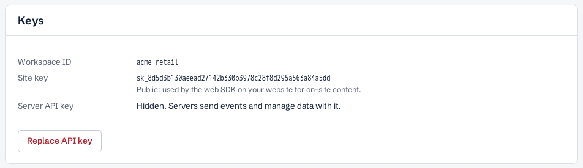

# 3. API guide

Everything the web app does goes through Pulse's HTTP API, so everything can be automated. This
guide explains how to authenticate, the conventions every endpoint follows, and then walks through
the common jobs with `curl`. It ends with an [index of every route](#route-index), generated from
the router in `internal/api` and the permission table in `internal/api/perms.go`.

The examples are based on the end-to-end tests in `test/e2e`, which call these endpoints against a
running stack; when in doubt, the tests are the reference.

All examples use a local stack (`make up`) and these shell variables:

```bash
PULSE=http://localhost:7080
KEY=pk_…            # your workspace's server API key (see below); never commit it
```

---

## Authentication

Pulse has four kinds of credentials. Which one a route takes is listed in the
[route index](#route-index).

| Credential | Looks like | Sent as | Who uses it | Acts as |
|---|---|---|---|---|
| **Server API key** | `pk_…` | `Authorization: Bearer pk_…` | Your servers and scripts | An admin of its workspace |
| **Session cookie** | `pulse_session` cookie | Cookie, plus `X-Pulse-CSRF` on changes | The web app (and the screenshot scripts) | The signed-in user, limited by their role |
| **Site key** | `sk_…` | `X-Pulse-Site-Key` header or `?site_key=` | Browsers and mobile apps (SDKs) on `/v1/web/*` | Only the public SDK endpoints |
| **Admin token** | your `PULSE_ADMIN_TOKEN` | `Authorization: Bearer …` on `POST /v1/tenants` | The platform operator | Creates workspaces |

Two more appear in integrations: a **Zapier / Make key** (`pzk_…`, sent as `Authorization: Bearer`
or `X-Pulse-Key` on `/v1/hooks/*`, see [6. Webhooks and integrations](06-webhooks-and-integrations.md#zapier-and-make-rest-hooks)),
and secret URLs for inbound provider webhooks.

### Server API key

Each workspace has one server API key. It is shown **once**: when the workspace is created
(sign-up's "workspace ready" screen, or the `api_key` field of `POST /v1/tenants`) and when an admin
replaces it in **Settings → Sign-in & keys → Keys → Replace API key** (or
`POST /v1/settings/api-key`). Pulse stores only its SHA-256, so a lost key can only be replaced.



```bash
curl -s $PULSE/v1/auth/me -H "Authorization: Bearer $KEY"
# {"permissions":{"broadcasts":"publish",…},"role":"admin","workspace":{"id":7,"name":"Acme Retail","slug":"acme-retail","site_key":"sk_…","require_signed_identify":false}}
```

The key has every admin permission, including the "full admin" settings (SSO, the API key itself,
webhooks, identity verification). Keep it on your servers. When it's replaced, the old key stops
working at once on the `api` instance that handled the change and within a minute on the others
(each caches keys for up to a minute).

### Session cookies and CSRF

The web app signs in with `POST /v1/auth/login` and then sends the `pulse_session` cookie
(`HttpOnly`, `SameSite=Lax`, `Secure` when `PULSE_PUBLIC_URL` is `https`, 14 days). With a cookie,
every request other than `GET` and `HEAD` must also carry an `X-Pulse-CSRF` header with any
non-empty value; without it the answer is `403 missing X-Pulse-CSRF header`. A cross-site form can't
set a custom header, so this stops cross-site request forgery.

```bash
curl -s -c jar -b jar -X POST $PULSE/v1/auth/login -H "Content-Type: application/json" \
  -d '{"workspace":"acme-retail","email":"docs.admin@pulse.test","password":"pulse-docs-pass-1"}'
curl -s -b jar $PULSE/v1/segments                                     # reads need only the cookie
curl -s -b jar -X POST $PULSE/v1/lists -H "X-Pulse-CSRF: 1" -H "Content-Type: application/json" \
  -d '{"name":"Webinar guests"}'                                      # changes need the header too
curl -s -b jar -X POST $PULSE/v1/auth/logout
```

(The credentials above are the local docs workspace's test values from
[deploy/dev-seed.md](../../deploy/dev-seed.md).) Sign-in is limited to 10 attempts per workspace and
email in 15 minutes. Use an API key, not a session, for automation.

A signed-in user is limited by their role. Each route needs a **level** (view, edit or publish) in
one **area** (contacts, segments, journeys, broadcasts, content, reports, channels, settings): reads
need view, changes need edit, and going live (activating journeys, scheduling broadcasts) needs
publish. The API's area names are the internal ones; the app's Roles page shows `broadcasts` as
**One-time campaigns** and `journeys` as **Triggered & automation campaigns**. Built-in roles:
admin (everything), editor (publish everywhere, view on channels and settings), viewer (view
everywhere except settings). Admins can define custom roles. A few
settings that amount to all access (SSO, the two-step sign-in policy, the API key, identity verification, webhooks) need
**every** admin permission ("full admin" in the index). A route that isn't in the permission table
needs settings edit, so a new route is never open to everyone by accident.

#### Two-step sign-in

When a person has two-step sign-in on (or the workspace requires it and they haven't set it up),
a correct password doesn't create a session. `POST /v1/auth/login` answers
`200 {"two_factor":"code"}` (or `"setup"`) and sets a short-lived `pulse_2fa` cookie (`HttpOnly`,
`SameSite=Strict`, path `/v1/auth/two-factor`, 10 minutes, sealed with `PULSE_SECRET_KEY`). The
session comes from the next step, which needs the `X-Pulse-CSRF` header too:

```bash
# "code": six digits from the authenticator app, or a recovery code
curl -s -c jar -b jar -X POST $PULSE/v1/auth/two-factor/verify -H "X-Pulse-CSRF: 1" \
  -H "Content-Type: application/json" -d '{"code":"492039"}'
# 200 {"user":{…}}   (with a recovery code also "recovery_codes_left": 9)

# "setup": a new secret for the app, then a code from it; answers the recovery codes once
curl -s -c jar -b jar -X POST $PULSE/v1/auth/two-factor/setup -H "X-Pulse-CSRF: 1"
# {"secret":"JBSW Y3DP …","uri":"otpauth://totp/Pulse:…","issuer":"Pulse","account":"asha@example.com (Acme Retail)"}
curl -s -c jar -b jar -X POST $PULSE/v1/auth/two-factor/enable -H "X-Pulse-CSRF: 1" \
  -H "Content-Type: application/json" -d '{"code":"492039"}'
# 200 {"user":{…},"recovery_codes":["k7wq2-mx9dp",…]}
```

Codes are RFC 6238 (HMAC-SHA1, 30-second steps, 6 digits); a code from the step before or after
is accepted, and each step works once. Wrong codes answer `401`; five tries per person per minute
(then `429`), and each counts toward the sign-in limit above. The `pulse_2fa` cookie is good for
one sign-in: it stops working once used, after an admin reset or a new phone, and setting up at
sign-in never replaces a secret that's already on. SSO sign-ins skip all this. The secret is
stored encrypted with `PULSE_SECRET_KEY`; recovery codes only as hashes. Without the key, two-step
sign-in can't be set up or required, and people who have it can't sign in (`503`).

People manage their own under `/v1/account/two-factor` (the session's user; the API key gets
`400`). Starting a new secret while it's on, turning it off and new recovery codes need
`{"code": "…"}` (an app or recovery code) or `{"password": "…"}`. Bodies sent to `/v1/account/*`
are never written to the audit log.

### Site key

The site key (`sk_…`) is public: it's in your web pages and app binaries. It works only on
`/v1/web/*`, which accepts less than the server API: at most 50 events per request, 600 events per
minute per client IP, no consent changes, no tags, points, lists or other server-only events, and
reserved attributes are dropped. With identity verification on, events for a known user need that
user's hash. See [4. Web SDK](04-web-sdk.md) and [5. Mobile SDKs](05-mobile-sdks.md).

### Admin token

`POST /v1/tenants` creates a workspace with no users and returns its keys, for platforms that
provision workspaces themselves (and for the tests). It needs `PULSE_ADMIN_TOKEN`; unset, the route
always answers 401.

```bash
curl -s -X POST $PULSE/v1/tenants -H "Authorization: Bearer $PULSE_ADMIN_TOKEN" \
  -H "Content-Type: application/json" -d '{"name":"Acme Retail"}'
# 201 {"api_key":"pk_…","id":12,"site_key":"sk_…","slug":"acme-retail-x1y2z3"}
```

The `slug` is the workspace ID people type when they sign in; a name already taken gets a suffix.
Add the first admin with the new key: `POST /v1/users` with `email`, `name`, `role` and `password`
([Installation](01-installation.md#workspaces-when-sign-up-is-off)).

---

## Conventions

**JSON.** Requests and responses are JSON (`Content-Type: application/json`) except CSV imports and
exports and file uploads. Unknown fields in a request are ignored, except in segment rules and journey
graphs, which are strict. Times are RFC 3339 (`2026-11-30T09:00:00Z`). Request bodies are limited to
4 MB (imports and uploads have their own limits, see [Configuration](02-configuration.md#limits-fixed-in-the-code)).

**Workspace scope.** Every call works inside the caller's workspace; IDs from another workspace
answer 404. A `tenant_id` in a request body is ignored.

**Contacts are addressed by your ID.** Contact routes take the **external ID**
(`/v1/contacts/{external_id}`): the ID you send events with (your user ID, or the email for
contacts created from an email). Pulse's numeric `id` appears in responses but isn't used in paths.

**Asynchronous writes.** Anything that changes a contact (events, tags, points, list members,
stage, company, merges) is written to Kafka and processed within seconds. Those routes answer
**202 Accepted** once Kafka has the data: it won't be lost, but a `GET` straight after may not show
it yet. Poll, as the tests do.

**Status codes.**

| Status | Means |
|---|---|
| 200, 201, 202, 204 | OK, created, accepted for processing, OK with no body |
| 400 | Invalid request; the message says what to fix. Several problems are joined with newlines |
| 401 | `sign in or send a valid API key` (or an invalid site key, integration key, admin token) |
| 403 | Missing CSRF header, `your role doesn't allow this (edit access to contacts is needed)`, `only admins can change this`, or identity verification failed (`user_hash is missing or wrong…`) |
| 404 | Not found, or in another workspace |
| 409 | Conflict: `already exists`, a segment still used by others, an active journey being edited, a broadcast already sending |
| 413 | Body too large |
| 422 | Hosted form (`/f/{key}`) with invalid values |
| 429 | Rate limited (sign-in, `/v1/web/*`, forms, downloads, landing pages) |
| 500 | `internal error` (details only in the server log) |
| 503 | A dependency is down (`event bus unavailable, retry`, `analytics unavailable`). Safe to retry |

Every error body has the same shape:

```json
{"error": "event 1: invalid event name \"9lives\""}
```

**Pagination.** Most lists return everything (segments, templates, journeys, broadcasts…). The
contact list pages with a keyset cursor: `GET /v1/contacts?limit=200&after=<next>`, where `next`
comes from the previous page and is empty on the last one. The audit log takes `?before=`; SDK inbox
lists take `?before=<message id>`.

**Rate limits.** Requests with an API key aren't rate-limited by Pulse; your throughput is bounded
by the event bus (one machine handled 20,000 events/s in the [load test](../03-load-test.md)) and by
the per-channel send rates. Public endpoints are limited per client IP: `/v1/web/events` 600
events/minute, form submissions 10/minute, sign-in 10 attempts per 15 minutes per workspace and
email. Behind a proxy, set `PULSE_TRUST_PROXY` so the client IP is right.

**Event names and attribute keys.** Event names: `^[a-zA-Z][a-zA-Z0-9_.:-]{0,63}$`. Attribute keys:
`^[a-zA-Z_][a-zA-Z0-9_]{0,63}$`. Some attributes are maintained by Pulse: stage, company, owner,
dates, email domain and last-seen device are ignored in `attrs` even from your server, and browsers
can't set consent, tags or points either. Your server may set `tags` (replacing the list), `points`
and the `optout_*` flags in `attrs`, but the events and routes below are better: the change shows on
the contact's timeline. Details:
[architecture, reserved attributes](../02-architecture.md#profiles-and-reserved-attributes).

---

## Events, identify and merge

`POST /v1/events` takes one event or `{"events": [...]}` with 1-1,000 events, and answers `202`
with the number accepted and their IDs.

| Field | Required | Meaning |
|---|---|---|
| `external_id` | yes | Your ID for the person (1-255 bytes). A new ID creates a contact |
| `name` | yes | The event name |
| `props` | | Event properties (any JSON) |
| `attrs` | | Profile attributes to merge into the contact |
| `email` | | Shorthand for `attrs.email` |
| `ts` | | When it happened (RFC 3339); default now; at most 5 minutes in the future |
| `id` | | Your event ID (up to 64 bytes). An ID already processed in the last 24 hours is skipped, so retries are safe. Default: random |

```bash
curl -s -X POST $PULSE/v1/events -H "Authorization: Bearer $KEY" -H "Content-Type: application/json" -d '{
  "events": [
    {"external_id": "cust-1001", "name": "identify", "email": "asha@example.com",
     "attrs": {"first_name": "Asha", "city": "Pune", "plan": "pro"}},
    {"external_id": "cust-1001", "name": "purchase", "id": "order-A-1001",
     "props": {"amount": 499, "currency": "INR", "order_id": "A-1001"}}
  ]}'
# 202 {"accepted":2,"ids":["…","order-A-1001"]}
```

**`identify`** only sets attributes. To **update a contact**, send `identify` with the attributes
that changed; values are merged into the profile, not replaced. To clear a value, send an empty
string (or `false`).

**Anonymous visitors.** The SDKs record visitors as `anon-<random>` until they sign in. An
`identify` for the real ID with `props.anonymous_id` set to that anonymous ID merges the visitor
(profile, events, counters) into the contact; later events for the anonymous ID follow:

```bash
curl -s -X POST $PULSE/v1/events -H "Authorization: Bearer $KEY" -H "Content-Type: application/json" \
  -d '{"external_id":"cust-1001","name":"identify","props":{"anonymous_id":"anon-5f2c9a…"}}'
```

**Companies.** An `identify` from your server with `attrs.company` (a name) links the contact to that
company, creating it if new. To link by ID or unlink, use `PUT /v1/contacts/{id}/company`.

**Merging two known contacts.** `POST /v1/contacts/merge` folds `loser` into `winner` (both
external IDs): the winner keeps its values and gains the loser's other attributes, tags, points,
history, counters and static segments; the loser is marked `merged_into` and its later events go to
the winner. `GET /v1/contacts/duplicates` lists contacts sharing an email or phone.

```bash
curl -s -X POST $PULSE/v1/contacts/merge -H "Authorization: Bearer $KEY" -H "Content-Type: application/json" \
  -d '{"winner":"cust-1001","loser":"asha@example.com"}'
# 202 {"loser":"asha@example.com","lists":1,"winner":"cust-1001"}
```

A loser that was already merged answers 409, as does a second merge of the same contacts started
before the first one finished.

**Event schemas** describe the properties an event carries (Audience → Events in the app;
[tutorial 12](../tutorials/12-events-and-properties.md)). Properties may be nested: segment and
trigger filters reach them with dotted paths (`product.code`) and `items[].code` (any item of a
list). A schema in **warn** mode (the default) only counts and samples events that don't fit; in
**enforce** mode this route refuses the whole request with 400 when any event doesn't fit its schema:

```bash
curl -s -X POST $PULSE/v1/events -H "Authorization: Bearer $KEY" -H "Content-Type: application/json" \
  -d '{"external_id":"cust-1001","name":"signup","props":{"method":"social"}}'
# 400 {"error":"event 0: signup doesn't fit its schema: social_provider is required"}
```

Events from browsers and apps (`/v1/web/*`, the SDKs) are never refused. A schema can also add a
property's value to a contact list field: with the suggested purchase schema, every purchase adds
`product_code` (and each `items[].product_code`) to the contact's `products`.

```bash
# The suggested schemas (purchase, signup, login, add_to_cart, cart_abandoned, checkout_abandoned)
curl -s -X POST $PULSE/v1/events/schemas/suggested -H "Authorization: Bearer $KEY" -H "Content-Type: application/json" -d '{}'
# {"added":["purchase","signup","login","add_to_cart","cart_abandoned","checkout_abandoned"]}

# One schema of your own: method social / otp / password; social_provider only (and then always) for social
curl -s -X PUT $PULSE/v1/events/signup/schema -H "Authorization: Bearer $KEY" -H "Content-Type: application/json" -d '{
  "label": "Sign-up", "mode": "warn", "props": [
    {"key": "method", "type": "enum", "required": true,
     "values": [{"value": "social", "label": "Social"}, {"value": "otp", "label": "OTP"}, {"value": "password", "label": "Password"}]},
    {"key": "social_provider", "type": "enum", "required": true,
     "values": [{"value": "google"}, {"value": "facebook"}, {"value": "apple"}, {"value": "linkedin"}],
     "depends_on": {"prop": "method", "values": ["social"]}},
    {"key": "referrer_email", "type": "string", "personal": true}
  ]}'
```

A property has `key`, optional `path` (where it is when not at the top level: `product.code`,
`items[].code`), `type` (`string`, `number`, `bool`, `date`, `enum`, `list`, `object`), `required`,
`values` (enums), `depends_on`, `personal` (hidden in samples and value suggestions) and
`add_to_list` (a custom list contact field, created when missing, which needs segments edit; Pulse's
own, consent and identity fields such as `email`, `tags` or `points` are refused). Switching a schema
to `enforce` needs `"confirm": "ENFORCE"` in the body; changing or deleting a schema that is or
becomes enforced needs settings edit access.

**Events Pulse records itself** can't be sent: `contact_merged`, `merge_requested`,
`company_linked`, `stage_changed`… are refused with 400 (`… is recorded by Pulse itself`); use the
routes below instead. Pulse also records message events (`email_sent`, `email_opened`,
`email_clicked`, `sms_delivered`, `push_clicked`, …), `form_submitted`, `segment_entered` /
`segment_exited` (webhooks only), `journey_*` and others; they show on the contact's timeline
(`GET /v1/contacts/{id}/events`).

---

## Contacts

### Get a contact

```bash
curl -s $PULSE/v1/contacts/cust-1001 -H "Authorization: Bearer $KEY"
```

```json
{
  "contact": {
    "tenant_id": 7, "id": 42, "external_id": "cust-1001", "email": "asha@example.com",
    "attrs": {"first_name": "Asha", "city": "Pune", "plan": "pro", "points": 10, "tags": ["vip"],
              "first_seen": "2026-11-10T08:12:01Z", "last_seen": "2026-11-11", "date_added": "…"},
    "created_at": "2026-11-10T08:12:01Z", "updated_at": "2026-11-11T06:40:12Z"
  },
  "segments": [3, 9]
}
```

`segments` are the IDs of the segments (dynamic and static) the contact is in right now. An unknown
external ID answers 404.

### The contact page: profile, messages and events

The app's contact page (`/contacts/{external_id}`) reads three routes, all with contacts view:

```bash
# Reach per channel, devices, journeys with their current step, activity over 1/7/30/365 days,
# purchases and products
curl -s $PULSE/v1/contacts/cust-1001/profile -H "Authorization: Bearer $KEY"
# {"contact":{…},"reach":[{"channel":"email","address":"asha@example.com","has_address":true,
#   "opted_out":false,"bounced":false,"reachable":true},…],"devices":[…],"journeys":[{"journey_id":8,
#   "name":"Welcome series","status":"waiting","step":"opened","current":true,…}],"activity":{…},
#   "purchases":{"count":3,"total":2497,"currency":"INR",…},"products":[…]}

# Every message sent (or not) to the contact, newest first: one row per message
curl -s "$PULSE/v1/contacts/cust-1001/messages?limit=50" -H "Authorization: Bearer $KEY"
# {"messages":[{"message_id":"…","channel":"email","source":"broadcast","source_id":6,
#   "campaign":"Spring catalogue","status":"bounced","kinds":["sent","bounced"],
#   "reason_code":"hard_bounce","reason_label":"…","reason":"550 mailbox unavailable",
#   "opened":false,"clicked":false,"clicks":0,"at":"…","last":"…"},…]}

# The timeline, filtered: names (up to 20), the contact's own activity or what Pulse recorded
curl -s "$PULSE/v1/contacts/cust-1001/events?name=purchase,add_to_cart&kind=activity&limit=100" \
  -H "Authorization: Bearer $KEY"
```

`reach` uses the dispatcher's own rules (an address that works, not bounced, not opted out) and
says `why` when a channel can't be used. `messages` and `events` page with `before` (RFC 3339) and
`limit` (default 50 for messages, 100 for events; at most 200). `kind` is `activity` (events that
count as the contact being active) or `pulse` (outcomes, engagement and bookkeeping Pulse records).
A message's `campaign` name is filled only for roles that may view that kind of campaign
(broadcasts or journeys).

### Tags, points, stage, owner, company

```bash
# Tags: letters, digits, - and _ (up to 64 characters)
curl -s -X POST $PULSE/v1/contacts/cust-1001/tags -H "Authorization: Bearer $KEY" \
  -H "Content-Type: application/json" -d '{"add":["vip","newsletter"],"remove":["trial"]}'
# 202 {"accepted":2}

# Points: a non-zero whole number, positive or negative
curl -s -X POST $PULSE/v1/contacts/cust-1001/points -H "Authorization: Bearer $KEY" \
  -H "Content-Type: application/json" -d '{"delta":25,"reason":"webinar attended"}'

# Lifecycle stage: the name of a stage defined in Settings → Stages (GET /v1/stages)
curl -s -X PUT $PULSE/v1/contacts/cust-1001/stage -H "Authorization: Bearer $KEY" \
  -H "Content-Type: application/json" -d '{"stage":"Customer"}'

# Owner: a teammate's user ID (GET /v1/users), 0 to unassign
curl -s -X PUT $PULSE/v1/contacts/cust-1001/owner -H "Authorization: Bearer $KEY" \
  -H "Content-Type: application/json" -d '{"user_id":3}'

# Company: a company ID (GET /v1/companies), null to unlink
curl -s -X PUT $PULSE/v1/contacts/cust-1001/company -H "Authorization: Bearer $KEY" \
  -H "Content-Type: application/json" -d '{"company_id":12}'
```

The same changes can be sent as events from your server (`tag_added` / `tag_removed` with
`props.tags`, `points_changed` with `props.delta`, `stage_changed` with `props.stage`), which is
handy inside a batch.

### Consent

Consent is per channel (`email`, `sms`, `whatsapp`, `rcs`, `push`, `inbox`) or `all`, kept in the
reserved attributes `optout_<channel>` and `optout_all`, and honoured by every send. Change it with
the `unsubscribed` and `resubscribed` events, from your server only (browsers can't):

```bash
curl -s -X POST $PULSE/v1/events -H "Authorization: Bearer $KEY" -H "Content-Type: application/json" -d '{
  "events": [
    {"external_id": "cust-1001", "name": "unsubscribed", "props": {"channel": "sms", "source": "crm"}},
    {"external_id": "cust-1002", "name": "resubscribed", "props": {"channel": "email", "source": "crm"}}
  ]}'
```

Without `channel` the event applies to `all`. Resubscribing to one channel also lifts an opt-out
from everything. The `source` is recorded; sources such as `email_link`, `one_click`,
`preference_center`, `form` and `complaint` count as the contact's own choice, anything else as a
manual change (`props.method` = `self` or `manual`, which segments can filter on).

Hard bounces set `email_bounced` (or `sms_bounced` for a dead number), which suppresses that
channel. Your server may clear them once the address is fixed, with an `identify` that sets the
attribute to `false`; a new phone number clears `sms_bounced` by itself.

To send a contact a link to their preference center (needs `PULSE_SECRET_KEY`):

```bash
curl -s $PULSE/v1/contacts/cust-1001/preferences-link -H "Authorization: Bearer $KEY"
# {"url":"http://localhost:7080/u/…?view=preferences"}
```

### Export one contact's data

For a data access request, everything Pulse keeps about one person as a JSON download:

```bash
curl -s $PULSE/v1/contacts/cust-1001/data -H "Authorization: Bearer $KEY" -o contact-cust-1001.json
```

```json
{
  "exported_at": "2026-11-11T10:00:00Z",
  "contact": {"external_id": "cust-1001", "email": "asha@example.com", "attributes": {…}, "created_at": "…", "updated_at": "…"},
  "consent": {"subscribed_to_all": true, "channels": [{"channel": "email", "subscribed": true}, {"channel": "sms", "subscribed": false}, …]},
  "segments": [{"id": 3, "name": "Pune buyers", "kind": "rule"}],
  "events": [{"id": "…", "name": "purchase", "at": "…", "props": {"amount": 499}}, …],
  "events_note": "Newest first, at most 100000 events. …"
}
```

It needs **contacts edit** access (it is personal data, like exports) and every download is in the
audit log. Events already removed by retention settings aren't included.

### Delete a contact

```bash
curl -s -X DELETE $PULSE/v1/contacts/cust-1001 -H "Authorization: Bearer $KEY"
# 200 {"deleted":"cust-1001"}
```

Deletes the contact permanently through the same path as retention cleanup: their ClickHouse events,
snapshots and segment memberships first, then the profile, devices, inbox messages, journey state
and files they uploaded through forms. It needs **contacts edit** access, is audited, and answers 404
for an unknown ID. New events for the same external ID create a new contact. Contacts are also
deleted by:

- a journey with a **Delete contact** step (`{"type":"delete_contact","confirm":"DELETE"}`, see
  [Journeys](#journeys)), for example triggered by your own `erasure_requested` event; saving or
  activating such a journey needs contacts edit access;
- retention cleanup, for anonymous visitors (Settings → Data & privacy).

### Search and filter: `GET /v1/contacts?q=`

`GET /v1/contacts` lists contacts, newest first by Pulse ID. With `q` it runs a filtered view: the
same filters as the Contacts search box in the app, ANDed, plus free text.

| Filter | Matches |
|---|---|
| `is:anonymous` / `is:identified` | Visitors without / with a known identity (an identified date, email or phone) |
| `is:unsubscribed` | Opted out of any channel |
| `is:bounced` | `email_bounced` or `sms_bounced` |
| `is:dnc` | Do not contact: unsubscribed or bounced |
| `segment:<name or id>` (also `list:`) | Members of a segment. Quote names with spaces: `segment:"VIP buyers"` |
| `tag:<tag>` | Has the tag |
| `stage:<name>` | In the lifecycle stage |
| `company:<name or id>` | Linked to the company |
| `owner:me` / `owner:none` / `owner:<name, email or id>` | Owned by you (a signed-in user, not an API key), by nobody, by a teammate (needs settings view) |
| `points:>50` | Points compared with `>`, `>=`, `<`, `<=`, `=` (or a bare number) |
| `email:<text>` | Email contains the text |
| `name:<text>` | `name`, `first_name` or `last_name` contains the text |
| anything else | Free text: quick find over external ID, email, name and phone |

At most 20 filters. Parameters: `limit` (1-200, default 50) and `after` (the previous page's
`next`).

```bash
curl -s -G $PULSE/v1/contacts -H "Authorization: Bearer $KEY" \
  --data-urlencode 'q=segment:"VIP customers" tag:newsletter points:>=50' --data-urlencode 'limit=100'
```

```json
{
  "filters": [{"token": "segment:VIP customers", "label": "Static segment: VIP customers"}, …],
  "text": "",
  "rule": {"all": [{"segment": 9, "op": "in"}, {"tag": "newsletter", "op": "has"}, {"attr": "points", "op": "gte", "value": 50}]},
  "count": 37, "approximate": false,
  "contacts": [ … ],
  "next": "5120"
}
```

Filtered views run in ClickHouse. The first page carries `count` (exact up to 10,000, then
`approximate: true`) and `rule`: the segment rule the filters compile to, which you can save as a
dynamic segment with `POST /v1/segments`. Without `q`, pages come from Postgres and carry no count.
An unknown filter value (a segment that doesn't exist, `is:` with another word) answers 400 with an
explanation. Words that don't start with a known filter name are free text.

#### The contacts behind a number

Every number the app counts (a segment's size, an estimate step, a campaign's "Opened", a
dashboard's buyers, an AMP poll's answers…) opens the Contacts list with filters that name exactly
that set, so the list and the number agree. The same filters work in `q`:

| Filter | Lists |
|---|---|
| `in:<segment>` | Members of the segment (name or ID). `in:a,b` = in any of them; several `in:` filters = in all of them. At most 10 segments in all |
| `not_in:<segment>` | Not in the segment (or `not_in:a,b`: in none of them) |
| `subscribed:<channel>` | Not unsubscribed from the channel (`email`, `sms`, `whatsapp`, `rcs`, `push`, `inbox`) |
| `reachable:<channel>` | Not unsubscribed and with a working address on it (the estimate's "Reachable" step) |
| `under_cap:<channel>` | Not held back by the channel's frequency cap right now |
| `journey:<id or name>` | Contacts who entered the journey. With `at:<step id>`: now at that step. With `journey_status:` `in_progress`, `completed`, `converted`, `exited`, `active` or `waiting` |
| `campaign:broadcast/<id>`, `campaign:journey/<id>` | A campaign's contacts. With `outcome:` (default `targeted`), `run:<unix seconds>` (broadcasts), `step:<step id>` (journeys), `reason:<code>` |
| `outcome:<outcome>` | `targeted`, `sent`, `delivered`, `opened`, `read`, `clicked`, `downloaded`, `bounced`, `hard_bounced`, `soft_bounced`, `complained`, `failed`, `failed_all`, `unsubscribed`, `fallback`, `skipped`, `skipped_consent`, `skipped_reachability`, `skipped_cap`, `skipped_missing_value`, `skipped_deadline`. Without `campaign:` it covers every campaign |
| `reason:<code>` | A failure or skip [reason code](06-webhooks-and-integrations.md#reason-codes); `outcome:` is then the raw kind (`failed`, `bounced`, `complained`, `suppressed`, `capped`), like the reports' reasons table |
| `event:<name>`, `no_event:<name>` | Did / didn't do the event (at most 5 event filters). `product:<code>` and `category:<name>` narrow them to one product or category |
| `active:<any, web, android, ios, other, new, returning>` | Active in the period (the Users dashboard's definition); `utm:<source>` (or `utm:none`) narrows by campaign source. Needs `period:` |
| `amp_poll:<template id>/<block id>` | Answered the poll in an AMP email; `answer:<text>` for one answer |
| `form:<id>` | Submitted the form |
| `period:<from>..<to>` | UTC days, both included, at most 366 (`period:2026-10-01..2026-10-31`); applies to `campaign:`, `outcome:`, `event:`, `active:`, `amp_poll:` and `form:` |

```bash
# Everyone who opened the "Spring catalogue" broadcast in October
curl -s -G $PULSE/v1/contacts -H "Authorization: Bearer $KEY" \
  --data-urlencode 'q=campaign:broadcast/6 outcome:opened period:2026-10-01..2026-10-31'
```

```json
{
  "filters": [{"token": "campaign:broadcast/6", "label": "Campaign “Spring catalogue”"},
              {"token": "outcome:opened", "label": "Opened"}, {"token": "period:2026-10-01..2026-10-31", "label": "…"}],
  "text": "",
  "note": "Counted now from the event log. Contacts merged into another or deleted since aren't listed, so this can be a little lower than the report.",
  "count": 412, "approximate": false,
  "contacts": [ … ], "next": "5120"
}
```

Filters combine with each other and with the older ones (`tag:`, `is:`…). With any of these
filters the answer has no `rule` (they aren't segment rules) and carries a `note` saying where the
list can differ from the number it came from (contacts merged or deleted since; a journey's numbers
count entries, the list people). Combinations that make no sense are refused with the reason
(`at: and journey_status: need journey:<id>`, `run: needs campaign:broadcast/<id>`,
`step: needs campaign:journey/<id>`, `answer: needs amp_poll:<template>/<block>`,
`product: and category: need event: or no_event:`, `utm: needs active:`,
`active: needs period:<from>..<to>`, `use outcome: once`…).

How they run: segment, subscription, reach and journey filters are Redis bitmap operations on the
same bitmaps the counts come from (cached for a minute); outcome, event, activity, poll and form
filters are ClickHouse queries. A view that has both checks the bitmap's contacts in ClickHouse
5,000 at a time; its `count` is exact up to 10,000 candidates (50,000 for `under_cap:` alone) and
sampled above (`approximate: true`). Building these views is limited to 120 a minute per
workspace (`429 too many contact list filters at once; try again in a minute`).

**Permissions.** A list needs contacts view, plus, for `campaign:broadcast/…` broadcasts view or
reports view; for `campaign:journey/…` and `journey:` journeys view or reports view; for `outcome:`
or `reason:` without `campaign:` (every campaign) reports view; for `amp_poll:` and `form:` content
view or reports view. Otherwise: `400 campaign: your role can't list these contacts (it needs view
access to …)`.

**Create a segment from a list.** These lists can't be a dynamic segment's rule, so they are saved
as a static segment holding the list's contacts now:

```bash
curl -s -X POST $PULSE/v1/contacts/view-segment -H "Authorization: Bearer $KEY" -H "Content-Type: application/json" \
  -d '{"q":"campaign:broadcast/6 outcome:clicked","name":"Clicked the spring catalogue"}'
# 202 {"id":31,"contacts":187,"approximate":false}
```

It needs segments edit, contacts view and whatever each filter needs; up to 500,000 contacts
(larger lists answer 400: use a dynamic segment or narrow the filters). The segment is created at
once and filled in the background through `list_joined` events, from a copy of the list taken
when you asked; it doesn't follow the list afterwards. At most 10 requests a minute and 2 fills
at a time per workspace (429). A view without any filter answers `400 add a filter first`.

### Import and export

```bash
# CSV import, synchronous, up to 200 MB. Header row: external_id (or email), email, phone, any attribute.
curl -s -X POST "$PULSE/v1/contacts/import?list_id=9" -H "Authorization: Bearer $KEY" \
  -H "Content-Type: text/csv" --data-binary @contacts.csv
# {"rows":3,"imported":3,"skipped":0,"errors":[],"columns":["external_id","email","city"]}

# Background import for large files (up to 10 GB): progress at GET /v1/imports/{id}
curl -s -X POST "$PULSE/v1/imports?filename=big.csv&list_id=9" -H "Authorization: Bearer $KEY" \
  -H "Content-Type: text/csv" --data-binary @big.csv
# 202 {"bytes":1048576,"id":5,"status":"queued"}

# Export: everything, or a view (any filter above), with the columns you want (contacts edit access)
curl -s -G $PULSE/v1/contacts/export -H "Authorization: Bearer $KEY" \
  --data-urlencode 'q=tag:vip' --data-urlencode 'columns=first_name,city,plan' -o vip.csv
```

Imported rows become `identify` events (plus `list_joined` with `list_id`), so they flow into
segments and journeys like live data. Values of fields defined as numbers or yes/no
(`PUT /v1/attributes/{key}`) are converted, and rows that don't convert are reported in `errors`.
Re-uploading the same file is harmless: event IDs derive from the content. The export always starts
with `external_id, email, created_at, updated_at`, then the chosen attributes (every attribute
without `columns`); cells are defused against spreadsheet formulas. It takes the same `q` as the
list, with the same permissions for each filter.

---

## Segments

A dynamic segment is a rule; membership is kept in real time as events arrive, and a new or changed
segment is first filled from history ("backfill").

```bash
curl -s -X POST $PULSE/v1/segments -H "Authorization: Bearer $KEY" -H "Content-Type: application/json" -d '{
  "name": "Pune buyers this week",
  "rule": {"all": [
    {"attr": "city", "op": "eq", "value": "Pune"},
    {"event": "purchase", "op": "gte", "count": 1, "days": 7, "where": [{"prop": "amount", "op": "gt", "value": 300}]},
    {"any": [{"tag": "vip", "op": "has"}, {"attr": "plan", "op": "in", "value": ["pro", "team"]}]}
  ]}}'
# 201 {"id":14,"status":"new"}

curl -s $PULSE/v1/segments/14 -H "Authorization: Bearer $KEY"
# {"id":14,"name":"Pune buyers this week","kind":"rule","status":"ready","size":12,…}
```

Each rule node has exactly one of:

| Node | Fields | Operators |
|---|---|---|
| Group | `all: [...]`, `any: [...]` or `none: [...]` (matches when none of its rules do) | (nested up to 8 levels, 200 nodes in all) |
| Attribute | `attr`, `op`, `value` | `eq`, `ne` (string, number or boolean); `contains`, `not_contains`, `starts_with`, `ends_with` (string); `gt`, `gte`, `lt`, `lte` (number); `in`, `not_in` (list of 1-1,000); `exists`, `not_exists` (no value); `between` (`[low, high]`, two numbers or two dates); `on`, `before`, `after` (date `2026-11-30`); `within_days`, `older_than_days` (whole days); `has`, `not_has` (a value of a list field, e.g. `products`) |
| Event count | `event`, `op`, `count`, `days` or `from` / `to`, optional `where` | `eq`, `ne`, `gt`, `gte`, `lt`, `lte` on the number of events in the last `days` (1-365: today plus the previous days, UTC), or in an absolute range of UTC days `from` (from 2000-01-01) to `to` (both included; no `to`: up to today). Ranges starting more than 365 days back are evaluated by the periodic sweep, not as events arrive. `where`: up to 5 property filters (`prop`: a name, `product.code`, or `items[].code` for any item; `op`, `value`: attribute operators except relative dates) |
| Tag | `tag`, `op` | `has`, `not_has` |
| Other segment | `segment` (ID), `op` | `in`, `not_in` (cycles are refused) |

```bash
# Bought SKU A1 (in any order item) between January and March, and not tagged churn
curl -s -X POST $PULSE/v1/segments -H "Authorization: Bearer $KEY" -H "Content-Type: application/json" -d '{
  "name": "Q1 A1 buyers", "refresh": {"mode": "daily", "at": "06:30", "tz": "Asia/Kolkata"},
  "rule": {"all": [
    {"event": "purchase", "op": "gte", "count": 1, "from": "2026-01-01", "to": "2026-03-31",
     "where": [{"prop": "items[].product_code", "op": "eq", "value": "A1"}]},
    {"none": [{"tag": "churn", "op": "has"}]}
  ]}}'
```

`refresh` is `{"mode": "live"}` (the default: members follow every event) or
`{"mode": "daily", "at": "HH:MM", "tz": "<IANA zone>"}`: the segment is built when saved and then
rebuilt once a day at that time, so its members don't change during the day; the segment returns
`next_refresh_at`. Leaving `refresh` out of a `PUT` keeps the current setting.

**Why is a contact in a segment?** `GET /v1/contacts/{external_id}/segments/{id}/explain` evaluates
the rule for that contact now, node by node:

```bash
curl -s $PULSE/v1/contacts/cust-1001/segments/14/explain -H "Authorization: Bearer $KEY"
# {"segment":14,"name":"Q1 A1 buyers","member":true,"refresh":{…},
#  "explanation":{"kind":"all","match":true,"children":[
#    {"kind":"event","rule":{…},"match":true,"count":2},
#    {"kind":"none","match":true,"children":[{"kind":"tag","rule":{…},"match":false}]}]}}
```

`value` is the contact's value of an attribute, `count` the events counted, and `sweep: true` marks
a range older than 365 days that only the sweep decides. A daily segment's `member` is from its last
refresh, so it can differ from `match` until the next one.

`status` is `new` until the backfill finishes, then `ready`. `POST /v1/segments/preview` with
`{"rule": …}` counts matches without saving. `PUT /v1/segments/{id}` changes name and rule (and
rebuilds); `DELETE` answers 409 while another segment uses it. How rules are evaluated:
[architecture, segment rules](../02-architecture.md#segment-rules).

### Static segments (lists)

Static segments have members you add and remove, by API, import, form or journey step.

```bash
curl -s -X POST $PULSE/v1/lists -H "Authorization: Bearer $KEY" -H "Content-Type: application/json" \
  -d '{"name":"Webinar guests"}'
# 201 {"id":21}

curl -s -X POST $PULSE/v1/lists/21/members -H "Authorization: Bearer $KEY" -H "Content-Type: application/json" \
  -d '{"action":"add","external_ids":["cust-1001","cust-1002"]}'
# 202 {"accepted":2}
```

Up to 10,000 external IDs per call; unknown IDs create contacts. `"action":"remove"` takes them
out. `PUT /v1/lists/{id}` renames, and `public` / `description` offer the list on the preference
center. Static segments are also segments: `GET /v1/segments/21` gives the size, a rule can test
membership with `{"segment": 21, "op": "in"}`, and `GET /v1/lists` lists only the static ones.

---

## Templates

A template belongs to one channel: `email` (default), `sms`, `whatsapp`, `rcs`, `push` or `inbox`.
Every sent field takes **variables**, filled per contact (`internal/personalize`):

| Variable | Is |
|---|---|
| `{{contact.x}}` | A contact field: `email`, `external_id`, or any attribute (`first_name`, `phone_country`, list fields joined with ", "; dotted paths into objects) |
| `{{event.x}}` | A property of the event (or form submission) that started the journey: `event.product_name`, `event.items.0.name` (one item), `event.items[].name` (every item, joined). Empty in broadcasts |
| `{{campaign.x}}` | `name`, `id`, `type` (`journey`, `broadcast`, `test`), `step`, `channel`, `template` |
| `{{links.x}}` | Email only: `unsubscribe`, `preferences` (an unsubscribe footer is added when the template doesn't place the link) |

Pipes format a value, left to right: `default:"there"`, `upper`, `lower`, `title`, `date:"2 Jan 2006"` (Go layout,
the contact's time zone), `money:"INR"` (the default currency), `number` / `number:2`, `truncate:40`, `urlencode`,
`json` — e.g. `{{contact.first_name | default:"there" | title}}`. Saving refuses an unknown pipe or `campaign.*` /
`links.*` key (400, naming it). HTML is escaped for where each value lands, and links stay click-tracked. The older Go
template syntax (`{{.Attrs.first_name}}`, `{{.Contact.Email}}`, `{{.UnsubscribeURL}}`, `{{.PreferencesURL}}`, `{{if}}`)
keeps working, also mixed with variables.

`"missing_values"` decides what happens when a variable has no value and no default: `"empty"` (the default) renders
it empty; `"skip"` sends nothing to that contact and records `<channel>_failed` with
`"reason": "skipped: no value for event.product_name"` and `"skipped": "missing_value"`. The event properties a journey
keeps are at most 16 KB and never include properties the event's schema marks `personal`.

```bash
# Email: subject and html required; content.text is the plain-text part (generated when empty)
curl -s -X POST $PULSE/v1/templates -H "Authorization: Bearer $KEY" -H "Content-Type: application/json" -d '{
  "name": "Welcome", "channel": "email", "subject": "Welcome, {{contact.first_name | default:\"friend\"}}",
  "html": "<p>Hi {{contact.first_name}}, thanks for joining.</p><p><a href=\"https://shop.example.com\">Shop now</a></p>"}'
# 201 {"id":31}

# SMS: content.text (up to 1,600 characters); track_links shortens and tracks links; skip contacts without the product
curl -s -X POST $PULSE/v1/templates -H "Authorization: Bearer $KEY" -H "Content-Type: application/json" -d '{
  "name": "Cart reminder", "channel": "sms", "missing_values": "skip",
  "content": {"text": "Hi {{contact.first_name | default:\"there\"}}, your {{event.product_name}} is waiting: https://shop.example.com/cart", "track_links": true}}'
```

What `content` takes per channel is in `channel.Content` (`internal/channel/channel.go`): SMS
`text`, `sender_id`, `track_links` and, for India's DLT rules, `dlt_template_id` and
`dlt_entity_id` (sent by providers that take them, such as Gupshup, instead of the provider's
defaults); WhatsApp `template_name`, `language`, `body_params`, `header_image_url`; RCS `text` or
`card`, up to 4 `suggestions`; push and inbox `title`, `body`, `image_url`, `url`, `data` (inbox
also `expires_days`, `category`); email `attachments` (asset IDs) and the AMP part (below).
`"transactional": true` skips frequency caps and quiet hours.

### The AMP part of an email

An email template may carry an AMP part (`text/x-amp-html`) next to its HTML: either AMP code in
`content.amp`, or the visual builder's document in `content.amp_blocks`, from which Pulse builds the
code on every save (the blocks are then the source; don't send both).

```bash
curl -s -X POST $PULSE/v1/templates -H "Authorization: Bearer $KEY" -H "Content-Type: application/json" -d '{
  "name": "Rate your order", "channel": "email", "subject": "How did we do?", "html": "<p>How did we do?</p>",
  "content": {"amp_blocks": {"style": {"accent": "#2747d6", "font": "sans"}, "blocks": [
    {"id": "intro", "type": "text", "text": "Hi {{contact.first_name | default:\"there\"}}, one quick question:"},
    {"id": "rating", "type": "poll", "text": "How was your delivery?", "options": ["Great", "Fine", "Late"], "show_results": true},
    {"id": "more", "type": "form", "submit_text": "Send", "success_text": "Thanks!", "fields": [
      {"key": "size", "label": "Your size", "type": "select", "options": ["S", "M", "L"], "save_to": "shoe_size"}]}]}}}'
```

Block `type`s: `heading`, `text`, `image` (`image`: `src`, `alt`, `link`, `width`, `height`),
`button` (`text`, `url`), `carousel` and `gallery` (`items`: images; `height`, `autoplay` seconds),
`accordion` (`sections`: `title`, `body`), `poll` (`text` = the question, `options`,
`show_results`) and `form` (`fields`: `key`, `label`, `type` text, email, number, textarea, select
or checkbox, `required`, `options`, `save_to`; `submit_text`, `success_text`). `style` sets
`background`, `text`, `accent` and `font` (`sans` or `serif`). A form field's `save_to` copies the
answer into a contact field: only custom fields, never identity, consent or Pulse's own fields.

Hand-written AMP is checked when saved: the AMP for Email doctype and `<html ⚡4email>`, the
runtime and boilerplate, only allowed component scripts (each one used must be included), no other
scripts, event handlers or `javascript:` URLs, no `img`, `iframe`, `video`, `svg`…, one
`<style amp-custom>` (no `!important`, at most 75,000 bytes), sized https `amp-img`, forms with
`method="post"` and `action-xhr`, and at most 200 KB. Errors refuse the save with their lines:

```
400 {"error":"AMP part: line 12: : use <amp-img> with width and height; line 30: …"}
```

Forms and polls must post to `action-xhr="pulse:submit/<block id>"` (an `amp-list` may read
`pulse:results/<block id>`); Pulse replaces these per recipient with a signed link to
`/v1/amp/{token}` (valid 60 days). Pulse variables work in the AMP part as in the HTML, except
inside amp-mustache `<template>`s, which belong to the email client.

```bash
# Check code, or build blocks, without saving: problems with lines, size, a script-free preview,
# and whether each of the workspace's email providers sends AMP
curl -s -X POST $PULSE/v1/templates/amp/check -H "Authorization: Bearer $KEY" -H "Content-Type: application/json" \
  -d '{"amp_blocks": {"blocks": [{"id": "rating", "type": "poll", "text": "How was it?", "options": ["Great", "Late"]}]}}'
# {"amp":"<!doctype html>…","problems":[],"size":4120,"max_size":204800,"preview":"<html>…",
#  "blocks":[…],"providers":[{"name":"Postmark","amp":false,"note":"Postmark doesn't send AMP email: …"}]}

# Poll results of a saved template, per poll block
curl -s $PULSE/v1/templates/31/amp/results -H "Authorization: Bearer $KEY"
# {"polls":{"rating":{"question":"How was your delivery?","total":48,
#   "items":[{"label":"Great","count":30,"percent":63},…]}}}
```

`problems` items are `{"line", "message", "warning"}`; warnings (an included component nobody uses)
don't stop a save. `POST /v1/templates/preview` also returns `amp` (the part as personalised for
the contact) and `amp_preview` (a script-free look at it), and a test send includes the AMP part.

Answers recorded from AMP emails are events on the contact: `amp_poll_answered` (`block`,
`question`, `answer`, `template_id`, `broadcast_id` or `journey_id`, `message_id`) and
`amp_form_submitted` (`block`, the ids, one property per field; fields with `save_to` update the
contact). Both are platform events: `POST /v1/events` refuses them, but segments, journeys and
webhooks can use them, and their starter schemas are in `GET /v1/events/schemas/suggested`. The
public endpoint they arrive through is described in [AMP post-backs](#amp-post-backs).

Try a template before using it:

```bash
# Render a template body (saved or not) for a real contact (omit external_id for a sample contact),
# with sample trigger event properties (omit event for none, as in a broadcast)
curl -s -X POST $PULSE/v1/templates/preview -H "Authorization: Bearer $KEY" -H "Content-Type: application/json" \
  -d '{"template":{"channel":"email","subject":"{{event.product_name}} is waiting","html":"<p>Hi {{contact.first_name}}</p>"},
       "external_id":"cust-1001","event":{"product_name":"Brass table lamp"}}'
# {"subject":"Brass table lamp is waiting","html":"<p>Hi Asha</p>",…,"missing":[],"skipped":false,"contact":{…}}
# A sample event: the contact's latest of that name (personal properties removed), else the schema's example
curl -s "$PULSE/v1/templates/sample-event?event=cart_abandoned&external_id=cust-1001" -H "Authorization: Bearer $KEY"
# {"source":"latest","at":"2026-11-11T09:30:00Z","props":{"product_name":"Brass table lamp",…}}   (or "schema", "none")
# Send it to that contact now (202), with the sample event, through the channel's default provider
# or another of its providers (provider_id; 400 if it isn't one of the workspace's for that channel)
curl -s -X POST $PULSE/v1/channels/test -H "Authorization: Bearer $KEY" -H "Content-Type: application/json" \
  -d '{"template_id":31,"external_id":"cust-1001","provider_id":12,"event":{"product_name":"Brass table lamp"}}'
```

Locally every email lands in Mailpit (http://localhost:18025), and the seeded sandbox providers put
SMS, WhatsApp, RCS and push in the test inbox (`GET /v1/sandbox/messages`).

---

## Journeys

A journey is a **trigger** plus a **graph** of steps. It is created as a draft, then activated. In
the app, journeys are the **Triggered** campaigns (an event or form trigger: "starts for each
person when they do something") and **Automation** campaigns (a segment trigger: "starts for each
person when they join a segment"), built on the step canvas; the API keeps the name `journey`.

### A worked example

New sign-ups get a welcome email. If they open it within two days they're tagged `engaged`;
otherwise they get an SMS nudge. Anyone who buys leaves the journey (the goal).

```json
{
  "name": "Welcome series",
  "graph": {
    "trigger": {"type": "event", "event": "signup", "reentry": "once"},
    "goal": {"event": "purchase"},
    "entry": "welcome",
    "nodes": {
      "welcome": {"type": "send_email", "template_id": 31, "next": "opened"},
      "opened":  {"type": "message_decision", "step": "welcome", "outcome": "opened",
                  "seconds": 172800, "yes": "tag", "no": "nudge"},
      "tag":     {"type": "update_tags", "add_tags": ["engaged"], "next": "done"},
      "nudge":   {"type": "send_sms", "template_id": 32, "next": "done"},
      "done":    {"type": "exit"}
    }
  }
}
```

```bash
curl -s -X POST $PULSE/v1/journeys -H "Authorization: Bearer $KEY" -H "Content-Type: application/json" \
  -d @welcome-journey.json
# 201 {"id":8,"status":"draft"}
curl -s -X POST $PULSE/v1/journeys/8/activate -H "Authorization: Bearer $KEY"
# 200 {"id":8,"status":"active"}
curl -s $PULSE/v1/journeys/8/stats -H "Authorization: Bearer $KEY"
# {"node":{"done":3,"opened":5},"status":{"active":5,"completed":3}}
```

How it fits together:

- **`trigger`**: `{"type":"event","event":"signup"}` enrolls on each matching event (with
  `"where": [{"prop":"payment_method","op":"eq","value":"upi"}]` only events whose properties pass
  every filter; same paths and operators as segment property filters);
  `{"type":"segment_entered","segment_id":14}` enrolls contacts entering a segment (live changes
  only, unless `"include_backfill": true`); `{"type":"form_submitted","form_id":4}` enrolls whoever
  submits that form (leave out `form_id` for any form; the submission is kept for `if_form_field`).
  `reentry`: `once` (default), `always`, or `after_days` with `days` (1-3650). Activation takes effect
  at once: the API tells the journey workers through Redis.
- **`goal`** (optional): contacts who do this event leave and count as converted.
- **`entry`** names the first step; **`nodes`** maps step IDs (your names) to steps. Steps point to
  the next with `next`, or `yes` / `no` for conditions and decisions, or `variants[].next` for
  splits. The graph must have no cycles (use a `jump` step to go back, at most 25 times), 1-500
  steps, and every edge must lead to an existing step.
- **`start_at` / `end_at`** (beside `name` and `graph`, optional): when contacts may enter. Without
  `start_at` the API starts it now.
- Graphs are strict: an unknown field or step type is a 400 that names the step.

The step types (each one's fields are in `journey.Node`, `internal/journey/graph.go`):

| Kind | Types |
|---|---|
| Send | `send_email`, `send_sms`, `send_whatsapp`, `send_rcs`, `send_push`, `send_inbox` (`template_id`; WhatsApp and RCS take `fallback_template_id`, an SMS template; optional `provider_id`, one of the workspace's providers for the step's channel, else the default), `send_message` (`channels`: rules `{channel, template_id, fallback_template_id?, provider_id?, when?}` in order; `when` holds segment property filters on `contact.<field>` and `event.<property>`, e.g. `{"prop":"contact.phone_country","op":"eq","value":"IN"}`; the first rule that matches and whose channel the contact can receive sends; none: `message_skipped`; step stats count the choice as `ch:<channel>`). Every send step and `send_message` takes `deadline` (`{"at": "HH:MM", "hours": N, "timezone": …}`, counted from when the step runs): a message held back past it is dropped as `<channel>_failed`, `reason: "deadline"`. A chosen `provider_id` that has since been removed falls back to the channel's default (the dispatcher logs a warning) |
| Wait | `wait` (`seconds`, up to 365 days), `wait_until` (`until`, or `time_of_day` + `timezone`) |
| Decision (wait for something, then `yes` / `no`) | `wait_for_event` (`event`, `seconds`), `message_decision` (`step`, `outcome`: opened, clicked, delivered, read, replied; `seconds` ≥ 60; optional `url`), `on_form`, `on_asset`, `on_page`, `on_device`, `on_dwc` |
| Condition (checked now, `yes` / `no`) | `condition` (`segment_id`), `check` (`rule`: any segment rule), `if_journey`, `if_form_field`, `if_notification`, `if_valid_email`, `if_dnc`, `if_before`, `if_visited` |
| Split | `split` (`variants`: 2-5 `{weight, next, label}`; optional `winner` for an automatic A/B winner) |
| Action | `update_attr` (`attrs`), `update_tags`, `adjust_points`, `update_list`, `change_stage`, `webhook` (`url`, `body`: a JSON template with variables, e.g. `{"cart": {{event.cart_id | json}}}`), `notify_user` (optional `provider_id`: an email provider), `show_focus`, `push_dwc`, `update_owner`, `update_company`, `add_company`, `company_points`, `change_journey`, `dnc_add`, `dnc_remove`, `push_integration` |
| End | `exit`, `jump` (`target`), `delete_contact` (`confirm: "DELETE"`) |

`PUT /v1/journeys/{id}` replaces name, graph and schedule; it answers 409 while the journey is active,
so pause it first (`POST /v1/journeys/{id}/pause`). `DELETE /v1/journeys/{id}` deletes a journey
nobody has entered (409 otherwise). One that has run is archived instead:
`POST /v1/journeys/{id}/archive` (paused or draft only) hides it from the app's list and stops it
going live (`activate` answers 409) while keeping its enrollments and reports;
`POST /v1/journeys/{id}/unarchive` brings it back. `GET /v1/journeys` returns `archived_at` and
`has_run` for each journey. A live journey whose saved graph no longer passes the workers' checks
(`journey.ParseGraph`, e.g. a rule added after it was saved) also carries `problem`, the reason;
`GET /v1/journeys/{id}` and the campaigns hub (`GET /v1/campaigns`) return it too. The workers skip
such a journey until it's fixed (and log it once). A step with no next step (such as `delete_contact`) simply ends its path. The web app's builder writes the same JSON, so a
quick way to learn a step's fields is to build it in the app and `GET /v1/journeys/{id}`. More
about the engine: [architecture, journeys](../02-architecture.md#journeys).

---

## Broadcasts

A broadcast sends one template to a segment, once or repeating. It's saved as a draft, then
scheduled. In the app a broadcast is a **one-time campaign** (the word "broadcast" appears only in
the API).

```bash
curl -s -X POST $PULSE/v1/broadcasts -H "Authorization: Bearer $KEY" -H "Content-Type: application/json" -d '{
  "name": "Weekend sale", "channel": "email", "template_id": 31, "segment_id": 14,
  "start_at": "2026-11-14T04:30:00Z", "repeat": "none",
  "conversion_event": "purchase", "conversion_days": 3}'
# 200 {"id":6,"status":"draft"}

curl -s -X POST $PULSE/v1/broadcasts/6/schedule -H "Authorization: Bearer $KEY"
# 200 {"id":6,"next_run_at":"2026-11-14T04:30:00Z","status":"scheduled"}
```

| Field | Meaning |
|---|---|
| `channel`, `template_id`, `segment_id` | What goes to whom; the template must be for that channel |
| `start_at`, `end_at` | First run; for repeating broadcasts, an optional end |
| `repeat` | `none` (default), `daily`, `weekly`, `monthly` |
| `fallback_template_id` | WhatsApp or RCS broadcasts: an SMS template for contacts they can't reach |
| `provider_id` | Send through this provider of the channel (the app's **Send through**) instead of the channel's default; it must be one of the workspace's providers for `channel` (400 otherwise). If the provider is removed later, the field is cleared and runs use the default |
| `ab` | A/B test: `{"variants":[{"label":"A","template_id":31},{"label":"B","template_id":33}], "test_percent":20, "metric":"opens", "wait_hours":4}`. `metric` `opens` or `clicks` (email) picks a winner after `wait_hours` (1-72) and sends it to the rest; `manual` waits for `POST /v1/broadcasts/{id}/runs/{run}/winner` with `{"variant":"B"}`; `test_percent: 100` is a plain split |
| `conversion_event`, `conversion_days` | Reports count recipients who do the event within 1-30 days (default 3) |
| `exclude_segment_ids` | Up to 10 segments whose members are left out, even if they are in `segment_id` |
| `local_time`, `timezone` | One-time broadcasts: send at `start_at`'s clock time in `timezone` (an IANA zone such as `Asia/Kolkata`, the zone the time was chosen in) in each contact's own zone: their `timezone` attribute, else `geo_timezone`, else `timezone`. The run starts when that clock time comes in UTC+14 (`next_run_at` shows it), and each message is held until it is due (a `<channel>_deferred` event records the wait) |

| `include_segment_ids` | More audience segments (members of any get it; at most 10 segments in all) |
| `deadline` | `{"at": "21:00", "hours": 6, "timezone": "Asia/Kolkata"}`, either or both: messages that can't go out before the first `at` after the run started (in `timezone`, UTC when empty; in each contact's zone for a local-time broadcast) or within `hours` (1-168) of it are dropped as `<channel>_failed` with `reason: "deadline"`. The report's `late` counts them |
| `tags` | Free labels (at most 20, 40 characters each); also `PUT /v1/broadcasts/{id}/tags` `{"tags": [...]}` in any status |

A run sends to whoever is in the segment when it starts. `start_at` in the past sends at once.
`GET /v1/broadcasts/{id}` returns the broadcast and its runs; `POST /v1/broadcasts/{id}/cancel`
stops the schedule; scheduling a broadcast that is already sending answers 409.

### Campaigns, estimates and one-time campaigns

`GET /v1/campaigns` lists broadcasts and journeys together, with `category` set by type (`one_time`,
`trigger`, `automation`: the app's One-time, Triggered and Automation tabs), `channels`, `status`,
`tags`, schedule, `audience` (the audience segment's size now; `null` for trigger-based journeys),
`sent` and `last_activity`, and `counts` per category. Filter with
`?category=&status=&channel=&tag=&q=`. A role sees only the kinds it may view.

The app's old list addresses `/journeys` and `/broadcasts` answer `301` to `/campaigns` and
`/campaigns?tab=one_time`; a campaign's own page (`/journeys/{id}`, `/broadcasts/{id}`) is unchanged.
API routes are not redirected.

The app's one-time wizard is ordinary calls: the content as a template with `"hidden": true` (left out
of `GET /v1/templates` and every picker until a `PUT` with `"hidden": false`), then a broadcast, then
`schedule`.

Count exactly who a campaign would reach, step by step:

```bash
curl -s -X POST $PULSE/v1/segments/estimate -H "Authorization: Bearer $KEY" -H "Content-Type: application/json" \
  -d '{"include": [14, 15], "exclude": [9], "channel": "email"}'
# 200 {"audience":1200,"after_exclude":1130,"after_consent":1102,"reachable":1080,"will_send":1074,
#      "capped":{"capped":6,"approximate":false,"checked":1080},"cap":{"max":3,"hours":24},
#      "ready":true,"computed_at":"…","cached_until":"…"}
```

`after_consent` leaves out contacts opted out of the channel or of everything; `reachable` keeps those
with an address (an email that hasn't bounced, a valid E.164 phone, an SMS number that hasn't bounced,
a push device); `capped` is how many a frequency cap of the channel would hold back now (not with
`"transactional": true`), exact up to 50,000 reachable contacts and sampled above. `ready: false`
means the workspace's reachability is still being built. Answers are cached for 30 seconds; other
requests are limited to 60 a minute per workspace (429). `GET /v1/segments/{id}/reach` gives each
channel's `after_consent` and `reachable` for one segment.

Copying journey steps: the app puts `{"pulse": "journey-steps", "version": 1, "entry": "e1", "nodes": {…}}`
on the clipboard. `POST /v1/journey-steps/check` `{"clipboard": …}` returns it cleaned (edges and jumps
to steps that weren't copied removed, references this workspace doesn't have cleared) with `notes`, or
400 when a step's settings are invalid. The app then renames the steps and inserts them.

Duplicates: `POST /v1/broadcasts/{id}/duplicate`, `/v1/journeys/{id}/duplicate`,
`/v1/templates/{id}/duplicate` and `/v1/segments/{id}/duplicate` (dynamic only) create drafts named
"… (copy)"; 201 `{"id": …}`.

---

## Form submissions

Forms are built in the app (or with `POST /v1/forms`) and filled in on the hosted page `/f/{key}`
or through the web SDK. `key` is the form's `public_key` (`GET /v1/forms/{id}` → `form.public_key`).

Read submissions:

```bash
curl -s $PULSE/v1/forms/4/submissions -H "Authorization: Bearer $KEY"
# {"total":128,"last_30_days":40,"contacts":121,"recent":[…50 latest…],"per_day":[…]}
```

Each submission is also a `form_submitted` event on the contact (`props.form_id` and the values),
which segments, journeys (`on_form`) and webhooks can use.

To submit a form from your own backend (a form on a page you render server-side), use the same
endpoint as the SDK. Fetch the form first: the response's `shown` timestamp must be sent back, and
submissions less than 2 seconds after it, or without it, are treated as bots (accepted, but nothing
is recorded). There is no form submission route for the server API key: from a server, send the
contact's data as events instead.

```bash
SHOWN=$(curl -s $PULSE/v1/web/forms/$FORM_KEY | jq .shown)
sleep 2
curl -s -X POST $PULSE/v1/web/forms/$FORM_KEY -H "Content-Type: application/json" \
  -d "{\"values\":{\"email\":\"asha@example.com\",\"first_name\":\"Asha\"},\"shown\":$SHOWN,\"page_url\":\"https://www.example.com/webinar\"}"
# 200 {"ok":true,"message":"Thanks!","redirect_url":""}
```

Invalid values answer 422 with `{"error": …, "fields": [{"field": "email", "message": "Enter a valid email address."}]}`.
The endpoint is limited to 10 submissions per minute per client IP, so it suits occasional
server-side posts, not bulk loads (use events or imports for those).

---

## Reports

```bash
# A journey: message outcomes per step and channel, enrollments and goal conversions
curl -s $PULSE/v1/journeys/8/report -H "Authorization: Bearer $KEY"

# A broadcast: totals, by_variant, by_run, by_channel, links, daily, revenue (?run=<unix seconds> for one run)
curl -s $PULSE/v1/broadcasts/6/report -H "Authorization: Bearer $KEY"

# A funnel over the last 30 days (default), steps within 1 day of each other, split by plan
curl -s -X POST $PULSE/v1/funnels/run -H "Authorization: Bearer $KEY" -H "Content-Type: application/json" -d '{
  "steps": [{"event":"page_view"},{"event":"add_to_cart"},{"event":"purchase","where":[{"prop":"amount","op":"gt","value":300}]}],
  "window_days": 1, "breakdown": {"attr": "plan"}}'
# {"steps":[{"event":"page_view","contacts":900,"of_first":1,"of_previous":1,"dropped":0},…],"breakdown":{…},"from":…,"to":…}

# Revenue attribution
curl -s -X POST $PULSE/v1/revenue/report -H "Authorization: Bearer $KEY" -H "Content-Type: application/json" \
  -d '{"model":"last_touch","window_days":7}'

# Dashboard numbers for the last 14 days
curl -s "$PULSE/v1/stats/overview?days=14" -H "Authorization: Bearer $KEY"

# The Overview's summary: contacts added and unsubscribes (last 7 days and the 7 before), revenue,
# one-time campaigns sending, coming up and recently sent, and warnings
curl -s "$PULSE/v1/stats/summary" -H "Authorization: Bearer $KEY"
# {"computed_at":"…","today":"2026-11-14","week_from":"2026-11-08","prev_from":"2026-11-01",
#  "audience":{"new":{"today":42,"week":310,"prev_week":280},"unsubscribed":{"week":12,"prev":9}},
#  "campaigns":{"sending":[{"id":7,"name":"Flash sale","channel":"email","status":"running","repeat":"none",
#    "at":"…","run":1794650400,"counts":{"sent":12400,…}}],"next":[…],"recent":[…]},
#  "revenue":{"event":"purchase","currency":"INR","week":{"orders":31,"revenue":48200,"buyers":29},"prev":{…}},
#  "attention":[{"kind":"quota","level":"problem","text":"Gmail has used its daily quota of 500 messages. …",
#    "link":"/settings/channels","link_text":"Channels"}]}
```

`/v1/stats/summary` is what the Overview page shows under the live numbers. Anyone signed in may
call it; the answer has only the parts the role may view: `audience` needs contacts view,
`campaigns` one-time campaigns view (outcome counts beyond `sent`, and `recent`, also need reports view),
`revenue` reports view, and each warning in `attention` the view access of what it is about
(channels for provider quotas and failing channels, reports or channels for bounce spikes,
one-time campaigns and reports for a campaign's failures). Days are UTC: the last 7 days are `week_from` to
`today`. `revenue` is left out when there were no revenue events in either week; a part that
couldn't be read is left out and named in `unavailable`. Warnings: a provider at 90% or more of its
daily quota; a channel where at least 20 messages and 10% failed in the last hour; at least 50 email
bounces today and 3 times the daily average of the 7 days before; a campaign run sending or sent in
the last 30 days with at least 20 and 10% of its messages failed. The summary is built once a
minute per workspace and shared by everyone who opens it (Redis, 15 seconds when a part was
missing), with at most 20 uncached builds a minute per workspace (429 beyond). The app polls it
every minute, and only while its tab is visible.

Message counts in reports have `sent`, `delivered`, `read`, `failed`, `fallback`, `suppressed`,
`capped`, `deferred`, `opened`, `clicked`, `unsubscribed`, `converted`, `bounced`, `complained` and
`downloaded` (clicks on `/a/{key}` assets or links to files such as `.pdf`, `.zip`, `.docx`; also
counted in `clicked`). Broadcast and journey reports also carry:

| Field | Is |
|---|---|
| `targeted` | Contacts with any outcome |
| `funnel` | Contacts at each stage: `audience` (broadcasts: the audience at send time, summed over runs, with `after_exclude`, `after_consent`, `reachable`) or `enrolled` (journeys), `targeted`, `skipped` by group (`consent`, `reachability`, `cap`, `missing_value`, `deadline`), `sent`, `delivered`, `opened`, `read`, `clicked`, `downloaded`, `converted`, `bounced` (`hard_bounced`, `soft_bounced`), `complained`, `failed` (tried and failed; skips not included), `unsubscribed` |
| `reasons` | Why messages failed, bounced, were skipped or complained about: `[{"kind","code","label","group","contacts"}]`, `kind` being `failed`, `bounced`, `complained`, `suppressed` or `capped` and `code` a [reason code](06-webhooks-and-integrations.md#reason-codes) |
| `reasons_by_node` | Journeys: the same per step |

Every count in a funnel and in `reasons` has a matching contact list (see
[the contacts behind a number](#the-contacts-behind-a-number)); "delivered" stays 0 for providers
that don't report deliveries (plain SMTP relays, FCM, web push).

Dashboards (reports view; answers cached for a minute, at most 60 uncached answers a minute per
workspace; `from` / `to` are UTC days, both included, at most 366 days):

```bash
# Users: active people per day, DAU / WAU / MAU, stickiness, new vs returning, by platform and UTM source
curl -s "$PULSE/v1/analytics/users?from=2026-08-01&to=2026-10-31&platform=web" -H "Authorization: Bearer $KEY"
# {"from":"2026-08-01","to":"2026-10-31","report":{"days":[…],"active":5210,"dau":340,"wau":1630,"mau":4020,
#   "stickiness":0.08,"new":1200,"returning":4010,"by_platform":[…],"by_source":[…]},"computed_at":"…"}

# Campaign performance: each campaign's counts, reasons, revenue and buyers (default: last 30 days)
curl -s "$PULSE/v1/analytics/campaigns?category=one_time&channel=email" -H "Authorization: Bearer $KEY"
# {"campaigns":[{"kind":"broadcast","id":6,"name":"Spring catalogue",…,"counts":{…},"reasons":[…],
#   "revenue":48200,"buyers":31}],"reasons":[…],"revenue_event":"purchase","currency":"INR",
#   "window_days":7,"delivery_reports":{"email":true,"sms":true,…}}

# Products: views, carts, buyers, revenue and abandoned carts per product and category
curl -s "$PULSE/v1/analytics/products?view_event=product_viewed&cart_event=add_to_cart" -H "Authorization: Bearer $KEY"
```

`users` takes `platform` (`web`, `android`, `ios`, `other`) and `source` (a UTM source; empty for
none); it defaults to the last 90 days. A person counts as active on a day when they did anything
other than identify, message outcomes or engagement, or bookkeeping. `campaigns` takes
`category`, `channel`, `tag` and `q`, lists only the kinds of campaign the role may view, and credits
revenue within 7 days of a recipient's first message; `delivery_reports` says per channel whether
the default provider reports deliveries. `products` reads `product_code` and `product_category`
from the view, cart and revenue events; abandoned means added to the cart and not bought in the
range.

The **live feed** shows the workspace's newest events as they are stored (contacts view, because
it shows people's events):

```bash
curl -s "$PULSE/v1/live/events?cursor=&name=email_*&limit=100" -H "Authorization: Bearer $KEY"
# {"events":[{"id":"…","name":"email_opened","external_id":"cust-1001","ts":"…","props":{…}},…],
#  "cursor":"1794375162123-0","max_per_second":50}
```

Poll with the returned `cursor` (the app polls every 2 s; at most 120 polls a minute per workspace).
`name` matches an event name (a trailing `*` matches a prefix), `contact` part of an external ID.
The feed keeps the newest 1,000 events per workspace (Settings → Automation & limits changes it)
and at most 50 events a second; properties an event schema marks personal are removed, and
properties over 4 KB are dropped (`truncated: true`). A funnel covers the last
30 days unless you send `from` / `to`, and at most a year. Cohorts (`/v1/cohorts/run`) and the custom report builder
(`/v1/reports/run`) take the specs the Analytics pages build (`analytics.CohortSpec` and
`analytics.ReportSpec` in `internal/analytics`); saving any of them (`POST /v1/funnels`,
`/v1/cohorts`, `/v1/reports`) needs reports edit access.

For raw data, ClickHouse holds every event (table `events`); see
[architecture, ClickHouse tables](../02-architecture.md#clickhouse-tables).

---

## Channels and providers

A provider connects a channel to a sending service. `GET /v1/channels/catalog` lists the channels,
every provider type with its fields (`config` and `secrets`, always lists, each with `label`, `hint`,
`options` and, for options shown in words, `option_labels`, e.g. `{"app_password": "An app password
(simplest)"}`; `type` is `bool`, `number` or `textarea` for fields that aren't a line of text;
`advanced: true` folds a field under **More settings**; `show_if: {"key": "auth_protocol", "values":
["", "plain", "login", "cram-md5"]}` shows it only while another setting has one of those values,
`""` meaning left empty, and a hidden field is never required), each type's `guide` (numbered how-to
steps, e.g. creating a Gmail app password) and `presets` (`{name, values, note}`: one-click settings
for well-known services, e.g. the SMTP type's Amazon SES, SendGrid, Mailgun, Postmark, Mailjet, Brevo,
SparkPost, Microsoft 365, Zoho Mail and Gmail), and `send_rates`: the server's own per-workspace send
rate for each channel, in messages per second (`PULSE_EMAIL_RATE`, `PULSE_SMS_RATE`… in the
[configuration](02-configuration.md#workers)). A provider's own `rate_per_second` never makes a
workspace send faster than that. Adding, changing and removing providers needs channels edit **and**
settings edit.

```bash
curl -s $PULSE/v1/channels/catalog -H "Authorization: Bearer $KEY"
# {"channels":["email","sms","whatsapp","rcs","push","inbox"],"providers":[{"id":"smtp","channel":"email",…},…],
#  "send_rates":{"email":200,"sms":100,"whatsapp":80,"rcs":50,"push":500,"inbox":2000}}
```

```bash
curl -s -X POST $PULSE/v1/channels/providers -H "Authorization: Bearer $KEY" -H "Content-Type: application/json" -d '{
  "channel": "email", "provider": "gmail_smtp", "name": "News Gmail", "is_default": false,
  "config": {"username": "news@acme.example", "from": "Acme <news@acme.example>", "auth_method": "app_password"},
  "secrets": {"password": "<app password>"}}'
# 200 {"id":12,"webhook_url":"http://localhost:7080/v1/webhooks/providers/12","secrets_cleared":false}

# Any SMTP server: encryption auto | starttls | ssl | none; login type plain | login | cram-md5 | none
curl -s -X POST $PULSE/v1/channels/providers -H "Authorization: Bearer $KEY" -H "Content-Type: application/json" -d '{
  "channel": "email", "provider": "smtp", "name": "Amazon SES",
  "config": {"host": "email-smtp.ap-south-1.amazonaws.com", "port": "587", "tls": "starttls", "auth_protocol": "plain",
             "from": "Acme <news@acme.example>", "headers": "X-SES-CONFIGURATION-SET: marketing"},
  "secrets": {"username": "<SMTP user name>", "password": "<SMTP password>"}}'
```

The SMTP type's other settings are `max_connections` (1-50), `messages_per_connection`, `helo`,
`skip_tls_verify` (`"true"` to accept a self-signed certificate), `service` (which delivery-report
header to add; detected from the host when empty) and `headers` (custom headers, one `Name: value`
per line, at most 20; Pulse's own headers such as `From`, `Subject`, `List-Unsubscribe` and
`X-Pulse-Ref` can't be replaced).

- **The default provider.** `is_default: true` (the form's **Use for all … messages**) makes a provider
  the channel's default: it sends every message that didn't choose another one with `provider_id`
  (one-time campaigns, journey send steps, test sends; the app's **Send through**). A message whose
  chosen provider has been removed since goes through the default.
- **Secrets are merged key by key** on `PUT /v1/channels/providers/{id}`: a secret left out or
  empty keeps its saved value. Secrets are never returned.
- **Changing where credentials go needs them again.** When a change points the provider at another
  host (any URL setting, an SMTP host, a login or token URL), the saved secrets are dropped and the
  save is refused until every secret is entered again; the answer then says `"secrets_cleared": true`.
  Other changes that could steer a secret (URLs including path and query, modes, authentication and
  request templates, receipt mappings, user names) also need every secret again
  (`400 the authentication or request settings changed: enter every secret again to save them`).
  Harmless settings (sender name or number, pool sizes, DLT IDs) don't.
- **Sending limits.** A new provider starts with `limits` if you send them
  (`{"rate_per_second": 1, "daily_quota": 500, "timezone": "Asia/Kolkata"}`), else its type's preset
  (Gmail 500 a day at 1/s, Google Workspace 2,000 a day at 2/s, the Workspace relay 10,000 a day),
  else the workspace's default for the channel (Settings → Automation & limits). Change them later
  with `PUT /v1/channels/providers/{id}/limits`.

Two tools work on the settings being edited, before saving (`provider_id` uses the saved secrets for
fields left empty, unless a host changed). Both need channels edit and settings edit and are audited:

```bash
# Test connection: run the custom authentication's login or token request now (20 a minute per workspace)
curl -s -X POST $PULSE/v1/channels/providers/check-auth -H "Authorization: Bearer $KEY" -H "Content-Type: application/json" \
  -d '{"provider_id": 14, "provider": "http_sms", "config": {…}, "secrets": {}}'
# 200 {"ok":true,"result":{"type":"login","token":"eyJh…9xQk","expires":"2026-11-12T11:00:00Z","static":false}}
# 502 {"ok":false,"error":"…","meaning":"…"}   (any secret is removed from the text)

# Preview: the exact request the provider would send for Pulse's test message, or for a template
# rendered for a contact (template_id, external_id, event); secrets and the token are masked
curl -s -X POST $PULSE/v1/channels/providers/preview -H "Authorization: Bearer $KEY" -H "Content-Type: application/json" \
  -d '{"provider_id": 14, "provider": "http_sms", "config": {…}, "template_id": 32, "external_id": "cust-1001", "to": "+919811122233"}'
# {"method":"POST","url":"https://api.sms.example/v2/send","headers":{"Authorization":"••••",…},"body":"{\"to\":\"+919811122233\",…}"}
```

The token is shown masked (at most its first and last four characters); the preview shows it as
`{{token}}`. Rendering for a contact needs contacts view. A provider without custom
authentication answers `400 this provider has no custom authentication to test; use Send test`; SMTP
has no request to preview. How custom authentication and custom requests work:
[6. Webhooks and integrations](06-webhooks-and-integrations.md#the-custom-http-gateway).

Email delivery webhooks (bounces, complaints, deliveries) can be verified with each service's own
signature. Save the keys with `PUT /v1/settings/bounces/signing` (settings edit; never returned):

```bash
curl -s -X PUT $PULSE/v1/settings/bounces/signing -H "Authorization: Bearer $KEY" -H "Content-Type: application/json" \
  -d '{"sendgrid_public_key": "MFkwEwYHKoZIzj0CAQYIKoZIzj0DAQcDQgAE…", "mailgun_signing_key": "key-…",
       "basic_user": "pulse", "basic_password": "<at least 12 characters>"}'
# {"signing":{"sendgrid":true,"mailgun":true,"ses":true,"basic":true,"basic_user":"pulse"}}
```

Empty fields keep what's saved; `"clear": ["sendgrid", "mailgun", "basic"]` removes keys.
`GET /v1/settings/bounces` returns the same `signing` status with the URLs. Once any key is saved,
every report must pass a check; see [6. Webhooks and integrations](06-webhooks-and-integrations.md#bounces-complaints-and-deliveries-email).

---

## Workspace settings: Automation & limits

Everything Pulse does on its own for a workspace, with each value's default and allowed range.
Reading needs settings view; changing, previewing and running cleanup need settings edit (audited).

```bash
curl -s $PULSE/v1/settings/automation -H "Authorization: Bearer $KEY"
# {"settings":{…},"defaults":{…},"limits":{"retention.event_days":{"min":30,"max":3650,"zero":true},…},
#  "server":{"sweep_minutes":5,"web_view_names":["page_view","screen_view","landing_page_viewed"],
#            "limit_channels":["email","sms","whatsapp","rcs","push"],"max_overrides":100,
#            "retention_hour_utc":7,"last_retention_run":"…"}}
```

| Section and field | Default | Range | Means |
|---|---|---|---|
| `retention.event_days` | 0 (forever) | 30-3650, or 0 | Events |
| `retention.message_event_days` | like events | 30-3650, or 0 | Message outcomes and engagement |
| `retention.web_view_days` | like events | 7-3650, or 0 | `page_view`, `screen_view`, `landing_page_viewed` |
| `retention.event_overrides` | none | 7-3650, or 0, per event name (up to 100) | Always win over the type-wide setting |
| `retention.anonymous_days` | 0 (off) | 7-3650, or 0 | Delete anonymous visitors idle this long |
| `retention.audit_days` | 365 | 30-3650, or 0 | Audit log |
| `retention.import_days` | 0 | 7-3650, or 0 | Import history (not the contacts) |
| `retention.webhook_delivery_days` | 7 | 1-90 | Outbound webhook delivery log |
| `retention.integration_log_days` | 7 | 1-90 | Integration log |
| `retention.sandbox_days` | 0 | 1-3650, or 0 | Sandbox test inbox |
| `retention.live_feed_size` | 1,000 | 100-10,000 | Events kept for the live feed |
| `retries.attempts` | 8 | 1-20 | Tries of a temporarily failed send, the first included |
| `retries.max_backoff_seconds` | 3600 | 60-86400 | Longest wait between tries (also caps a provider's `Retry-After`) |
| `schedules.sweep_minutes` | 0 (the server's `PULSE_SWEEP_INTERVAL`) | 1-1440, or 0 | Re-check time-window segments every |
| `schedules.reach_rebuild_hour` | -1 (a day after the last rebuild) | -1-23 | Hour (UTC) to recount who can be reached |
| `schedules.daily_segment_at`, `daily_segment_tz` | `06:00`, the browser's zone | | Default time for new daily-refresh segments |
| `messages.inbox_expiry_days` | 30 | 1-365 | App inbox messages expire after |
| `default_limits.<channel>` | none | rate 0-100,000/s, quota 0-1,000,000,000/day | Limits new providers start with |

```bash
# A PUT replaces the sections it sends; fields left out of a section take their defaults
curl -s -X PUT $PULSE/v1/settings/automation -H "Authorization: Bearer $KEY" -H "Content-Type: application/json" \
  -d '{"retention": {"event_days": 730, "event_overrides": {"page_view": 90}, "audit_days": 365,
       "webhook_delivery_days": 7, "integration_log_days": 7, "live_feed_size": 1000}}'

# What a shorter retention would delete now (counts; cached 60 s, one uncached preview per workspace every 5 s)
curl -s -X POST $PULSE/v1/settings/automation/preview -H "Authorization: Bearer $KEY" -H "Content-Type: application/json" \
  -d '{"retention": {"event_days": 365, "audit_days": 365, "webhook_delivery_days": 7, "integration_log_days": 7, "live_feed_size": 1000}}'
# {"items":[{"key":"events","store":"clickhouse","table":"events","days":365,"cutoff":"…",
#   "old_days":0,"rows":1834520}],"approximate":true,"cached":false}

# Run this workspace's cleanup now (409 while one is running)
curl -s -X POST $PULSE/v1/settings/automation/run-retention -H "Authorization: Bearer $KEY"
```

Unknown sections or fields and out-of-range values answer 400. Cleanup otherwise runs once a day
per workspace, in the UTC hour `retention_hour_utc`. `PUT /v1/settings/data` still changes the
anonymous-visitor, event and audit retention (merged into these settings) along with anonymous
tracking and GeoIP.

---

## Website content and web push

**Content slot variants.** A content slot (`/v1/dwc`) has a default and ordered `variants`; the
first variant whose audience matches wins:

```json
{"name": "home-hero", "default_html": "<h2>Welcome</h2>", "variants": [
  {"name": "VIPs on mobile", "html": "<h2>Your VIP offer</h2>",
   "audience": {"segment_ids": [9], "exclude_segment_ids": [12], "url_contains": ["/shop"],
                "url_not_contains": ["/checkout"], "devices": ["mobile", "tablet"],
                "conditions": [{"prop": "contact.city", "op": "eq", "value": "Pune"}]}}]}
```

Variants get a stable `id` when saved. Every audience rule is optional (no rules: everyone);
`conditions` are segment property filters on contact fields, applied only to visitors with a
verified identity. `GET` and save return `shadowed` (`[{"index", "by", "note"}]`: variants an
earlier one always covers, so they can never show) and `default_never_shown`. An older variant's
`segment_id` is read as its audience's segment.

**Focus items** take the same rules in `targeting` (`segment_ids`, `exclude_segment_ids`,
`url_contains`, `url_not_contains`, `devices`, `conditions`) plus `trigger`, `trigger_value`,
`frequency` and `priority`. The SDK shows one pop-up, one bar and one slide-in per page: the first
in order whose frequency allows it. Set the order with
`PUT /v1/focus-items/order` `{"ids": [7, 3, 9]}` (content edit; 204).

**Overlap.** How many known contacts each variant's audience reaches, and how they overlap
(content view; cached a minute; 30 uncached counts a minute per workspace):

```bash
curl -s -X POST $PULSE/v1/dwc/overlap -H "Authorization: Bearer $KEY" -H "Content-Type: application/json" -d '{"slot_id": 3}'
# or unsaved variants: {"variants": [...]}; focus items: POST /v1/focus-items/overlap {"kind": "modal"} or {"ids": [...]}
# {"names":["VIPs on mobile","Pune"],"variants":[{"index":0,"matching":120,"sees":120},{"index":1,"matching":340,"sees":300}],
#  "pairs":[{"a":0,"b":1,"both":20}],"multi":40,"default":5200,"contacts":5620,"approximate":true,
#  "shadowed":[],"default_never_shown":false,"cached":false,"at":"…"}
```

Only segment rules are counted; with page, device or contact-field rules the answer is
`approximate`.

**Web push prompt and install check** (Settings → Web push; channels view to read, channels edit to
change):

```bash
curl -s -X PUT $PULSE/v1/settings/web-push -H "Authorization: Bearer $KEY" -H "Content-Type: application/json" -d '{
  "site_url": "https://www.example.com", "service_worker": "/pulse-sw.js",
  "prompt": {"enabled": true, "style": "bell", "position": "bottom-right", "title": "Get updates",
             "text": "We'll tell you about offers.", "allow": "Allow", "later": "Not now",
             "delay_seconds": 5, "scroll_percent": 0, "page_views": 2, "repeat_days": 7,
             "show_on": ["/shop"], "hide_on": ["/checkout"]}}'

# Fetch the site and its service worker from the server and check the set-up (10 a minute)
curl -s -X POST $PULSE/v1/settings/web-push/check -H "Authorization: Bearer $KEY" -H "Content-Type: application/json" \
  -d '{"site_url": "https://www.example.com", "service_worker": "/pulse-sw.js"}'
# {"site_url":"…","service_worker_url":"…","ok":false,"checked_at":"…",
#  "items":[{"key":"https","label":"Your site uses HTTPS","status":"ok"},
#           {"key":"snippet","label":"The Pulse snippet is on the page","status":"fail","detail":"…"},…]}

# A 30-minute link that makes the SDK on your site report Pulse.diagnose(), then read the report
curl -s -X POST $PULSE/v1/settings/web-push/check-token -H "Authorization: Bearer $KEY"
# {"token":"pc…","url":"https://www.example.com?pulse_check=pc…","expires_at":"…"}
curl -s "$PULSE/v1/settings/web-push/diagnosis?token=pc…" -H "Authorization: Bearer $KEY"
# {"report":null}   until the page was opened; then the browser's report
```

`style` is `bell`, `bar` or `modal`; `repeat_days` 0 never asks again after "Not now". The install
check reaches only public https addresses (redirects only within the site, 1 MB, 10 s) unless
`PULSE_ALLOW_PRIVATE_WEBHOOKS` is set. What the SDK does with these settings:
[4. Web SDK](04-web-sdk.md#web-push).

---

## AMP post-backs

Forms and polls in AMP emails post from inside the email client to public, token-signed routes:

| Route | Does |
|---|---|
| `POST /v1/amp/{token}` | A form's or poll's answer (form fields of the block the template defines). Answers `{"message": …}` for the email to show; polls also `items` and `total` |
| `GET /v1/amp/{token}/results` | A poll's results `{"items": [{"label","count","percent"}], "total"}` for `amp-list` |
| `OPTIONS` on both | CORS preflight |

The token (sealed by this server) names the workspace, contact, message, template and block, and
expires after 60 days; nothing in the body chooses who answered. Requests must follow the AMP for
Email CORS rules: version 2 (`AMP-Email-Sender` → `AMP-Email-Allow-Sender`) or version 1 (`Origin`
of a known email client, such as Gmail, Yahoo, Outlook, Mail.ru or the AMP playground, plus
`__amp_source_origin` → `Access-Control-Allow-Origin` and
`AMP-Access-Control-Allow-Source-Origin`), and the sender's domain must be the domain of one of the
workspace's email From addresses (or the server's `PULSE_SMTP_FROM`). Limits: 60 answers a minute
per client IP and workspace, 10 per token. A poll records one answer per contact (later ones get
"You already answered: …"); a replayed form records once. Test sends answer without recording anything.
Errors answer with a `message` too: 403 (not from the email it was sent in), 404, 410 (expired),
400 (a required field missing, an invalid email or number), 429.

---

## Webhooks

Outbound webhooks post events to your URLs, signed. Managing them needs full admin access (an API
key has it):

```bash
curl -s -X POST $PULSE/v1/settings/webhooks -H "Authorization: Bearer $KEY" -H "Content-Type: application/json" \
  -d '{"name":"Purchases to CRM","url":"https://crm.example.com/hooks/pulse","events":["purchase","segment_entered"],"active":true}'
# 200 {"id":2}
curl -s $PULSE/v1/settings/webhooks/2 -H "Authorization: Bearer $KEY"        # includes "secret": "whsec_…"
curl -s -X POST $PULSE/v1/settings/webhooks/2/test -H "Authorization: Bearer $KEY"
# {"duration_ms":84,"ok":true,"status":200}
```

The test attempt is also listed in the webhook's `deliveries` with `"test": true` (never retried).

Payload, signature verification (Node, Python, Go) and retries are in
[6. Webhooks and integrations](06-webhooks-and-integrations.md).

---

## Route index

Every route the `api` role serves, from the `mux.HandleFunc` registrations in `internal/api`.
**Needs** is what a signed-in user's role must allow (area and level, from `internal/api/perms.go`);
an API key passes all of them. "+ settings edit" marks routes that also check settings edit in the
handler; "full admin" needs every admin permission; "none" routes are public (they check a token in
the path, a signature, or nothing).

### Health, workspaces and sign-in

| Method | Path | Does | Needs |
|---|---|---|---|
| `GET` | `/healthz` | Liveness: `{"status":"ok"}` | none |
| `POST` | `/v1/tenants` | Create a workspace without users; returns `api_key` (once) and `site_key`. Bearer `PULSE_ADMIN_TOKEN` | admin token |
| `POST` | `/v1/auth/signup` | Create a workspace and its first admin; signs in (`PULSE_ALLOW_SIGNUP`) | none |
| `POST` | `/v1/auth/login` | Sign in with `workspace`, `email`, `password`; sets the `pulse_session` cookie | none |
| `POST` | `/v1/auth/logout` | Sign out (deletes the session) | none |
| `GET` | `/v1/auth/me` | The caller: workspace (with `site_key`), role, permissions, user | signed in |
| `GET` | `/v1/auth/sso` | Whether a workspace has SSO (`?workspace=`), for the sign-in page | none |
| `GET` | `/v1/auth/sso/start` | Start an OIDC sign-in (browser redirect) | none |
| `GET` | `/v1/auth/sso/callback` | OIDC redirect target | none |
| `POST` | `/v1/auth/two-factor/verify` | Second sign-in step: `{"code"}` (app or recovery code); creates the session | `pulse_2fa` cookie |
| `POST` | `/v1/auth/two-factor/setup` | Required setup at sign-in: a new app secret (`secret`, `uri` for the QR code) | `pulse_2fa` cookie |
| `POST` | `/v1/auth/two-factor/enable` | Confirm it with `{"code"}`; creates the session, returns `recovery_codes` once | `pulse_2fa` cookie |
| `GET` | `/v1/account/two-factor` | Your two-step sign-in: `enabled`, `recovery_codes_left`, `required`, `password`, `available` | signed in |
| `POST` | `/v1/account/two-factor/setup` | A new app secret (`secret`, `uri`); while it's on, needs `{"code"}` or `{"password"}` | signed in |
| `POST` | `/v1/account/two-factor/enable` | Confirm the new secret with `{"code"}`; returns `recovery_codes` once | signed in |
| `POST` | `/v1/account/two-factor/disable` | Turn it off (`{"code"}` or `{"password"}`); refused when the workspace requires it | signed in |
| `POST` | `/v1/account/two-factor/recovery-codes` | Replace your recovery codes (`{"code"}` or `{"password"}`) | signed in |

### Team, roles and workspace settings

| Method | Path | Does | Needs |
|---|---|---|---|
| `GET` | `/v1/settings/identity` | Identity verification: signing secret and whether it's required | full admin |
| `PUT` | `/v1/settings/identity` | Turn required verification on or off (`{"required": true}`) | full admin |
| `POST` | `/v1/settings/identity/rotate` | Replace the identity signing secret | full admin |
| `GET` | `/v1/audit` | Audit log (`?before=&user_id=&object_type=` and dates) | settings edit |
| `GET` | `/v1/audit/export` | Audit log as CSV or JSON (`?format=`) | settings edit |
| `GET` | `/v1/settings/data` | Anonymous tracking, GeoIP and the older retention values | settings view |
| `PUT` | `/v1/settings/data` | Change them (retention merged into Automation & limits) | settings edit |
| `GET` | `/v1/roles` | List roles (built-in and custom) | settings view |
| `POST` | `/v1/roles` | Create a custom role | settings edit |
| `PUT` | `/v1/roles/{id}` | Change a custom role | settings edit |
| `DELETE` | `/v1/roles/{id}` | Delete a custom role | settings edit |
| `PUT` | `/v1/users/{id}/role` | Change a teammate's role | settings edit |
| `GET` | `/v1/users` | List teammates | settings view |
| `POST` | `/v1/users` | Add a teammate (`email`, `name`, `role`, optional `password`) | settings edit |
| `DELETE` | `/v1/users/{id}` | Remove a teammate | settings edit |
| `DELETE` | `/v1/users/{id}/two-factor` | Reset a teammate's two-step sign-in (lost phone); not your own | settings edit |
| `GET` | `/v1/settings/two-factor` | Two-step sign-in policy: `{"mode":"optional"\|"everyone"\|"some","roles":[…],"users":[…]}` | settings view |
| `PUT` | `/v1/settings/two-factor` | Change it (roles and teammates must exist; `some` needs at least one) | full admin |
| `GET` | `/v1/settings/sso` | Single sign-on settings (client secret never returned) | full admin |
| `PUT` | `/v1/settings/sso` | Change single sign-on settings | full admin |
| `DELETE` | `/v1/settings/sso` | Remove single sign-on (settings and client secret) | full admin |
| `POST` | `/v1/settings/api-key` | Replace the server API key; returns the new `api_key` once | full admin |
| `GET` | `/v1/settings/delivery` | Delivery rules: frequency caps, quiet hours, keywords, reply tracking | settings view |
| `PUT` | `/v1/settings/delivery` | Change delivery rules | settings edit |
| `GET` | `/v1/settings/automation` | Automation & limits: settings, defaults, ranges, the cleanup hour and last run | settings view |
| `PUT` | `/v1/settings/automation` | Change them (the sections sent replace the saved ones) | settings edit |
| `POST` | `/v1/settings/automation/preview` | Rows a shorter retention would delete now; cached 60 s | settings edit |
| `POST` | `/v1/settings/automation/run-retention` | Run the workspace's cleanup now (409 while one runs) | settings edit |

### Events and contacts

| Method | Path | Does | Needs |
|---|---|---|---|
| `PUT` | `/v1/contacts/{external_id}/stage` | Move to a lifecycle stage (`stage`); 202 | contacts edit |
| `PUT` | `/v1/contacts/{external_id}/owner` | Assign an owner (`user_id`, 0 to unassign) | contacts edit |
| `GET` | `/v1/companies` | List companies | contacts view |
| `POST` | `/v1/companies` | Create a company | contacts edit |
| `GET` | `/v1/companies/{id}` | A company | contacts view |
| `PUT` | `/v1/companies/{id}` | Change a company (attributes fan out to its contacts) | contacts edit |
| `DELETE` | `/v1/companies/{id}` | Delete a company | contacts edit |
| `PUT` | `/v1/contacts/{external_id}/company` | Link to a company (`company_id`, `null` to unlink); 202 | contacts edit |
| `POST` | `/v1/contacts/merge` | Merge `loser` into `winner` (external IDs); 202 | contacts edit |
| `GET` | `/v1/contacts/duplicates` | Contacts that share an email or phone | contacts view |
| `GET` | `/v1/tags` | Every tag in use | contacts view |
| `POST` | `/v1/contacts/{external_id}/tags` | Add and remove tags (`add`, `remove`); 202 | contacts edit |
| `POST` | `/v1/contacts/{external_id}/points` | Add or take away points (`delta`, `reason`); 202 | contacts edit |
| `POST` | `/v1/devices` | Store a push token for a contact (`external_id`, `token`, `platform`) | contacts edit |
| `POST` | `/v1/contacts/import` | Import a CSV (up to 200 MB) synchronously; `?list_id=` adds rows to a static segment | contacts edit |
| `GET` | `/v1/contacts/export` | CSV of all contacts or of a view (`?q=&columns=`) | contacts edit (+ what each filter needs) |
| `POST` | `/v1/imports` | Start a background CSV import (body: the file, up to 10 GB; `?filename=&list_id=`); 202 | contacts edit |
| `GET` | `/v1/imports` | Background imports and their progress | contacts view |
| `GET` | `/v1/imports/{id}` | One import: status, rows done and failed, errors | contacts view |
| `POST` | `/v1/imports/{id}/cancel` | Cancel an import | contacts edit |
| `GET` | `/v1/contacts/{external_id}/inbox` | The contact's app inbox messages | contacts view |
| `GET` | `/v1/contacts/{external_id}/preferences-link` | A preference-center URL for the contact (needs `PULSE_SECRET_KEY`) | contacts edit |
| `POST` | `/v1/events` | Ingest 1-1,000 events (`identify`, custom events, consent, tags, points, lists); 202 (400 when a schema in enforce mode refuses one) | contacts edit |
| `GET` | `/v1/events/catalog` | Events sent in the last 30 days and events with a schema: volume, contacts, last seen, schema mode, problems in 7 days | contacts view |
| `GET` | `/v1/events/{name}/summary` | One event: daily volume, properties seen in a sample, schema, checks (14 days) with samples | contacts view |
| `GET` | `/v1/events/schemas` | Every event schema | contacts view |
| `GET` | `/v1/events/schemas/suggested` | The starter schemas, and which exist | contacts view |
| `POST` | `/v1/events/schemas/suggested` | Add starter schemas (`names`, all when empty); never replaces | contacts edit (+ segments edit to create a list field) |
| `GET` | `/v1/events/{name}/schema` | An event's schema | contacts view |
| `PUT` | `/v1/events/{name}/schema` | Create or replace it; enforce needs `"confirm":"ENFORCE"` | contacts edit (+ settings edit when enforced; + segments edit to create a list field) |
| `DELETE` | `/v1/events/{name}/schema` | Delete it | contacts edit (+ settings edit when enforced) |
| `GET` | `/v1/contacts/{external_id}/segments/{id}/explain` | Why the contact is (or isn't) in a segment, filter by filter | contacts view |
| `GET` | `/v1/contacts/{external_id}` | Profile and the IDs of the segments the contact is in | contacts view |
| `GET` | `/v1/contacts` | List or search contacts: `?q=` filters, `limit`, `after` cursor | contacts view (+ what each filter needs) |
| `GET` | `/v1/contacts/{external_id}/events` | The contact's events, newest first (`?name=&kind=activity\|pulse&before=&limit=`, default 100) | contacts view |
| `GET` | `/v1/contacts/{external_id}/profile` | The contact page: reach per channel, devices, journeys, activity, purchases, products | contacts view |
| `GET` | `/v1/contacts/{external_id}/messages` | Every message to the contact with outcome, reason, campaign and engagement (`?before=&limit=`) | contacts view |
| `POST` | `/v1/contacts/view-segment` | Create a static segment from a list view (`q`, `name`); filled in the background; 202 | segments edit + contacts view (+ what each filter needs) |
| `GET` | `/v1/live/events` | The live feed: newest events after `cursor` (`?name=&contact=&limit=`) | contacts view |
| `GET` | `/v1/contacts/{external_id}/data` | Download everything about the contact as JSON (audited) | contacts edit |
| `DELETE` | `/v1/contacts/{external_id}` | Delete the contact permanently (audited) | contacts edit |

### Segments and contact data model

| Method | Path | Does | Needs |
|---|---|---|---|
| `GET` | `/v1/stages` | Lifecycle stages in order | segments view |
| `POST` | `/v1/stages` | Create a stage | segments edit |
| `PUT` | `/v1/stages/order` | Reorder stages | segments edit |
| `PUT` | `/v1/stages/{id}` | Rename or change a stage | segments edit |
| `DELETE` | `/v1/stages/{id}` | Delete a stage | segments edit |
| `GET` | `/v1/lists` | List static segments | segments view |
| `POST` | `/v1/lists` | Create a static segment (`name`); 201 | segments edit |
| `PUT` | `/v1/lists/{id}` | Rename; `public` and `description` for the preference center | segments edit |
| `POST` | `/v1/lists/{id}/members` | Add or remove members (`action`, `external_ids`, up to 10,000); 202 | segments edit |
| `GET` | `/v1/scoring/rules` | Points per event | segments view |
| `PUT` | `/v1/scoring/rules` | Set the points for an event (`event`, `points`) | segments edit |
| `DELETE` | `/v1/scoring/rules/{id}` | Delete a scoring rule | segments edit |
| `GET` | `/v1/attributes` | Defined contact fields, and keys seen on contacts but not defined | segments view |
| `PUT` | `/v1/attributes/{key}` | Define a field: `label`, `type` (string, number, boolean, date, list, enum), `options` (enum: `[{value, label}]`), `pii`, `description` | segments edit |
| `DELETE` | `/v1/attributes/{key}` | Remove a definition (values stay on contacts) | segments edit |
| `POST` | `/v1/segments` | Create a dynamic segment (`name`, `rule`, optional `refresh`); 201, built in the background | segments edit |
| `GET` | `/v1/segments` | List segments (dynamic and static) with sizes | segments view |
| `GET` | `/v1/segments/{id}` | A segment with `status` and `size` | segments view |
| `PUT` | `/v1/segments/{id}` | Change name, rule and `refresh` (rebuilt) | segments edit |
| `DELETE` | `/v1/segments/{id}` | Delete (409 while other segments use it) | segments edit |
| `POST` | `/v1/segments/preview` | Count who a rule matches now, without saving | segments view |
| `POST` | `/v1/segments/estimate` | Exact audience after exclusions, consent, reachability and caps (`include`, `exclude`, `channel`, `transactional`); cached 30 s, 60/min per workspace | segments view |
| `GET` | `/v1/segments/{id}/reach` | Members reachable on each channel | segments view |
| `POST` | `/v1/segments/{id}/duplicate` | Copy a dynamic segment ("… (copy)"); 201 | segments edit |

### Content

| Method | Path | Does | Needs |
|---|---|---|---|
| `GET` | `/v1/assets` | List uploaded files | content view |
| `POST` | `/v1/assets` | Upload a file (multipart, up to 25 MB) | content edit |
| `GET` | `/v1/assets/{id}` | A file's details | content view |
| `PUT` | `/v1/assets/{id}` | Change a file's title, description and form gate | content edit |
| `DELETE` | `/v1/assets/{id}` | Delete a file | content edit |
| `GET` | `/v1/assets/{id}/file` | Download a file from the app (not counted) | content view |
| `POST` | `/v1/templates/preview` | Render a template, saved or not, for a contact or a sample one | content view |
| `GET` | `/v1/templates/sample-event` | Sample trigger event properties for previews (`event`, optional `external_id`): the contact's latest, else the schema's example | contacts view |
| `GET` | `/v1/forms` | List forms | content view |
| `POST` | `/v1/forms` | Create a form; returns its `id` | content edit |
| `GET` | `/v1/forms/{id}` | A form (with `public_key` for `/f/{key}` and the SDK) | content view |
| `PUT` | `/v1/forms/{id}` | Change a form | content edit |
| `DELETE` | `/v1/forms/{id}` | Delete a form | content edit |
| `GET` | `/v1/forms/{id}/submissions` | Totals, the latest 50 submissions and submissions per day | content view |
| `GET` | `/v1/forms/{id}/uploads/{upload}` | Download a file a contact uploaded (personal data) | contacts view |
| `GET` | `/v1/inapp` | List in-app campaigns (mobile apps) | content view |
| `POST` | `/v1/inapp` | Create an in-app campaign | content edit |
| `GET` | `/v1/inapp/{id}` | An in-app campaign | content view |
| `PUT` | `/v1/inapp/{id}` | Change an in-app campaign | content edit |
| `DELETE` | `/v1/inapp/{id}` | Delete an in-app campaign | content edit |
| `GET` | `/v1/inapp/check` | Live campaigns a contact would get now (`?external_id=&platform=`) | contacts view |
| `POST` | `/v1/inapp/{id}/test` | Queue a campaign for one contact's next fetch | content edit |
| `GET` | `/v1/landing-pages` | List landing pages | content view |
| `POST` | `/v1/landing-pages` | Create a landing page | content edit |
| `POST` | `/v1/landing-pages/preview` | Render unsaved page HTML without scripts | content view |
| `GET` | `/v1/landing-pages/{id}` | A landing page | content view |
| `PUT` | `/v1/landing-pages/{id}` | Change a landing page | content edit |
| `DELETE` | `/v1/landing-pages/{id}` | Delete a landing page | content edit |
| `GET` | `/v1/landing-pages/{id}/stats` | Views, visitors and submissions | content view |
| `GET` | `/v1/focus-items` | List focus items (website pop-ups, bars, slide-ins) | content view |
| `POST` | `/v1/focus-items` | Create a focus item | content edit |
| `GET` | `/v1/focus-items/{id}` | A focus item | content view |
| `PUT` | `/v1/focus-items/{id}` | Change a focus item | content edit |
| `DELETE` | `/v1/focus-items/{id}` | Delete a focus item | content edit |
| `GET` | `/v1/dwc` | List web content slots (Dynamic Web Content) | content view |
| `POST` | `/v1/dwc` | Create a content slot | content edit |
| `GET` | `/v1/dwc/{id}` | A content slot | content view |
| `PUT` | `/v1/dwc/{id}` | Change a content slot | content edit |
| `DELETE` | `/v1/dwc/{id}` | Delete a content slot | content edit |
| `POST` | `/v1/dwc/overlap` | How a slot's variant audiences overlap (`slot_id` or unsaved `variants`) | content view |
| `POST` | `/v1/focus-items/overlap` | The same for live focus items of a `kind`, or the given `ids` | content view |
| `PUT` | `/v1/focus-items/order` | The order focus items are tried in (`ids`); 204 | content edit |
| `POST` | `/v1/templates` | Create a template (`channel` defaults to email); 201 | content edit |
| `GET` | `/v1/templates` | List message templates (`?channel=`) | content view |
| `GET` | `/v1/templates/{id}` | A template | content view |
| `PUT` | `/v1/templates/{id}` | Change a template (its channel stays) | content edit |
| `DELETE` | `/v1/templates/{id}` | Delete a template | content edit |
| `POST` | `/v1/templates/text` | Plain-text version of an email's HTML | content view |
| `POST` | `/v1/templates/amp/check` | Validate AMP code or build it from blocks: problems with lines, size, preview, providers' AMP support | content view |
| `GET` | `/v1/templates/{id}/amp/results` | A template's AMP poll results, per poll block | content view |
| `POST` | `/v1/templates/{id}/duplicate` | Copy a template ("… (copy)", reusable); 201 | content edit |
| `GET` | `/v1/test-contacts` | Saved test contacts | content view |
| `POST` | `/v1/test-contacts` | Add one (`name`, and `external_id` or any of `email`, `phone`, `push_token`); at most 50 | content edit (+ channels edit without `external_id`) |
| `PUT` | `/v1/test-contacts/{id}` | Change one | content edit (+ channels edit without `external_id`) |
| `DELETE` | `/v1/test-contacts/{id}` | Remove one | content edit |

### Journeys (triggered and automation campaigns)

| Method | Path | Does | Needs |
|---|---|---|---|
| `POST` | `/v1/journeys` | Create a journey (`name`, `graph`, optional `start_at`, `end_at`); 201, draft | journeys edit |
| `POST` | `/v1/journeys/{id}/{action}` | `activate`, `pause`, `archive` or `unarchive` | journeys publish |
| `GET` | `/v1/journeys/{id}/stats` | Enrollments by status and by current step | journeys view |
| `GET` | `/v1/journeys` | List journeys with enrollment counts, `archived_at`, `has_run` and `problem` | journeys view |
| `GET` | `/v1/journeys/{id}` | A journey with its graph | journeys view |
| `PUT` | `/v1/journeys/{id}` | Change a journey (409 while it's active) | journeys edit |
| `DELETE` | `/v1/journeys/{id}` | Delete a journey nobody has entered (409 otherwise: archive it) | journeys edit |
| `PUT` | `/v1/journeys/{id}/tags` | Set its tags (any status) | journeys edit |
| `POST` | `/v1/journeys/{id}/duplicate` | Copy it as a draft ("… (copy)", same steps and tags); 201 | journeys edit (+ contacts edit for steps that need it) |
| `POST` | `/v1/journey-steps/check` | Check a clipboard of copied steps before pasting; returns it cleaned with `notes` | journeys edit |

### Broadcasts (one-time campaigns)

| Method | Path | Does | Needs |
|---|---|---|---|
| `GET` | `/v1/broadcasts` | List broadcasts | broadcasts view |
| `POST` | `/v1/broadcasts` | Create a broadcast (draft); 200 | broadcasts edit |
| `GET` | `/v1/broadcasts/{id}` | A broadcast and its runs | broadcasts view |
| `PUT` | `/v1/broadcasts/{id}` | Change a broadcast | broadcasts edit |
| `DELETE` | `/v1/broadcasts/{id}` | Delete a broadcast | broadcasts edit |
| `POST` | `/v1/broadcasts/{id}/schedule` | Schedule it (its `start_at`, repeating per `repeat`) | broadcasts publish |
| `POST` | `/v1/broadcasts/{id}/cancel` | Cancel the schedule | broadcasts publish |
| `POST` | `/v1/broadcasts/{id}/runs/{run}/winner` | Pick an A/B winner by hand (`variant`) | broadcasts publish |
| `PUT` | `/v1/broadcasts/{id}/tags` | Set its tags (any status) | broadcasts edit |
| `POST` | `/v1/broadcasts/{id}/duplicate` | Copy it as a draft (its own hidden template copied too); 201 | broadcasts edit |
| `GET` | `/v1/campaigns` | Broadcasts and journeys in one list, by category (`?category=&status=&channel=&tag=&q=`) | broadcasts or journeys view (each kind shown only with its own) |
| `GET` | `/v1/campaigns/tags` | Tags used on broadcasts and journeys, most used first | broadcasts or journeys view |

### Channels, sandbox and bounces

| Method | Path | Does | Needs |
|---|---|---|---|
| `GET` | `/v1/settings/bounces` | The workspace's secret bounce and reply webhook URLs, and which signature checks are on | settings edit |
| `PUT` | `/v1/settings/bounces/signing` | Save the email services' webhook keys (SendGrid, Mailgun, basic auth); never returned | settings edit |
| `POST` | `/v1/sandbox/bounce` | Simulate a bounce or complaint (`email`, `type`) | content edit |
| `POST` | `/v1/channels/providers/{id}/test` | Send a fixed test message through one provider | channels edit + settings edit |
| `GET` | `/v1/channels/catalog` | Channels, every provider type with its settings fields, and the server's send rate per channel (`send_rates`) | channels view |
| `GET` | `/v1/channels/providers` | Configured providers (secrets never returned) with their webhook URLs, `limits` and `usage_today` | channels view |
| `PUT` | `/v1/channels/providers/{id}/limits` | Sending limits: `rate_per_second`, `daily_quota`, `timezone` (0 or empty: none) | channels edit |
| `POST` | `/v1/channels/providers` | Add a provider (`channel`, `provider`, `name`, `config`, `secrets`, `is_default`) | channels edit + settings edit |
| `PUT` | `/v1/channels/providers/{id}` | Change a provider (secrets merged key by key; a changed host clears them, `secrets_cleared`) | channels edit + settings edit |
| `DELETE` | `/v1/channels/providers/{id}` | Remove a provider | channels edit + settings edit |
| `POST` | `/v1/channels/providers/check-auth` | Test connection: run a provider's login or token request now (settings being edited); 20 a minute | channels edit + settings edit |
| `POST` | `/v1/channels/providers/preview` | The exact request a provider would send, secrets masked | channels edit + settings edit (+ contacts view to render for a contact) |
| `GET` | `/v1/settings/web-push` | Web push prompt, site address and service worker path, with defaults | channels view |
| `PUT` | `/v1/settings/web-push` | Change them | channels edit |
| `POST` | `/v1/settings/web-push/check` | Fetch the site and its service worker and check the set-up; 10 a minute | channels edit |
| `POST` | `/v1/settings/web-push/check-token` | A 30-minute `?pulse_check=` link for the browser self-check | channels edit |
| `GET` | `/v1/settings/web-push/diagnosis` | What the browser reported for that link (`?token=`) | channels view |
| `POST` | `/v1/channels/test` | Test-send a template to a contact (`template_id`, `external_id` or `test_contact_id`, optional `provider_id` and `event` properties for `{{event.x}}`); 202; 30 a minute per workspace (429) | content edit |
| `GET` | `/v1/sandbox/messages` | Messages the sandbox providers recorded (test inbox) | content view |
| `POST` | `/v1/sandbox/receipts` | Simulate a delivery report for a sandbox message | content edit |
| `POST` | `/v1/sandbox/inbound` | Simulate a reply from a phone number (e.g. STOP) | content edit |
| `GET` | `/v1/settings/bounce-mailbox` | Bounce mailbox (IMAP) settings | settings edit |
| `PUT` | `/v1/settings/bounce-mailbox` | Change them (password sealed) | settings edit |
| `DELETE` | `/v1/settings/bounce-mailbox` | Remove the bounce mailbox | settings edit |
| `POST` | `/v1/settings/bounce-mailbox/test` | Test the IMAP connection | settings edit |
| `POST` | `/v1/settings/bounce-mailbox/check` | Read the mailbox now | settings edit |

### Reports and analytics

| Method | Path | Does | Needs |
|---|---|---|---|
| `GET` | `/v1/broadcasts/{id}/report` | Outcomes, engagement, conversions, revenue; `?run=` | reports view |
| `POST` | `/v1/cohorts/run` | Run a cohort / retention report | reports view |
| `GET` | `/v1/cohorts` | Saved cohorts | reports view |
| `POST` | `/v1/cohorts` | Save a cohort | reports edit |
| `GET` | `/v1/cohorts/{id}` | A saved cohort | reports view |
| `PUT` | `/v1/cohorts/{id}` | Change a saved cohort | reports edit |
| `DELETE` | `/v1/cohorts/{id}` | Delete a saved cohort | reports edit |
| `POST` | `/v1/reports/run` | Run a custom report | reports view |
| `GET` | `/v1/reports` | Saved custom reports | reports view |
| `POST` | `/v1/reports` | Save a custom report | reports edit |
| `GET` | `/v1/reports/{id}` | A saved custom report | reports view |
| `PUT` | `/v1/reports/{id}` | Change a saved custom report | reports edit |
| `DELETE` | `/v1/reports/{id}` | Delete a saved custom report | reports edit |
| `GET` | `/v1/revenue/settings` | Revenue event, amount property, currency | reports view |
| `PUT` | `/v1/revenue/settings` | Change them | settings edit |
| `POST` | `/v1/revenue/report` | Revenue attribution (`model`: last_touch, first_touch, linear; `window_days`) | reports view |
| `GET` | `/v1/journeys/{id}/report` | Message outcomes per step and channel, goal and enrollment counts | reports view |
| `GET` | `/v1/events/names` | Event names seen in the last 90 days, most sent first, then described events not sent yet | reports view |
| `GET` | `/v1/attributes/{key}/values` | Most common values of an attribute | contacts view |
| `GET` | `/v1/events/{name}/values` | Most common values of an event property (`?prop=`: a name, `product.code` or `items[].code`; none for personal data) | contacts view |
| `GET` | `/v1/funnels` | Saved funnels | reports view |
| `POST` | `/v1/funnels` | Save a funnel | reports edit |
| `GET` | `/v1/funnels/{id}` | A saved funnel | reports view |
| `PUT` | `/v1/funnels/{id}` | Change a saved funnel | reports edit |
| `DELETE` | `/v1/funnels/{id}` | Delete a saved funnel | reports edit |
| `POST` | `/v1/funnels/run` | Run a funnel (`steps`, `window_days`, dates, `segment_id`, `breakdown`) | reports view |
| `GET` | `/v1/stats/overview` | Dashboard counts and daily activity (`?days=`, up to 90) | reports view |
| `GET` | `/v1/stats/summary` | The Overview's summary: audience, revenue, one-time campaigns, warnings (cached a minute) | signed in; each part needs its own view access |
| `GET` | `/v1/analytics/users` | Users dashboard: active people, DAU/WAU/MAU, new and returning (`?from=&to=&platform=&source=`) | reports view |
| `GET` | `/v1/analytics/campaigns` | Campaign performance (`?from=&to=&category=&channel=&tag=&q=`); campaigns listed by the role's view access | reports view |
| `GET` | `/v1/analytics/products` | Products dashboard (`?from=&to=&view_event=&cart_event=`) | reports view |

### Outbound webhooks and integrations

| Method | Path | Does | Needs |
|---|---|---|---|
| `GET` | `/v1/hooks/me` | Who the key belongs to (Zapier's connection test) | integration key (pzk_) |
| `GET` | `/v1/hooks/segments` | Segments, for a trigger's dropdown | integration key (pzk_) |
| `GET` | `/v1/hooks/samples` | A sample payload (`?event=`) | integration key (pzk_) |
| `POST` | `/v1/hooks/subscriptions` | Subscribe a URL (`target_url` or `hookUrl`, `event`, `segment_id`, `form_id`); 201 | integration key (pzk_) |
| `DELETE` | `/v1/hooks/subscriptions/{id}` | Unsubscribe; 204 | integration key (pzk_) |
| `POST` | `/v1/hooks/contacts` | Create or update a contact (`external_id` or `email`, `phone`, `attrs`); 202 | integration key (pzk_) |
| `POST` | `/v1/hooks/events` | Track an event (`external_id` or `email`, `name`, `props`); 202 | integration key (pzk_) |
| `POST` | `/v1/hooks/tags` | Add tags, or remove them with `remove: true`; 202 | integration key (pzk_) |
| `GET` | `/v1/integrations/catalog` | Integration types and their settings | settings view |
| `GET` | `/v1/integrations` | Configured integrations | settings view |
| `POST` | `/v1/integrations` | Add an integration (`kind`, `name`, ...); a `rest_hooks` one returns its `api_key` once | settings edit |
| `GET` | `/v1/integrations/{id}` | An integration, its log and (REST hooks) subscriptions | settings view |
| `PUT` | `/v1/integrations/{id}` | Change an integration | settings edit |
| `DELETE` | `/v1/integrations/{id}` | Delete an integration | settings edit |
| `POST` | `/v1/integrations/{id}/test` | Test the connection | settings edit |
| `GET` | `/v1/integrations/{id}/fields` | The CRM's fields, for mapping | settings edit |
| `POST` | `/v1/integrations/{id}/pull` | Pull from the CRM now | settings edit |
| `POST` | `/v1/integrations/{id}/push` | Push one contact to the CRM | settings edit |
| `POST` | `/v1/integrations/{id}/preview` | Show what would be sent or recorded, without calling out | settings edit |
| `POST` | `/v1/integrations/{id}/key` | Replace a REST hooks integration's `pzk_` key | settings edit |
| `DELETE` | `/v1/integrations/{id}/subscriptions/{sub}` | Remove a Zapier / Make subscription | settings edit |
| `GET` | `/v1/integrations/{id}/audiences` | Ad audience links of an integration | settings view |
| `POST` | `/v1/integrations/{id}/audiences` | Link a segment to an ad audience (also needs segments edit) | settings edit |
| `PUT` | `/v1/integrations/{id}/audiences/{sync}` | Change an audience link | settings edit |
| `DELETE` | `/v1/integrations/{id}/audiences/{sync}` | Unlink | settings edit |
| `POST` | `/v1/integrations/{id}/audiences/{sync}/reconcile` | Re-check the whole segment now | settings edit |
| `GET` | `/v1/settings/webhooks` | Outbound webhooks, with their signing secrets | full admin |
| `POST` | `/v1/settings/webhooks` | Create a webhook (`name`, `url`, `events`, `active`); 200 | full admin |
| `GET` | `/v1/settings/webhooks/{id}` | A webhook and its latest 100 deliveries | full admin |
| `PUT` | `/v1/settings/webhooks/{id}` | Change a webhook; `rotate_secret: true` replaces the secret | full admin |
| `DELETE` | `/v1/settings/webhooks/{id}` | Delete a webhook | full admin |
| `POST` | `/v1/settings/webhooks/{id}/test` | Send a signed `webhook_test` delivery now and report the answer | full admin |

### Browser and app SDK (site key or form key)

| Method | Path | Does | Needs |
|---|---|---|---|
| `OPTIONS` | `/v1/web/forms/{key}` | CORS preflight | form key in the path |
| `GET` | `/v1/web/forms/{key}` | A form's fields for the SDK (skips fields the visitor already gave) | form key in the path |
| `POST` | `/v1/web/forms/{key}` | Submit a form (JSON, or multipart with files) | form key in the path |
| `OPTIONS` | `/v1/web/inapp` | CORS preflight | none |
| `POST` | `/v1/web/inapp` | In-app campaigns for this person and platform | site key |
| `GET` | `/v1/web/inbox` | The visitor's app inbox (`?id=&user_hash=&before=`) | site key |
| `OPTIONS` | `/v1/web/inbox` | CORS preflight | none |
| `POST` | `/v1/web/inbox` | Mark read, delete or click inbox messages | site key |
| `OPTIONS` | `/v1/web/decide` | CORS preflight | none |
| `POST` | `/v1/web/decide` | Focus items (in order) and content slots for this visitor, page and `device`; returns `variants` | site key |
| `OPTIONS` | `/v1/web/events` | CORS preflight | none |
| `POST` | `/v1/web/events` | Browser/app events, 1-50 per request; 202 | site key |
| `OPTIONS` | `/v1/web/devices` | CORS preflight | none |
| `POST` | `/v1/web/devices` | Register a push token (`external_id`, `token`, `platform`, `user_hash`); 204 | site key |
| `GET` | `/v1/web/push-config` | Web push public key (`vapid_public_key`), the opt-in `prompt` and the `service_worker` path | site key |
| `OPTIONS` | `/v1/web/diagnose` | CORS preflight | none |
| `POST` | `/v1/web/diagnose` | The SDK's web push self-check (`token`, `report`) | site key + check token |

### Inbound webhooks (secret URL or signature)

| Method | Path | Does | Needs |
|---|---|---|---|
| `POST` | `/v1/bounces/{token}` | Bounces, complaints and deliveries (SendGrid, Postmark, Mailgun, SES via SNS, SparkPost, generic JSON); verified with the saved keys | none |
| `POST` | `/v1/replies/{token}` | Inbound email replies (SendGrid, Mailgun, Postmark inbound parse, generic JSON) | none |
| `POST` | `/v1/webhooks/providers/{id}` | Delivery receipts and inbound messages from a provider (signature checked by the adapter) | none |
| `GET` | `/v1/webhooks/providers/{id}` | Provider URL verification (Meta's `hub.challenge`); Gupshup delivery reports sent by GET | none |
| `POST` | `/v1/webhooks/shopify/{id}` | Shopify orders, customers and checkouts (Shopify HMAC) | none |

### Public pages and tracking links

| Method | Path | Does | Needs |
|---|---|---|---|
| `GET` | `/a/{key}` | Asset download page (or its form gate) | none |
| `POST` | `/a/{key}` | Submit an asset's form gate | none |
| `GET` | `/a/{key}/download` | Download the file | none |
| `GET` | `/f/{key}` | Hosted form page (may be framed) | none |
| `POST` | `/f/{key}` | Hosted form submission | none |
| `GET` | `/p/{workspace}/{slug}` | Landing page | none |
| `GET` | `/t/o/{file}` | Email open pixel | none |
| `GET` | `/t/c/{token}` | Email click redirect | none |
| `GET` | `/t/s/{code}` | SMS / RCS short link redirect | none |
| `POST` | `/t/p/{token}` | Push click or dismissal (`?a=clicked` or `dismissed`, `&platform=`); 204 | none |
| `OPTIONS` | `/t/p/{token}` | CORS preflight | none |
| `GET` | `/u/{token}` | Unsubscribe and preference page | none |
| `POST` | `/u/{token}` | Unsubscribe (also RFC 8058 one-click) | none |
| `OPTIONS` | `/v1/amp/{token}` | CORS preflight | none |
| `POST` | `/v1/amp/{token}` | An AMP email's form or poll answer (AMP for Email CORS, signed token) | none |
| `OPTIONS` | `/v1/amp/{token}/results` | CORS preflight | none |
| `GET` | `/v1/amp/{token}/results` | A poll's results for `amp-list` | none |


Next: [4. Web SDK](04-web-sdk.md).
