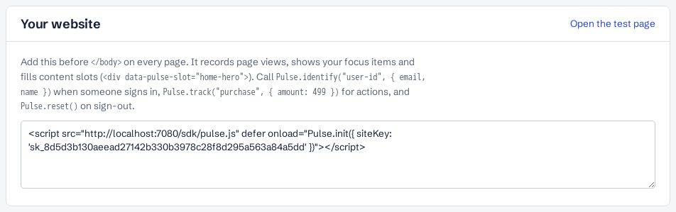
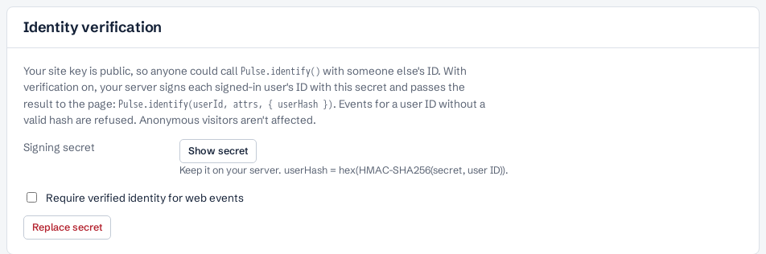
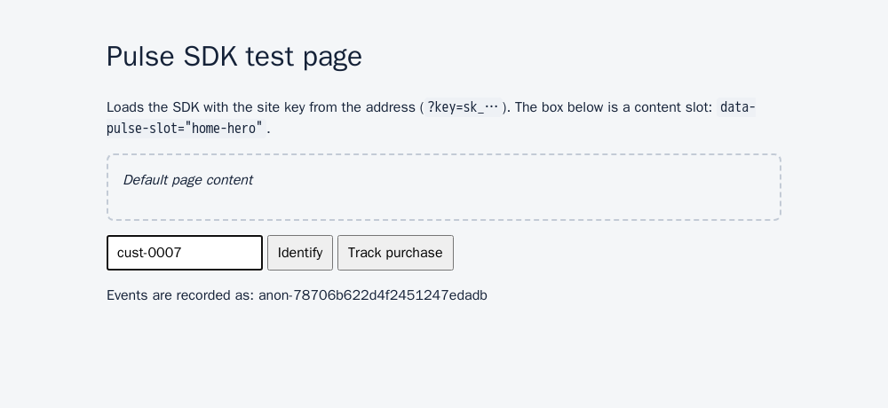

# 4. Web SDK

`pulse.js` connects a website to Pulse. It records page views and events, ties visitors to your
signed-in users, shows on-site content (focus items and content slots), renders Pulse forms,
subscribes browsers to web push and reads the app inbox. This guide covers installing it and
everything it exposes.

The source is `web/src/sdk/pulse.ts`, built by `npm run build` (in `web/`) into one file that Pulse
serves at **`/sdk/pulse.js`** with a 5-minute cache and `Access-Control-Allow-Origin: *`. It exposes
`window.Pulse`. The SDK only ever uses the workspace's public **site key** (`sk_…`): never put the
server API key or the identity verification secret in a page.

---

## Install

Copy the snippet from **Settings → Sign-in & keys → Your website** and add it before `</body>` on
every page:



```html
<script src="https://pulse.example.com/sdk/pulse.js" defer
        onload="Pulse.init({ siteKey: 'sk_…' })"></script>
```

On load, `init`:

1. gives the browser an anonymous ID (`anon-` + 24 hex characters) if it has none;
2. records the visit's campaign (`utm_*` parameters) for attribution;
3. records a `page_view` (and a `session_start` first, when a new session begins);
4. renders any `data-pulse-form` forms and asks Pulse for focus items and content slots for this
   page;
5. shows the workspace's web push opt-in prompt when its rules allow (see [Web push](#web-push)),
   and runs the browser self-check when the page was opened with `?pulse_check=…`.

### Options

```js
Pulse.init({
  siteKey: "sk_…",          // required
  host: "https://pulse.example.com", // default: the origin pulse.js was loaded from
  autoPageview: true,        // default true: record a page_view in init
  onsite: true,              // default true: fetch and show focus items and content slots
  storagePrefix: "",         // namespaces the stored IDs (Pulse's own landing pages use the site key)
});
```

`host` matters only when you serve `pulse.js` from somewhere else (your CDN): then point it at your
Pulse. With `PULSE_PAGES_URL` set, the SDK and its API (`/sdk/`, `/v1/web/`) are served on the pages
host too.

### Content Security Policy

If your site sends a CSP, allow the Pulse origin in `script-src` (for `pulse.js`) and `connect-src`
(for its API calls). Focus items render inside a Shadow DOM with an inline `<style>`, which a CSP
doesn't block. Avoid inline `onload` handlers under a strict CSP: load `pulse.js` and call
`Pulse.init` from your own script file, as the test page does (`/sdk/demo.js`).

---

## Identify, track, reset

```js
// When someone signs in (and on each page load while they are signed in):
Pulse.identify("cust-1001", { email: "asha@example.com", first_name: "Asha", plan: "pro" },
               { userHash: "<from your server>" });

// Actions:
Pulse.track("add_to_cart", { sku: "TEE-RED-M", price: 499 });
Pulse.track("purchase", { amount: 1299, currency: "INR", order_id: "A-1001" });

// On sign-out:
Pulse.reset();
```

| Call | Does |
|---|---|
| `Pulse.identify(userId, attrs?, { userHash }?)` | Records an `identify` for `userId` with `attrs` (`email` becomes the contact's email), the device properties and `props.anonymous_id` (the ID used until now), so Pulse merges the anonymous visitor into the contact. Sends at once, and refreshes on-site content 1.5 s later (new segments may change what they see). Later events are recorded under `userId` |
| `Pulse.track(name, props?)` | Records an event under the current ID |
| `Pulse.page(props?)` | Records a `page_view` (`url`, `path`, `title`, `referrer`, the session's `utm_*`, device properties, `session_id`) |
| `Pulse.reset()` | Forgets the user, their hash, the anonymous ID, the campaign and the session: the next event is a new anonymous visitor in a new session |
| `Pulse.flush(beacon?)` | Sends queued events now (with `beacon: true`, through `navigator.sendBeacon`) |
| `Pulse.currentId()` | The ID events are recorded under: the user ID after `identify`, otherwise the anonymous ID |

**Delivery.** Events are queued and sent in batches of up to 50 to `POST /v1/web/events`: after one
second, as soon as 20 are waiting, after `identify`, and with `sendBeacon` when the page is hidden
(`pagehide`). The server accepts at most 600 events a minute per client IP and workspace. Event
names follow `^[a-zA-Z][a-zA-Z0-9_.:-]{0,63}$`; a bad name is refused by the server with 400 (the
SDK doesn't validate names itself).

**What a browser can't do.** The site key is public, so the server refuses consent events
(`unsubscribed`, `resubscribed`) and server-only events (`tag_added`, `points_changed`,
`list_joined`, …) with 400, and drops reserved attributes (`optout_*`, `tags`, `points`, `stage`,
`company_*`, dates, device fields…) from `attrs`. An `identify` can merge only the browser's own
`anon-` visitor, never another known contact. Change those things from your server
([API guide](03-api.md)).

### Sending event properties

`props` can be any JSON object, nested objects and lists included. Name properties the way the
workspace's event schemas describe them (Audience → Events; the suggested schemas use
`product_code`, `product_name`, `product_category`, `value`, `currency`, `items`, `method`,
`social_provider`, `payment_method`…), so segments and journeys get typed filters and the schema
checks find nothing wrong:

```js
Pulse.track("add_to_cart", {
  product_code: "KIT-101", product_name: "Cast iron skillet", product_category: "Kitchen",
  price: 1899, quantity: 1, source: "web", landing_page: "/sale",
});
Pulse.track("purchase", {
  order_id: "A-1001", value: 3798, currency: "INR", source: "web",
  items: [{ product_code: "KIT-101", quantity: 2, price: 1899 }],
});
Pulse.track("signup", { method: "social", social_provider: "google" });
Pulse.track("cart_abandoned", { product_code: "KIT-101", price: 1899, cart_value: 1899 });
```

Segments read nested properties by path: `items[].product_code` matches when any item has that code,
`product.code` reads `{"product": {"code": …}}`. Browser events are never refused, even when the
event's schema is in enforce mode: problems are counted and shown on the event's page instead. Keep
personal data out of event properties where you can; a schema can mark a property personal so
Pulse hides it in samples and value suggestions. Walk-through: [tutorial 12](../tutorials/12-events-and-properties.md).

**Single-page apps.** `init` records one page view. On each client-side route change call
`Pulse.page()`, then `Pulse.refresh()` so focus items and content slots match the new URL.

### Sessions and device data

A session starts with the first event and again after 30 minutes without events (shared by all
tabs, kept in `localStorage`). Each starts with a `session_start` event (`session_id`, URL,
referrer, device properties, campaign). `identify`, `page_view` and `session_start` carry the
device properties, which Pulse keeps on the profile as the last-seen device: `platform`,
`device_type`, `os`, `os_version`, `browser`, `device_brand`, `device_model` (from the user agent,
and from Client Hints in Chromium browsers) and `locale`. `Pulse.deviceProps()` shows them.

### Campaign attribution

When a page is opened with `utm_*` parameters, the SDK keeps that campaign as the **first touch**
(once) and the **last touch** (every time), plus the referring site. Every `identify` and form
submission sends them as profile attributes `first_utm_source` … `first_utm_content`,
`first_referrer`, `last_utm_*`, `last_referrer` (Pulse keeps the `first_*` values once set). Page
views carry the session's campaign as `utm_*` and `referrer_domain`, which revenue attribution uses.
`Pulse.attribution()` returns what would be sent.

---

## Identity verification

Anyone can read your site key and call `Pulse.identify("someone-else")`. With **identity
verification**, your server signs each signed-in user's ID and the page passes the signature to
`identify`; Pulse then refuses events, push registrations and inbox requests for a known user
without a valid hash (403). Anonymous `anon-` visitors need no hash.



1. An admin opens **Settings → Sign-in & keys → Identity verification** and copies the signing secret
   (or reads it with `GET /v1/settings/identity`, full admin). Keep it on your server.
2. Your server computes the hash for the signed-in user and renders it into the page:

   ```
   userHash = hex(HMAC-SHA256(secret, userId))      // lower-case hex, 64 characters
   ```

   ```js
   // Node.js
   const crypto = require("crypto");
   const userHash = crypto.createHmac("sha256", process.env.PULSE_IDENTITY_SECRET).update(userId).digest("hex");
   ```

   ```python
   # Python
   import hmac, hashlib, os
   user_hash = hmac.new(os.environ["PULSE_IDENTITY_SECRET"].encode(), user_id.encode(), hashlib.sha256).hexdigest()
   ```

   ```go
   // Go
   mac := hmac.New(sha256.New, []byte(os.Getenv("PULSE_IDENTITY_SECRET")))
   mac.Write([]byte(userID))
   userHash := hex.EncodeToString(mac.Sum(nil))
   ```

3. The page passes it: `Pulse.identify(userId, attrs, { userHash })`. The SDK stores it and adds it
   to every event of that user (`props.user_hash`, which the server removes before recording).
4. When every page sends hashes, tick **Require verified identity for web events**
   (`PUT /v1/settings/identity` with `{"required": true}`).

**Replace secret** (`POST /v1/settings/identity/rotate`) invalidates every hash at once: deploy the
new secret to your server straight after. While verification is required, on-site content for a
user without a valid hash is decided as for an anonymous visitor (their segments are never
revealed). The app inbox of a signed-in user needs the hash even when verification isn't required.

---

## Consent and opting out

The web SDK has **no opt-out switch** of its own, and browsers can't change channel consent
(`unsubscribed` / `resubscribed` from a browser answer 400). Options:

- **Don't track before consent.** If your cookie banner must allow tracking first, load `pulse.js`
  (or call `Pulse.init`) only after the visitor agrees. Nothing is stored or sent before `init`.
- **Stop tracking anonymous visitors** for the whole workspace: Settings → Data & privacy → anonymous
  tracking off. Events for `anon-` IDs are then dropped by the server; signed-in visitors are still
  recorded.
- **Channel consent** (email, SMS, push…) changes through unsubscribe links, the preference center
  (`{{.PreferencesURL}}` in templates, or `GET /v1/contacts/{id}/preferences-link`), forms that opt
  people in, or `unsubscribed` / `resubscribed` events from your server.
- **Web push**: the browser's own notification permission. Unsubscribing in the browser stops
  delivery; Pulse removes tokens the push service reports as gone.

(The Android and iOS SDKs have a local `optOut()`; see [Mobile SDKs](05-mobile-sdks.md).)

---

## Forms

Build a form in **Content → Forms**, then embed it. The SDK renders it with its own small styles,
checks required fields, emails, numbers and files in the browser, splits page breaks into steps
with a progress bar, and skips fields the visitor's profile already has ("progressive" fields).

```html
<!-- Rendered automatically by Pulse.init (forms added later: call Pulse.form) -->
<div data-pulse-form="FORM_KEY"></div>
```

```js
Pulse.form(document.querySelector("#signup"), "FORM_KEY");   // render into any element
```

`FORM_KEY` is the form's public key (the embed snippet in the form's page shows it). Submissions go
to `POST /v1/web/forms/{key}` with the visitor's ID (and user hash), the page URL and the campaign;
files go as `multipart/form-data`. A successful submission shows the form's success message or
follows its redirect URL. The contact is found by the signed-in visitor, else by email, else by
phone, and an anonymous visitor's history is merged in.

Alternatives without the SDK: the hosted page `https://pulse.example.com/f/FORM_KEY`, which may be
put in an `<iframe>` on any site, or a server-side post ([API guide](03-api.md#form-submissions)).

---

## Content slots

A content slot is an element whose HTML Pulse fills per visitor (dynamic web content).

```html
<div data-pulse-slot="home-hero">
  <h2>Welcome to Acme</h2>   <!-- shown until Pulse answers, and to visitors no variant matches -->
</div>
```

Create a content slot in **Campaigns → Website & app messages** (New → Website → Dynamic web
content) with the same name (`home-hero`), a default and ordered variants. Each variant has an
audience: segments the visitor is in (or not), page address contains / doesn't contain, device
(desktop, mobile, tablet) and contact-field conditions (matched only for a verified identity, see
[identity verification](#identity-verification)). On `init` (and `Pulse.refresh()`), the SDK posts
the page URL, the slot names on the page and the device type to `POST /v1/web/decide`; the first
variant in order whose audience matches wins, else the default. The answer's `variants` names the
variant chosen per slot. Journeys can also push HTML into a slot for one contact (step
**Push dynamic content**). A slot request from a known contact is recorded as `dwc_requested`, which
the journey decision "Requests dynamic content" waits for. Slot names: lower-case letters, digits,
`-` and `_`; at most 50 slots per page.

## Focus items

Focus items are pop-ups (`modal`), bars (`bar`, top or bottom) and slide-ins (`slide`) created in
**Campaigns → Website & app messages** (New → Website). The decide call returns the items for this
visitor, URL and device (by the same audience rules as content variants, and schedule), in the
workspace's order (**Order** on the list). The SDK shows **one pop-up, one bar and one slide-in per
page**: of each kind, the first in order whose frequency still allows it. It shows it on its
trigger:

| Trigger | Shown |
|---|---|
| `load` | at once |
| `delay` | after `trigger_value` seconds (default 5) |
| `scroll` | when the visitor has scrolled `trigger_value` % of the page (default 50) |
| `exit_intent` | when the mouse leaves through the top of the window |

and respects the item's frequency in this browser: `once` (ever), `session`, `daily` or `always`.
Items render in a Shadow DOM, so your CSS and theirs never mix; the body HTML is the workspace's own,
and only `http(s)` links and images are used. The SDK records `focus_shown`, `focus_clicked` and
`focus_closed` (`props.focus_id`, `how`: `button`, `backdrop` or `escape`), which the item's report
counts. A journey's **Show focus item** step queues an item for one contact's next page view.

Pass `onsite: false` to `init` to turn slots and focus items off on a page.

---

## Web push

Standard web push (VAPID), no Firebase needed. Pulse creates the workspace's key pair on first use.
Pulse accepts and sends to subscriptions only on the browsers' push services (`https` endpoints on
`fcm.googleapis.com`, `push.services.mozilla.com`, `push.apple.com` or `notify.windows.com`); any other
endpoint is refused with `400` when registered, so a page script can't point Pulse at another address.

1. Serve a service worker file from your site, by default **`/pulse-sw.js`** at its root,
   containing one line:

   ```js
   importScripts("https://pulse.example.com/sdk/pulse-sw.js");
   ```

   (A service worker must come from your own origin; this file pulls in Pulse's, which shows
   notifications, opens their link on click and reports clicks and dismissals.) If it lives
   elsewhere, set it in **Settings → Web push → Install check** (**Service worker file**); the SDK reads it
   from `GET /v1/web/push-config`.

2. Ask visitors, either way:

   - **No code: the opt-in prompt.** Turn it on in **Settings → Web push**: a bell, a bar or a
     pop-up, its texts and colours, when it appears (seconds after the page loads, how far the
     visitor has scrolled, pages seen this visit), on which pages (show on / hide on, matched
     against the path and query), and after how many days to ask again once dismissed (0: never).
     The SDK shows it only while the browser's permission is undecided; **Allow** then opens the
     browser's own prompt (browsers require that click) and subscribes. Browsers that already
     allowed notifications are kept subscribed on their next visit.
   - **Your own button**, from a user gesture:

     ```js
     document.querySelector("#notify-me").addEventListener("click", async () => {
       const ok = await Pulse.enablePush();            // or Pulse.enablePush({ serviceWorker: "/sw/pulse-sw.js" })
       if (!ok) showHint("Notifications are blocked or not supported in this browser.");
     });
     ```

`enablePush` asks for permission, fetches the workspace's public key (`GET /v1/web/push-config`),
registers the service worker, subscribes, and registers the subscription for the current visitor
(`POST /v1/web/devices`). It resolves to `true` when subscribed. Call it again after `identify` if
the visitor signed in, so the subscription belongs to the user.

The prompt records events (with `props.style`) for reports and segments:

| Event | When |
|---|---|
| `push_prompt_shown` | The prompt appeared |
| `push_prompt_allowed` | The visitor clicked **Allow** on it |
| `push_prompt_dismissed` | The visitor clicked **Not now** (it's asked again after the repeat days) |
| `push_subscribed` | The browser's prompt was accepted and the subscription registered |
| `push_permission_refused` | The browser's prompt was refused or failed |

### Checking the set-up

**Settings → Web push → Install check → Check my site** has the server fetch your page and service worker (public
https addresses only) and report: HTTPS, the page opens, the snippet is found (and from which
host), the site key is this workspace's, the service worker exists, is JavaScript and imports
Pulse's, and the workspace has VAPID keys.

**Check in my browser** gives a link to your site with `?pulse_check=<token>` (valid 30 minutes).
Opened in a browser, the SDK on that page runs `Pulse.diagnose()` and posts the result to
`POST /v1/web/diagnose`, where the settings page shows it. You can also call it yourself in the
browser console:

```js
await Pulse.diagnose();
// {sdk_version, url, https, push_supported, permission: "default"|"granted"|"denied"|"unsupported",
//  service_worker: "/pulse-sw.js", worker_found, worker_pulse, subscribed, prompt_enabled, identified,
//  problems: ["No service worker at /pulse-sw.js.", …]}
```

### Sending

Send with a **push** template (title, body, image, URL) from a campaign. Browser subscriptions
are sent with the workspace's own VAPID keys and need no provider; app tokens on the same contact
go through the push provider in Settings → Channels (FCM). The service worker posts clicks and
dismissals to the message's tracking link (`POST /t/p/{token}?a=clicked`), recorded as
`push_clicked` / `push_dismissed` for reports and journey decisions.

If your site already uses Firebase Cloud Messaging for the web, register its token instead:
`Pulse.registerPushToken(token)`.

---

## App inbox on the web

Messages sent to the **inbox** channel are kept per person. `Pulse.inbox` reads and updates the
current visitor's:

```js
const { messages, unread } = await Pulse.inbox.list();          // newest 50; list(lastId) for older
await Pulse.inbox.markRead([messages[0].id]);                     // markRead() marks all
await Pulse.inbox.click(messages[0].id);                          // counts a click; open message.url yourself
await Pulse.inbox.remove([messages[0].id]);
```

Each message has `id`, `message_id`, `title`, `body`, `image_url`, `url`, `category`, `data`,
`created_at`, `read_at` and `expires_at`. A signed-in user's inbox needs their user hash (pass it to
`identify`) even when the workspace doesn't require verification for events; without it `list()`
returns an empty result.

---

## The test page

Every Pulse serves a page to try the SDK against a workspace: **`/sdk/demo.html?key=<site key>`**,
also linked from Settings → Sign-in & keys → Your website (**Open the test page**). It loads
`pulse.js` with that site key, shows which ID events are recorded under, has a content slot named
`home-hero`, and buttons to identify a user and track a `purchase`.



Use it to check a setup end to end:

1. Open the page; a new anonymous visitor appears in Audience → Contacts within seconds (`is:anonymous`).
2. Enter an external ID and click **Identify**: the visitor is merged into that contact.
3. Click **Track purchase**: a `purchase` event with `amount: 499` is on the contact's timeline.
4. Create a content slot `home-hero` or a focus item and reload to see it.
5. Turn on the opt-in prompt in Settings → Web push and reload: it appears after its delay
   (browsers allow notifications on `http://localhost` too).

The test page records real data in the workspace, so use a test workspace or test IDs. In the
browser's developer tools, the requests to `/v1/web/events` and `/v1/web/decide` show exactly what
the SDK sends and receives.

---

## API used by the SDK

| Call | Endpoint |
|---|---|
| Events | `POST /v1/web/events` (`X-Pulse-Site-Key`, or `?site_key=` for beacons), `{"events":[{"id","external_id","name","ts","props","attrs","email"}]}` → 202 |
| On-site content | `POST /v1/web/decide` (`X-Pulse-Site-Key`), `{"external_id","user_hash","url","slots":[…],"device"}` → `{"focus":[…in order],"content":{slot: html},"variants":{slot: variant id}}` |
| Forms | `GET /v1/web/forms/{key}?id=&user_hash=` → fields; `POST /v1/web/forms/{key}` → `{"ok","message","redirect_url"}` or 422 with `fields` |
| Push settings | `GET /v1/web/push-config?site_key=` → `{"vapid_public_key","prompt":{…},"service_worker"}` |
| Self-check | `POST /v1/web/diagnose`, `{"token","report"}` (only with a `?pulse_check=` token from Settings → Web push) |
| Push token | `POST /v1/web/devices`, `{"external_id","token","user_hash","platform":"web"}` → 204 |
| Inbox | `GET /v1/web/inbox?site_key=&id=&user_hash=&before=`; `POST /v1/web/inbox` `{"id","user_hash","action","message_ids":[…]}` with `action` `read`, `delete` or `click` |

The source of truth is `web/src/sdk/pulse.ts` (the prompt is `pushPrompt.ts`); its unit tests
(`npm test` in `web/`) cover the device parsing, sessions, attribution, form pages and the prompt's
rules.

Next: [5. Mobile SDKs](05-mobile-sdks.md).
