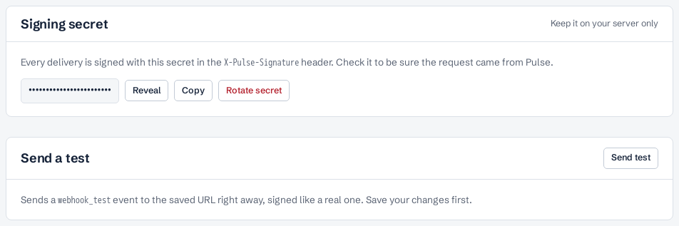
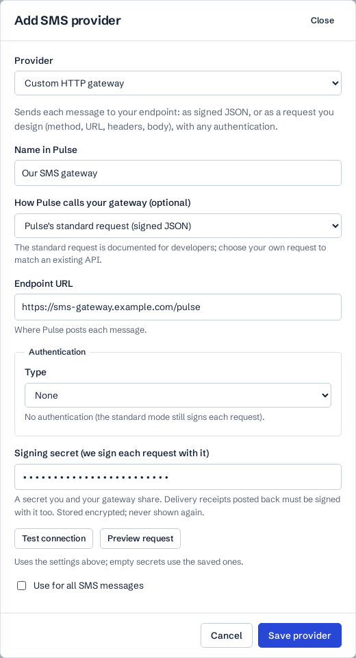

# 6. Webhooks and integrations

How data leaves Pulse for your systems, and how other systems talk back to it:

- [Outbound webhooks](#outbound-webhooks): Pulse POSTs events to your URLs, signed.
- [Inbound provider webhooks](#inbound-provider-webhooks): delivery receipts, replies, bounces and
  complaints from email, SMS, WhatsApp and RCS services.
- [Zapier and Make (REST hooks)](#zapier-and-make-rest-hooks): triggers and actions with an
  integration key.
- [The custom HTTP gateway](#the-custom-http-gateway): send any channel through your own service.
- [CRM, Shopify and ad audiences](#crm-shopify-and-ad-audiences): what the built-in connectors do.

Outbound calls (webhooks, the gateway, connectors) go through an HTTP client that refuses private
and loopback addresses unless `PULSE_ALLOW_PRIVATE_WEBHOOKS=true` (development only; see
[Configuration](02-configuration.md#secrets-and-outbound-calls)). Signing secrets are stored
encrypted with `PULSE_SECRET_KEY`, which webhooks need.

---

## Outbound webhooks

An outbound webhook posts every event it subscribes to, as JSON, to one URL. Manage them in
**Settings → Webhooks** or with `/v1/settings/webhooks` ([API guide](03-api.md#webhooks)). Only
people with every admin permission can see and change them, since a webhook can copy every contact
out of the workspace.


### Events

`events` is a list of event names, or `["*"]` for everything. Any event works, including ones you
haven't sent yet:

- events you send (`purchase`, `signup`, …) and the SDKs record (`page_view`, `identify`,
  `session_start`, `form_submitted`, `focus_clicked`, …);
- events Pulse records: messages (`email_sent`, `email_opened`, `email_clicked`, `sms_delivered`,
  `push_clicked`, …), consent (`unsubscribed`, `resubscribed`), `email_bounced`, `tag_added`,
  `points_changed`, `stage_changed`, `journey_entered`, `journey_completed` and others;
- `segment_entered` and `segment_exited`, from segment membership changes;
- `contact_created`, sent when a contact becomes known (a new identified contact, or an anonymous
  visitor who identifies). `*` doesn't include it: list it by name.

A new or changed webhook starts receiving within about 10 seconds (the `webhooks` role reloads its
list every 10 s). Untick **Active** (`"active": false`) to pause one without deleting it.

### Request

```http
POST /hooks/pulse HTTP/1.1
Host: crm.example.com
Content-Type: application/json
User-Agent: Pulse-Webhooks/1
X-Pulse-Event: purchase
X-Pulse-Delivery: 6f1c0d2a9b8e4f7a8c3d2e1f0a9b8c7d
X-Pulse-Signature: t=1794375162,v1=<64 hex characters>

{"id":"6f1c0d2a9b8e4f7a8c3d2e1f0a9b8c7d","event":"purchase","ts":"2026-11-11T10:00:00Z","workspace_id":7,
 "contact":{"id":42,"external_id":"cust-1001","attributes":{"email":"asha@example.com","city":"Pune","plan":"pro"}},
 "props":{"amount":499,"currency":"INR"}}
```

| Field | Meaning |
|---|---|
| `id` | The event's ID, also in `X-Pulse-Delivery`. The same on every retry: use it to skip duplicates |
| `event` | The event name, also in `X-Pulse-Event` |
| `ts` | When the event happened (UTC) |
| `workspace_id` | Pulse's numeric workspace ID |
| `contact.id`, `contact.external_id` | The contact (Pulse's ID and yours) |
| `contact.attributes` | The whole profile **after** this event |
| `props` | The event's properties (omitted when empty) |
| `segment_id` | `segment_entered` / `segment_exited` only |

Segment events carry only `contact.id` (no external ID or attributes) and an ID of the form
`seg:<segment>:<contact>:<time>:<entered>`; look the contact up with the API if you need more.
`contact_created` has the ID `created:<event id>`. The **Send test** button (or
`POST /v1/settings/webhooks/{id}/test`) sends a `webhook_test` event with a sample contact, signed
like a real one, and shows your server's answer. The attempt is also listed under **Deliveries**
(`"test": true` in the API), marked **test**, and is never retried.

### Verifying the signature

Each webhook has a signing secret (`whsec_…`), shown on its page (behind **Reveal**) and in
`GET /v1/settings/webhooks/{id}`. Every request carries:

```
X-Pulse-Signature: t=<unix seconds>,v1=<hex HMAC-SHA256(secret, "<t>." + raw body)>
```

The HMAC key is the secret string exactly as shown (including `whsec_`), and the message is the
timestamp, a dot, and the raw request body bytes. Check it on the **raw** body before parsing the
JSON (re-serialising changes the bytes), compare in constant time, and reject timestamps more than
5 minutes away from now. Each retry is signed again with its own `t`.



**Node.js** (with Express, keep the raw body):

```js
const crypto = require("crypto");

// Returns true when the request really comes from Pulse.
// rawBody: the body exactly as received (a Buffer or string), before any JSON parsing.
// header: the X-Pulse-Signature header, "t=<unix seconds>,v1=<hex>".
function verifyPulseSignature(rawBody, header, secret, toleranceSeconds = 300) {
  const parts = {};
  for (const item of String(header || "").split(",")) {
    const [k, v] = item.trim().split("=", 2);
    parts[k] = v;
  }
  const t = Number(parts.t);
  if (!parts.v1 || !Number.isInteger(t)) return false;
  if (Math.abs(Date.now() / 1000 - t) > toleranceSeconds) return false;   // replayed or stale
  const expected = crypto.createHmac("sha256", secret)
    .update(`${parts.t}.`)
    .update(rawBody)
    .digest("hex");
  const a = Buffer.from(expected), b = Buffer.from(parts.v1);
  return a.length === b.length && crypto.timingSafeEqual(a, b);
}

// app.post("/hooks/pulse", express.raw({ type: "application/json" }), (req, res) => {
//   if (!verifyPulseSignature(req.body, req.get("X-Pulse-Signature"), process.env.PULSE_WEBHOOK_SECRET)) {
//     return res.sendStatus(401);
//   }
//   const event = JSON.parse(req.body);
//   ...
//   res.sendStatus(204);
// });
```

**Python** (with Flask, `request.get_data()` is the raw body):

```python
import hashlib
import hmac
import time


def verify_pulse_signature(raw_body: bytes, header: str, secret: str, tolerance: int = 300) -> bool:
    """True when the request really comes from Pulse.

    raw_body: the request body bytes exactly as received.
    header: the X-Pulse-Signature header, "t=<unix seconds>,v1=<hex>".
    """
    parts = dict(item.strip().split("=", 1) for item in (header or "").split(",") if "=" in item)
    t, given = parts.get("t", ""), parts.get("v1", "")
    if not t.isdigit() or not given:
        return False
    if abs(time.time() - int(t)) > tolerance:  # replayed or stale
        return False
    expected = hmac.new(secret.encode(), t.encode() + b"." + raw_body, hashlib.sha256).hexdigest()
    return hmac.compare_digest(expected, given)

# @app.post("/hooks/pulse")
# def pulse_hook():
#     if not verify_pulse_signature(request.get_data(), request.headers.get("X-Pulse-Signature", ""), SECRET):
#         abort(401)
#     event = request.get_json()
#     ...
#     return "", 204
```

**Go**:

```go
import (
	"crypto/hmac"
	"crypto/sha256"
	"encoding/hex"
	"strconv"
	"strings"
	"time"
)

// VerifyPulseSignature reports whether body (exactly as received) was signed by Pulse with secret.
// header is the X-Pulse-Signature value, "t=<unix seconds>,v1=<hex>".
func VerifyPulseSignature(body []byte, header, secret string, tolerance time.Duration) bool {
	var ts, sig string
	for _, part := range strings.Split(header, ",") {
		k, v, _ := strings.Cut(strings.TrimSpace(part), "=")
		switch k {
		case "t":
			ts = v
		case "v1":
			sig = v
		}
	}
	t, err := strconv.ParseInt(ts, 10, 64)
	if err != nil || sig == "" || time.Since(time.Unix(t, 0)).Abs() > tolerance {
		return false
	}
	mac := hmac.New(sha256.New, []byte(secret))
	mac.Write([]byte(ts + "."))
	mac.Write(body)
	return hmac.Equal([]byte(hex.EncodeToString(mac.Sum(nil))), []byte(sig))
}

// In a handler: body, _ := io.ReadAll(r.Body)
// if !VerifyPulseSignature(body, r.Header.Get("X-Pulse-Signature"), secret, 5*time.Minute) { 401 }
```

These three were checked against a signature computed the way `webhooks.Sign`
(`internal/webhooks/webhooks.go`) computes it: each accepts it, and rejects the body with one extra
byte. The same functions verify the [custom gateway](#the-custom-http-gateway)'s requests.

**Rotating the secret**: **Rotate secret** on the webhook's page (or `PUT` with
`"rotate_secret": true`) replaces it at once; deliveries from then on use the new one, including
retries of earlier events. Update your receiver right after.

### Retries and ordering

A delivery succeeds when your server answers **2xx within 10 seconds**. Anything else (a network
error, a timeout, any other status) is retried after **30 s, 2 min, 10 min, 1 h and 6 h**: six
attempts over about seven hours, then it's given up. Every attempt is recorded in the webhook's
**Deliveries** list (the latest 100, with status, error and time; `GET /v1/settings/webhooks/{id}`
→ `deliveries`, where `final` marks the last attempt of a delivery). Retries are kept in Redis and
continue across restarts; deleting or pausing the webhook stops them.

Deliveries happen in parallel (up to 32 at a time per worker) and in no guaranteed order across
events, and an event can arrive more than once (a retried batch, or a timeout after your server
already processed it). So:

- answer quickly (do the work in a queue) and with 2xx once you've stored the event;
- deduplicate by `X-Pulse-Delivery`;
- order by `ts`, not by arrival.

---

## Inbound provider webhooks

Pulse receives callbacks from the services it sends through. Each kind has its own URL; none needs
an API key: they are authenticated by the provider's signature or by a secret in the URL.

### Delivery receipts and replies (SMS, WhatsApp, RCS, gateway)

Each provider you add in **Settings → Channels** gets a webhook URL,
`{PULSE_PUBLIC_URL}/v1/webhooks/providers/{provider id}`, shown on the Channels page as "Delivery
reports" and in `GET /v1/channels/providers` (`webhook_url`). Enter it in the provider's console:

| Provider | What to configure | How Pulse checks it |
|---|---|---|
| Twilio (SMS) | The number's "A message comes in" webhook and the status callback (Pulse sends its URL with each message) | `X-Twilio-Signature`: HMAC-SHA1 with the auth token over the URL Twilio called plus the form fields. Behind a proxy, keep `Host` and set `X-Forwarded-Proto` so the URL matches |
| Meta WhatsApp Cloud API | The app's webhook URL, with the provider's **verify token**; subscribe to `messages` | `GET` verification with `hub.verify_token`; `X-Hub-Signature-256` (HMAC-SHA256 with the app secret) on every post |
| Google RCS Business Messaging | The agent's webhook URL, with the provider's **webhook client token** | The client-token handshake; HMAC-SHA512 signature on every post |
| Custom HTTP gateway | Your service posts receipts back (see [the gateway contract](#the-custom-http-gateway)) | `X-Pulse-Signature`, as above, with the gateway's signing secret |

What Pulse does with them:

- **Delivery receipts** (`delivered`, `read`, `failed`) become `<channel>_delivered`, `_read` and
  `_failed` events on the message's contact, for reports and journey message decisions. A WhatsApp
  or RCS message reported undeliverable falls back to its SMS template, if it has one.
- **Inbound messages** from a known phone number become `<channel>_received` (`text`, `from`,
  `keyword`) on every contact with that number. Messages from unknown numbers are dropped.
- **Keywords**: a reply matching the workspace's opt-out words (STOP and the like) unsubscribes
  those contacts from that channel (`unsubscribed`, `source: "sms_keyword"`); an opt-in word (START…)
  resubscribes them. The lists are editable in the delivery rules (Settings → Channels,
  `PUT /v1/settings/delivery`).
- **RCS replies** (typed text or a tapped suggestion) are also recorded as `rcs_replied` on the
  latest RCS message the contact got in the last 7 days, so a journey can wait for "replied".

To try this without a provider, the sandbox simulates both: `POST /v1/sandbox/inbound`
(`{"channel":"sms","from":"+919800000001","text":"STOP"}`) and `POST /v1/sandbox/receipts`.

### Bounces and complaints (email)

**Settings → Channels → Bounces and complaints** (or `GET /v1/settings/bounces`) shows the
workspace's secret bounce URL, `{PULSE_PUBLIC_URL}/v1/bounces/{token}`. Point your email service's
event webhook at it. The body format is detected:

| Service | Configure |
|---|---|
| SendGrid | Event Webhook (bounce, dropped, spam report events) |
| Postmark | Bounce and spam complaint webhooks |
| Mailgun | Webhooks for permanent and temporary failures and complaints (v3 `event-data`) |
| Amazon SES | Notifications through an SNS topic with an HTTPS subscription to the URL; Pulse confirms the subscription itself |
| Anything else | Generic JSON: `{"email": "…", "type": "hard", "reason": "…"}` (`type`: `hard`, `soft` or `complaint`), or a list of them |

```bash
curl -s -X POST "$PULSE/v1/bounces/$BOUNCE_TOKEN" -H "Content-Type: application/json" \
  -d '[{"email":"asha@example.com","type":"hard","reason":"550 mailbox unavailable"}]'
```

A **hard** bounce records `email_bounced` and sets `email_bounced: true`, which stops email to the
address until your server clears it. A **soft** bounce is only recorded. A **complaint** records
`email_complained` and unsubscribes the contact from email (`source: "complaint"`). Addresses that
match no contact are ignored. The URL is the only credential: keep it private.

If your mail goes through a server that sends delivery status notifications (RFC 3464) and ARF
complaints (RFC 5965) to a mailbox instead, add it under **Settings → Channels → Bounce mailbox**
(IMAP; the `integrations` role reads it every 5 minutes, and needs `PULSE_SECRET_KEY`).

### Email replies

To let journeys react to replies ("Replies to email"), set a reply tracking address in the delivery
rules (`reply_to`, e.g. `replies@inbound.example.com`). Marketing emails then get
`Reply-To: replies+r<code>@inbound.example.com`. Route that domain's mail to your email service's
inbound parse (SendGrid Inbound Parse, Mailgun routes, Postmark inbound) and point its webhook at
`{PULSE_PUBLIC_URL}/v1/replies/{token}` (the same token as the bounce URL; shown as the reply URL).
Pulse finds the code among the recipients and records `email_replied` on the contact who got that
message. Generic JSON is also accepted: `{"to": "…", "from": "…", "subject": "…", "text": "…"}`.

---

## Zapier and Make (REST hooks)

Pulse speaks the REST hooks pattern that Zapier and Make use, with its own key per connector so
you never hand out the workspace API key. There is no published Zapier or Make app yet: use their
"Webhooks" / "HTTP" modules with these endpoints.

1. In **Settings → Integrations**, add **Zapier / Make** (or `POST /v1/integrations` with
   `{"kind":"rest_hooks","name":"Zapier"}`). Its API key (`pzk_…`) is shown once; replace it with
   `POST /v1/integrations/{id}/key`.
2. Call `/v1/hooks/*` with `Authorization: Bearer pzk_…` (or `X-Pulse-Key: pzk_…`).

| Call | Does |
|---|---|
| `GET /v1/hooks/me` | Connection test: `{"workspace","integration","integration_id"}` |
| `GET /v1/hooks/segments` | Segments, for a dropdown |
| `GET /v1/hooks/samples?event=purchase` | A sample payload, for mapping fields |
| `POST /v1/hooks/subscriptions` | Subscribe: `{"target_url" (or Zapier's "hookUrl"), "event", "segment_id"?, "form_id"?}` → 201 `{"id","event","target_url","secret"}` |
| `DELETE /v1/hooks/subscriptions/{id}` | Unsubscribe (204) |
| `POST /v1/hooks/contacts` | Create or update a contact: `{"external_id"? or "email", "phone"?, "attrs"?}` → 202. Reserved attributes are left out and listed in `ignored_attrs` |
| `POST /v1/hooks/events` | Track an event: `{"external_id"? or "email", "name", "props"?}` → 202 |
| `POST /v1/hooks/tags` | Add tags, or remove them with `"remove": true`: `{"external_id"? or "email", "tags": [...]}` → 202 |

```bash
ZAP=pzk_…   # the connector's key
curl -s -X POST $PULSE/v1/hooks/subscriptions -H "Authorization: Bearer $ZAP" -H "Content-Type: application/json" \
  -d '{"hookUrl":"https://hooks.zapier.com/hooks/catch/123/abc/","event":"segment_entered","segment_id":14}'
curl -s -X POST $PULSE/v1/hooks/contacts -H "Authorization: Bearer $ZAP" -H "Content-Type: application/json" \
  -d '{"email":"lead@example.com","attrs":{"plan":"trial","source":"typeform"}}'
# 202 {"event_id":"…","external_id":"lead@example.com","ignored_attrs":[]}
```

Triggers: `contact_created`, `segment_entered` / `segment_exited` (optionally one segment),
`form_submitted` (optionally one form), or any event name. Deliveries are outbound webhooks owned by
the connector: the same payload, signature (with the subscription's `secret`), retries and delivery
log (on the connector's page). A **410 Gone** answer removes the subscription, as REST hooks expect.
At most 100 subscriptions per connector. Actions find the contact by `external_id`, else by email,
else create one named by the email.

---

## The custom HTTP gateway

When Pulse has no adapter for your provider (a regional SMS aggregator, an in-house notification
service), add a **Custom HTTP gateway** provider to any channel (email, SMS, WhatsApp, RCS, push):
Pulse POSTs each rendered message to your endpoint, signed, and your service delivers it.



```bash
curl -s -X POST $PULSE/v1/channels/providers -H "Authorization: Bearer $KEY" -H "Content-Type: application/json" -d '{
  "channel": "sms", "provider": "http_sms", "name": "Our SMS gateway", "is_default": true,
  "config": {"url": "https://sms-gateway.example.com/pulse"},
  "secrets": {"signing_secret": "<a long random string you also give your gateway>"}}'
```

The provider IDs are `http_email`, `http_sms`, `http_whatsapp`, `http_rcs` and `http_push`. The
signing secret is yours to choose (`openssl rand -hex 32`); Pulse stores it encrypted and never shows
it again.

### What Pulse sends

```http
POST /pulse HTTP/1.1
Host: sms-gateway.example.com
Content-Type: application/json
X-Pulse-Signature: t=1794375162,v1=<hex HMAC-SHA256(signing secret, "<t>." + body)>
Idempotency-Key: 1f6c…-welcome

{"message_id":"1f6c…-welcome","channel":"sms","to":"+919811122233",
 "content":{"text":"Hi Ravi, your cart is waiting: https://pulse.example.com/t/s/Xy12ab"}}
```

| Field | Channels | Meaning |
|---|---|---|
| `message_id` | all | Pulse's message ID, also in `Idempotency-Key`. A retry sends the same ID: deliver it once |
| `channel` | all | `email`, `sms`, `whatsapp`, `rcs` or `push` |
| `to` | all | Email address, E.164 phone number, or push token |
| `platform` | push | `android`, `ios` or `web` |
| `subject`, `html`, `text` | email | The rendered email; `text` is the plain-text part |
| `headers` | email | Extra headers to set, e.g. `List-Unsubscribe` and `List-Unsubscribe-Post` |
| `attachments` | email | `[{"filename","content_type","size","url"}]`: signed download links valid 7 days (needs `PULSE_SECRET_KEY`) |
| `content` | all | The rendered channel content (`channel.Content`): `text`, `sender_id` (SMS); `template_name`, `language`, `body_params` (WhatsApp); `text`, `card`, `suggestions` (RCS); `title`, `body`, `image_url`, `url`, `data` (push; `data.pulse_track` is the click tracking URL) |

Verify `X-Pulse-Signature` with the functions [above](#verifying-the-signature) and the gateway's
signing secret.

### What your gateway answers

Pulse waits up to 15 seconds.

| Your answer | Pulse records |
|---|---|
| `2xx`, optionally `{"id": "your-message-id"}` | Sent (`<channel>_sent`). Keep `id` to match the receipts you post later |
| `404` or `410` | The recipient can't be reached on this channel: WhatsApp and RCS fall back to SMS when the message has an SMS template; an SMS number is marked `sms_bounced`; a push token is deleted |
| other `4xx` | Permanent failure (`<channel>_failed`), not retried |
| `429` or `5xx`, a timeout or a network error | Temporary failure: the dispatcher tries again, see the note below |

**Note on temporary failures.** The `dispatch` role tries a message that failed temporarily again
after 30 s, 1 min, 2 min, 5 min, 10 min, 30 min and 1 h (about 1 h 50 min in all), without holding
up other messages. Send `Retry-After` (seconds or an HTTP date) with a `429` or `503` to ask for a
longer wait (up to an hour). If every try fails, Pulse records `<channel>_failed` with
`reason: "gave up after 8 tries: …"`. Every try carries the same `message_id`: deliver it once.

### Receipts and replies back to Pulse

Post delivery receipts and inbound messages to the provider's webhook URL
(`{PULSE_PUBLIC_URL}/v1/webhooks/providers/{provider id}`), signed the same way with the same secret
(Pulse rejects a signature older than 5 minutes):

```json
{"id": "your-message-id", "status": "delivered"}
{"id": "your-message-id", "status": "failed", "unreachable": true, "reason": "not on WhatsApp"}
{"status": "inbound", "id": "your-inbound-id", "from": "+919811122233", "text": "STOP"}
```

`status` is `delivered`, `failed`, `read` or `inbound`; `unreachable: true` on a failure triggers the
SMS fallback for WhatsApp and RCS (and marks an SMS number bounced). Receipts are matched to messages
sent in the last 3 days; later or unknown IDs are ignored. Inbound messages are handled like any provider's
([above](#delivery-receipts-and-replies-sms-whatsapp-rcs-gateway)). Signing in Node.js:

```js
const body = JSON.stringify({ id: "your-message-id", status: "delivered" });
const t = Math.floor(Date.now() / 1000);
const sig = crypto.createHmac("sha256", secret).update(`${t}.${body}`).digest("hex");
await fetch(webhookUrl, {
  method: "POST",
  headers: { "Content-Type": "application/json", "X-Pulse-Signature": `t=${t},v1=${sig}` },
  body,
});
```

Pulse answers 200 when accepted, 401 for a bad signature, 400 for a body it can't read.

---

## CRM, Shopify and ad audiences

Built-in connectors live in **Settings → Integrations** (`/v1/integrations`, settings edit access).
Their credentials are sealed with `PULSE_SECRET_KEY` and only shown masked; every remote base URL is
a setting, and every call goes through the guarded HTTP client.

| Connector | Direction | How |
|---|---|---|
| HubSpot (private app token) | Both | Contacts pulled on a schedule (15 minutes to a day) through a field mapping, recorded as `crm_synced` events with `hubspot_id`; a contact is pushed on demand (`POST /v1/integrations/{id}/push`) or by the journey step **Push contact to integration** |
| Salesforce (connected app, client credentials; Contact or Lead) | Both | The same, with `salesforce_id` |
| Shopify | In | `POST /v1/webhooks/shopify/{id}` takes `orders/create`, `customers/create`, `checkouts/create` and `checkouts/update`, verified with Shopify's HMAC (`X-Shopify-Hmac-Sha256`) and the shop domain, as `order_completed`, `customer_created` and `cart_updated` |
| Facebook Custom Audiences, Google Ads Customer Match | Out | A segment linked to an audience uploads its members as SHA-256 hashes of the normalised email and phone, streams entries and exits, and reconciles every `PULSE_AUDIENCE_RECONCILE_INTERVAL` |

These connectors have been tested against mock servers only, not live accounts
([known gaps](../05-feature-parity.md#known-gaps)). Field-by-field behaviour is in the
[feature parity notes](../05-feature-parity.md) and the [architecture](../02-architecture.md#integrations-batch-8a).

Next: [7. Architecture and extending](07-architecture-and-extending.md).
