# Tutorial 1: Getting started

In about 15 minutes you will create a workspace, bring in your team with the right access, connect
your website, and watch your first visitor become a contact.

**You need:** a Pulse address (here `http://localhost:7080`) and, for step 6, a website you can add a
script to. You can also use Pulse's built-in test page instead of a website.

---

## 1. Create your workspace

A workspace holds one company's contacts, campaigns and settings. Nothing is shared between
workspaces.

1. Open `http://localhost:7080/signup`. (From the sign-in page: **New to Pulse? Create a workspace**.)
2. Fill in:
   - **Company or team name**, e.g. `Acme Retail`
   - **Your name**
   - **Work email**
   - **Password**: at least 10 characters
3. Click **Create workspace**.

   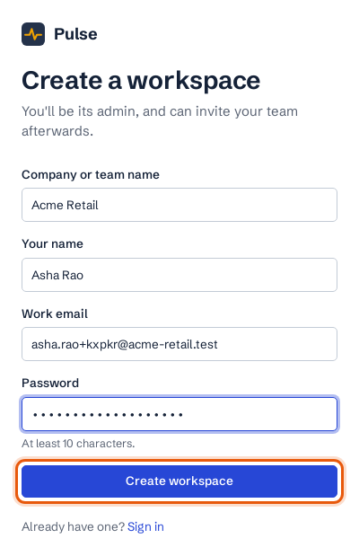

You see **Your workspace is ready** with two things to keep:

- **Your workspace ID**, e.g. `acme-retail`: made from the name. You and your team type it when
  signing in.
- **Server API key** (starts with `pk_`): **copy it now, it is shown only once.** Your servers use it
  to send data to Pulse (step 8). If you lose it, you can replace it later.

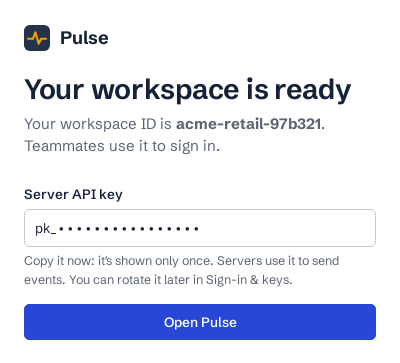

In this picture the ID ends in a short suffix (`acme-retail-…`): another workspace already had
`acme-retail`, so Pulse made the new one unique.

4. Click **Open Pulse**. You land on **Overview**, which is empty for now: no events, no contacts.

   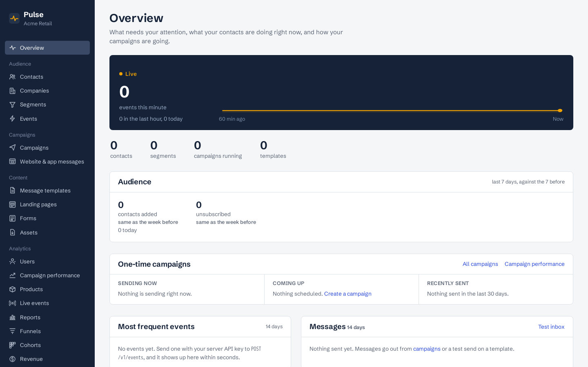

> **Self-hosting?** Your operator may have turned sign-up off (`PULSE_ALLOW_SIGNUP=false`). Then
> they create the workspace for you and send you the workspace ID and sign-in details.

## 2. Sign in later

On `http://localhost:7080/login` enter **Workspace ID**, **Email** and **Password**, then **Sign in**.
If your workspace uses single sign-on, choose **Sign in with SSO** instead and enter the workspace ID
(set up in tutorial 11). If you (or your workspace) turned on two-step sign-in, Pulse then asks for
the code from your authenticator app ([tutorial 11](11-admin-and-privacy.md#9-two-step-sign-in-with-an-authenticator-app)).

## 3. Find your way around

The sidebar groups everything into:

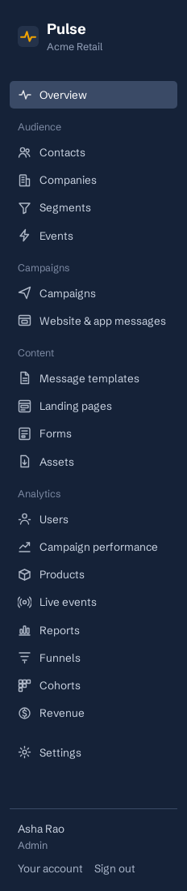

| Group | Pages | For |
|---|---|---|
| | **Overview** | What needs attention, live activity, new contacts and unsubscribes, revenue, and one-time campaigns sending, coming up and just sent |
| **Audience** | Contacts, Companies, Segments, Events | Who your contacts are, how you group them, and what they do |
| **Campaigns** | Campaigns, Website & app messages | What you send them, and what you show on your website and in your app |
| **Content** | Message templates, Landing pages, Forms, Assets | What your campaigns are made of |
| **Analytics** | Users, Campaign performance, Products, Live events, Reports, Funnels, Cohorts, Revenue | How it is going |
| | **Settings** (bottom) | Team, sign-in, contact data, channels, connections |
| | **Your account**, **Sign out** (under your name) | Your own details and two-step sign-in |

<br clear="right">

You only see the pages your role allows (step 5). On a narrow screen the sidebar folds behind the
**Menu** button.

### Every campaign is under Campaigns

**Campaigns** lists everything you send, in three types named by *when* they send:

| Type | Sends | For example |
|---|---|---|
| **One-time** | One message to everyone in your chosen segments, sent once or repeated | A newsletter, a sale announcement |
| **Triggered** | Starts for each person when they do something | An abandoned cart reminder, a welcome after sign-up |
| **Automation** | Starts for each person when they join a segment | Winning back inactive customers |

Triggered and automation campaigns are built as *journeys*: a flow of messages, waits and checks.

To start one, click **Campaigns → New campaign**. Pulse asks **What do you want to do?** and you
pick the goal in plain words: **Send a message to a segment** (then the channel), **React when
someone does something**, or **Follow up when someone joins a segment**. Pulse opens the right editor
for it. (Tutorials 6, 7 and 14 build each type.)

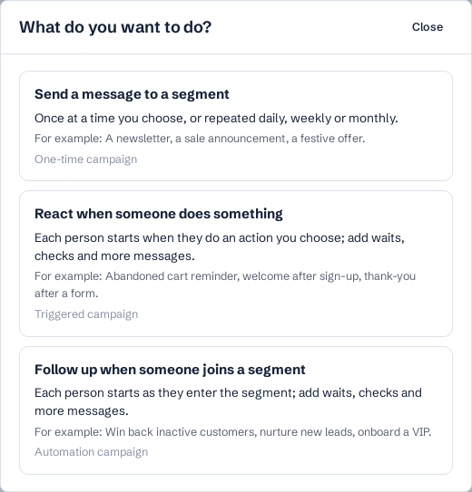

Almost every number in Pulse (a segment's size, a campaign's "Sent to", a dashboard figure) is a
link: click it to see exactly those contacts. Tutorial 18 shows how.

## 4. Add your teammates

1. Go to **Settings → Team** (under *Workspace*). You are listed as **Admin**.

   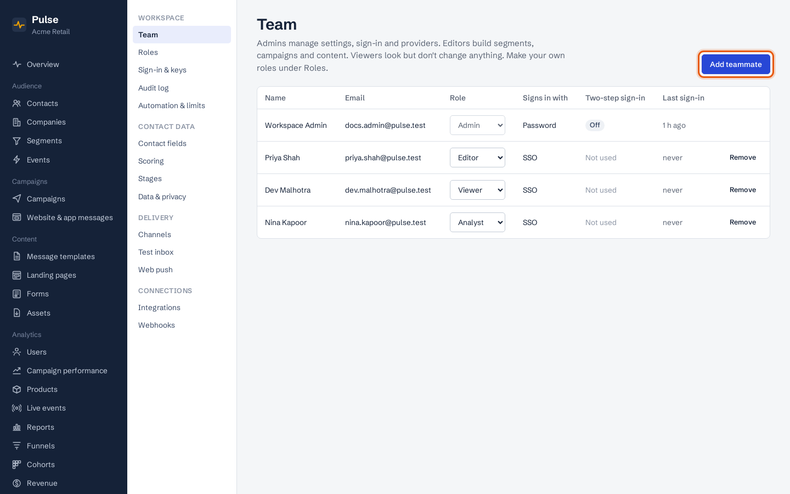
2. Click **Add teammate** and fill in:
   - **Email** and **Name**
   - **Role**: **Admin**, **Editor** or **Viewer** (see the table below)
   - **Temporary password (optional)**: at least 10 characters. Pulse doesn't email anyone, so share
     the workspace ID, their email and this password with them privately. Leave it empty if they
     will only sign in with SSO.
   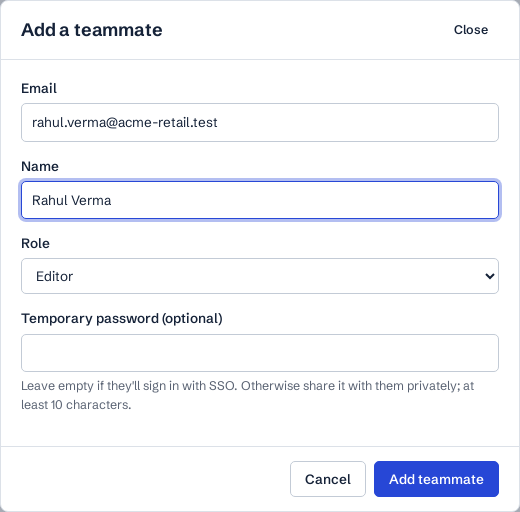

3. Click **Add teammate**. They appear in the list with **Last sign-in: never** until they sign in.

To change someone's role later, pick a new one in their **Role** column. **Remove** takes their access
away. (You can't remove yourself.)

| Built-in role | Can |
|---|---|
| **Admin** | Everything, including team, sign-in, keys and channels |
| **Editor** | Build and launch everything; can see but not change settings and channels |
| **Viewer** | See everything except settings; change nothing |

## 5. Make a custom role (optional)

When the built-in roles don't fit, say a copywriter who should only touch content:

1. Go to **Settings → Roles** and click **New role**. The page first compares the built-in roles.

   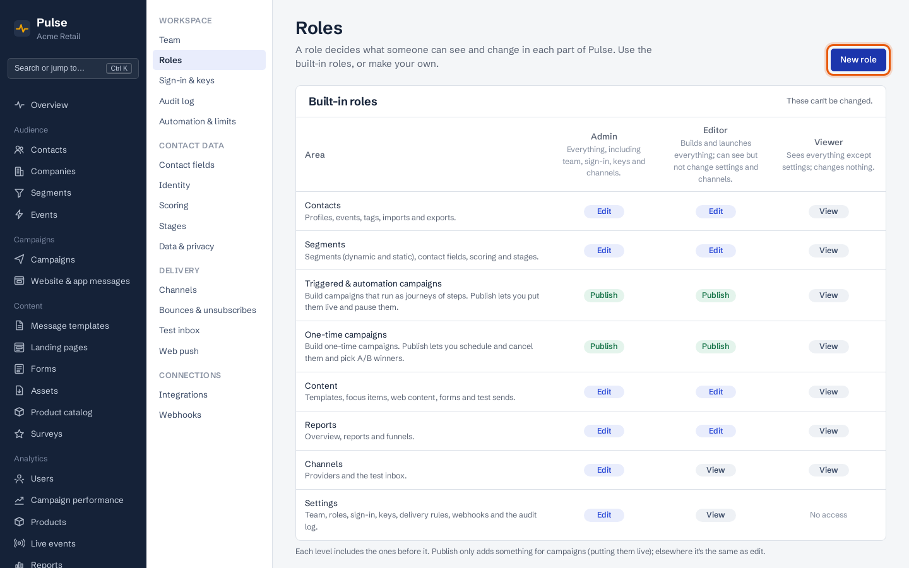
2. Enter a **Name** (e.g. `Content writer`) and a **Description**.
3. **Start from** copies a built-in role's access, which you can then change.
4. Under **Access**, choose a level for each area: **None**, **View**, **Edit**, and for
   **Triggered & automation campaigns** and **One-time campaigns** also **Publish**, which is what lets
   someone go live, pause, schedule or cancel. Each level includes the ones before it. For a content writer: **Content: Edit**, **Reports: View**, the rest
   **None**.
   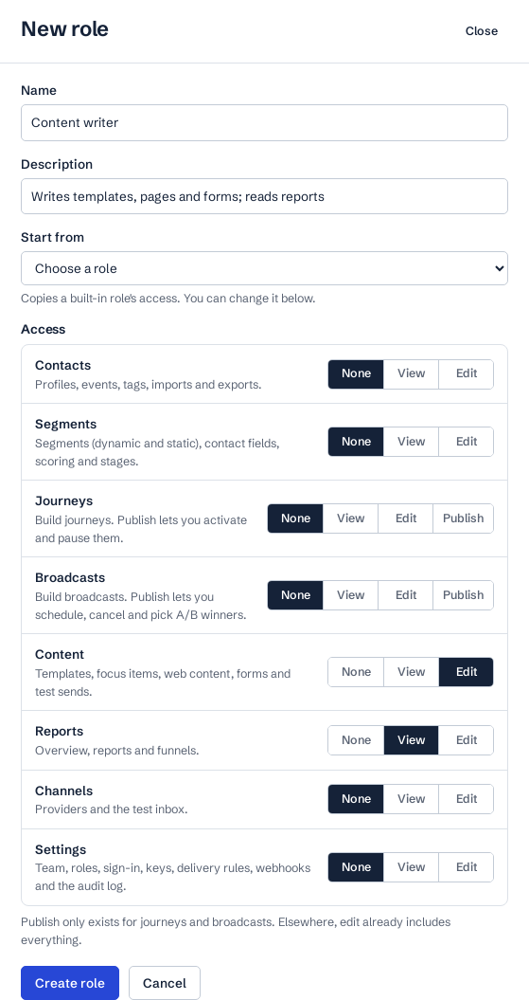

5. Click **Create role**. It now appears in the **Role** list on **Settings → Team**.

> Some campaign steps need more than campaign access. A triggered or automation campaign that deletes
> contacts, removes Do Not Contact or changes owners and companies also needs **Contacts: Edit**.

## 6. Connect your website

This lets Pulse record page views, recognise visitors when they sign in, and show on-site content.

1. Go to **Settings → Sign-in & keys** and scroll to **Your website**.

   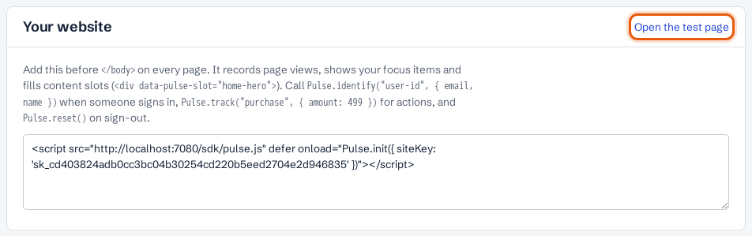
2. Copy the snippet. It looks like this, with your own site key:

   ```html
   <script src="http://localhost:7080/sdk/pulse.js" defer
           onload="Pulse.init({ siteKey: 'sk_…' })"></script>
   ```

3. Paste it just before `</body>` on every page of your site.
4. In your site's code, tell Pulse who people are and what they do:

   ```js
   // when someone signs in
   Pulse.identify("cust-0001", { email: "asha@example.com", name: "Asha Rao" });
   // when they do something you care about
   Pulse.track("purchase", { amount: 499 });
   // when they sign out
   Pulse.reset();
   ```

The **site key** (`sk_…`) is public: it is meant to be in your web pages. The **server API key**
(`pk_…`) is secret and must never be in a web page.

**No website yet?** Click **Open the test page** in the same section. It loads the snippet with your
site key and has **Identify** and **Track purchase** buttons.

> **Recommended before going live: Identity verification** (same page). Because the site key is
> public, anyone could call `Pulse.identify()` with someone else's ID. With verification on, your
> server signs each user ID with the **Signing secret** and the page passes the result:
> `Pulse.identify(userId, attrs, { userHash })`. Turn on **Require verified identity for web events**
> once your site sends the hash.

## 7. See your first contacts

Using the test page (or your site):

1. Open the page. It says **Events are recorded as: anon-…**: you are an anonymous visitor.
2. Type an ID such as `cust-0001` in the box and click **Identify**, then **Track purchase**. It now
   says **Events are recorded as: cust-0001**.

   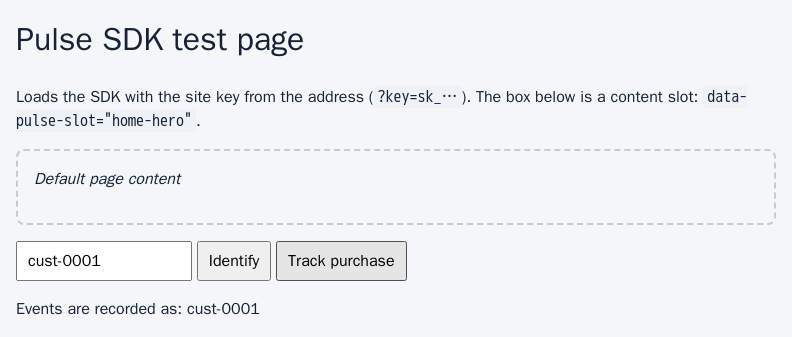
3. In Pulse, go to **Contacts**. Within a few seconds you see **cust-0001**.

   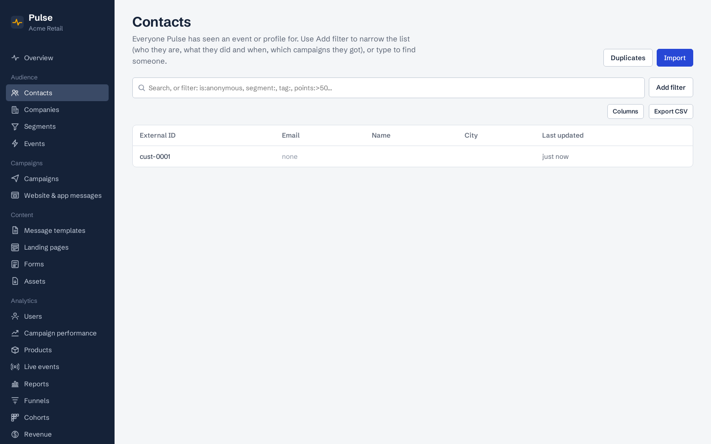
4. Type `is:anonymous` in the search box and press Enter: **0 contacts**. Your anonymous visit wasn't
   lost: when you identified, Pulse merged the anonymous visitor into `cust-0001`, so its page views
   are now part of that contact's history. Click **×** on the chip to clear the filter.

   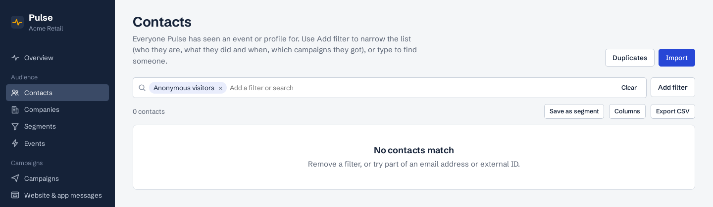
5. Click **cust-0001** to open the profile: segments, owner, stage and company, tags and points, the
   messages they agreed to, attributes (device, locale, first seen…) and the **Activity** list of
   events, including the merge of the anonymous visitor. **Open full page** shows everything about them
   (tutorial 2).

   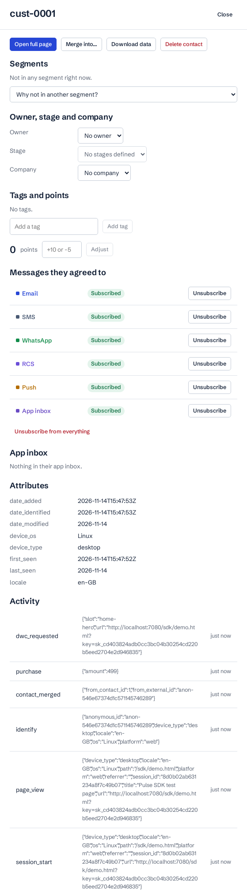

6. **Overview** now shows the events under **Live**, the contact in the counts, and the events under
   **Most frequent events**. The parts below the counts (**Audience**, **One-time campaigns**) are
   refreshed once a minute, so the new contact shows under **contacts added** a minute later.

   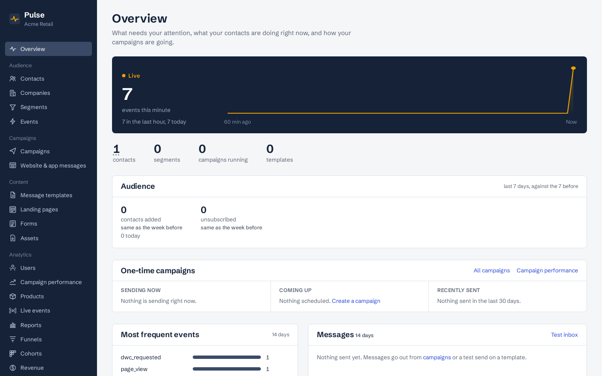

Anonymous tracking is on by default. To turn it off, go to **Settings → Data & privacy**. To delete
anonymous visitors after a period without activity (off by default), go to **Settings → Automation &
limits → Anonymous visitors**.

## 8. Send data from your server (optional)

Your backend can send the same events with the server API key, for things that happen outside the
browser (a payment, a subscription renewal):

```bash
curl -s -X POST http://localhost:7080/v1/events \
  -H "Authorization: Bearer pk_…" \
  -d '{"events":[
    {"external_id":"cust-0001","name":"identify","email":"asha@example.com","attrs":{"city":"Pune"}},
    {"external_id":"cust-0001","name":"purchase","props":{"amount":499}}]}'
```

Use the same `external_id` as on your website, so both land on one contact. To replace a lost or
leaked key: **Settings → Sign-in & keys → Keys → Replace API key**. Pulse asks you to confirm, then
shows the new key once. The old key stops working right away (within a minute if you run several Pulse
servers), so put the new key on your servers straight away.

## What you have now

- A workspace, and teammates with the access they need
- Your website (or the test page) sending page views and events
- Your first contact, with anonymous activity merged in

**Next:** Tutorial 2, Contacts: import a CSV, add contact fields, and filter your contacts.
