# Tutorial 2: Contacts

In about 25 minutes you will find your way around the contact list and a contact's profile (the quick
panel and the full contact page), define the fields your team uses, import a CSV of customers into a
static segment, filter the list and save a view as a segment, export it, merge duplicates, and link
contacts to companies.

**You need:** a workspace with some contacts (tutorial 1) and access to edit contacts (the **Admin**
or **Editor** role). For the import, use the sample file
[`files/sample-contacts.csv`](files/sample-contacts.csv): eight customers from a store opening in Pune.

---

## 1. The contact list

Go to **Contacts** (under *Audience*). Everyone Pulse has seen an event or a profile for is here,
newest first, 50 at a time (**Load more** at the bottom fetches the next 50).

| Part | What it does |
|---|---|
| Search box | Filters and quick find (step 7) |
| **Add filter** | Narrow the list by answering a plain question: who they are, what they did and when, which campaigns they got (step 7) |
| **Duplicates** | Contacts that share an email or phone number (step 10) |
| **Import** | Import a CSV (step 5). Only for roles that can edit contacts |
| **Columns** | Choose the columns of the list (step 9) |
| **Export CSV** | Download the list as it is filtered now (step 9) |

Click any row to open that contact's profile.

> **Lists opened from a number.** Most numbers in Pulse (a segment's size, a campaign's "Sent to", a
> dashboard figure) are links. Clicking one opens this page already filtered to exactly those
> contacts, with the filters shown as chips in words, such as *Campaign “Spring catalogue”* and
> *Opened*. [Tutorial 18](18-contacts-behind-a-number.md) explains these lists.

## 2. A contact's profile

The profile opens as a panel on the right: the quick view, for a look or a change. **Open full page**
at the top shows everything about the person on a page of its own ([below](#the-full-contact-page)).
From top to bottom, the panel has:

- **Open full page**: the full contact page (below).
- **Merge into…**: fold this contact into another one (step 10).
- **Download data** and **Delete contact** (with **Contacts: Edit**): a JSON file of everything Pulse
  keeps about the person, and permanent deletion after you type `DELETE`. Both are for privacy
  requests ([tutorial 11](11-admin-and-privacy.md#5-a-persons-data-see-it-export-it-erase-it)).
- **Segments**: every segment the contact is in right now, dynamic and static. Click one (**· why?**)
  to see why; **Why not in another segment?** checks any other dynamic segment (below).
- **Owner, stage and company**: three drop-downs (step 3).
- **Tags and points**: the contact's tags and score (step 4).
- **Lists and choices**: the contact's list and choice fields (below), when you have defined some.
- **Messages they agreed to**: consent per channel (step 4).
- **Attributes**: every profile field, such as `city`, `plan` or `first_seen`.
- **Activity**: the contact's events, newest first. Every change you make in the profile is
  recorded here too (`tag_added`, `points_changed`, `stage_changed`, `owner_changed`, …).

 

The panel refreshes every few seconds, so a new event or segment shows up while you look. Click
**Close** (or outside the panel) to go back to the list.

Pulse keeps a few attributes itself, such as `email_domain` and `phone_country`: the country of the
mobile number (`IN`, `GB`, `US`, `AE`, …), worked out from its country code. It is set only for
numbers written in international form, with `+` or `00` (`+91 98200 11001`, `0044 7700 900123`); a
national number such as `98200 11001` has no country.

### Lists and choices

List and choice fields (step 5) have their own section. A **list** shows its values as chips, e.g.
the products a customer bought; a **choice** shows its option's label, e.g. **Silver**.

With **Contacts: Edit**, click **Edit** next to a field: for a list, type a value and press
**Enter** to add it (**×** removes one); for a choice, pick an option or **Not set**. Click
**Save**; the profile shows the change within a second or two.

### Why is this contact in a segment?

Click a segment under **Segments** (each says **· why?**). A box opens below with the segment's
rule, filter by filter:

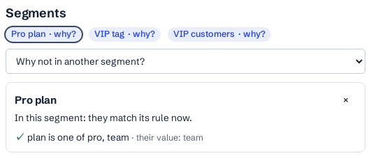

- A first line with the verdict, e.g. **In this segment: they match its rule now.**
- One line per filter and group, with **✓** (matches) or **✗** (doesn't), the contact's own value
  (*their value: team*) or, for event filters, how many matching events they have.
- **?** marks an event filter whose period starts more than a year ago: the periodic sweep checks
  it, not this box.

To find out why someone is **not** in a segment, choose it in **Why not in another segment?** (it
lists the dynamic segments the contact isn't in):

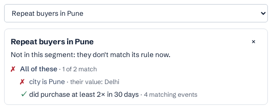

Here the customer bought often enough but lives in Delhi. For a static segment the box says whether
the contact was added to it; for a segment refreshed daily (tutorial 3) it can say the contact
matches now but joins at the next refresh. **×** closes the box.

### The full contact page

Click **Open full page** in the panel (or go to `/contacts/<external ID>`). The page shows the
contact's name and external ID with **Merge into…**, **Download data** and **Delete** at the top,
then a line of facts: **External ID**, **Email**, **Name**, **Stage**, **Owner**, **Created**,
**Updated** and **Last active**. **Contacts** (top left) goes back to the list.

The right-hand column keeps the panel's sections: owner, stage and company, tags and points,
consent, lists and choices, **Devices** (the push devices registered for them), app inbox and
attributes. The main part has three tabs.

**Overview** answers "can we reach this person, and what do they do?":

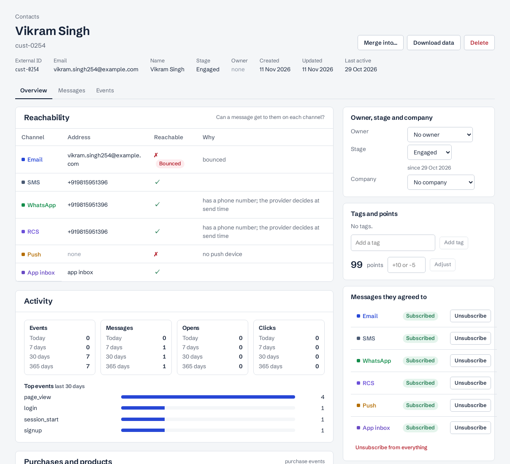

- **Reachability**: one row per channel with the **Address** Pulse would use, whether a message can
  get to them (**✓** or **✗**, with **Opted out** or **Bounced** when that's the cause) and **Why**,
  in words: no phone number, unsubscribed, a hard bounce…
- **Activity**: how many **Events**, **Messages**, **Opens** and **Clicks** they had **Today**,
  in **7 days**, **30 days** and **365 days**, and their **Top events** of the last 30 days.
- **Purchases and products**: their purchases with the total spent, and the products list field.
- **Journeys**: the triggered and automation campaigns they are in or went through, with the
  **Status**, the **Step** they are at, when they **Entered** and when it was last **Updated**.
  **Current** marks the ones still running for them.
- **Segments**: the same **· why?** and **Why not in another segment?** as in the panel.

**Messages** lists every message Pulse sent them, newest first:

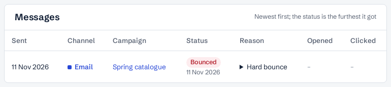

| Column | Shows |
|---|---|
| **Sent** | When (hover for the exact time) |
| **Channel** | Email, SMS, WhatsApp… |
| **Campaign** | The campaign (a link to it) and the step that sent it. Roles that can't view that kind of campaign see no name |
| **Status** | How far it got: **Sent**, **Delivered**, **Opened**, **Clicked**, **Read**, or what stopped it: **Bounced**, **Spam complaint**, **Failed**, **Opted out**, **Over limit**… Hover to see the other steps it went through |
| **Reason** | For a message that didn't arrive, why, in words (**Hard bounce**, **Not reachable on this channel**…). Click it to see what the provider said |
| **Opened**, **Clicked** | **✓** when they did (with the number of clicks) |

**Events** is their full event history. Choose **All**, **Their activity** (what they did) or
**Pulse events** (what Pulse recorded: messages, segment changes, campaign steps), or type event names
separated by commas and click **Filter** (or click a name under the box). Click an event to see its
properties.

## 3. Owner, stage and company

Under **Owner, stage and company**, each drop-down saves as soon as you pick a value, and a message
at the bottom of the screen confirms it.

| Drop-down | Choices | Notes |
|---|---|---|
| **Owner** | **No owner** or a teammate | The teammate responsible for this contact. Filter with `owner:me` (step 7). People who can't view settings only see the current owner |
| **Stage** | Your lifecycle stages (Settings → Stages, see tutorial 3) | Shows *since …* when it last changed. If no stages exist it says **No stages defined** |
| **Company** | **No company** or one of your companies | **Open** goes to the company. The company's fields appear below as `company_…` (step 11) |

## 4. Tags, points and consent

**Tags** are short labels such as `vip` or `gift-cards`.

1. Type a tag in **Add a tag** (letters, digits, `-` and `_`, up to 64 characters; the box suggests
   tags already in use) and click **Add tag**.
2. To remove a tag, click **×** on it.

**Points** are the contact's score. Scoring rules add points automatically when contacts do certain
events (tutorial 3); here you change them by hand:

1. Type a whole number in the box next to the points, e.g. `+10` or `-5` (`25` works too).
2. Click **Adjust**. The number above changes within a second or two.

**Messages they agreed to** lists every channel (Email, SMS, WhatsApp, RCS, Push, App inbox) as
**Subscribed** or **Unsubscribed**. **Unsubscribe** and **Subscribe** change one channel;
**Unsubscribe from everything** (it asks you to confirm) stops all messages on every channel.
Every campaign respects these settings.

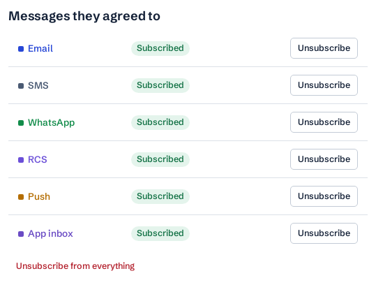

> Subscribing a contact to one channel again also lifts an "everything" unsubscribe, so that
> channel works.

## 5. Define your contact fields

Pulse keeps any field you send, without setup. Defining a field gives it a label and a type, which
helps in two places: the segment builder offers the right comparisons (numbers get *greater than*,
dates get *in the last … days*), and imports check and convert the values.

1. Go to **Settings → Contact fields** (under *Contact data*). Defined fields are listed first;
   below, **Seen on contacts, not defined yet** shows fields your contacts already have. Click one
   of those to define it.

   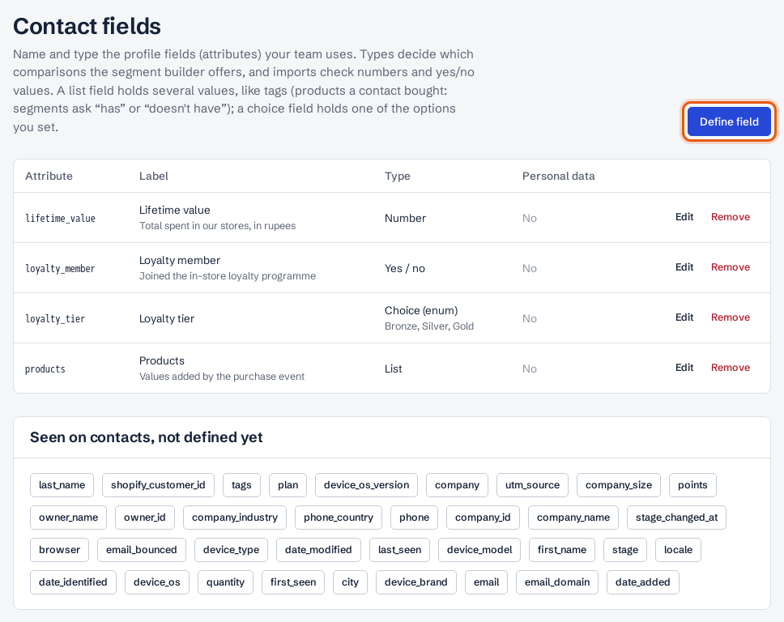
2. Click **Define field** and fill in:
   - **Attribute key**: as it appears in events and files, e.g. `lifetime_value` (letters, digits
     and `_`, starting with a letter or `_`). It can't be changed later.
   - **Label**: e.g. `Lifetime value`
   - **Type**: **Text**, **Number**, **Yes / no**, **Date**, **List** or **Choice (enum)** (below)
   - **Description** (optional), and **Holds personal data** for phone numbers, addresses, birthdays
3. Click **Save attribute**.

   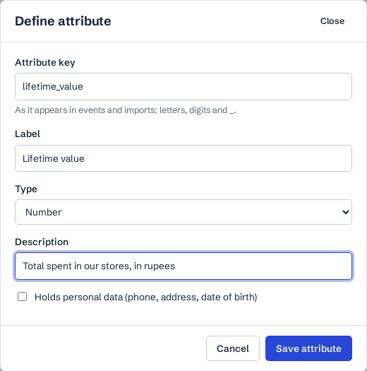

For the sample file, define two fields:

| Attribute key | Label | Type |
|---|---|---|
| `lifetime_value` | Lifetime value | Number |
| `loyalty_member` | Loyalty member | Yes / no |

**Remove** deletes only the definition; the values on contacts stay.

### List and choice fields

- A **List** field holds several values, like tags: the products a customer bought, the stores they
  visited. In segments it is **has** / **doesn't have** a value. Send it as a JSON array
  (`"products": ["KIT-101", "BED-404"]`); in an import, separate the values in the cell with `|` or
  commas (`KIT-101|BED-404`). An event can also add to it on every event, e.g. each purchase adds its
  product codes ([tutorial 12](12-events-and-properties.md#11-fill-a-contacts-list-from-events)).
- A **Choice (enum)** field holds one of a set of **Options**. Each option has a value (what your
  data sends, e.g. `gold`) and a label people see (`Gold`); **+ Add option** adds one. In segments
  the value is a drop-down of the options.

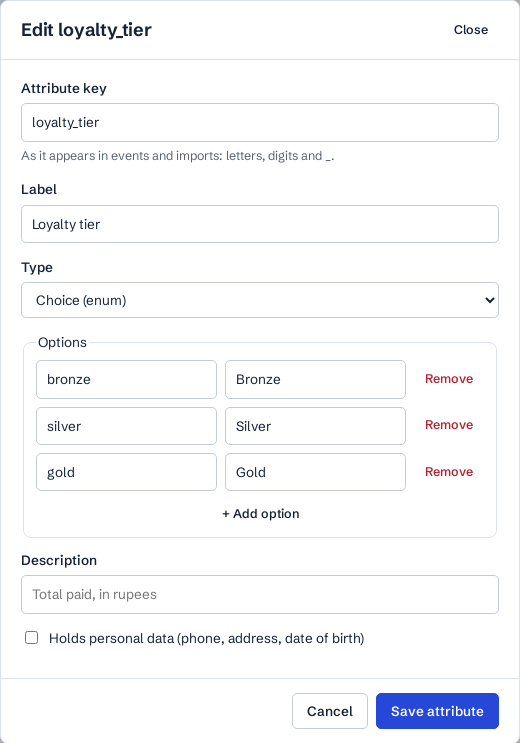

In the list, a choice field shows its options under its type, e.g. **Choice (enum)** · *Bronze,
Silver, Gold*. Acme Retail has two of these: **Products** (a list filled from purchases) and
**Loyalty tier** (a choice).

## 6. Import a CSV

Go to **Contacts → Import**. The import has four steps, shown at the top: **Upload**, **Map
columns**, **Static segment**, **Review**.

**What the file needs:** a first row that names the columns, and in every row an external ID or an
email (the email then becomes the ID). Files can be up to 10 GB. Existing contacts are updated, and
empty cells leave the values a contact already has.

### Upload

1. Drop the CSV file on the box, or click **Choose File** and pick `sample-contacts.csv`. Its name
   and size appear.
2. Click **Next**.

   

### Map columns

Each column of your file is a row here, with a few example values. Under **Import as**, Pulse has
already guessed:

| Your column | Import as | Why |
|---|---|---|
| `customer_id` | **External ID** | `id`, `user_id`, `customer_id` and `contact_id` are recognised |
| `email` | **Email** | also `e_mail`, `email_address`, `mail` |
| `mobile` | **Phone (international format)** | also `phone_number`, `mobile_number`, … Spaces, dashes and brackets are removed, so `+91 98200 11001` becomes `+919820011001`, and Pulse sets `phone_country` (`IN`) from the `+91` |
| `lifetime_value`, `loyalty_member` | **Lifetime value**, **Loyalty member** | the fields you defined in step 5 |
| `first_name`, `last_name`, `city`, `plan` | **New field: …** | fields without a definition; created as text, marked *new field* |
| `tags` | **Tags to add (separated by ;)** | `store-pune;diwali-2026` adds two tags |

A column mapped to a **List** field may hold several values separated by `|` (or by commas when the
cell has no `|`): `KIT-101|BED-404`. Blanks and repeats are dropped.

3. Set **notes** to **Don't import**: those are the store's own remarks.
4. Click **Next**. If something is wrong, Pulse lists it in red under the table and **Next** stays
   off: no column mapped to External ID or Email, two columns mapped to the same field, or a field
   name with characters other than letters, digits and `_`.

   

### Static segment

A static segment holds exactly the contacts you put in it; it is handy for "everyone in this file".

5. Choose one of:
   - **Don't add them to a segment**
   - **Add them to a static segment**, then pick it from the list
   - **Create a new static segment** and type a name, here `Pune store opening guests`
6. Click **Next**.

   

### Review and start

7. Check the file, the columns that will be imported (and how many are skipped) and the segment.
8. Tick **These people agreed to hear from us.** Only import people who did. If your file has
   unsubscribe columns such as `optout_email` (with `true`, `yes` or `1`), Pulse respects them.
9. Click **Start import**.

   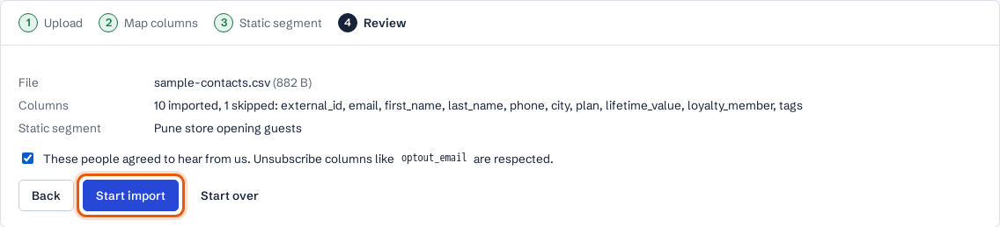

While the file uploads you see a progress bar and **Cancel upload**: keep the page open until it
finishes. After that the import runs on the server in the background, and you can leave the page.

### Import history

The import appears under **Import history** with its status: **Uploading**, **Waiting**,
**Importing**, then **Done** (or **Failed** or **Cancelled**), how long it took, and how many rows
were **Imported** and **Skipped**. **Cancel** stops a running import; rows already imported stay.

The sample file gives **6 imported, 2 skipped**. Click **Show errors** to see why:

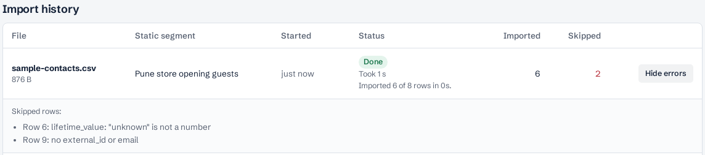

- **Row 6: lifetime_value: "unknown" is not a number.** Because `lifetime_value` is defined as a
  Number, Pulse checks it and skips the row rather than store bad data. Fix the cell and import the
  file again: rows already imported are just updated.
- **Row 9: no external_id or email.** A row needs one of them.

Row numbers count the heading row as row 1, like a spreadsheet. The list shows up to 50 skipped rows.

Go back to **Contacts**: the new contacts (`store-1001` to `store-1007`, without Farah) are at the
top, and each is in the segment **Pune store opening guests**.

> **A `tags` column adds tags.** The tags in the cell are added to the ones the contact already has;
> nothing is removed. To take a tag away, use the contact's profile or a campaign's
> **Modify contact's tags** step.

## 7. Filter your contacts

### Add filter: filters as plain questions

Next to the search box, click **Add filter**:

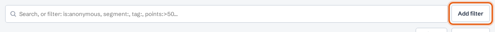

The **Add a filter** window lists every filter as a plain question, in three groups:

| Group | Filters |
|---|---|
| **Who they are** | **Contact type** (identified, anonymous, unsubscribed, bounced, Do Not Contact), **In a segment**, **Not in a segment**, **Has a tag**, **Lifecycle stage**, **Works at a company**, **Owner**, **Points** (more than, less than, exactly, at least), **Email contains**, **Name contains** |
| **What they did** | **Did an event** and **Didn't do an event** (between two dates; *Did an event* optionally for one **Product code**), **Was active** (anywhere, on the website, Android or iOS, for the first time or coming back, between two dates, optionally from one `utm_source`), **Submitted a form** (between two dates) |
| **Campaigns and channels** | **Got a campaign** and what happened (was in the audience, was sent it, got it, opened it, clicked in it, unsubscribed, bounced, marked it as spam, failed or was skipped), optionally between two dates; **In a triggered or automation campaign** (entered it, still in it, finished it, reached its goal, left it early); **Can be reached by**, **Not unsubscribed from** and **Not held back by the frequency cap** on a channel |

Pick a question on the left and fill in its fields on the right. Dates start at the last 30 days.
For example, everyone who bought in the first two weeks of November: **Did an event**, **Event**
`purchase`, **From** 1 Nov, **To** 14 Nov.

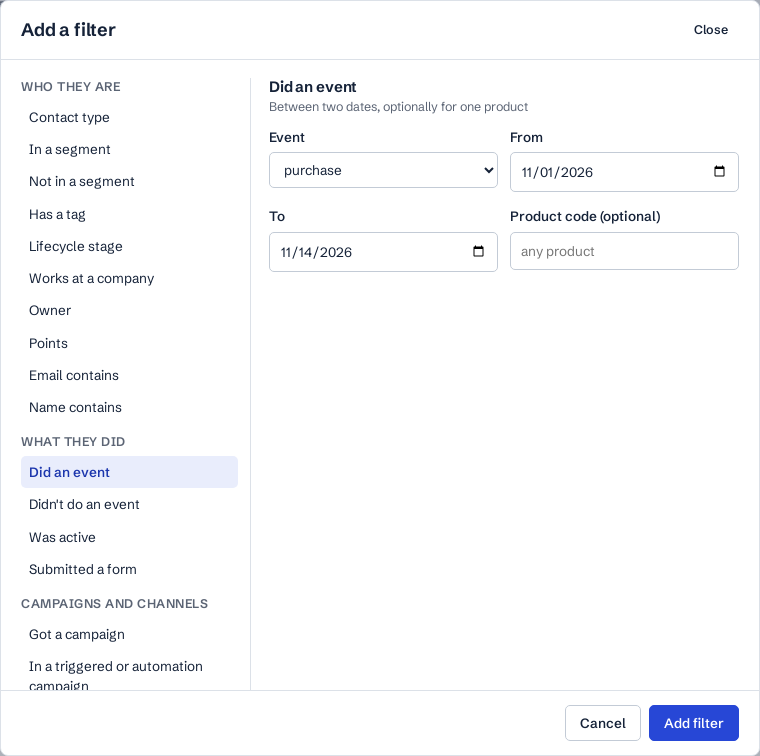

Click **Add filter**. The filter appears in the search box as chips in words, here **Did purchase**
and **Between 1 Nov and 14 Nov 2026**, and the list and its count change at once:

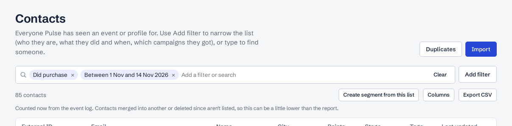

Add more filters the same way: they all have to match. A filter that can be used only once per list
(the dates, a campaign and what happened, a channel) replaces the earlier one. Remove a filter with
**×** on its chip.

### Type filters in the search box

You can also type filters. Type in the search box. Words like `key:value` become **filters**, shown as chips; anything else is a
quick search. As you type, suggestions appear: type `is:` and pick one with the arrow keys and
**Enter**, or click it.

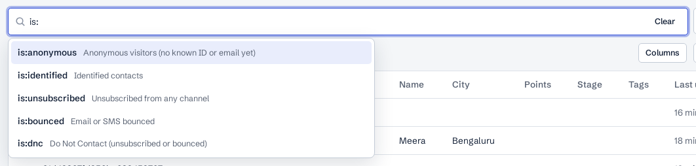

| Filter | Shows contacts who |
|---|---|
| `is:anonymous` | have no known ID or email yet (website visitors) |
| `is:identified` | are known: an ID, email or phone |
| `is:unsubscribed` | unsubscribed from any channel, or from everything |
| `is:bounced` | had an email or SMS bounce |
| `is:dnc` | are "Do Not Contact": unsubscribed or bounced |
| `segment:"Pune store opening guests"` | are in that segment, dynamic or static (by name or ID) |
| `tag:vip` | have the tag |
| `stage:Lead` | are in the stage |
| `company:"Northwind Traders"` | work at the company (by name or ID) |
| `owner:me`, `owner:none`, `owner:"Priya Shah"` | are owned by you, by nobody, or by a teammate (name, email or ID; naming a teammate needs access to view settings) |
| `points:>50` (also `>=`, `<`, `<=`, `=`) | have more than 50 points. `points:<10` includes contacts with no points |
| `email:@example.com` | have an email that contains the text |
| `name:kavya` | have a name, first name or last name that contains the text |

How filters work:

- Several filters must all match. `tag:vip points:>50` is VIPs with more than 50 points.
- Put a value with spaces in double quotes: `segment:"VIP customers"`.
- **Enter** (or a space after a finished filter) makes the chip. **×** on a chip removes it,
  **Backspace** in an empty box removes the last one, **Clear** removes everything.
- Above the list you see how many contacts match, e.g. **26 contacts** (above 10,000 it says
  *About …*).
- Other text, e.g. `kavya` or `98200`, is a quick search on the external ID, email, name and
  phone, in any case.
- The address bar keeps the filters (`/contacts?q=…`), so you can bookmark a view or send the link
  to a teammate.
- Lists opened by clicking a number elsewhere in Pulse carry more filters (who opened a campaign,
  who is reachable by email, who is at a step of a journey…). They show as chips in words and are
  removed the same way; [tutorial 18](18-contacts-behind-a-number.md) lists them. A short note under
  the bar can say why such a list may differ slightly from the number you clicked.

> `email:` and `name:` look for the text as you typed it, in lower case, and with a capital first
> letter (`kavya`, `Kavya`), not every mix of cases.

## 8. Save a view as a segment

When a filtered view is a group you will use again, keep it as a segment:

1. With the filters in place, click **Save as segment**.
2. Check the name (Pulse suggests one from the filters) and click **Create segment**.

   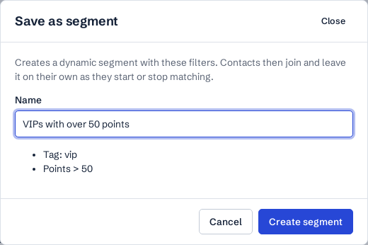 50" width="420">

You land on the new dynamic segment. Contacts join and leave it on their own from now on, as they
start or stop matching. See tutorial 3 for what you can do there.

**Save as segment** is only there for roles that can edit segments, and it is greyed out while the
search box has quick-search text: use `email:` or `name:` instead.

**Create segment from this list.** A list opened from a number (say, everyone who clicked a
campaign) can't become a segment that updates itself. Instead of **Save as segment**, the bar then
offers **Create segment from this list**: it makes a **static** segment of the people in the list
right now (up to 500,000), for example to send them a follow-up. People who match later aren't added.
[Tutorial 18](18-contacts-behind-a-number.md#5-keep-the-list-as-a-segment) walks through it.

## 9. Choose columns and export

1. Click **Columns** and tick what the list should show: **Email**, **Name**, **Phone**, **City**,
   **Points**, **Stage**, **Company**, **Owner**, **Tags**, **Last seen**, **Date added**, **Last
   updated**, plus every field you defined (here **Lifetime value** and **Loyalty member**). External
   ID always shows.
2. Click **Done**. **Reset** goes back to Email, Name, City and Last updated. Your choice is
   remembered in this browser.

To download the list, click **Export CSV**. You get the contacts of the current view (all contacts
when there's no filter) as `contacts-view-<date>.csv` (or `contacts-<date>.csv`). The file has
`external_id`, `email`, `created_at` and `updated_at`, then the columns you chose (Name becomes
`name`, `first_name` and `last_name`). Exporting needs contact edit access, like importing.

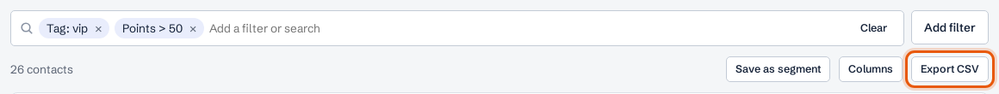

## 10. Find and merge duplicates

The sample file has Kabir Sethi twice: he signed up again at the till and got a second ID
(`store-1006` and `store-1007`, same email).

1. On **Contacts**, click **Duplicates**. Choose **Same email address** or **Same phone number**.
   Each group shows the contacts that share the value.
2. Under **Keep**, choose the contact to keep, here `store-1006`.
3. Click **Merge into store-1006** and confirm. It can't be undone.

   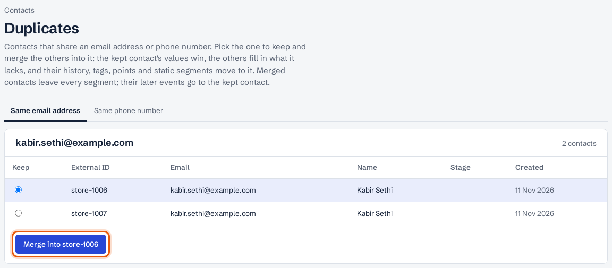

What a merge does:

- The kept contact's values win; the other contact fills in only what the kept one lacks.
- History, tags, points and static segments move to the kept contact.
- The merged contact leaves every segment and its profile says it was merged into the kept one.
  Events that still arrive for it go to the kept contact.

To merge two contacts that don't share an email or phone (say, an old and a new address), open the
one to fold away, click **Merge into…**, search by ID, email, name or phone, choose the contact to
keep and click **Merge**.

## 11. Companies

For B2B, link contacts to the companies they work for. Go to **Companies** (under *Audience*).

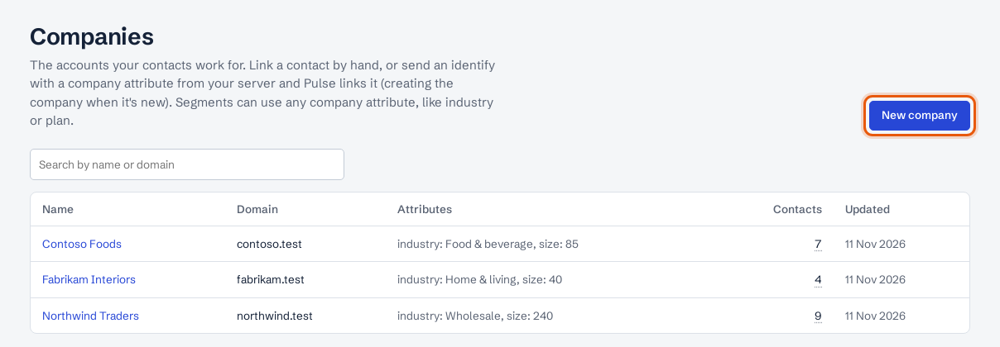

1. Click **New company**, enter a **Name** and a **Domain (optional)**, and click **Create company**.
2. On the company's page, click **Add attribute** to add fields such as `industry` = `Wholesale` or
   `size` = `240`, then **Save**. Each one is copied to the company's contacts as
   `company_<name>` (`company_industry`, `company_size`), within seconds, so segments and
   messages can use them. Numbers and true/false keep their type.
3. Link a contact: open its profile and choose the company under **Company** (step 3). Your server
   can do it too: an identify event with `attrs.company` links the contact, and creates the company
   if it's new.

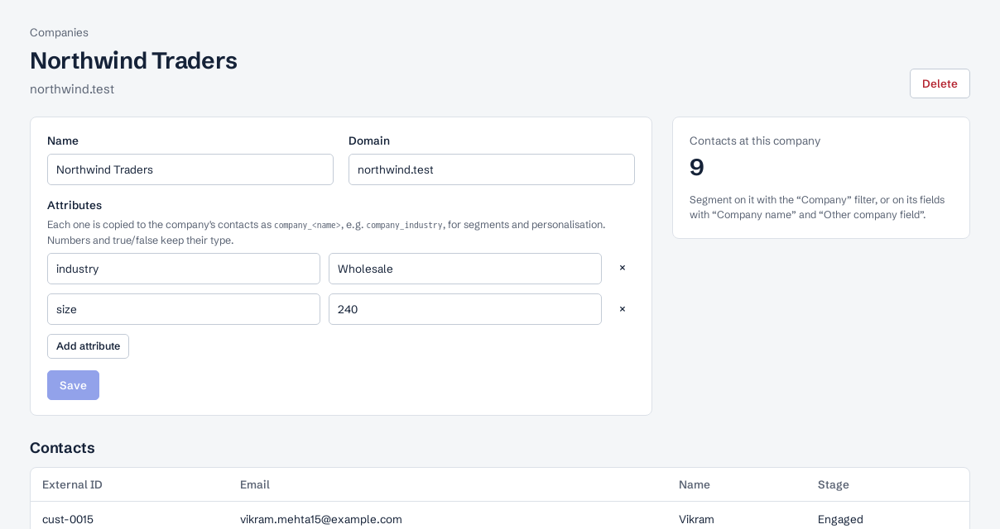

The company page lists its contacts (click one to open it) and counts them on the right. **Delete**
removes the company; its contacts stay, unlinked. In the segment builder, the **Company** group has
**Company** (works at a company), **Company name** and **Other company field** (any `company_…`
field, such as industry).

## What you have now

- Two typed contact fields, `lifetime_value` and `loyalty_member`, and an idea of list and choice
  fields
- Six customers from the store opening, imported into the static segment **Pune store opening
  guests**, and one of them (`store-1001`) with an owner, a stage, tags and points
- A feel for filters, saved views, exports, duplicates and companies, for **· why?** on a contact's
  segments, and for the full contact page with its reachability, messages and events

**Next:** Tutorial 3, Segments: build dynamic segments with the rule builder, manage static ones, and
set up scoring and stages.
