# Tutorial 3: Segments

In about 30 minutes you will build a dynamic segment with the rule builder, work with a static
segment, see membership change in real time, and set up scoring and stages. Then you will use list
and choice fields, phone country, date ranges and an Exclude group, and make a segment that changes
only once a day.

**You need:** tutorial 2 done (it imported the static segment **Pune store opening guests**), and
access to edit segments (the **Admin** or **Editor** role).

---

## 1. Dynamic and static segments

A segment is a group of contacts you send to, start journeys from, or look at. There are two types:

| | Dynamic | Static |
|---|---|---|
| Who is in it | Contacts who match its rules: attributes, events, tags, consent, other segments | Exactly the contacts you put in it |
| How it changes | On its own, the moment an event or a profile change makes a contact match or stop matching (or once a day at a set time, section 9) | When you add or remove contacts: by hand, by importing a CSV, with a journey step, a form or the API |
| Good for | "Bought twice this month in Pune", "VIPs who haven't opened in 90 days" | Event guests, a sales hand-off, a seed list |

Go to **Segments** (under *Audience*). Every segment is listed with its **Type**, **Who's in it**
(the rule in words), the number of **Contacts** (live), its **State** and **View contacts**. Use
**All**, **Dynamic** and **Static** above the list to show one type, and **Find a segment** to search
by name.

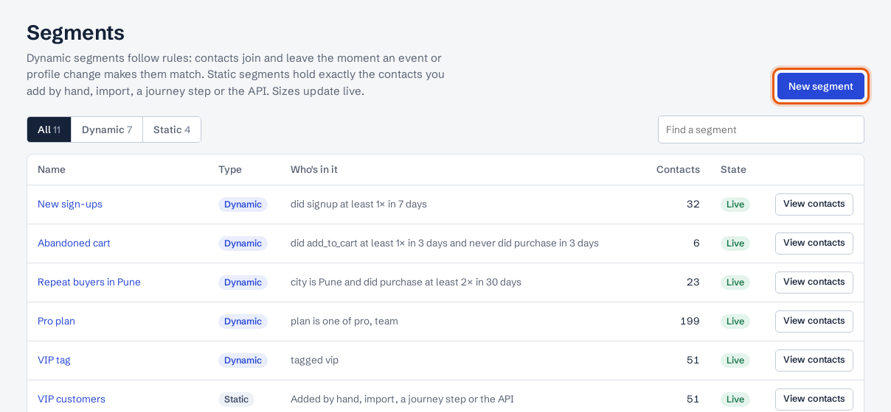

## 2. Create a dynamic segment

We'll build **Pune shoppers to thank**: people in Pune who bought at least twice in the last 30 days
and who are either VIPs or opened the Welcome email.

1. Click **New segment**, choose **Dynamic** and click **Continue**.

   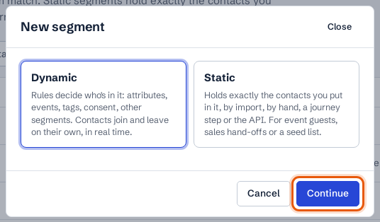
2. Type the **Name**: `Pune shoppers to thank`.

The rule is a box that starts **Contacts who match ALL of the following:**. Change **ALL** to
**ANY** when one filter matching is enough. Between filters the box shows the joining word: **AND**
for ALL, **OR** for ANY.

### Add a filter on a field

3. Click **+ Add filter**. The filter picker opens: a search box, the groups on the left (Contact,
   Company, Location, Device, Consent & deliverability, Behaviour: messages / web / forms & assets
   / journeys / any event, Points & stage, Segments & tags), and your six most recently used filters
   first. Fields you defined show their type after the name (*list*, *choice*, …). Type `city`.

   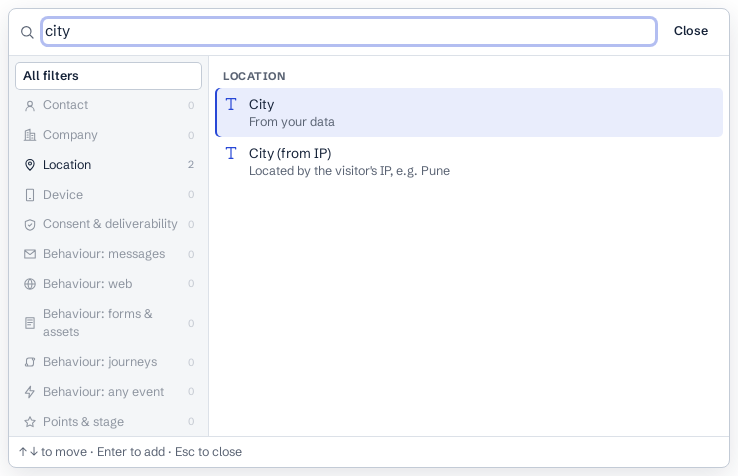
4. Click **City** (or press **Enter**). A row appears: **City** · **is** · a value box.
5. Type `Pune` in the value box.

The comparisons follow the field's type, so define your fields first (tutorial 2, step 5):

| Field type | Comparisons |
|---|---|
| Text | is, is not, contains, doesn't contain, starts with, ends with, is one of, is not one of, is empty, is not empty. The value box suggests values your contacts have |
| Number | is, is not, is greater than, is at least, is less than, is at most, is between, is empty, is not empty |
| Yes / no | is or is not, then **yes** or **no**; also is set, is not set |
| Date | is in the last … days, is more than … days ago, is on, is before, is after, is between (two dates), is set, is not set |
| List (e.g. Products) | has, doesn't have, is empty, is not empty |
| Choice (e.g. Loyalty tier) | is, is not, is one of, is not one of, is empty, is not empty, with a drop-down of the field's options |
| Stage, company, owner | is, is not, is set, is not set, with a list of your own stages, companies or teammates |

To change a filter, click its field button (here **City**) and pick another one; **×** at the end of
the row removes it.

### Add a behaviour filter

Behaviour filters count events: "did *this* at least *N* times in the last *N* days".

6. Click **+ Add filter**, search `did an event` and pick **Did an event**.
7. The row reads like a sentence. In the event list, keep **Another event…** and type `purchase` in
   the box next to it. Then **at least** · `2` · **times in the last** · `30` · **days**.

   | Part | Choices |
   |---|---|
   | Event | Ready-made events grouped as Email; SMS, WhatsApp, RCS; Push, inbox and in-app; Web; Forms, assets, journeys, consent. **Another event…** for your own events such as `purchase` |
   | How often | **at least**, **more than**, **exactly**, **fewer than**, **at most**, **never** |
   | When | **in the last** 1 to 365 **days**, **between** two days, or **since** a day (section 8) |

   **+ Only count events where…** narrows the count by an event property, e.g. `amount` **is
   greater than** `1000` (up to 5 per filter). Nested values take a dotted path (`product.code`), and
   `items[].product_code` matches when **any** item of the `items` list has the value. When the event
   is described by a schema ([tutorial 12](12-events-and-properties.md)), the property box suggests
   its properties and the comparison follows their type: a drop-down of allowed values, numbers,
   dates.

### Add a nested group

8. Click **+ Add group** (the one under the main box). A new box appears inside, set to the opposite
   of its parent: **Match ANY of the following**, with a violet border. Its picker opens at once:
   search `tags` and pick **Tags**. Keep **include** and type `vip`.
9. Inside the group, click **+ Add filter**, search `read a specific email` and pick **Read a
   specific email**. In the row, choose **the email** · **Welcome email**. Keep **at least** `1`
   time in the last `30` days.

   Other message filters work the same way: **Read any email**, **Clicked any link from any email**,
   **Opened an email from a campaign**, **Didn't open an email from a campaign** (good for a
   resend), **Received an SMS**, **Read a WhatsApp message**, and more. In a message filter, the
   first drop-down chooses **the email** (a template), **from campaign**, **not from campaign**,
   **from journey** or **not from journey**.

Next to **+ Add group** is **+ Exclude (none of)**, for contacts to leave out (section 8).

Groups can be nested inside groups, up to 7 levels. **Remove group** deletes a group with its
filters; removing the last filter of a nested group removes the group too.

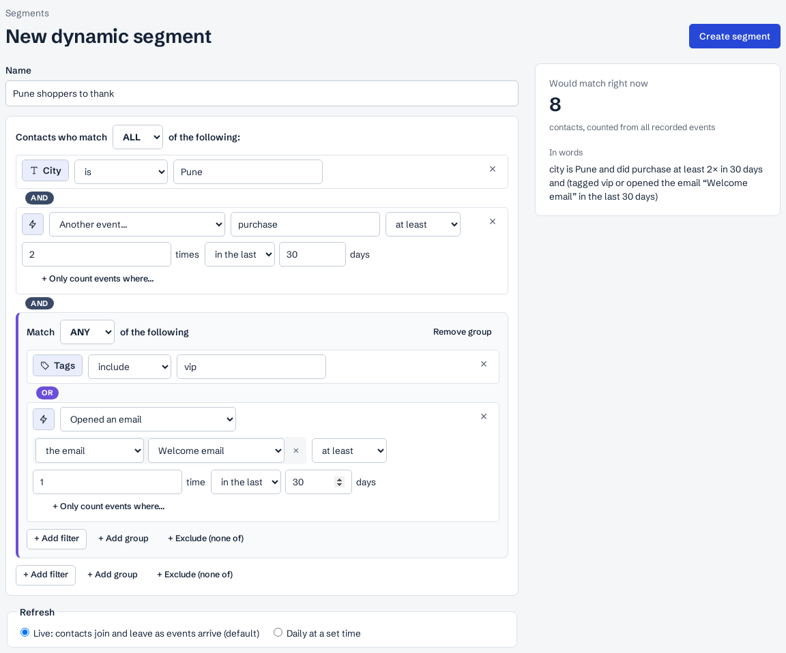

### Check the live count and save

On the right, **Would match right now** shows how many contacts match the rule, counted from all
recorded events. It updates a moment after each change (it dims while counting). **In words**
repeats the rule as a sentence: read it to check you built what you meant. If something is missing
(an empty value, say), a note under the rule says what.

10. Click **Create segment**.

Pulse fills the segment in the background: its **State** is **Queued**, then **Live**, and **In
segment now** shows how many contacts are in it. **Last rebuilt** says when it was last filled
from scratch.

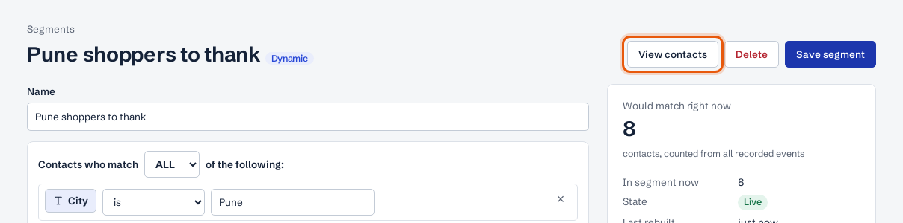

Under the rule, **Refresh** is **Live: contacts join and leave as events arrive (default)**; section
9 shows the other choice, **Daily at a set time**.

To change a dynamic segment later, open it, edit the rule and click **Save segment**: Pulse
rebuilds it. **Delete** asks you to confirm; journeys that start from it stop enrolling.

## 3. View contacts

Click **View contacts** (on the segment's page, or on its row in the list). It opens **Contacts**
filtered to the segment, as the chip **Segment: Pune shoppers to thank**. From there you can add
more filters, choose columns or export the list (tutorial 2, steps 7 to 9).

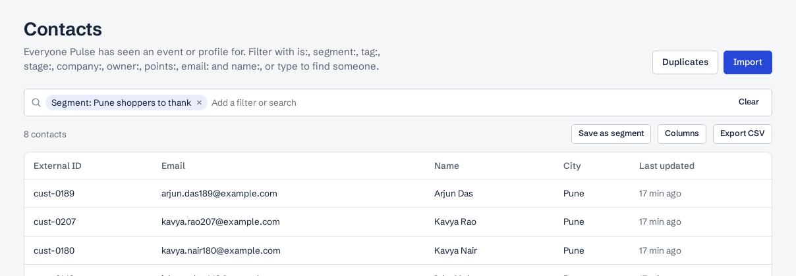

## 4. Membership updates in real time

Dynamic segments don't wait for a nightly or 15-minute rebuild. When an event or a profile change
arrives, Pulse checks that contact against every segment straight away, usually within a second.

Try it:

1. Open **Contacts**, click `store-1004` (imported in tutorial 2) and note its **Segments**.
2. Add the tag `vip`. Within a few seconds **VIP tag** appears under **Segments**, and the **VIP
   tag** segment's count goes up by one.
3. Remove the tag (**×**). The contact leaves **VIP tag** again.

The same happens with events: a Pune VIP's second `purchase` in 30 days puts them in **Pune
shoppers to thank** at once. Leaving because time passes ("in the last 30 days" no longer holds) is
checked on a schedule instead, every 5 minutes by default (`PULSE_SWEEP_INTERVAL`). Journeys that
start when a contact enters a segment react at the moment the contact joins.

Two exceptions: an event filter whose period starts more than a year ago is checked by that sweep,
not at once (section 8), and a segment set to refresh **daily** changes only at its set time
(section 9).

To see why a contact is in a segment, or why not, open the contact and click the segment's
**· why?** ([tutorial 2](02-contacts.md#why-is-this-contact-in-a-segment)).

## 5. Static segments

Open **Pune store opening guests** (choose **Static** above the list to find it). Its page shows
**In this segment now** and **Used by**: the dynamic segments that include or exclude it.

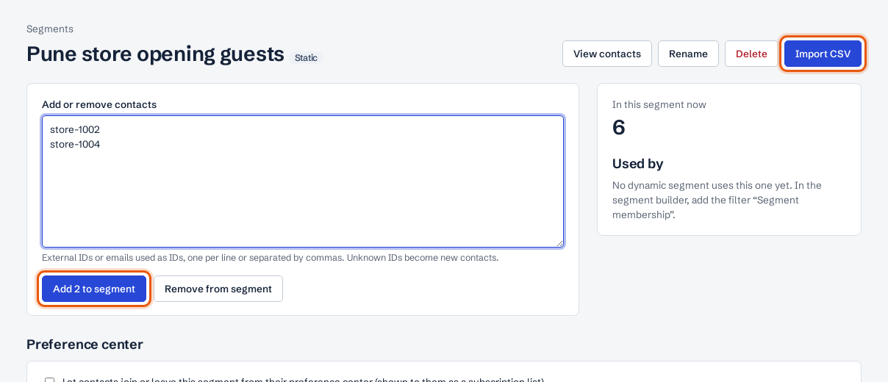

To create one from scratch: **New segment** → **Static** → type a **Name** → **Create static
segment**.

### Add or remove contacts by ID

1. Under **Add or remove contacts**, type external IDs (or emails, where the email is the ID), one
   per line or separated by commas. Up to 10,000 at a time.
2. Click **Add N to segment** or **Remove from segment**. A message confirms how many were taken.
   An ID Pulse doesn't know yet becomes a new contact.

### Import into it

Click **Import CSV**. It opens **Contacts → Import** with this segment already chosen in the
**Static segment** step (tutorial 2, step 6).

### More

- **Rename** changes the name; **View contacts** works as for dynamic segments.
- **Delete** asks you to confirm. Its contacts stay. It is greyed out while a dynamic segment uses
  this one; change that segment first.
- **Preference center**: tick **Let contacts join or leave this segment from their preference
  center**, add a line under **What subscribers get** and click **Save**. Contacts then see it as a
  subscription list they can join or leave.
- A dynamic segment can include or exclude a static one: in the builder, pick **Segment
  membership** → **is in** / **is not in** → the segment.

## 6. Use segments in journeys and broadcasts

- **Broadcasts** (tutorial 7): **Send to** picks a segment. Who is in it is taken at send time.
- **Journeys** (tutorial 6): **Start this journey when a contact** → **enters a segment** enrolls
  each contact the moment they join. The **Contact segments** condition asks **Is the contact in
  this segment?** when the contact reaches it, and the **Modify contact's segments** action adds
  contacts to, or removes them from, static segments.
- **On-site & in-app** (tutorial 8): pop-ups, web content and in-app messages can target a segment.

## 7. Scoring and stages

### Scoring: points for events

Go to **Settings → Scoring** (under *Contact data*).

1. In **When a contact does … give … points**, type the event name, e.g. `review_written`, and the
   points, e.g. `15`. Use a negative number to take points away, e.g. `-20` for `unsubscribed`.
2. Click **Save rule**. Saving an event that already has a rule replaces it; **Remove** deletes one.

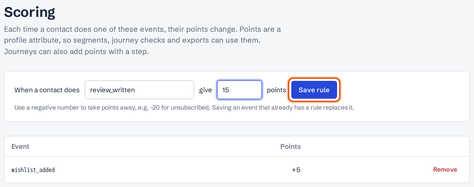

From then on, each time a contact does that event, their points change. You can also change points
by hand in the profile (tutorial 2, step 4) or with the journey step **Adjust contact points**. In segments, filter on
**Points** (group **Points & stage**), e.g. **Points** **is at least** `50`; in the contact list,
`points:>=50`.

### Stages: the lifecycle

Go to **Settings → Stages**. A stage is where a contact is in your lifecycle, for example Visitor →
Lead → Engaged → Customer. Each contact is in one stage at a time.

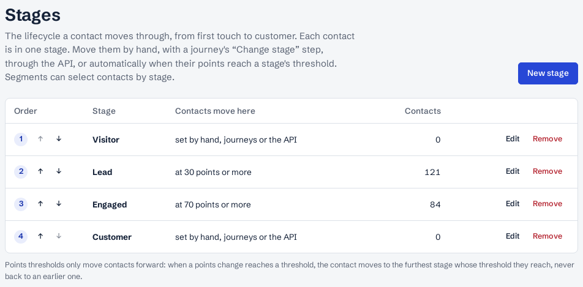

1. Click **New stage** and enter a **Name**, a **Description (optional)** and, if you like, **Move
   contacts here at (points, optional)**. Click **Add stage**. New stages go after the last one; use
   the **↑** and **↓** buttons to reorder.
2. **Edit** changes a stage. Renaming it moves its contacts to the new name within seconds.
3. **Remove** deletes the stage; its contacts keep the old name until they move.

Contacts change stage by hand (the **Stage** drop-down in the profile), with a journey's **Change
contact's stage** step, through the API, or automatically when their points reach a stage's threshold. A
threshold only moves contacts forward, to the furthest stage they reach, never back. Segments use
the **Stage** filter (group **Points & stage**); the contact list uses `stage:Lead`.

## 8. More filters: lists, choices, phone country, dates, Exclude

We'll build **Gold skillet buyers, morning send**: Gold members who bought the skillet `KIT-101`,
with an Indian mobile number, leaving out anyone who bought in the last 7 days.

1. **New segment** → **Dynamic** → **Continue**, and type the name.
2. **+ Add filter** → search `loyalty` → **Loyalty tier** (a choice field). Keep **is** and pick
   **Gold (gold)** in the drop-down: the options' labels, with the value in brackets.
3. **+ Add filter** → **Products** (a list field). Keep **has** and type `KIT-101`. **doesn't
   have** is the opposite; **is empty** means no values at all.
4. **+ Add filter** → **Phone country** (group *Location*). Keep **is** and type `IN`.
5. Click **+ Exclude (none of)** under the main box. A box with a red edge appears: **Leave out
   contacts who match NONE of the following**, *a contact matching any of these is excluded*. Its
   picker opens: pick **Did an event**, type `purchase` and set **in the last** `7` days.

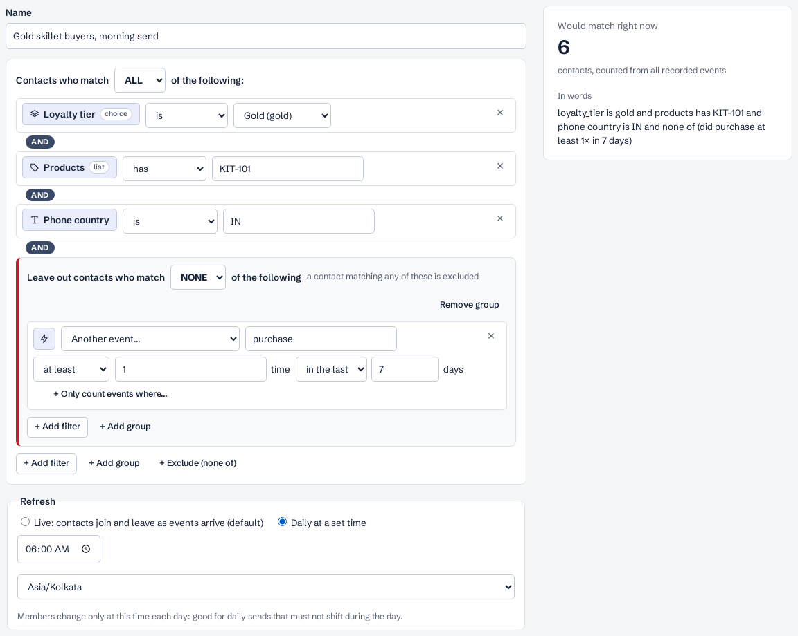

The **In words** box reads *… and none of (did purchase at least 1× in 7 days)*. Any group can be
set to **NONE** with its drop-down (next to **ALL** and **ANY**); **+ Exclude (none of)** is the
quick way. A NONE group can hold several filters and groups: a contact matching **any** of them is
left out.

### Lists, choices and phone country

- **List** fields, such as **Products** (filled from purchases, see
  [tutorial 12](12-events-and-properties.md#11-fill-a-contacts-list-from-events)), work like tags:
  **has** / **doesn't have** one value.
- **Choice** fields, such as **Loyalty tier**, offer their options in a drop-down; **is one of**
  takes several.
- **Phone country** is the two-letter country code of the contact's mobile number (`IN`, `GB`,
  `US`, `AE`, …). Pulse sets it from the number's country code, only for numbers written with `+` or
  `00`.

Define list and choice fields in **Settings → Contact fields** ([tutorial 2](02-contacts.md#list-and-choice-fields)).

### Dates and periods

Date fields such as **Date added** have **is between**, two dates, both included. Event filters have
three periods in the **When** drop-down:

| When | Counts events |
|---|---|
| **in the last** N **days** | in a rolling window, 1 to 365 days |
| **between** a first and a last day | on those days, both included (days in UTC) |
| **since** a day | from that day until now |

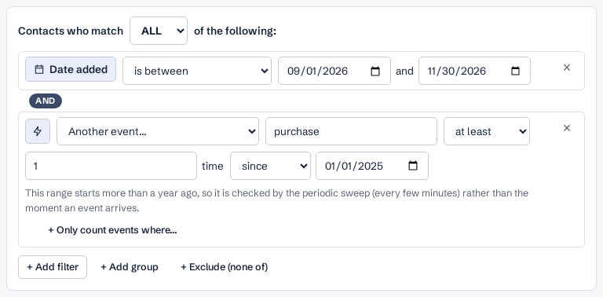

A period that starts more than a year ago shows a note: *This range starts more than a year ago, so
it is checked by the periodic sweep (every few minutes) rather than the moment an event arrives.*
The segment is still right; contacts just join or leave a few minutes later.

## 9. Refresh: live or daily

By default a dynamic segment is **Live**: contacts join and leave as events arrive. For a daily
send that must not change during the day (a morning SMS list, a report), choose a daily refresh:

1. Under the rule, in **Refresh**, choose **Daily at a set time**.
2. Set the time, e.g. `06:00`, and the time zone, e.g. **Asia/Kolkata**.

   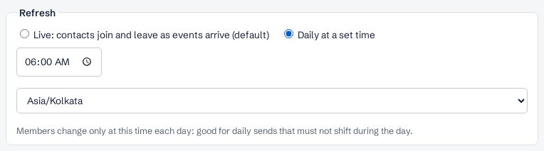
3. Click **Create segment** (or **Save segment**).

Pulse fills the segment once now. After that, its members change only at that time each day,
whatever happens in between. The segment's page shows **Next refresh**, and the list says
**Refreshed daily at 06:00 (Asia/Kolkata)** under the rule:

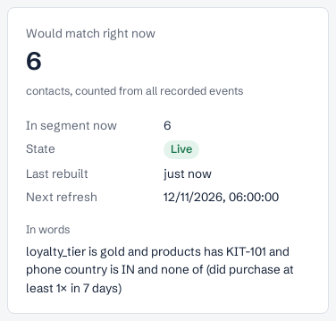

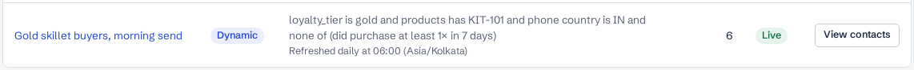

A contact who starts matching during the day joins at the next refresh; the contact's **· why?**
says so. Switch back to **Live** and save to follow every event again.

## What you have now

- A dynamic segment, **Pune shoppers to thank**, built with a nested group and a behaviour filter
- A static segment you can add to by ID or by import
- A scoring rule, and an idea of how points move contacts through stages
- A daily segment, **Gold skillet buyers, morning send**, with list and choice fields, phone country
  and an Exclude group

**More:** [tutorial 12](12-events-and-properties.md) describes events and their properties, for
typed property filters.

**Next:** Tutorial 4, Channels: connect email, SMS, WhatsApp, RCS and push, and send a test.
