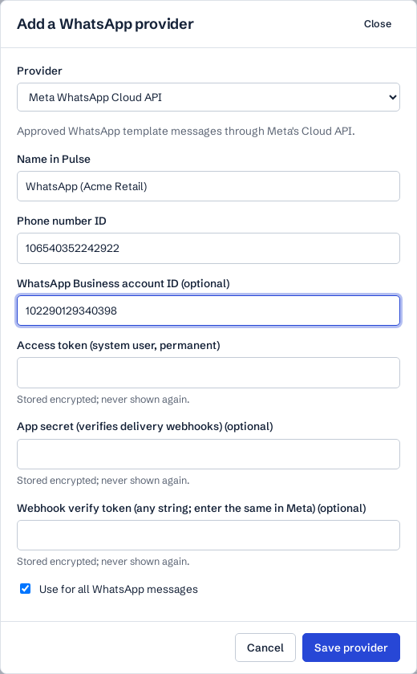
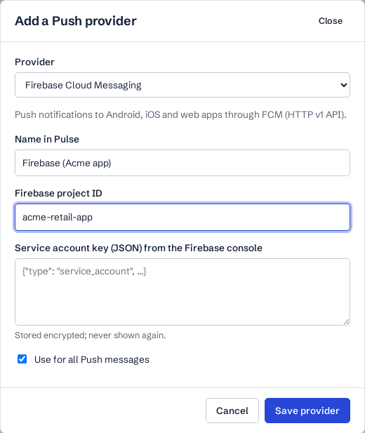
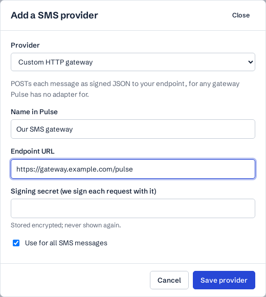
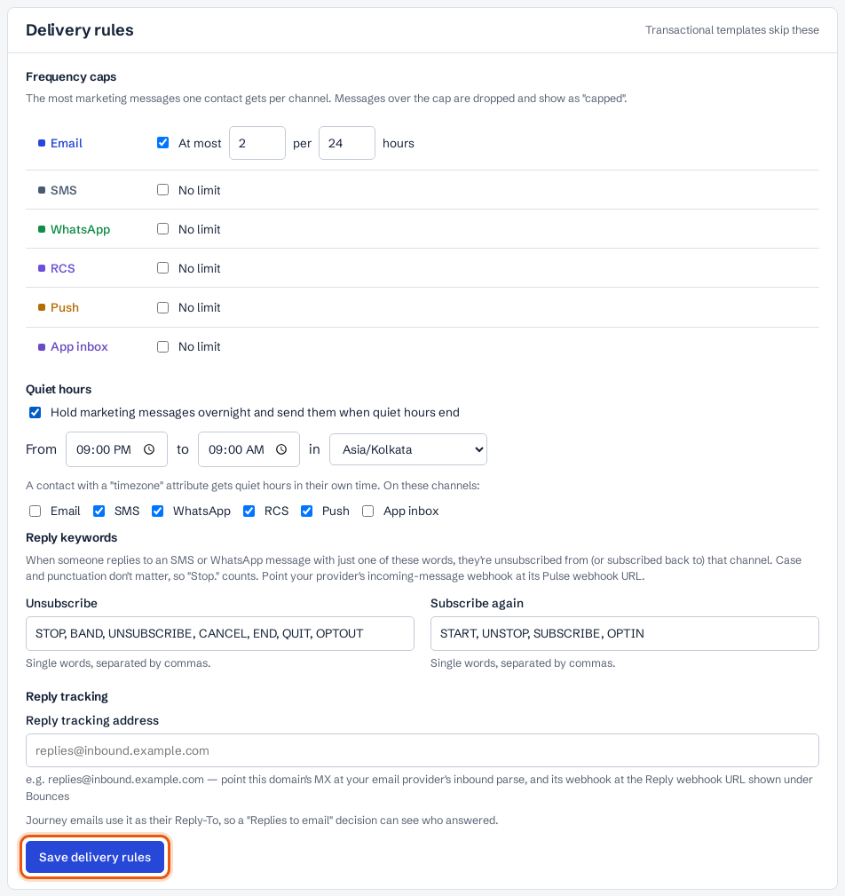
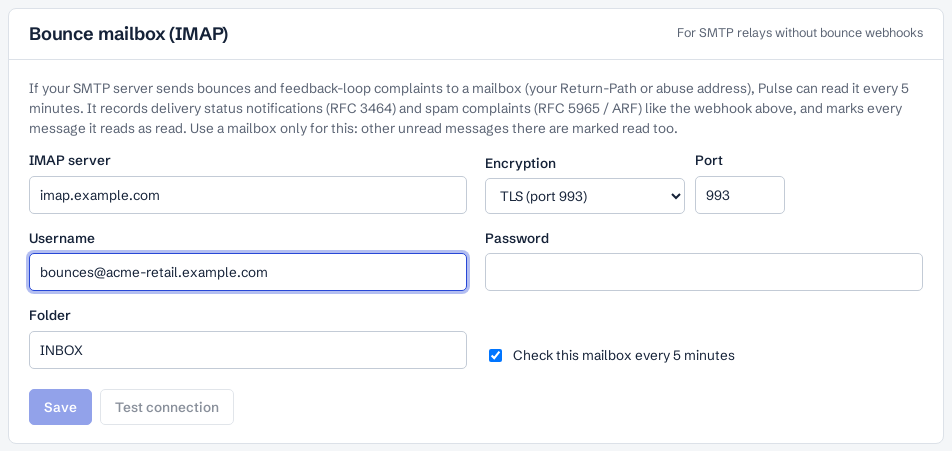
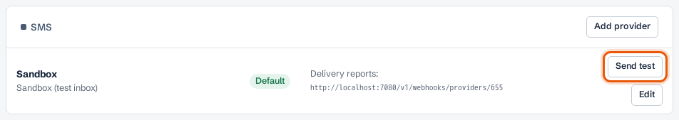
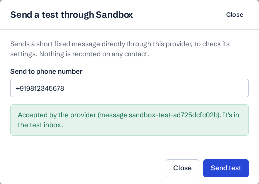
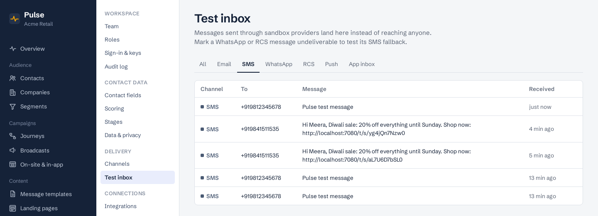

# Tutorial 4: Channels

In about 20 minutes you will see where each kind of message goes out, connect a provider for email,
SMS, WhatsApp, RCS and push, check it with a test send, and set the rules that protect your contacts
and your sender reputation: frequency caps, quiet hours, reply keywords, bounce handling and reply
tracking.

**You need:** a workspace where you are an **Admin** (tutorial 1). Only admins can add providers, send
provider tests and change delivery rules; editors and viewers see the page read-only. Nothing in this
tutorial needs a real provider account: Pulse has a **sandbox** provider for every channel.

---

## 1. Open the Channels page

Go to **Settings → Channels** (under *Delivery*). There is one panel per channel: **Email**, **SMS**,
**WhatsApp**, **RCS** and **Push**, then **App inbox**, **Delivery rules**, **Bounces and complaints**
and **Bounce mailbox (IMAP)**.


Each provider row shows:

| Column | Meaning |
|---|---|
| Name, and the kind of provider under it | e.g. **Sandbox** / *Sandbox (test inbox)* |
| **Default** or **Standby** | Every message on that channel goes through its default provider. A standby provider is saved but unused until you make it the default |
| **Delivery reports:** a URL | This provider's Pulse webhook URL. Give it to the provider for delivery receipts and incoming replies |
| **Send test**, **Edit** | Check the connection (step 7); change the settings or **Remove** the provider |

What happens when a channel has no provider:

- **Email** says *Using the server's SMTP relay*: Pulse sends through the mail server its operator set
  up (`PULSE_SMTP_ADDR`). On the local Docker stack that is Mailpit, so every email lands at
  `http://localhost:18025`. Add a provider to send through your own.
- **SMS, WhatsApp, RCS, Push**: journey and broadcast steps on that channel fail with *no provider
  configured*.

> The docs workspace in these pictures already has sandbox providers for SMS, WhatsApp, RCS and push
> (made by `make docs-seed`). In a new workspace these panels are empty: add a sandbox provider first
> (step 2) to try things safely.

## 2. Add a provider

1. In the channel's panel, click **Add provider**.
2. Pick a **Provider** (the choices are in the table below). The line under it says what it does.
3. **Name in Pulse**: how it is listed, e.g. `Amazon SES (Mumbai)`. Empty means the provider's name.
4. Fill in its settings. Fields marked *(optional)* can stay empty. Secret fields (passwords, tokens,
   keys) are **stored encrypted and never shown again**; when you edit the provider later, leave them
   empty to keep the saved value.
5. **Use for all <channel> messages** (ticked by default) makes it the channel's default. Untick it to
   save it as a standby.
6. Click **Save provider**. New sends use it within 30 seconds.

The provider and channel can't be changed after saving. To switch provider, add the new one as the
default (or edit the old one and **Remove** it).

| Channel | Providers |
|---|---|
| Email | **SMTP**, **Custom HTTP gateway**, **Sandbox (test inbox)** |
| SMS | **Twilio**, **MSG91**, **Custom HTTP gateway**, **Sandbox (test inbox)** |
| WhatsApp | **Meta WhatsApp Cloud API**, **Custom HTTP gateway**, **Sandbox (test inbox)** |
| RCS | **Google RCS Business Messaging**, **Custom HTTP gateway**, **Sandbox (test inbox)** |
| Push | **Firebase Cloud Messaging**, **Custom HTTP gateway**, **Sandbox (test inbox)** |

The real adapters (Twilio, MSG91, Meta, Google RBM, FCM) are tested against recordings of those
APIs, not yet against live accounts. Try your first send with a test number.

### Email: SMTP

**SMTP** works with any SMTP relay: Amazon SES SMTP, SendGrid, Postmark, Mailgun, your own mail
server.

| Field | Example |
|---|---|
| **Host** | `email-smtp.ap-south-1.amazonaws.com` |
| **Port** | `587` |
| **From address** | `Acme Retail <hello@acme-retail.example.com>`: the sender every email shows |
| **Username (optional)**, **Password (optional)** | The relay's SMTP credentials (for SES, the SMTP user, not your AWS keys) |


> Before sending to real people, set up SPF, DKIM and DMARC for the From domain at your email
> service, and point its bounce webhook at Pulse (step 5).

### SMS: Twilio or MSG91

| Provider | Settings |
|---|---|
| **Twilio** | **Account SID**, **Auth token**; then either a **From number** or a **Messaging Service SID**; optionally **Delivery report URL**: paste this provider's own Pulse webhook URL (you get it after saving, so edit the provider once more) |
| **MSG91** (India, DLT) | **Flow template ID** (the flow's text must be exactly `##message##`: Pulse puts the whole SMS there), **Sender ID (DLT header)**, **Auth key** |


A template's own **Sender ID** (tutorial 5) overrides the provider's.

### WhatsApp: Meta WhatsApp Cloud API

| Field | Where to find it |
|---|---|
| **Phone number ID** | Meta Business → WhatsApp → API setup |
| **WhatsApp Business account ID (optional)** | Same page |
| **Access token (system user, permanent)** | A system user token with WhatsApp permissions |
| **App secret (verifies delivery webhooks) (optional)** | Your Meta app's settings. With it, Pulse checks that receipts really come from Meta |
| **Webhook verify token (optional)** | Any string you choose; enter the same one in Meta's webhook settings |



In Meta's webhook settings, use this provider's **Delivery reports** URL as the callback URL. WhatsApp
only delivers business-started messages from templates Meta has approved; tutorial 5 shows how a
Pulse template points at one.

### RCS: Google RCS Business Messaging

**Agent ID**, a **Service account key (JSON) with RBM access**, and optionally a **Webhook client
token** (the token you set on the agent's webhook in the RBM console). With the token, Pulse checks
the webhook's signature and records delivery and read receipts, replies and taps on suggestions.

### Mobile push: Firebase Cloud Messaging

**Firebase project ID** and the **Service account key (JSON) from the Firebase console** (Project
settings → Service accounts → Generate new private key; paste the whole file). FCM delivers to
Android, iOS (through FCM tokens, not direct APNs) and web apps that use Firebase. Your app registers
its device tokens with the Pulse mobile SDKs.



### Web push: no provider needed

Browsers subscribe with standard Web Push, signed with your workspace's own **VAPID keys**. Pulse
creates the key pair the first time a browser asks for it; there is nothing to set up on this page and
no Firebase project.

1. Install the web SDK (tutorial 1, step 6).
2. Serve a file called `/pulse-sw.js` from your site's root containing one line:

   ```js
   importScripts("http://localhost:7080/sdk/pulse-sw.js");
   ```
3. Call `Pulse.enablePush()` from a click (browsers only show the permission prompt after a user
   action):

   ```js
   document.querySelector("#notify-me").addEventListener("click", async () => {
     const ok = await Pulse.enablePush();   // true when this browser is subscribed
   });
   ```
   Use `Pulse.enablePush({ serviceWorker: "/path/to/worker.js" })` if the worker lives elsewhere.

Push messages to subscribed browsers then go out through Web Push even when the Push channel has no
provider, and the service worker reports clicks and dismissals (`push_clicked`, `push_dismissed`).

### Any other gateway: Custom HTTP gateway

For an SMS aggregator or in-house service Pulse has no adapter for, pick **Custom HTTP gateway** on
any channel:

- **Endpoint URL**: Pulse POSTs each rendered message there as JSON.
- **Signing secret (we sign each request with it)**: every request is signed like Pulse's outgoing
  webhooks, so your endpoint can check it came from Pulse.



Your endpoint answers 2xx to accept (optionally `{"id": "..."}` to match receipts later), 404 or 410
when the recipient can't be reached, another 4xx for a permanent failure; 429 and 5xx are retried.
Receipts go back to the provider's Pulse webhook URL as `{"id", "status": "delivered" | "failed" |
"read"}`. The developer docs describe the payload.

### Sandbox (test inbox)

**Sandbox (test inbox)** delivers nothing: each message is recorded in **Settings → Test inbox**
(step 8). Its one setting, **Treat recipients ending with this as unreachable**, makes numbers (or
device tokens) ending in, say, `0000` fail as if they weren't on WhatsApp or RCS, so you can test the
SMS fallback. The seeded WhatsApp and RCS sandboxes use `0000`.

## 3. App inbox: built in

The **App inbox** panel says *Built in*: Pulse keeps inbox messages itself, so there is nothing to
connect. Apps show them with the Flutter SDK, websites with `Pulse.inbox` in the web SDK. Messages
expire after 30 days unless the template sets **Keep for (days)**.


## 4. Set delivery rules

The **Delivery rules** panel holds the workspace's sending limits. Templates marked
**Transactional** (an OTP, a receipt, a password reset; tutorial 5) skip caps and quiet hours.



1. **Frequency caps**: tick a channel and set **At most** *n* **per** *h* **hours**. That is the most
   marketing messages one contact gets on that channel in that window. Messages over the cap are
   dropped and show as **capped** in reports. Unticked means **No limit**.
2. **Quiet hours**: tick **Hold marketing messages overnight and send them when quiet hours end**,
   then set **From**, **to** and the time zone (default 21:00 to 09:00, `Asia/Kolkata`), and tick the
   channels it applies to (by default SMS, WhatsApp, RCS and Push). Messages are held, not dropped.
   A contact with a `timezone` attribute (or one located by IP) gets quiet hours in their own time.
3. **Reply keywords**: when someone replies to an SMS, WhatsApp or RCS message with just one of these
   words, they are unsubscribed from (**Unsubscribe**) or subscribed back to (**Subscribe again**) that
   channel. Case and punctuation don't matter, so `Stop.` counts. Defaults: `STOP, BAND, UNSUBSCRIBE,
   CANCEL, END, QUIT, OPTOUT` and `START, UNSTOP, SUBSCRIBE, OPTIN`. For this to work, point the
   provider's incoming-message webhook at its **Delivery reports** URL.
4. **Reply tracking address** (optional), e.g. `replies@inbound.example.com`: journey emails use it as
   their Reply-To, so a journey's **Replies to email** decision can see who answered. Point that
   domain's MX at your email provider's inbound parse, and its webhook at the **Reply webhook URL**
   (step 5).
5. Click **Save delivery rules**. They apply within 30 seconds.

## 5. Handle bounces and complaints

The **Bounces and complaints** panel shows your workspace's bounce webhook URL and, below it, the
**Reply webhook URL**. Click **Copy** and paste the bounce URL into your email service:


| Service | Where |
|---|---|
| SendGrid | Event Webhook |
| Postmark | Bounce and Spam Complaint webhooks |
| Mailgun | Permanent Failure, Temporary Failure and Spam Complaint webhooks |
| Amazon SES | An SNS topic with an HTTPS subscription to the URL; Pulse confirms the subscription for you |
| Anything else | POST JSON like `{"email": "…", "type": "hard"}` (or a list); `type` is `hard`, `soft` or `complaint` |

What Pulse does with each:

- **Hard bounce** (the address doesn't exist): the contact gets `email_bounced` = true and no more
  email is sent to them.
- **Soft bounce** (a full inbox): recorded as an `email_bounced` event; email keeps going.
- **Complaint** (marked as spam): the contact is unsubscribed from email.

> Treat both URLs like passwords: anyone who has them can report bounces or replies for your
> workspace.

### No bounce webhook? Use a bounce mailbox

If your SMTP relay only sends bounce messages to a mailbox (your Return-Path or abuse address), Pulse
can read that mailbox every 5 minutes, in **Bounce mailbox (IMAP)**:

1. **IMAP server** (e.g. `imap.example.com`), **Encryption** (**TLS (port 993)**, **STARTTLS (port
   143)**, or **None (development only)**), **Port**, **Username**, **Password**, **Folder** (`INBOX`).
2. Click **Test connection**, then **Save**. **Check this mailbox every 5 minutes** is on by default.
3. Once saved: **Check now** reads it straight away, and the panel shows when it last checked, how many
   bounces and complaints it recorded, and the last error.



Pulse reads standard delivery status notifications (RFC 3464) and spam complaint reports (RFC 5965 /
ARF), and marks every message it reads as read. **Use a mailbox only for this**: other unread messages
there are marked read too. One mailbox per workspace; password sign-in only (no Gmail / Microsoft 365
OAuth); unusual plain-text bounces aren't recognised.

## 6. How unsubscribes work on each channel

Every message checks consent first: a contact who opted out of a channel (or of everything) gets
nothing on it, and the message shows as **suppressed**.

| Channel | How a contact opts out |
|---|---|
| Email | The unsubscribe link Pulse adds to every email (or where you place `{{.UnsubscribeURL}}`), the preference center (`{{.PreferencesURL}}`), the mail app's one-click unsubscribe button (RFC 8058), or a spam complaint. A hard bounce stops email too |
| SMS, WhatsApp, RCS | Replying with a reply keyword (step 4) |
| Push, app inbox | **Unsubscribe** on the contact's profile, an `unsubscribed` event from your server, or "unsubscribe from everything" on the email unsubscribe page |

The email unsubscribe page lets the contact leave email only, or everything, and undo it. Teammates
who can edit contacts can change any channel on the contact's profile (**Unsubscribe** /
**Subscribe** per channel, or **Unsubscribe from everything**), and a form's consent box can opt
people back in (tutorial 5).

## 7. Send a test through a provider

**Send test** on a provider row sends a short fixed message straight through that provider, to check
its settings. Nothing is recorded on any contact.

1. Click **Send test** on the SMS row.

   
2. Enter where to send it. The field depends on the channel: **Send to email address**, **Send to phone
   number** (SMS, RCS), **Send to WhatsApp number** (plus **Approved template to send**: Meta's sample
   `hello_world` if empty), or **Send to device token** (push).
3. Click **Send test**. You see either **Accepted by the provider** (with the provider's message ID; for
   a sandbox, *It's in the test inbox*) or **Not sent:** with the reason and the provider's error.

   

To send a real template to a real contact, personalised, use **Send a test** in the template editor
instead (tutorial 5). That one goes through the normal delivery path, so consent, quiet hours and caps
apply unless the template is transactional.

## 8. Use the test inbox

Go to **Settings → Test inbox**. Every message sent through a sandbox provider lands here instead of
reaching anyone. The tabs filter by channel; the list refreshes every 2 seconds.



- On WhatsApp and RCS messages, **Mark undeliverable** reports the message as failed, as the real
  provider would. If it was sent with an SMS fallback, the SMS appears here shortly, marked
  **Fallback**.
- **Simulate a reply** sends an incoming SMS, WhatsApp or RCS message **From** a phone number. Every
  contact with that number gets an `sms_received` (or `whatsapp_received`, `rcs_received`) event, and
  a reply keyword such as `STOP` unsubscribes them. For RCS you can also simulate a tapped suggested
  reply or action.
- **Simulate a bounce** reports a **Hard bounce**, **Soft bounce** or **Spam complaint** for an
  **Email**, exactly as a bounce webhook would.


> Simulations change real contacts in your workspace: a `STOP` from a contact's number really
> unsubscribes them from SMS, and a hard bounce really stops their email. Use test numbers and
> addresses.

## What you have now

- A provider (or the sandbox) on every channel you use, checked with a test send
- Delivery rules: caps, quiet hours, reply keywords and reply tracking
- Bounces and complaints flowing back from your email service
- The test inbox, for trying everything without messaging anyone

**Next:** Tutorial 5, Templates and content: write the messages these channels send, and the landing
pages, forms and files around them.
