# Tutorial 4: Channels

In about 30 minutes you will see where each kind of message goes out, connect a provider for email,
SMS, WhatsApp, RCS and push, check it with a test send, and set the rules that protect your contacts
and your sender reputation: frequency caps, quiet hours, reply keywords, bounce handling and reply
tracking. At the end you set up the web push prompt that asks your website's visitors to get
notifications.

**You need:** a workspace where you are an **Admin** (tutorial 1). Only admins can add providers, send
provider tests and change delivery rules; editors and viewers see the page read-only. Nothing in this
tutorial needs a real provider account: Pulse has a **sandbox** provider for every channel.

---

## 1. Open the Channels page

Go to **Settings → Channels** (under *Delivery*). A **provider** is the service that delivers your
messages: an SMTP server, an SMS gateway, WhatsApp. There is one panel per channel: **Email**,
**SMS**, **WhatsApp**, **RCS** and **Push**, then **App inbox**, **Test contacts**, **Delivery
rules**, **Bounces and complaints** and **Bounce mailbox (IMAP)**.

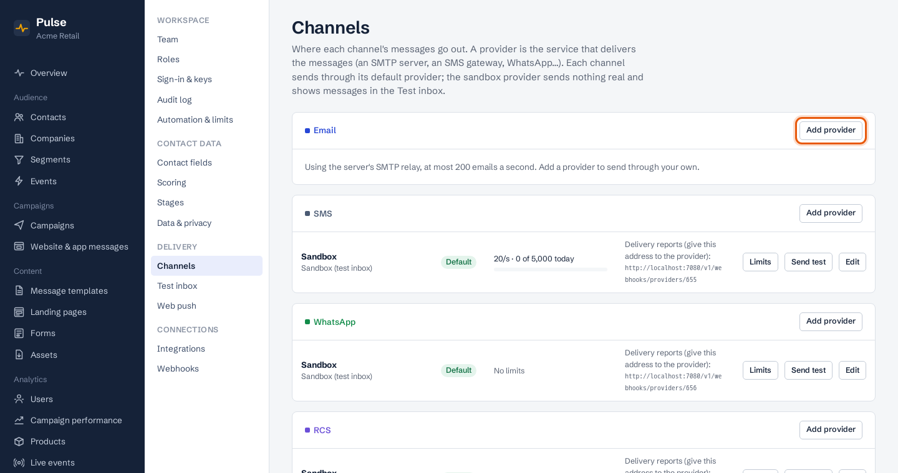

Each provider row shows:

| Column | Meaning |
|---|---|
| Name, and the kind of provider under it | e.g. **Sandbox** / *Sandbox (test inbox)* |
| **Default** or **Standby** | Every message on that channel goes through its default provider, unless a campaign, a campaign step or a test send picks another one under **Send through** ([step 7](#choose-the-provider-for-a-campaign-send-through)). A standby provider is used only when it is picked that way |
| Limits and today's count | e.g. *20/s · 1 of 5,000 today*, or *No limits* (step 9) |
| **Delivery reports (give this address to the provider):** a URL | This provider's Pulse webhook URL. Give it to the provider for delivery receipts and incoming replies |
| **Limits**, **Send test**, **Edit** | Sending limits (step 9); check the connection (step 7); change the settings or **Remove** the provider |

What happens when a channel has no provider:

- **Email** says *Using the server's SMTP relay, at most 200 emails a second*: Pulse sends through the
  mail server its operator set up (`PULSE_SMTP_ADDR`), at the speed they set (step 9). On the local Docker stack that is Mailpit, so every email lands at
  `http://localhost:18025`. Add a provider to send through your own.
- **SMS, WhatsApp, RCS, Push**: messages on that channel in campaigns fail with *no provider
  configured*.

> The docs workspace in these pictures already has sandbox providers for SMS, WhatsApp, RCS and push
> (made by `make docs-seed`). In a new workspace these panels are empty: add a sandbox provider first
> (step 2) to try things safely.

## 2. Add a provider

1. In the channel's panel, click **Add provider**.
2. Pick a **Provider** (the choices are in the table below). The line under it says what it does, and
   some providers show a blue note with what to set up at the provider.
3. **Provider name** (next to it): how campaigns and reports name it, e.g. `Amazon SES (Mumbai)`.
   Empty means the provider's own name.
4. Fill in its settings. Most providers show them in short numbered steps: **1 Connection** (where
   and as whom Pulse sends), **2 Sign-in** (the password, key or token), and **More settings**, folded
   away, for the rare ones. Some start with a short how-to, and SMTP has **Fill in for:** buttons
   that fill in a well-known service for you. Pulse only shows the fields that apply to your
   choices: pick **No login**, and the username and password disappear. Fields marked *(optional)*
   can stay empty. Secret fields (passwords, tokens, keys) are **stored encrypted and never shown
   again**.
5. **Sending limits**, at the end of the form: how fast and how much your account at the provider may
   send. Leave them empty if it has no limits; [step 9](#9-sending-limits-and-daily-quotas) explains
   them.
6. **Use for all <channel> messages** (ticked by default) makes it the channel's default. Untick it to
   save it as a standby.
7. Click **Save provider**. You see *Provider saved. New sends use it within 30 seconds.*

The provider and channel can't be changed after saving. To switch provider, add the new one as the
default (or edit the old one and **Remove** it).

The list offers the usual services first (for email, **SMTP** comes first: with its **Fill in for:**
buttons it covers most sending services), then **Custom HTTP gateway**, then **Sandbox (test inbox)**:

| Channel | Providers |
|---|---|
| Email | **SMTP**, **Gmail (SMTP)**, **Google Workspace (SMTP)**, **Google Workspace SMTP relay**, **Custom HTTP gateway**, **Sandbox (test inbox)** |
| SMS | **Gupshup SMS (Enterprise)**, **MSG91**, **Twilio**, **Custom HTTP gateway**, **Sandbox (test inbox)** |
| WhatsApp | **Gupshup WhatsApp**, **Meta WhatsApp Cloud API**, **Custom HTTP gateway**, **Sandbox (test inbox)** |
| RCS | **Google RCS Business Messaging**, **Gupshup RCS**, **Custom HTTP gateway**, **Sandbox (test inbox)** |
| Push | **Firebase Cloud Messaging**, **Custom HTTP gateway**, **Sandbox (test inbox)** |

The real connections are tested against recordings of those services' APIs, not against live
accounts; the Gupshup ones say so on the form. Try your first send with a test number.

Some providers come with their **Sending limits** already filled in, e.g. Gmail with 1 message a
second and 500 a day. Others start with the workspace's default limits for the channel, set on
**Settings → Automation & limits** (tutorial 11), or none. Change them in the form before saving.

**Editing a provider later.** Leave a secret field empty to keep its saved value; type in a field to
replace just that secret. To protect saved passwords, Pulse asks for **every secret again** when you
change a setting that decides where or how they are sent:

- If you change an address's host (a URL, an SMTP host), the form warns *An endpoint's host changed:
  the saved secrets will be cleared, so enter every secret again.*
- If you change another such setting (a URL's path, a port, a user name, the authentication or
  request settings), saving says *the authentication or request settings changed: enter every secret
  again to save them*.

Sender names and numbers, pool sizes and DLT IDs can change without the secrets.

### Email: SMTP

**SMTP** works with any mail server or sending service: Amazon SES, SendGrid, Mailgun, Postmark,
Mailjet, Brevo, SparkPost, Microsoft 365, Zoho Mail, your own mail server.

**Fill in for:** saves you looking up the server details. Click your service (**Amazon SES**,
**SendGrid**, **Mailgun**, **Postmark**, **Mailjet**, **Brevo**, **SparkPost**, **Microsoft 365**,
**Zoho Mail** or **Gmail**) and Pulse fills in the host, port, encryption and login type, and picks the
right **Sending service** for delivery reports. A blue note under the buttons says what goes in the
username and password for that service, e.g. for SendGrid *The username is literally apikey; the
password is your SendGrid API key.* Check the host afterwards: Amazon SES fills in the Mumbai region
(`ap-south-1`), Mailgun its US server and Zoho Mail its Indian one, and the note says what to change.

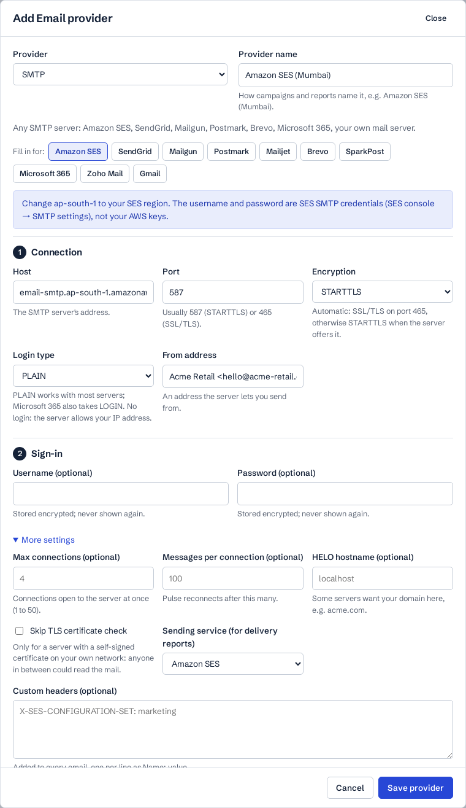

**1 Connection**

| Field | What to enter |
|---|---|
| **Host** | The server's address, e.g. `email-smtp.ap-south-1.amazonaws.com` |
| **Port** | Usually `587` (STARTTLS) or `465` (SSL/TLS) |
| **Encryption** | **Automatic** (the default: SSL/TLS on port 465, otherwise STARTTLS when the server offers it), **STARTTLS** (refuse to send if the server doesn't offer it), **SSL/TLS** (on any port), or **None** (only for a server on your own network) |
| **Login type** | **PLAIN** works with most servers; Microsoft 365 also takes **LOGIN**; some older servers want **CRAM-MD5**. **No login**: the server lets your Pulse server in by its IP address |
| **From address** | `Acme Retail <hello@acme-retail.example.com>`: the sender every email shows, an address the server lets you send from |

**2 Sign-in**: the server's **Username** and **Password** (for Amazon SES, the SES SMTP credentials,
not your AWS keys). They aren't shown with **No login**.

**More settings** (click to open; it opens by itself when one of them has a value, as after **Fill in
for:**):

| Field | Default | What it does |
|---|---|---|
| **Max connections** | 4 | Connections each Pulse server keeps open to the mail server (1 to 50). Pulse reuses them, which is many times faster than connecting for every email. Ask your service how many it allows |
| **Messages per connection** | 100 | Emails sent on one connection before Pulse opens a new one |
| **HELO hostname** | `localhost` | The name Pulse gives when it says hello. Some servers want your domain here, e.g. `acme.com` |
| **Skip TLS certificate check** | Off | Only for a server with a self-signed certificate on your own network: anyone in between could read the mail |
| **Sending service (for delivery reports)** | Detect from the host | **Amazon SES**, **SendGrid**, **Mailgun**, **Postmark**, **SparkPost** or **Other**. Pulse marks each email the way that service expects, so its delivery reports, bounces and complaints are matched to the campaign that sent the email |
| **Custom headers** | None | Headers added to every email, one per line as `Name: value`, e.g. `X-SES-CONFIGURATION-SET: marketing`. At most 20. Headers Pulse sets itself (From, To, Subject, Date, Message-ID, the content headers, `X-Pulse-Ref` and the unsubscribe headers) can't be replaced |

A plain SMTP server tells Pulse about bounces but not about deliveries, so campaign reports show
**Delivered** as "—" (*not reported by this provider*) for it. Sending services (SendGrid, Mailgun,
Postmark, Amazon SES, SparkPost) report deliveries through their webhook (step 5).

To check the settings before saving, click **Test connection**: Pulse connects to the server, logs in
(unless **No login**) and disconnects, and says *Connected to* or *Logged in to* the server, or what
went wrong. Then save the provider and use **Send test** on its row to check a real email arrives
(step 7).

> Before sending to real people, set up SPF, DKIM and DMARC for the From domain at your email
> service, and point its webhook at Pulse (step 5).

### Email: Gmail and Google Workspace

For small volumes from a Google account:

| Provider | Starts with | Use it for |
|---|---|---|
| **Gmail (SMTP)** | 500 a day, 1 a second | A personal Gmail account |
| **Google Workspace (SMTP)** | 2,000 a day, 2 a second | A Workspace account (your company's Google mail) |
| **Google Workspace SMTP relay** | 10,000 a day | Workspace's relay for applications, set up by your Google admin |

Google limits how many people an account may email a day, and Pulse sets that as the provider's
daily quota. Bulk mail belongs on the Workspace relay or a sending service (SES, SendGrid, Postmark).

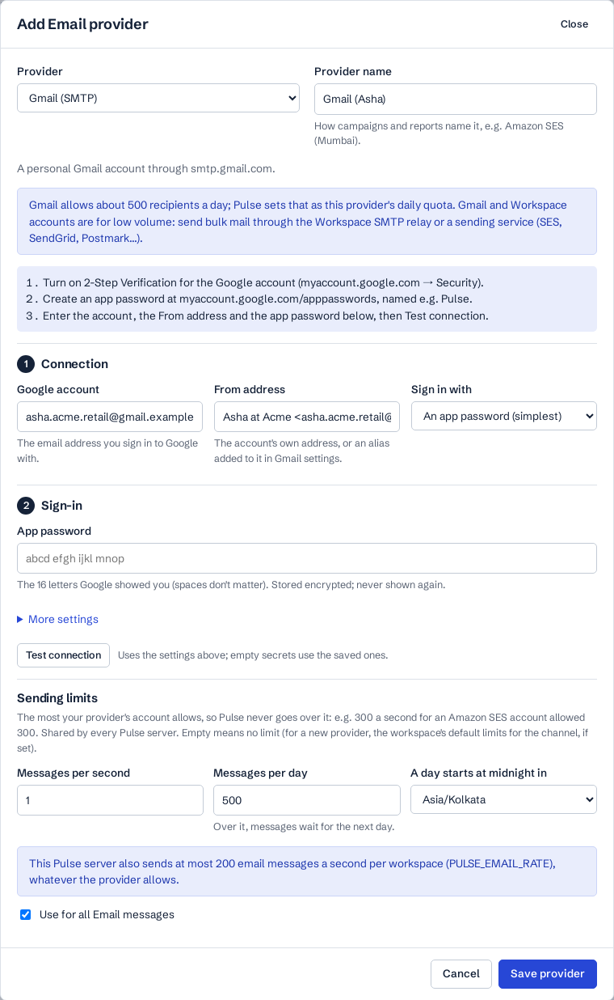

For **Gmail (SMTP)** and **Google Workspace (SMTP)** the form starts with three short steps for
getting an **app password** from Google:

1. Turn on 2-Step Verification for the Google account (myaccount.google.com → Security).
2. Create an app password at myaccount.google.com/apppasswords, named e.g. Pulse.
3. Enter the account, the From address and the app password below, then Test connection.

Then fill in:

1. **1 Connection**: **Google account** (the address you sign in to Google with), **From address**
   (the account's own address, or an alias added to it in Gmail settings) and **Sign in with**:
   - **An app password (simplest)**: under **2 Sign-in**, paste the 16 letters Google showed you into
     **App password** (spaces don't matter).
   - **A Google OAuth client (for IT teams)**: your IT team creates an OAuth client with access to
     Gmail (`https://mail.google.com/`) and gives you the **OAuth client ID** (under **1 Connection**),
     the **OAuth client secret** and the **OAuth refresh token** (under **2 Sign-in**).

   Only the fields for the way you chose are shown.
2. Click **Test connection** to check that Pulse can sign in to Gmail (with an app password) or get a
   token from Google (with an OAuth client).
3. **More settings** holds the **Port** (**587 (STARTTLS, recommended)** or **465 (SSL/TLS)**; both are
   secure, keep 587 unless your network blocks it) and **Max connections**.
4. Save, then check the account with **Send test** (step 7).

For **Google Workspace SMTP relay**, your Google admin first turns on the relay (Google Admin
console → Apps → Google Workspace → Gmail → Routing → SMTP relay service), allowing your Pulse
server's IP address or SMTP sign-in. Then fill in the **From address** (an address in your Workspace
domain), **Your domain (sent in EHLO)** (Google needs a real domain name here when it allows you by IP
address) and, only with SMTP sign-in, **SMTP auth user (optional)** and **SMTP auth password
(optional)**. **More settings** holds the **Port** (587, 465 or 25) and **Max connections**.

None of the three report deliveries to Pulse (like any plain SMTP relay).

### SMS: Twilio or MSG91

| Provider | Settings |
|---|---|
| **Twilio** | **Account SID**, **Auth token**; then either a **From number** or a **Messaging Service SID**; optionally **Delivery report URL**: paste this provider's own Pulse webhook URL (you get it after saving, so edit the provider once more) |
| **MSG91** (India, DLT) | **Flow template ID** (the flow's text must be exactly `##message##`: Pulse puts the whole SMS there), **Sender ID (DLT header)**, **Auth key** |

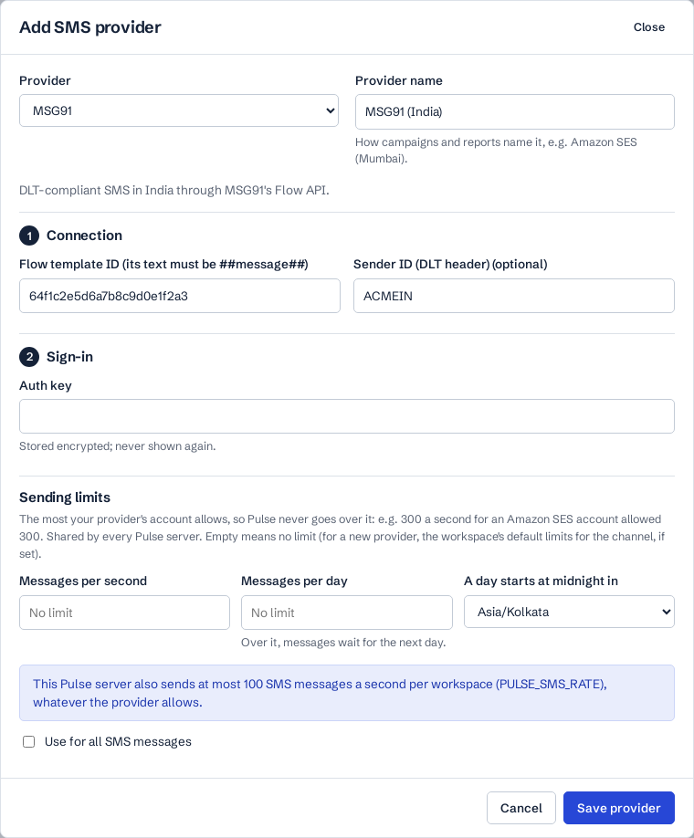

A template's own **Sender ID** (tutorial 5) overrides the provider's.

### SMS, WhatsApp and RCS: Gupshup

| Provider | Settings |
|---|---|
| **Gupshup SMS (Enterprise)** | **API URL** (keep the default), **Sender ID (DLT header)**, **DLT principal entity ID**, **Default DLT template ID** (used only when an SMS template has no DLT template ID of its own), **User ID (Enterprise account number)**, **Password**, **Webhook token** |
| **Gupshup WhatsApp** | **Source number (your WhatsApp business number)** (digits with the country code, no +), **App name (src.name)**, **API URL**, **API key**, **Webhook token**. A Pulse WhatsApp template's **Approved template name** is the Gupshup template ID |
| **Gupshup RCS** | **API URL**, **User ID (Enterprise account number)**, **Password**, **Webhook token** |

Every SMS sent in India needs a DLT-registered sender and template: set the **DLT template ID
(India)** on each SMS template (tutorial 5), or a default here.

The **Webhook token** is any long random string you make up. Pulse refuses delivery reports and
replies that don't carry it. At Gupshup, register the provider's **Delivery reports** address (you
get it after saving) with `?token=<your webhook token>` at the end; for SMS, that is the Realtime
Delivery URL (Settings → Advanced Account Settings), as a POST.

Gupshup's addresses and fields come from its public documentation and were tested against
recordings only: confirm them with your Gupshup account manager before the first real campaign. Set
the provider's **Sending limits** to the speed Gupshup confirms for your account.

### WhatsApp: Meta WhatsApp Cloud API

| Field | Where to find it |
|---|---|
| **Phone number ID** | Meta Business → WhatsApp → API setup |
| **WhatsApp Business account ID (optional)** | Same page |
| **Access token (system user, permanent)** | A system user token with WhatsApp permissions |
| **App secret (verifies delivery webhooks) (optional)** | Your Meta app's settings. With it, Pulse checks that receipts really come from Meta |
| **Webhook verify token (optional)** | Any string you choose; enter the same one in Meta's webhook settings |

In Meta's webhook settings, use this provider's **Delivery reports** URL as the callback URL. WhatsApp
only delivers business-started messages from templates Meta has approved; tutorial 5 shows how a
Pulse template points at one.

### RCS: Google RCS Business Messaging

**Agent ID**, a **Service account key (JSON) with RBM access**, and optionally a **Webhook client
token** (the token you set on the agent's webhook in the RBM console). With the token, Pulse checks
the webhook's signature and records delivery and read receipts, replies and taps on suggestions.

### Mobile push: Firebase Cloud Messaging

**Firebase project ID** and the **Service account key (JSON) from the Firebase console** (Project
settings → Service accounts → Generate new private key; paste the whole file). FCM delivers to
Android, iOS (through FCM tokens, not direct APNs) and web apps that use Firebase. Your app registers
its device tokens with the Pulse mobile SDKs.

### Web push: no provider needed

Browsers subscribe with standard Web Push, signed with your workspace's own keys, which Pulse creates
by itself: there is no provider to add and no Firebase project. Push messages to subscribed browsers
go out through Web Push even when the Push channel has no provider. Asking visitors and checking your
site are on **Settings → Web push** ([step 11](#11-web-push-ask-visitors-and-check-your-site)).

### Any other gateway: Custom HTTP gateway

For a provider Pulse has no ready-made connection for, pick **Custom HTTP gateway** on any channel.
Then click one of two cards:

- **Connect to a gateway's existing API**: your SMS or messaging company already has an API. You tell
  Pulse, in numbered steps, where to send, how to sign in, what to send, how it knows a message was
  sent and how delivery reports come back, without any code.
  [Tutorial 16](16-connecting-any-provider.md) walks through it.
- **Your developers build an endpoint for Pulse** (the default): Pulse posts each message as JSON in
  its own format to **1 Your endpoint**: the **Endpoint URL**, signed with the **Signing secret (we
  sign each request with it)**. **2 Sign-in (optional)** adds a login if the endpoint asks for one;
  most don't. **3 Check it** has **Preview request** to see what Pulse would send. The developer
  docs describe the format.

### Sandbox (test inbox)

**Sandbox (test inbox)** delivers nothing: each message is recorded in **Settings → Test inbox**
(step 8). Its one setting, **Treat recipients ending with this as unreachable**, makes numbers (or
device tokens) ending in, say, `0000` fail as if they weren't on WhatsApp or RCS, so you can test the
SMS fallback. The seeded WhatsApp and RCS sandboxes use `0000`.

## 3. App inbox: built in

The **App inbox** panel says *Built in*: Pulse keeps inbox messages itself, so there is nothing to
connect. Apps show them with the Flutter SDK, websites with `Pulse.inbox` in the web SDK. Messages
expire after 30 days unless the template sets **Keep for (days)**.

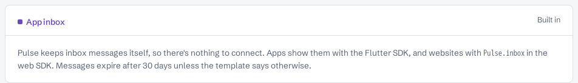

## 4. Set delivery rules

The **Delivery rules** panel holds the workspace's sending limits. Templates marked
**Transactional** (an OTP, a receipt, a password reset; tutorial 5) skip caps and quiet hours.

1. **Frequency caps**: tick a channel and set **At most** *n* **per** *h* **hours**. That is the most
   marketing messages one contact gets on that channel in that window. Messages over the cap are
   dropped and show as **capped** in reports. Unticked means **No limit**.
2. **Quiet hours**: tick **Hold marketing messages overnight and send them when quiet hours end**,
   then set **From**, **to** and the time zone (default 21:00 to 09:00, `Asia/Kolkata`), and tick the
   channels it applies to (by default SMS, WhatsApp, RCS and Push). Messages are held, not dropped.
   A contact with a `timezone` attribute (or one located by IP) gets quiet hours in their own time.
3. **Reply keywords**: when someone replies to an SMS, WhatsApp or RCS message with just one of these
   words, they are unsubscribed from (**Unsubscribe**) or subscribed back to (**Subscribe again**) that
   channel. Case and punctuation don't matter, so `Stop.` counts. Defaults: `STOP, BAND, UNSUBSCRIBE,
   CANCEL, END, QUIT, OPTOUT` and `START, UNSTOP, SUBSCRIBE, OPTIN`. For this to work, point the
   provider's incoming-message webhook at its **Delivery reports** URL.
4. **Reply tracking address** (optional), e.g. `replies@inbound.example.com`: emails from triggered
   and automation campaigns use it as their Reply-To, so a **Replies to email** decision can see who
   answered. Point that domain's MX at your email provider's inbound parse, and its webhook at the
   **Reply webhook URL** (step 5).
5. Click **Save delivery rules**. They apply within 30 seconds.

## 5. Handle bounces and complaints

The **Bounces and complaints** panel shows your workspace's email webhook URL and, below it, the
**Reply webhook URL**. Click **Copy** and paste the first URL into your email service:

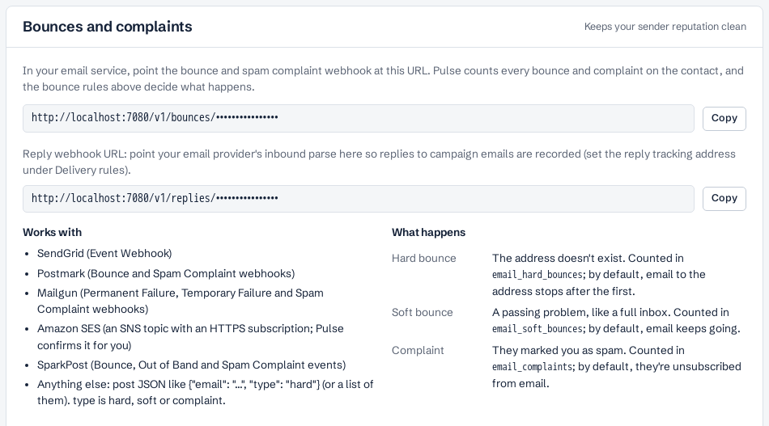

| Service | Where |
|---|---|
| SendGrid | Event Webhook (with the Delivered, Bounced, Dropped, Deferred and Spam Reports events) |
| Postmark | Bounce, Spam Complaint and Delivery webhooks |
| Mailgun | Delivered, Permanent Failure, Temporary Failure and Spam Complaint webhooks |
| Amazon SES | An SNS topic with an HTTPS subscription to the URL; Pulse confirms the subscription for you |
| SparkPost | Bounce, Out of Band, Spam Complaint and Delivery events |
| Anything else | POST JSON like `{"email": "…", "type": "hard"}` (or a list); `type` is `hard`, `soft` or `complaint` |

What Pulse does with each:

- **Hard bounce** (the address doesn't exist): the contact gets `email_bounced` = true and no more
  email is sent to them.
- **Soft bounce** (a full inbox): recorded as an `email_bounced` event; email keeps going.
- **Complaint** (marked as spam): the contact is unsubscribed from email.
- **Delivered** (from the sending services): recorded as `email_delivered`.

Each report is matched to the exact email it is about (Pulse marks every email it sends), so
bounces, complaints and deliveries count in that campaign's report, with the reason
([tutorial 15](15-delivery-and-dashboards.md)). Bounces from before this matching existed stay
unmatched: they update the contact but don't show in a campaign. If the panel says *Reports can't be
matched to the messages they're about*, ask your server administrator to set a secret key
(`PULSE_SECRET_KEY`).

> Treat both URLs like passwords: anyone who has them can report bounces or replies for your
> workspace.

### Webhook signatures

Below the services, **Webhook signatures** makes Pulse check that each report really comes from
your email service. The **Checked** column shows the state per service:

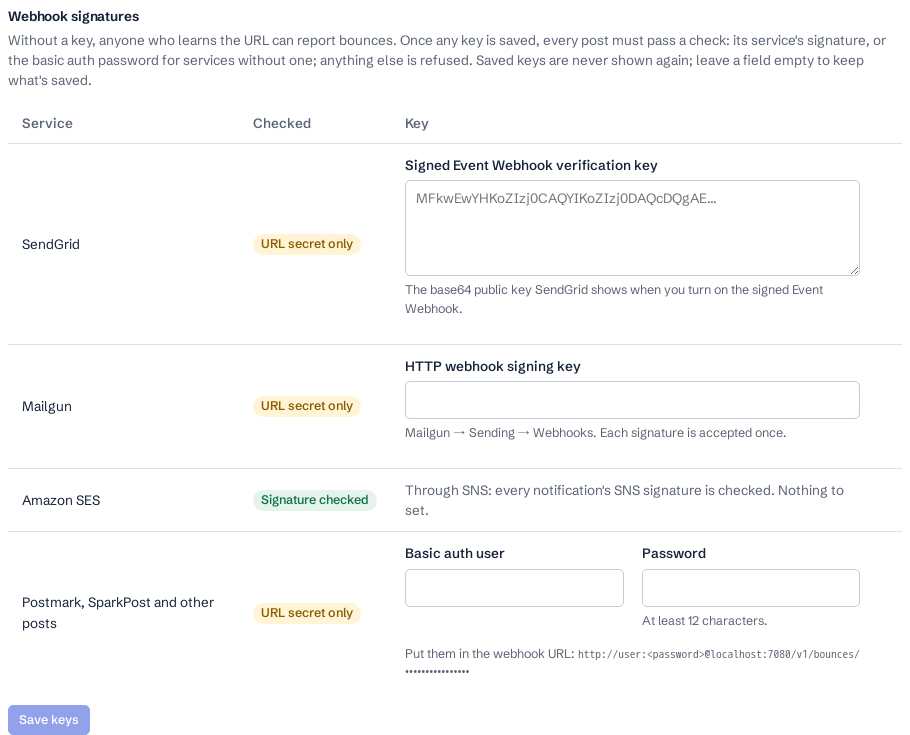

| Service | What to enter |
|---|---|
| **SendGrid** | **Signed Event Webhook verification key**: the public key SendGrid shows when you turn on the signed Event Webhook |
| **Mailgun** | **HTTP webhook signing key**: Mailgun → Sending → Webhooks |
| **Amazon SES** | Nothing: every SNS notification's signature is always checked |
| **Postmark, SparkPost and other posts** | A **Basic auth user** and **Password** (at least 12 characters), which you then put in the webhook URL at the service: `https://user:<password>@…/v1/bounces/…` |

Click **Save keys**. Keys are never shown again; leave a field empty to keep what is saved, or
**Remove** a key.

| Checked | Means |
|---|---|
| **Signature checked** | Posts must carry this service's valid signature |
| **Password checked** | Posts must carry the basic auth user and password |
| **URL secret only** | No key yet: anyone who learns the URL can post reports |
| **Refused** | Another service's key is saved, so posts in this format, which nothing checks, are refused. Save its key, or a basic auth password |

Once you save any key, **every** report must pass a check, so set up each service you use before
saving the first key.

### No bounce webhook? Use a bounce mailbox

If your SMTP relay only sends bounce messages to a mailbox (your Return-Path or abuse address), Pulse
can read that mailbox every 5 minutes, in **Bounce mailbox (IMAP)**:

1. **IMAP server** (e.g. `imap.example.com`), **Encryption** (**TLS (port 993)**, **STARTTLS (port
   143)**, or **None (development only)**), **Port**, **Username**, **Password**, **Folder** (`INBOX`).
2. Click **Test connection**, then **Save**. **Check this mailbox every 5 minutes** is on by default.
3. Once saved: **Check now** reads it straight away, and the panel shows when it last checked, how many
   bounces and complaints it recorded, and the last error.

Pulse reads standard delivery status notifications (RFC 3464) and spam complaint reports (RFC 5965 /
ARF), and marks every message it reads as read. **Use a mailbox only for this**: other unread messages
there are marked read too. One mailbox per workspace; password sign-in only (no Gmail / Microsoft 365
OAuth); unusual plain-text bounces aren't recognised.

## 6. How unsubscribes work on each channel

Every message checks consent first: a contact who opted out of a channel (or of everything) gets
nothing on it, and the message shows as **suppressed**.

| Channel | How a contact opts out |
|---|---|
| Email | The unsubscribe link Pulse adds to every email (or where you place `{{.UnsubscribeURL}}`), the preference center (`{{.PreferencesURL}}`), the mail app's one-click unsubscribe button (RFC 8058), or a spam complaint. A hard bounce stops email too |
| SMS, WhatsApp, RCS | Replying with a reply keyword (step 4) |
| Push, app inbox | **Unsubscribe** on the contact's profile, an `unsubscribed` event from your server, or "unsubscribe from everything" on the email unsubscribe page |

The email unsubscribe page lets the contact leave email only, or everything, and undo it. Teammates
who can edit contacts can change any channel on the contact's profile (**Unsubscribe** /
**Subscribe** per channel, or **Unsubscribe from everything**), and a form's consent box can opt
people back in (tutorial 5).

## 7. Send a test through a provider

**Send test** on a provider row sends a short fixed message straight through that provider, to check
its settings. Nothing is recorded on any contact.

1. Click **Send test** on the SMS row.

   
2. Enter where to send it. The field depends on the channel: **Send to email address**, **Send to phone
   number** (SMS, RCS), **Send to WhatsApp number** (plus **Approved template to send**: Meta's sample
   `hello_world` if empty), or **Send to device token** (push).
3. Click **Send test**. You see either **Accepted by the provider** (with the provider's message ID; for
   a sandbox, *It's in the test inbox*) or **Not sent:** with the reason and the provider's error.

   

To send a real template to a real contact, personalised, use **Send a test** in the template editor
instead (tutorial 5). That one goes through the normal delivery path, so consent, quiet hours and caps
apply unless the template is transactional.

### Choose the provider for a campaign: Send through

When a channel has more than one provider, the places that send show a **Send through** list:
one-time campaigns (the editor and the New campaign wizard), the message steps of triggered and
automation campaigns, and every **Send a test** dialog. The channel's default comes first and
is preselected (e.g. *Sandbox (default)*); pick another provider to send that campaign, step or test
through it, for example a standby route you keep for transactional messages.

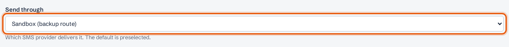

- With only one provider on the channel there is nothing to choose, so the list isn't shown.
- If the chosen provider is removed later, messages go through the channel's default instead.
- A WhatsApp or RCS message that falls back to SMS always uses the SMS default.

## 8. Use the test inbox

Go to **Settings → Test inbox**. Every message sent through a sandbox provider lands here instead of
reaching anyone. The tabs filter by channel; the list refreshes every 2 seconds.

- On WhatsApp and RCS messages, **Mark undeliverable** reports the message as failed, as the real
  provider would. If it was sent with an SMS fallback, the SMS appears here shortly, marked
  **Fallback**.
- **Simulate a reply** sends an incoming SMS, WhatsApp or RCS message **From** a phone number. Every
  contact with that number gets an `sms_received` (or `whatsapp_received`, `rcs_received`) event, and
  a reply keyword such as `STOP` unsubscribes them. For RCS you can also simulate a tapped suggested
  reply or action.
- **Simulate a bounce** reports a **Hard bounce**, **Soft bounce** or **Spam complaint** for an
  **Email**, exactly as a bounce webhook would.

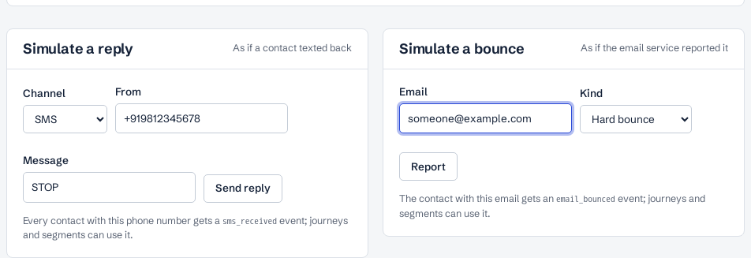

> Simulations change real contacts in your workspace: a `STOP` from a contact's number really
> unsubscribes them from SMS, and a hard bounce really stops their email. Use test numbers and
> addresses.

## 9. Sending limits and daily quotas

Providers have limits: an SMS route may take 20 messages a second and 5,000 a day. Tell Pulse, and
every Pulse server keeps to them together. You set them in two places, with the same fields:

- in the **Sending limits** part at the end of the **Add provider** or **Edit** form;
- with **Limits** on the provider's row (you need edit access to channels), to change only the limits.

The fields:

| Field | What to enter |
|---|---|
| **Messages per second** | The most your account at the provider may send in a second. Empty: no limit |
| **Messages per day** | The most it may send in a day. Empty: no limit |
| **A day starts at midnight in** | The time zone whose midnight starts a new day for **Messages per day** |

**Example: an Amazon SES account allowed 300 emails a second.** Add the email provider with
**SMTP** (step 2), and under **Sending limits** type `300` in **Messages per second**. Leave **Messages
per day** empty, or enter your SES daily quota. Then click **Save provider**.

Under the fields, a note shows the **server's own speed** for the channel. Whoever runs Pulse sets,
for each channel, the most messages a second any one workspace may send (200 emails a second unless
they changed it), and that speed wins: with 300 on a server that allows 200, Pulse sends 200 a
second, and the note turns into a warning:

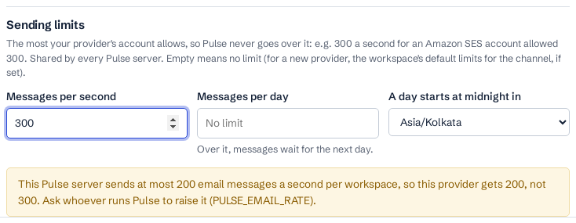

If your account really allows more, ask whoever runs Pulse to raise the setting the note names
(`PULSE_EMAIL_RATE` for email, `PULSE_SMS_RATE` for SMS, and so on).

To change only the limits later, click **Limits** on the provider's row, change the fields and click
**Save limits**. Every Pulse server follows them within 30 seconds.

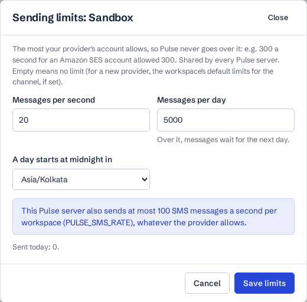

The provider's row then shows its limits and how many messages it has sent today:

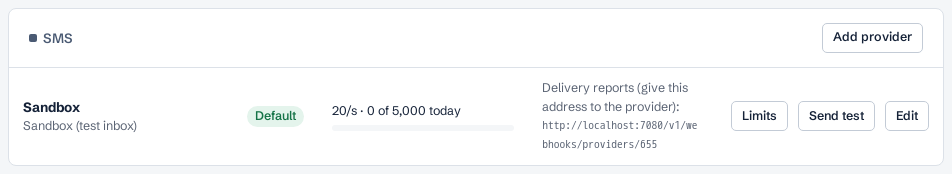

- The provider's rate is on top of the server's rate for the channel; whichever is slower applies.
- When the day's quota is used up, further messages **wait for the next day** (they show as *held*,
  `<channel>_deferred`, like quiet hours) and go out after midnight in the quota's time zone. A
  message whose **send deadline** (tutorials 6, 7 and 14) comes first is dropped instead, recorded as
  failed with the reason `deadline`.
- A message that wasn't accepted (the provider was down, the number was wrong) doesn't use the quota.

## 10. Saved test contacts

Under **Test contacts** on the Channels page, keep the people every **Send a test** dialog offers:
yourself, your team, a QA phone.

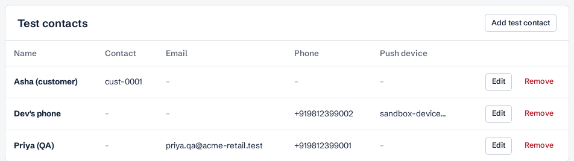

**Add test contact** takes a name and either:

- **An existing contact** (their external ID): tests to them are personalised with their data and go
  through the normal delivery path, like any test send.
- **Addresses**, used as they are: an email, a phone number with its country code (SMS, WhatsApp,
  RCS) and a push device token. Only the name is filled in (`{{contact.first_name}}`); nothing is
  tracked or recorded on any contact, and consent and caps don't apply.

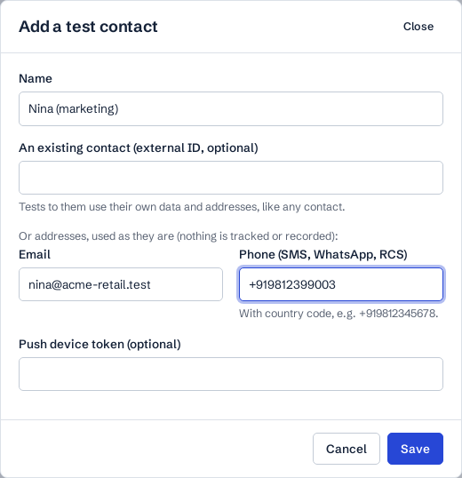

In **Send a test** (the template editor, campaign steps, one-time campaigns and the campaign wizard), choose one
under **Send to**. A test contact without an address for the template's channel is greyed out. You can
still pick a sample trigger event (tutorial 13).

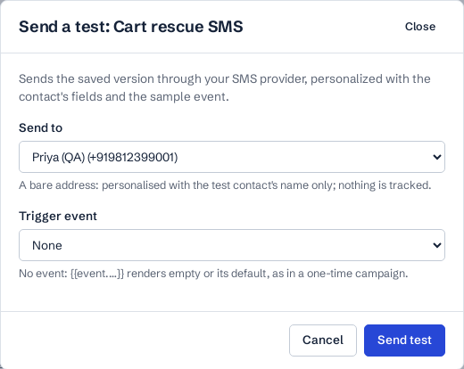

Adding and editing test contacts needs edit access to content, as sending tests does. A test contact
with its own **addresses** also needs edit access to channels (the **Admin** role), because tests to
it skip consent: admins keep that list, and everyone who checks messages sends to it. Test sends are
limited to 30 a minute per workspace, and each one is in the audit log. A browser push token must be a
subscription from a browser push service (Chrome, Firefox, Safari, Edge).

## 11. Web push: ask visitors and check your site

Go to **Settings → Web push** (under *Delivery*). It works with the website snippet you already
have (tutorial 1): no code beyond one small file on your site. Web push needs a secure (https)
site; on iPhone and iPad, visitors must first add your site to their home screen. Changing it needs
edit access to channels.

### The opt-in prompt

Browsers allow one question about notifications, and a visitor who says no there can't be asked
again. So Pulse first shows your own friendly message; the browser's question opens only when the
visitor clicks your **Allow** button.

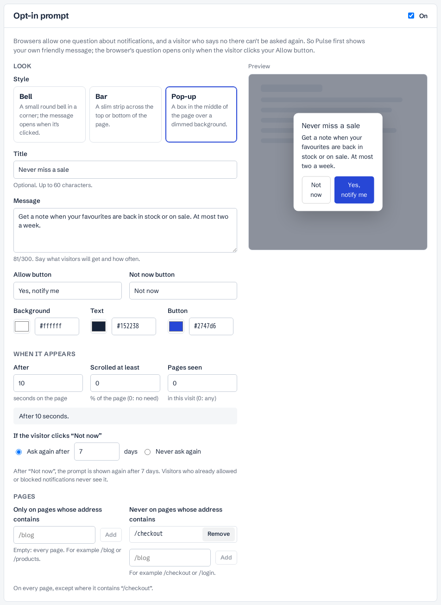

1. Turn the prompt on with the switch at the top right (**On** / **Off**).
2. **Look**: the **Style**: **Bell** (a small round bell in a corner; the message opens when it's
   clicked), **Bar** (a slim strip across the top or bottom of the page) or **Pop-up** (a box in the
   middle of the page over a dimmed background), and **Where** for the bell and the bar. Then the
   **Title** (optional, up to 60 characters), the **Message** (up to 300: say what visitors will get
   and how often), the **Allow button** and **Not now button** labels, and the **Background**,
   **Text** and **Button** colours. The **Preview** on the right shows it as you type.
3. **When it appears**: **After** so many seconds on the page (default 5), **Scrolled at least** a
   percentage of the page, and **Pages seen** in this visit. The line under them sums it up, e.g.
   *After 10 seconds.*
4. **If the visitor clicks "Not now"**: **Ask again after** a number of days (default 7) or **Never
   ask again**. Visitors who already allowed or blocked notifications never see it.
5. **Pages**: **Only on pages whose address contains** (empty: every page) and **Never on pages whose
   address contains** (e.g. `/checkout`), each with **Add**.
6. Click **Save** at the bottom of the page. Your site picks up the change on the next page a
   visitor opens.

With the prompt off, visitors are only asked if your site calls `Pulse.enablePush()` itself (the
developer docs show how).

### The install check

Web push needs two things on your site: the website snippet on its pages, and one small file, the
**service worker**, at the address in **Service worker file** (`/pulse-sw.js` unless your web team
put it elsewhere). The panel shows the line that file holds, with **Copy**; give it to your web team.

**Check my site**: enter **Your site's address** (e.g. `https://www.example.com/`) and click
**Check my site**. Pulse opens the page from its server and reports each part, with **What to do**
for anything that's wrong:

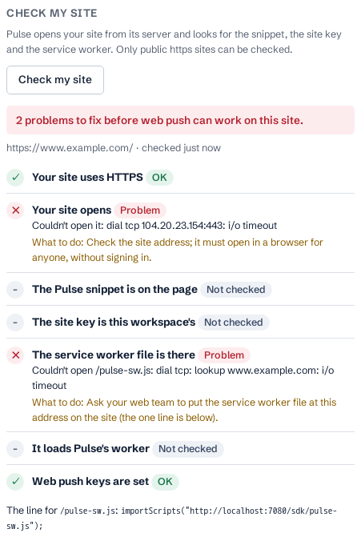

Only public https sites can be checked this way, at most 10 checks a minute.

**Check in my browser** tests a real browser, the way your visitors see the site. Save your site's
address first, then click **Check in my browser**: Pulse makes a one-off check link (it works for 30
minutes). Click **Open my site**, or open the link on another device, such as a phone. The website
snippet on that page tests the browser and reports back; the panel shows the result after a few
seconds:

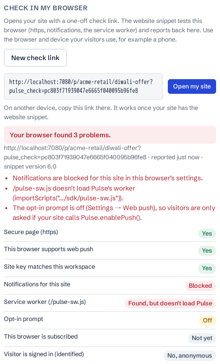

The report covers a secure page, browser support, the site key, whether notifications are allowed or
blocked for the site, the service worker, the opt-in prompt, whether this browser is subscribed, and
whether the visitor is signed in. In the picture the check ran on one of the workspace's landing
pages, which has the snippet but no service worker.

## What you have now

- A provider (or the sandbox) on every channel you use, checked with a test send
- Sending limits on providers that have them, and test contacts for everyone who checks messages
- Delivery rules: caps, quiet hours, reply keywords and reply tracking
- Bounces, complaints and deliveries flowing back from your email service, with checked signatures
- The test inbox, for trying everything without messaging anyone
- A web push prompt and a site that passes the install check

**Next:** [Tutorial 5, Templates and content](05-templates-and-content.md): write the messages these
channels send, and the landing pages, forms and files around them. For a provider without a
ready-made connection, see [tutorial 16](16-connecting-any-provider.md).
