# Tutorial 5: Templates and content

In about 30 minutes you will write a personalised Diwali offer as an email and an SMS, preview it as a
real contact and send yourself a test; then build a landing page with a sign-up form, a two-page
enquiry form with a file upload (and double opt-in), and a price list people download after telling
you who they are. At the end: a spam check, shared content blocks, templates in several languages, AI
help and the template report.

**You need:** a workspace with channels set up (tutorial 4: the sandbox providers are enough), a few
contacts (tutorial 1 or 2), and a role that can edit **Content**. Pictures use the Acme Retail docs
workspace and its contact `cust-0287` (Meera Rao, Delhi).

Everything here lives under **Content** in the sidebar:

| Page | Holds |
|---|---|
| **Message templates** | The content of every email, SMS, WhatsApp, RCS, push and app inbox message your campaigns send |
| **Landing pages** | Hosted pages at `/p/<workspace>/<address>` |
| **Forms** | Sign-up and contact forms: a hosted link, or embedded |
| **Assets** | Files to download (openly or behind a form) and to attach to emails |

---

## 1. Message templates

Go to **Content → Message templates**. The tabs filter by channel (**All**, **Email**, **SMS**,
**WhatsApp**, **RCS**, **Push**, **App inbox**). Each template belongs to one channel. The button at the
top right creates a template for the tab you're on: **New email template** on *All* or *Email*, **New SMS
template** on *SMS*, and so on.

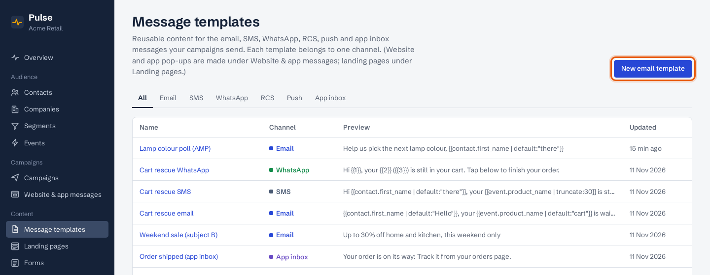

Every template has a **Template name** and a box at the top:

> **Transactional (an OTP, receipt or password reset): ignore frequency caps and quiet hours.** Tick it
> only for messages someone is waiting for. Consent still applies.

The buttons at the top right are the same for every channel: **Preview as contact**, **Send a test**
(after the first save), **Save template**, and **Delete**. A template that a scheduled, running or
testing one-time campaign or an active triggered campaign sends can't be deleted: Pulse names those
campaigns; pause or finish them first. Other campaign steps that use a deleted template fail to
send. An email template also has **🛡️ Spam check** (step 10), and every template except
WhatsApp has **✨ AI** when your Pulse server has AI help turned on (step 13).

A saved template has two tabs: **✏️ Content** (the editor) and **📊 Report** (how its messages did in
every campaign, step 14). Above the editor, the **🌐 Language** bar adds versions in other languages
(step 12). The **🧩 Content blocks** button on the template list opens the shared headers, footers and
offers (step 11).

## 2. Personalisation

Templates use **variables** in double braces, filled for each contact when the message goes out:

| Variable | Gives |
|---|---|
| `{{contact.first_name}}` | Any contact field by its key (`city`, `phone_country`, your own fields from **Settings → Contact fields**) |
| `{{contact.email}}`, `{{contact.external_id}}` | The contact's email address and ID |
| `{{contact.first_name \| default:"there"}}` | A fallback when the field is empty; other formats: `upper`, `title`, `date`, `money`, `truncate:40`… |
| `{{event.product_name}}` | A property of the event that started a triggered campaign (a cart's product) |
| `{{campaign.name}}` | The campaign's name |
| `{{links.unsubscribe}}`, `{{links.preferences}}` | Email only: the contact's unsubscribe link and preference center |

Every templated field has a **{ } Variable** button that lists them and adds a default or a format;
in the rich text editor the **Personalize…** menu does the same. Above the editor, choose what happens
when a variable has no value: **leave it empty** (the default) or **don't send to that contact**.
[Tutorial 13](13-personalising-messages.md) covers variables, formats, the **Trigger event for
{{event.…}}** box beside it (the event that started a campaign) and choosing the channel by rule.

> Templates written with the older Go template tags (`{{.Attrs.first_name}}`, `{{.Contact.Email}}`,
> `{{.UnsubscribeURL}}`, `{{if …}}`) keep working, also next to variables. The form
> `{contactfield=first_name}` works only in a campaign's **Update contact** step.

## 3. Write an email

1. On **Message templates**, click **New email template**.
2. The email opens in the **Visual builder**: drag blocks (sections, columns, buttons, images, text)
   from the right onto the email, and click any text to edit it.

   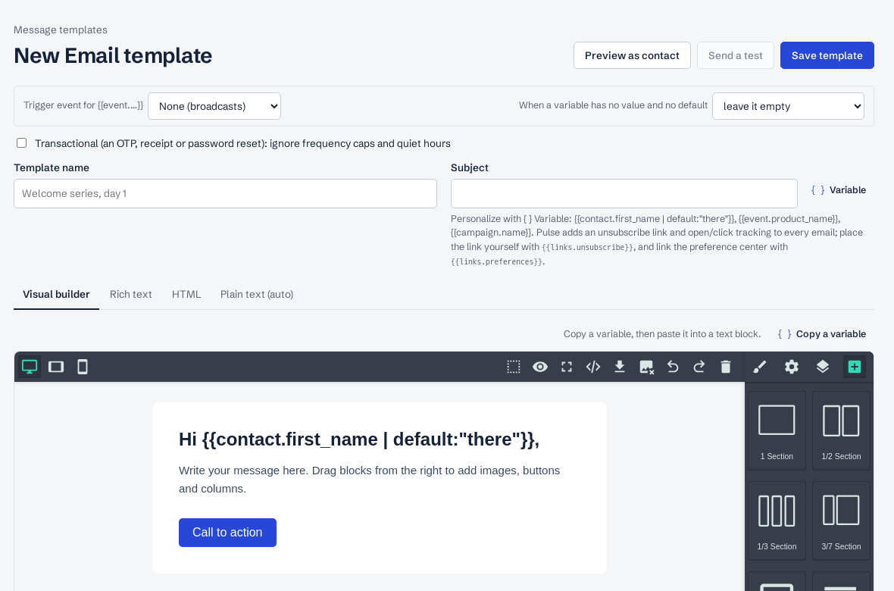

   The four tabs are four ways to write the same email:

   | Tab | Use it for |
   |---|---|
   | **Visual builder** | Designed layouts: columns, buttons, images |
   | **Rich text** | A simple, letter-style email, edited like a document |
   | **HTML** | Pasting or hand-writing HTML, with a live preview beside it |
   | **Plain text (auto)** | The plain-text version sent alongside the HTML (below) |

   Switching from the builder to **Rich text** or **HTML** asks first: saving from those tabs replaces
   the builder's layout with plain HTML.
3. For this offer, click **Rich text** and confirm. Fill in:
   - **Template name**: `Diwali offer (email)`
   - **Subject**: `{{contact.first_name | default:"Hello"}}, your Diwali offer is here` (type it, or click
     **{ } Variable** beside the field, choose **First name** and enter the default)
4. Write the email. The toolbar has text styles, bold/italic/underline, colours, links (select text,
   then the link button or Ctrl+K), lists, alignment, images and tables. Put the cursor where the city
   goes and choose **Personalize… → City**. The preview on the right fills variables with a sample
   contact (Asha from Pune).

   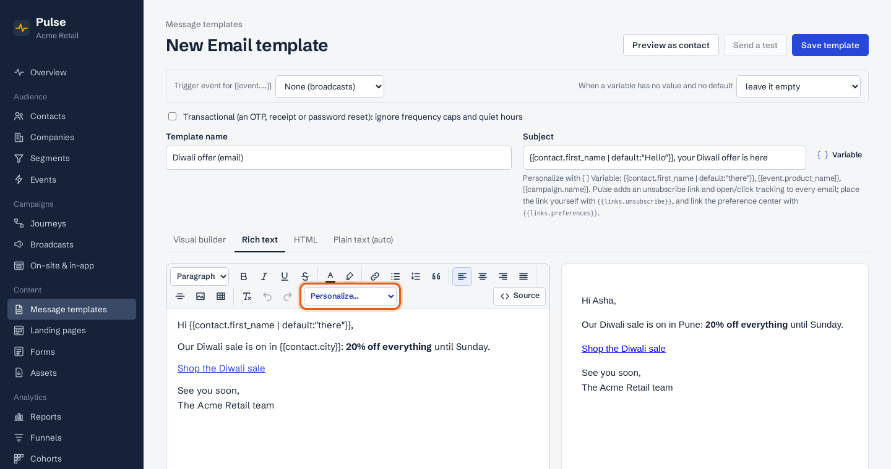

   The **Source** button shows the HTML of what you wrote. The **HTML** tab shows the whole email with
   its preview:

   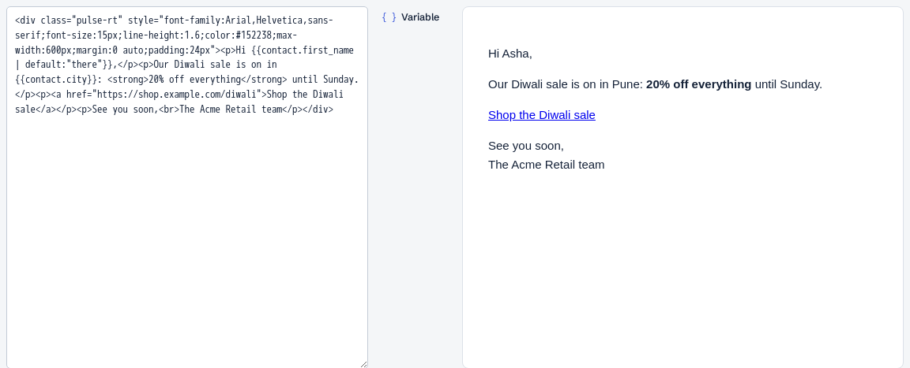
5. Click **Save template**. You see *Template saved*.

Pulse adds three things to every email when it is sent, so you don't have to:

- **An unsubscribe link** in a footer (*You're receiving this because you subscribed. Unsubscribe*), and
  the List-Unsubscribe header mail apps use for their own unsubscribe button. If you place
  `{{links.unsubscribe}}` yourself, that's used instead.
- **Open and click tracking**: every link goes through a signed tracking link, recorded as
  `email_clicked`; opens are recorded as `email_opened`. Campaigns, segments and reports use both.
- **A plain-text part**. Leave the **Plain text (auto)** tab empty and Pulse generates it from the HTML
  when sending (links become "text (url)"). To write your own, open the tab and click **Generate from
  HTML** to start from that text; **Clear (generate automatically)** goes back to automatic.

**Attachments**: below the editor, choose a file you uploaded to **Assets** (step 9) and click
**Attach**. Up to 10 files, 10 MB together, go with every email from this template.

**An interactive AMP version (optional)**: below the editor, the **AMP version** panel adds a second
version of the email in which people vote in a poll, fill in a form or swipe through pictures
without leaving their inbox (in Gmail, Yahoo Mail and Mail.ru). Everyone else gets the normal email,
which is always sent too.

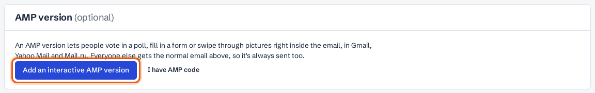

**Add an interactive AMP version** builds it from blocks; **I have AMP code** takes code your
developers wrote. [Tutorial 17](17-interactive-amp-emails.md) shows both, with the check, the
preview and the poll results.

## 4. Preview as a contact

1. Click **Preview as contact**. It first shows the sample contact.
2. Type a contact's external ID (here `cust-0287`) and click **Preview as contact**.

   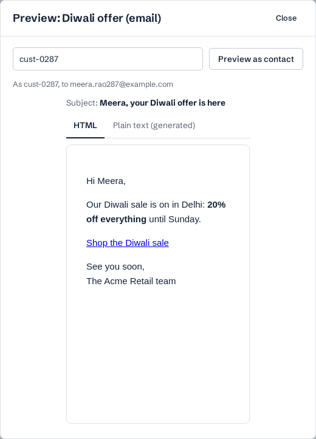

The server renders the template exactly as it would be sent, with that contact's attributes: here
*Meera* and *Delhi*. **Plain text (generated)** shows the text part. Preview works before you save, too.
Previewing as a real contact shows their data, so it needs a role that can view contacts; anyone who
can view templates can preview with the sample contact.

## 5. Send a test

**Send a test** sends the saved template to one contact through the channel's normal delivery path,
personalised with their attributes.

1. Click **Send a test**, enter the **Contact's external ID** (`cust-0287`), and click **Send test**.
   (**Send to** also lists your saved test contacts, see tutorial 4.)

   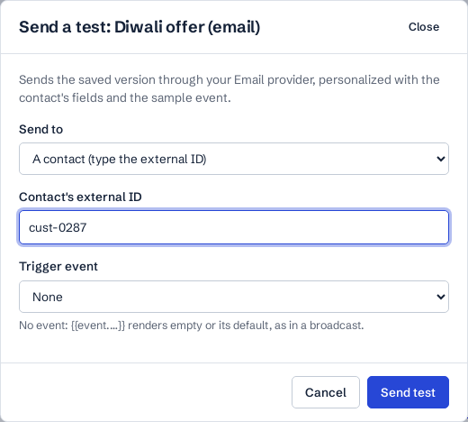
2. You see *Test queued. Check the test inbox or the contact's device.*
3. Where it arrives depends on the channel's provider (tutorial 4). Email through the server's relay
   on the local Docker stack lands in **Mailpit** at `http://localhost:18025`; through a sandbox
   provider, in **Settings → Test inbox**.

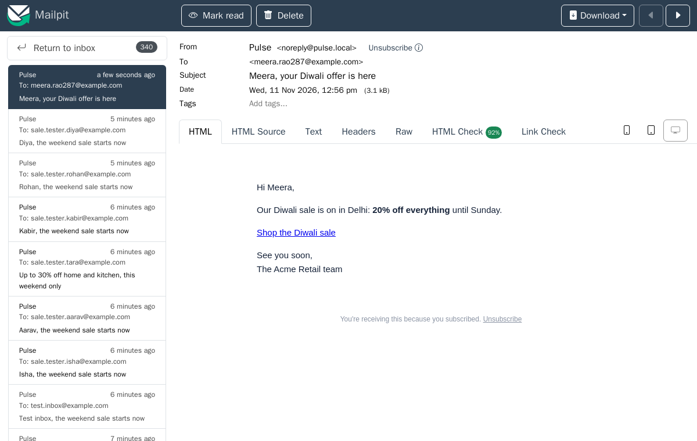

The test is a real send to a real contact: they must be subscribed to the channel, and unless the
template is **Transactional**, quiet hours and frequency caps apply (a held or capped test doesn't
arrive). It shows as an `email_sent` event on the contact. For WhatsApp and RCS, **SMS fallback
(optional)** also tests the fallback: pick an SMS template, and if the contact can't get the message,
the SMS goes instead.

## 6. The other channels

Non-email templates show a phone preview beside the form, filled with sample values as you type.

### SMS

1. On the **SMS** tab, click **New SMS template**. Name it `Diwali offer (SMS)`.
2. **Message**: `Hi {{contact.first_name | default:"there"}}, Diwali sale: 20% off everything until Sunday. Shop now:
   https://shop.example.com/diwali`. Under it Pulse counts characters and SMS parts (160 per SMS, or 70
   with characters outside the GSM alphabet such as emoji or Hindi).
3. **Sender ID**: your registered header (e.g. `ACMEIN` for India DLT); empty uses the provider's.
   For India, also fill in **DLT template ID (India)**: the ID this exact text is registered under on
   the DLT portal (providers such as Gupshup send it with each message), and, if it differs from the
   provider's, the **DLT principal entity ID**.
4. Tick **Track link clicks**: links become short tracked links (about 40 characters, working for 30
   days), so "Clicked a link in an SMS" works in segments and reports.

   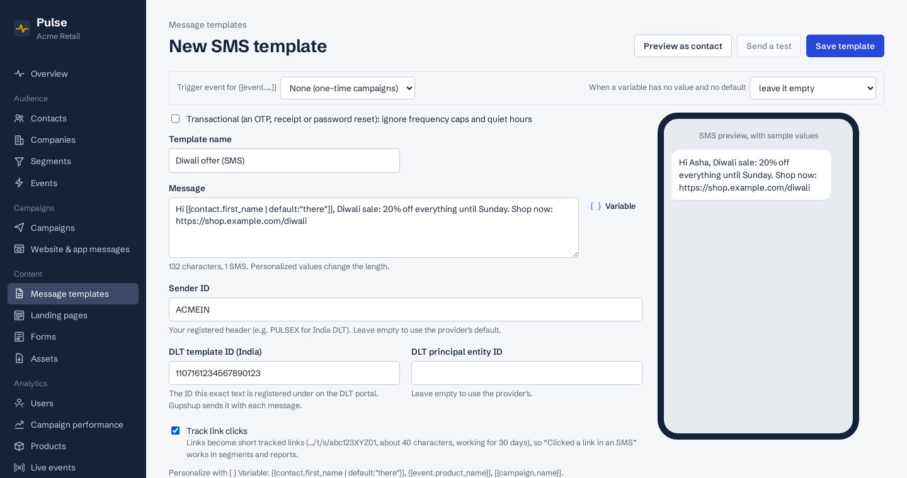
5. **Save template** and **Send a test** to `cust-0287`. Through the sandbox, it appears in
   **Settings → Test inbox** with the link shortened:

   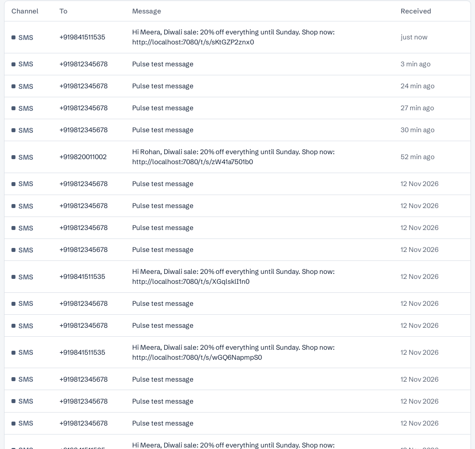

RCS templates have the same **Track link clicks** box.

### WhatsApp

WhatsApp only delivers business-started messages from templates Meta has approved, so a Pulse
WhatsApp template points at one:

| Field | What to enter |
|---|---|
| **Approved template name** | The name in Meta, e.g. `cart_reminder` |
| **Language code** | The approved language, e.g. `en`, `hi`, `en_US` |
| **Template text, for the preview** | The approved text with `{{1}}`, `{{2}}`… (only for the preview; Meta sends its own copy) |
| **Variables** | One per `{{n}}`, in order; **Add variable** for more. Each can use variables, e.g. `{{contact.first_name}}` or `{{event.product_name}}` |
| **Header image URL (optional)** | For templates with an image header |

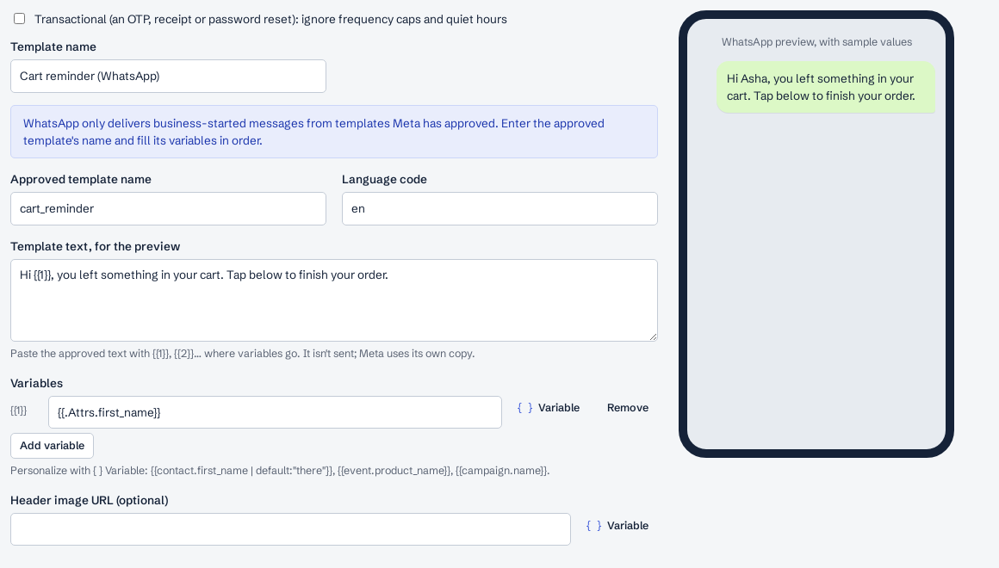

### RCS

Either a plain **Message**, or tick **Send as a rich card** for a **Card title**, **Card
description** and **Image URL**. Add up to four **Suggested replies and actions** with **Add a
suggestion**: **Reply** (a quick answer), **Open link** or **Call**.

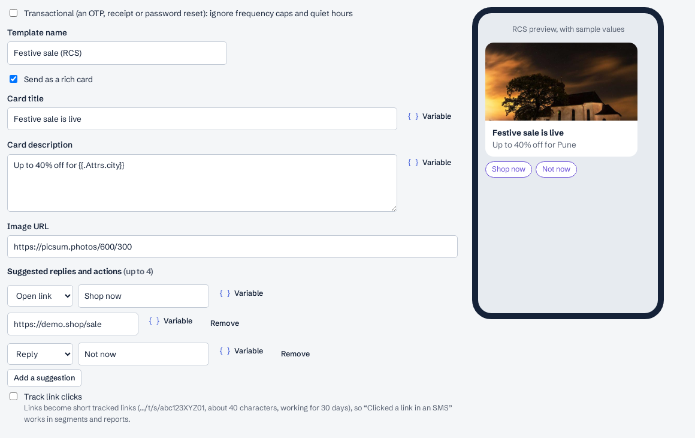

### Push and app inbox

**Push**: **Title**, **Message**, **Image URL (optional)** and **Open this link when tapped** (an
`https://` address or an app deep link). The same template goes to mobile apps (FCM) and subscribed
browsers (Web Push).

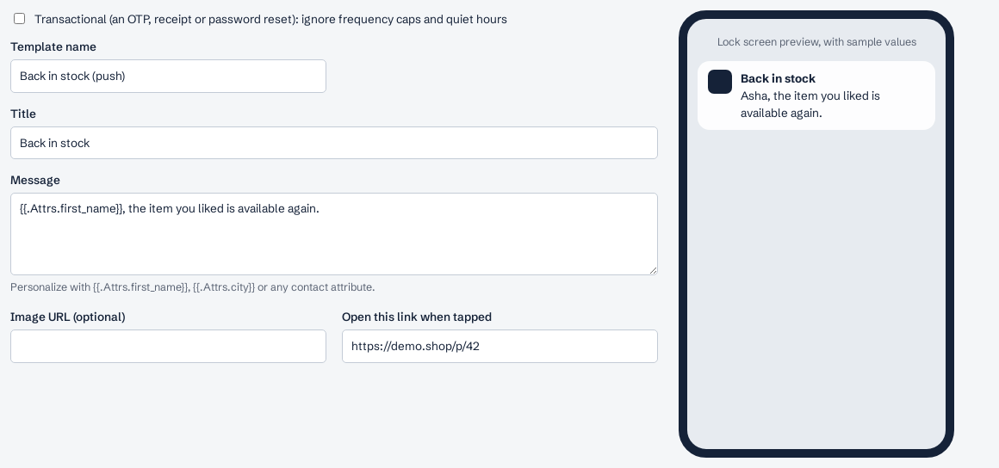

**App inbox**: the same fields plus **Category (optional)** (lets the app filter its inbox, e.g.
`offers`) and **Keep for (days)** (1-365; 30 if empty). It stays in the contact's inbox until it
expires or they delete it. No provider is needed.

## 7. Build a landing page

1. Go to **Content → Landing pages** and click **New page**.

   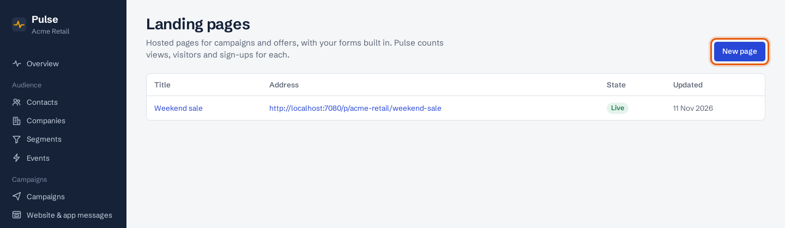
2. Fill in the page settings:
   - **Title**: `Diwali offer: 20% off everything` (browser tab and link previews; up to 200
     characters).
   - **Address**: filled from the title; here `diwali-offer`. Lowercase letters, digits and dashes, up
     to 80 characters. The full address shows under it: `http://localhost:7080/p/acme-retail/diwali-offer`.
   - **Meta description**: up to 320 characters, shown by search engines and link previews.
   - **Status**: **Draft** (nobody can open it) or **Published**.
   - **Online from (required)** and **Ends (optional)**: the publish window. A published page is online
     only inside it; leave **Ends** empty to keep it running.

   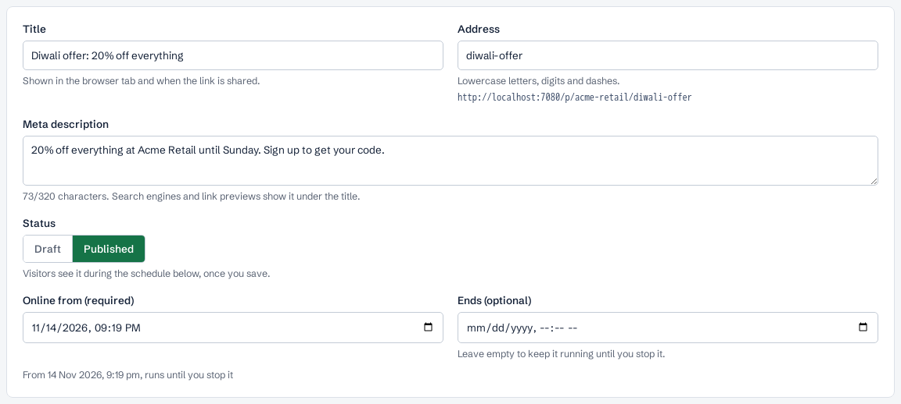
3. Write the page. The tabs: **Drag and drop** (the same builder as email), **Rich text**, **HTML** and
   **Preview**. Here, **Rich text**: a heading and a paragraph.
4. Add a sign-up form: click where it should go, then **Insert form… → Newsletter sign-up**. Pulse puts
   the form's token, `{form:KEY}`, at the cursor, and the preview on the right shows the form there.
   (In **Drag and drop**, **Insert form…** copies the token: paste it into a text block.) **Insert
   download link…** does the same for a file from Assets.

   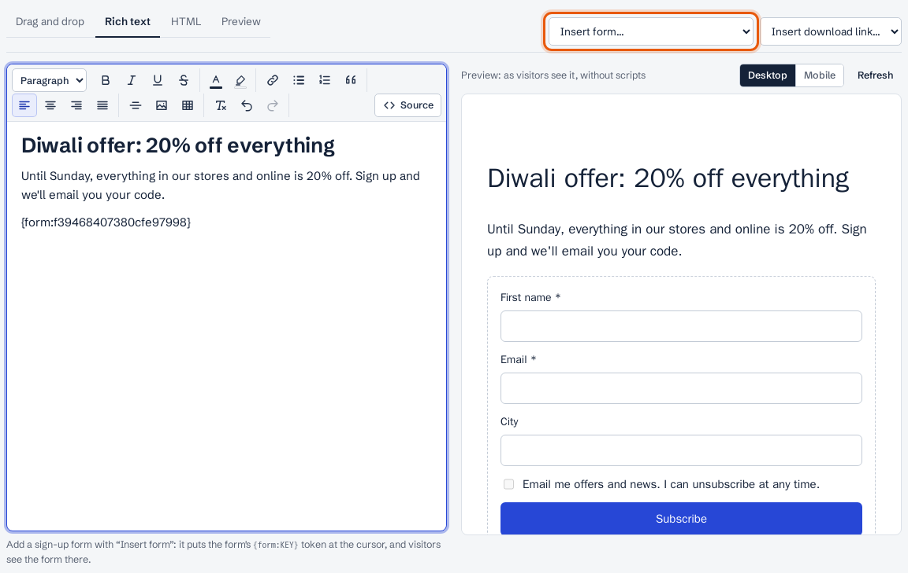

   The preview is rendered by the server as visitors see it, without scripts; **Desktop** / **Mobile**
   change its width.
5. Click **Save**: *Saved. The page is live.* (or *Saved. It's published, but outside its schedule right
   now.*)

Below the editor you now have **Use it**, with the **Page address** (**Copy**, **Open**) and an
**Embed it on another site** iframe code, and **Stats** for the last 30 days: views, unique visitors,
form submissions and conversion.

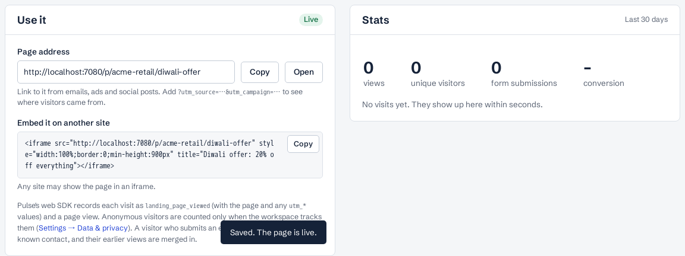

Open the address: this is what visitors see.

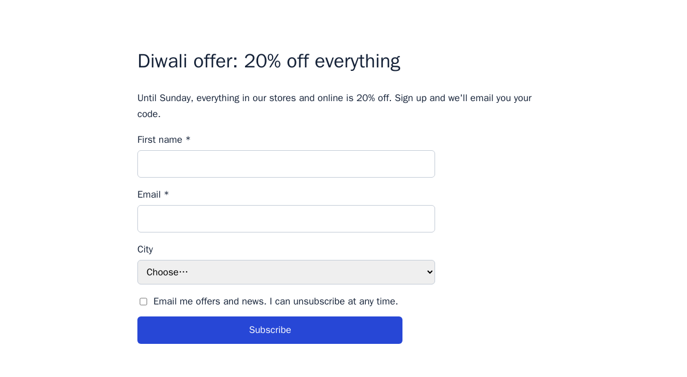

> **What runs on the page:** only Pulse's web SDK. When the page is served, Pulse removes
> `<script>` elements, `onclick=…` handlers, `javascript:` links, `<base>` and `<meta http-equiv>`.
> Each visit is recorded as `landing_page_viewed` (with any `utm_*` values from the address), and a
> visitor who submits the form becomes a known contact with their earlier views merged in.

## 8. Build a form

This one is a two-page bulk order enquiry with a file upload and a hidden campaign field.

1. Go to **Content → Forms** and click **New form**.

   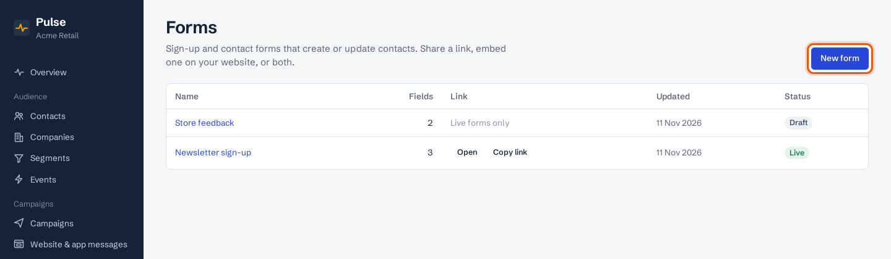
2. **Name**: `Bulk order enquiry` (the form's heading). A new form starts with **Email** (required)
   and **First name**.
3. Click **Add field** for each field. Each has a **Label**, **Saves to** (the contact attribute key,
   filled from the label: `Company` → `company`) and a **Type**: **Short text**, **Email**, **Phone**,
   **Number**, **Long text**, **Dropdown** (options one per line), **Checkbox**, **Hidden** or **File
   upload**. Under each: **Required**, **Hide when already known**, and **Move up** / **Move down** /
   **Remove**.
   - Add `Company`.
   - Click **Add page break**, with **Page title (optional)** `About your order`. Everything below it is
     page 2.
   - Add `Quantity` as **Number**, **Required**.

   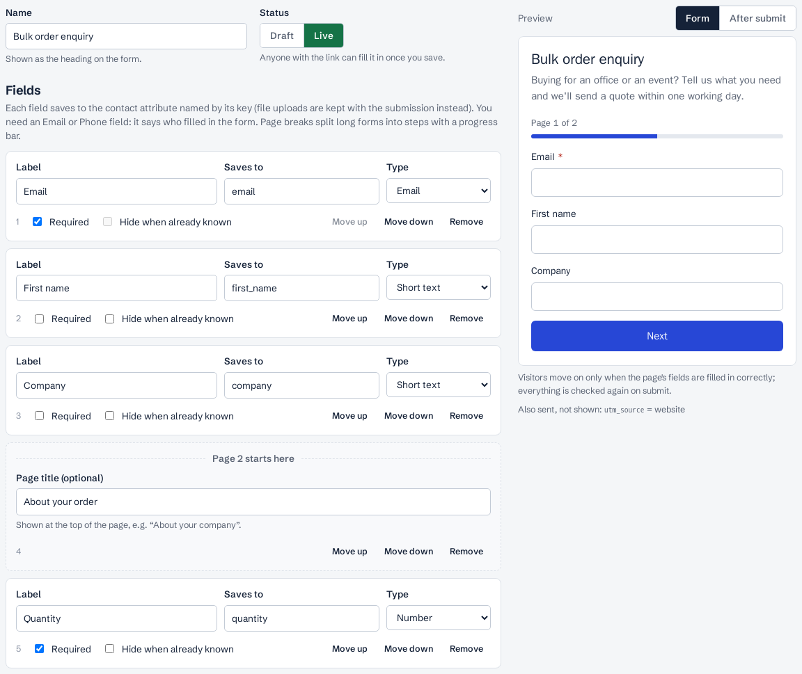

   The preview on the right is the real form: **Next** and **Back** move between pages, and **After
   submit** shows what people see once they're done.
4. Add a file upload: `Purchase order`, type **File upload**. Under **Accepted files**, keep **PDF**
   only; **Size limit (MB)** 1 to 10 (5 by default).
5. Add a hidden field: label `Campaign source`, type **Hidden**, set **Saves to** to `utm_source` and
   **Value sent** to `website`. Visitors don't see it. On the hosted link, `?utm_source=newsletter` in
   the address replaces the value.

   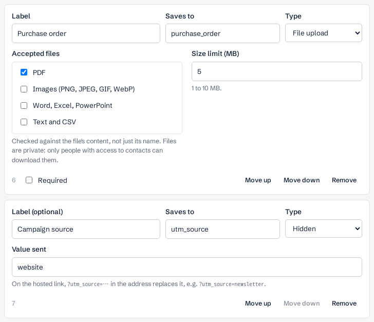
6. **Form text**: **Description** (shown above the fields), **Button text** `Send enquiry`, and an
   **Accent color** for the button and checkboxes.
7. **After they submit**: **Show a message** (`Thanks! We'll send your quote within one working day.`)
   or **Send them to a page** (an `https://` address). Then optionally **Add them to these static
   segments** and **Add these tags** (`bulk-order`).
8. **Consent**: a **Consent checkbox** text makes people tick a box to submit. With it, **Opt them back
   in to** re-subscribes people who opted out of those channels (here **Email**) when they tick it.

   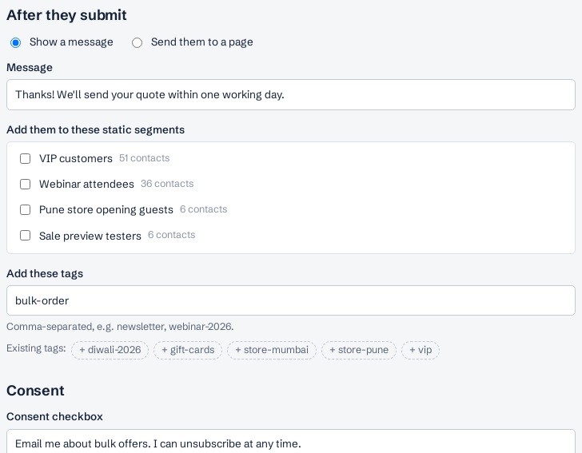
9. Set **Status** to **Live** and click **Save**: *Saved. The form is live.*

### Double opt-in: ask people to confirm their address

With double opt-in, people who fill in the form get an email with a link, and only join your lists
when they click it. It proves the address is theirs: fewer typos and fake sign-ups, better
deliverability, and consent you can show.

1. In the form editor, under **Double opt-in**, tick **Ask people to confirm their email address
   first**.
2. **Confirmation email**: choose an email template that has the link `{{event.confirm_url}}`. To get
   one quickly, click **✨ Create the standard one**: Pulse makes the template *Confirm your
   subscription* (subject *Please confirm your subscription*, a **Yes, subscribe me** link) and picks
   it. Edit it under **Message templates** any time.
3. Optionally, **After confirming, show** a message (`Thanks — you're subscribed.`), **Or send them to**
   a page on your site (the page wins over the message).
4. **Save**.

What happens then:

- The person becomes a contact right away, with what they typed, and gets the confirmation email.
  The form's lists (static segments), tags and channel opt-ins wait.
- The link in the email opens a page, *Confirm your subscription*, with a **Yes, confirm my
  subscription** button. Only the button confirms: mail scanners that open links confirm nothing.
- When they click it, they join the lists, get the tags and the opt-ins, and see *You're confirmed*
  (or your message, or your page). Clicking again does nothing more.
- Links work for 7 days. After that the page says *This link has expired*: they fill in the form
  again.
- Each step is an event on the contact: `optin_requested` when the email goes out, `optin_confirmed`
  when they confirm. Both show on the contact's **Consent & privacy** tab ([tutorial 11](11-admin-and-privacy.md#6-a-persons-data-see-it-export-it-erase-it))
  and work in segments and campaign triggers.

A double opt-in form needs a required **Email** field. Pulse sends no reminder to people who never
confirm; to send one, make a triggered campaign that starts on `optin_requested`, waits a day, and
sends a reminder if they haven't done `optin_confirmed` ([tutorial 6](06-triggered-and-automation-campaigns.md)).

### The rules Pulse checks

The rules Pulse checks as you type: an **Email** field (key `email`) or a **Phone** field (key
`phone`) is required, as it says who filled in the form; up to 30 fields, 10 pages and 5 file fields; a
page break goes between fields, not first or last; keys use letters, digits and `_`.

### Share or embed it

After saving, **Use it** gives three ways to put the form in front of people:

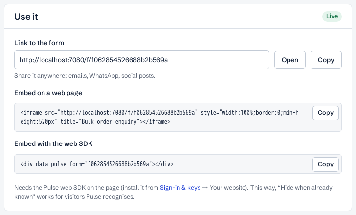

| Option | Use |
|---|---|
| **Link to the form** | `http://localhost:7080/f/<key>`: a hosted page for emails, WhatsApp, social posts |
| **Embed on a web page** | An `<iframe>` of that page |
| **Embed with the web SDK** | `

` on a page with the Pulse snippet. Only this way does **Hide when already known** work, for visitors Pulse recognises |

On the hosted page, visitors fill in page 1, click **Next** (each page is checked before the next one
shows), then attach the file and tick the consent box:

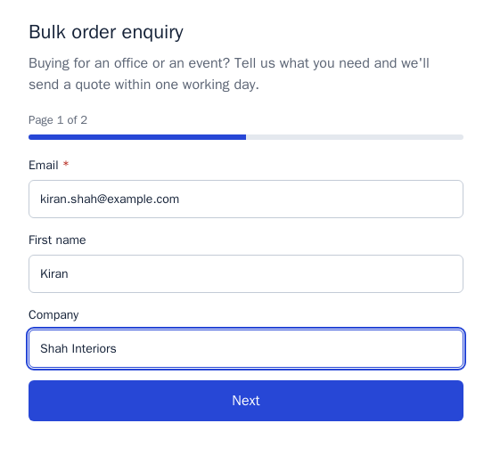 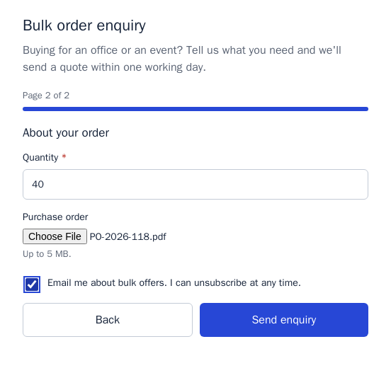

The submitter becomes a contact (or updates the existing one) right away, with `company`, `quantity`
and `utm_source` on their profile and the `bulk-order` tag. Pulse keeps bots out with a hidden
honeypot field, a minimum fill time (2 seconds; a submission that doesn't say when the form was
shown counts as too fast) and a limit on submissions per IP address. To follow up automatically,
start a triggered campaign on **submits a form** with this form ([tutorial 6](06-triggered-and-automation-campaigns.md#3-choose-the-trigger)).

### Submissions

Back in the form editor, **Submissions** shows totals (**in total**, **last 30 days**, **unique
contacts**), a **By day** chart, and **Recent** submissions with every answer and where it came from
(**Link** or **Web SDK**). An uploaded file is a download link there, for teammates who can see
contacts.

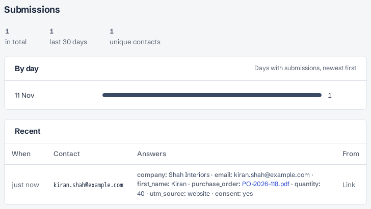

Uploaded files are private (only teammates with contacts access can download them), checked against
their content and not just their name, and deleted with the form or the contact. They aren't
virus-scanned, and they show only here, not on the contact's profile.

## 9. Upload a file and gate it behind a form

1. Go to **Content → Assets**. In **Upload a file**, drop a file on the box or click **Choose file**.
   Up to 25 MB; allowed types: `.pdf .png .jpg .jpeg .gif .webp .svg .csv .txt .ics .zip .docx .xlsx
   .pptx` (checked against the file's content).
2. **Title** (defaults to the file name): `2026 bulk price list`. **Description**: shown above the form
   for gated downloads.
3. **Who can download**: **Anyone with the link**, or a form people fill in first. Here: **Newsletter
   sign-up**. (A draft form blocks downloads until it's live.)
4. Click **Upload**.

   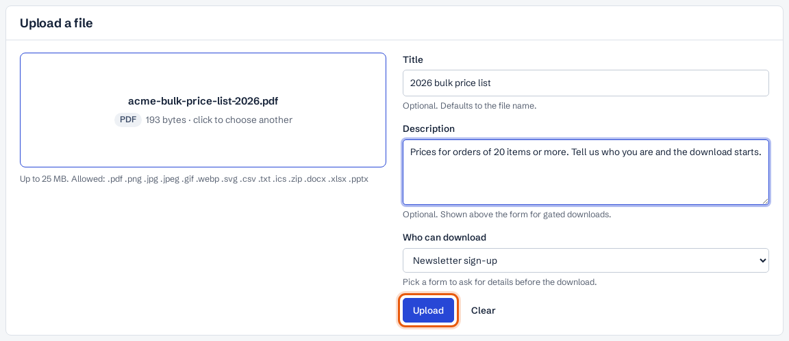

The file's panel opens: downloads (**Downloads**, **By known contacts**, **Unique contacts**), the
editable title, description and gate, and **Use it** with the **Download link** and an **HTML link** to
paste into pages. **Download a copy** gets the file yourself without counting it. The file itself can't
be replaced: upload a new one instead.

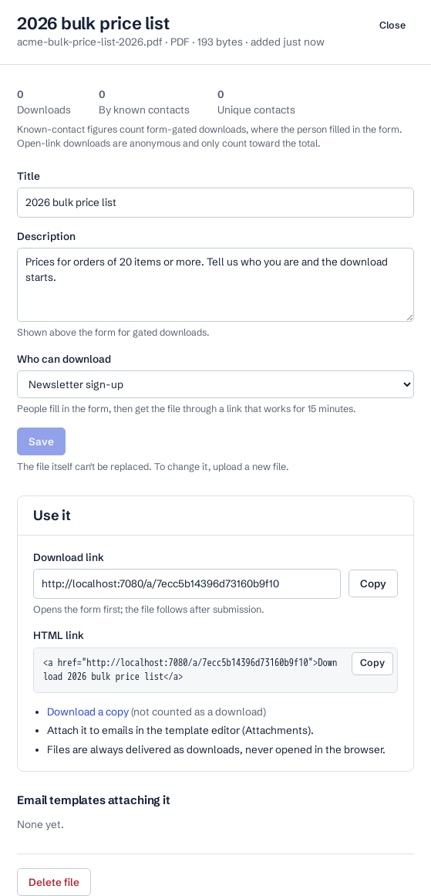

Visitors who open the download link (`http://localhost:7080/a/<key>`) see the form first:

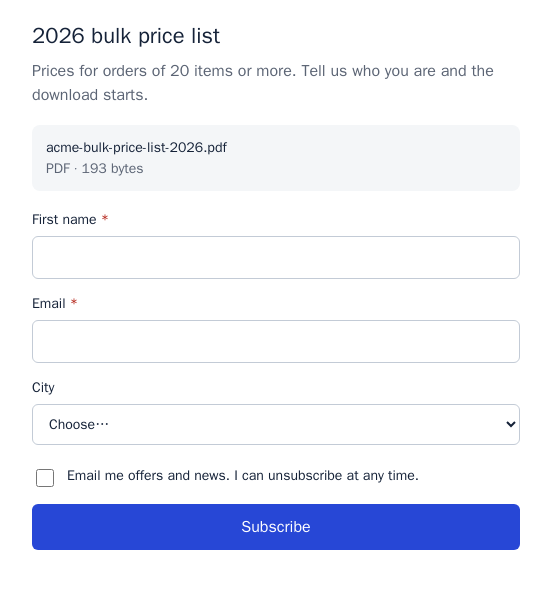

After they submit, the download starts through a link that works for 15 minutes, and their profile gets
an `asset_downloaded` event (usable in campaigns and segments). Open-link downloads are counted but
anonymous. Files always download; they never open in the browser.

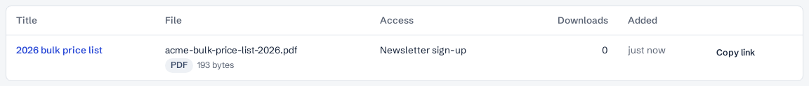

## 10. Check an email for spam

Before you send an email, check whether its content looks like spam to inbox filters.

1. Open the email template and click **🛡️ Spam check** (top right).
2. The **Spam check and inbox preview** window opens.

At the top is the **inbox preview**: one line as it would look in an inbox list, with your sender, the
subject and the first words of the email (the preheader). If the first words are "View in browser" or
an image's name, change the start of your email.

Under it is the **score**: points for everything a spam filter dislikes. Under 3 points is good.

| Rating | Means |
|---|---|
| ✅ **Looks good** | Nothing here should send it to spam |
| ⚠️ **Risky** | Some filters may file it as spam or Promotions. Fix the items listed |
| 🚫 **Likely spam** | Most filters would flag it. Fix the items before sending |

Each item has its points and how to fix it. Pulse checks, among others: spammy words in the subject
("FREE!!!", "100% guaranteed"), a subject in capitals or with many exclamation marks, an email that is
only an image, images without alt text, no plain-text version, link shorteners, a link whose text names
another website than it goes to, hidden text, forms or scripts, and bare web addresses. The line at
the bottom gives the email's size (Gmail cuts off emails over 102 KB), and how many links and images
it has.

The check looks at your content only. It doesn't run the network tests some spam filters use, and it
doesn't send to real test inboxes. Your sending domain matters as much: check it on **Settings →
Channels** ([tutorial 4](04-channels.md#12-check-your-sending-domain)).

## 11. Reuse content: content blocks

A content block is a header, footer, offer or signature you write once and use in any template. Change
the block and every template that uses it changes from the next send.

1. On **Content → Message templates**, click **🧩 Content blocks**, then **New block**.
2. **Name**: `Festive footer`. The **Key** fills in from the name (`festive_footer`); templates use the
   block as `{{block.festive_footer}}`.
3. **Content (emails)**: write the block in the rich text editor (links, images, tables).
4. **Plain text (SMS, WhatsApp, push, subjects)**: the words for channels without formatting. Leave it
   empty to use the content's words.
5. Click **Save block**.

To use it, put `{{block.festive_footer}}` where it should go in a template: click **Copy** next to it
in the block list and paste, or pick it from the **{ } Variable** button's list. Previews and sends
use the block's current content, and variables inside a block (`{{contact.first_name}}`) are filled in
for each contact.

When you open a block again, **Used by** lists the templates that use it. Saving says how many
templates get the change. Changing a block's key breaks templates that use the old key. **Delete**
says how many templates use it; after deleting, they show nothing in its place.

Blocks can't contain other blocks. The keys `feed` and `recommendations` are kept for Pulse's own
blocks: `{{block.feed}}` (RSS-to-email, [tutorial 7](07-one-time-campaigns.md#10-a-newsletter-from-your-blog-the-archive-and-rss-to-email))
and `{{block.recommendations}}` ([tutorial 19](19-product-recommendations.md)).

## 12. Write it in several languages

One template can have a version per language. Each contact gets the version for their language;
everyone else gets the default.

1. Open the template. Above the editor, the **🌐 Language** bar shows **Default**.
2. Click **+ Add language**. Choose one of the offered languages (Hindi, Tamil, Marathi, English and
   others), or type a code such as `hi-IN` and click **Add**. A template can have up to 20 languages.
3. The language's editor opens. Click **Copy from Default** to start from the default's words, then
   translate them. (With AI help on, **✨ Translate from Default** does a first draft, step 13.)
4. **Save template**.

What a language version holds depends on the channel:

| Channel | A language version has |
|---|---|
| Email | **Subject** and the email body (rich text) |
| SMS, RCS | **Message** |
| Push, app inbox | **Title** and **Body** |
| WhatsApp | The **Approved template name** and its **Template language code** (WhatsApp approves each language separately) |

Leave a field empty to use the default's. Links, images and settings stay the default's, and
variables work the same.

**Who gets which version.** Pulse reads the contact's `locale` field (or, without it, `language`).
An exact match wins (`hi-IN`); otherwise the same language does (a contact with `hi-IN` gets the `hi`
version). Everyone else, and contacts with no language, get the default. **Preview as contact** shows
the version that contact would get.

**Remove language** deletes a version; contacts in that language then get the default. An email built
with the drag-and-drop builder keeps its layout in the default only: its language versions are rich
text. Reports count all languages together.

## 13. Let AI help

If whoever runs your Pulse server has turned on AI help (with the setting `PULSE_AI_API_KEY`), you
see **✨** buttons in three places. Without it, the buttons don't show.

**In a template:** click **✨ AI** (top right; not on WhatsApp templates). The **✨ AI help** window
has:

- **Subject line ideas** (email) or **Title ideas** (push, app inbox): click **Suggest**, then **Use**
  next to the one you like. **More ideas** asks again.
- **Rewrite the email body** (or the message, or the body): choose how (**Shorter**, **Friendlier**,
  **Simpler words**, **More urgent**, **More formal**, **Fix spelling and grammar**) and click
  **Rewrite**. **Now** and **Suggested** show side by side; **Use the suggestion** puts it in the
  editor. An email in the drag-and-drop builder can't be rewritten: switch it to rich text or HTML
  first.

**In a language version:** **✨ Translate from Default** fills it with a translation of the default's
words. If it already has words, Pulse asks before replacing them.

**In a segment:** **✨ Describe who should be in it**, e.g. *Bought twice in the last 90 days, live in
Pune, not unsubscribed*, then **Build**. The conditions appear in the rule builder for you to check
([tutorial 3](03-segments.md)).

What to know:

- Nothing changes until you click **Use**, **Use the suggestion**, **Translate** or **Build**, and you
  can still edit the result, or leave without saving.
- Variables like `{{contact.first_name}}` must come back unchanged, and a segment's conditions must be
  valid; if not, Pulse refuses the suggestion.
- Only the words you are working on (and your field and event names, for segments) are sent to the AI
  service, never your contacts' data.
- A workspace can make 20 AI requests a minute and 200 a day (the day starts at 00:00 UTC). After
  that, Pulse says so and AI help works again the next day.
- Very long texts are refused, not cut: an email body over about 60 KB can't be rewritten, and a
  template whose words come to over about 120 KB can't be translated in one go. If an answer would
  be too long to come back whole, Pulse says so instead of using half of it.
- There is no image generation.

## 14. How a template does: the Report tab

Open a saved template and click **📊 Report** to see how its messages did across every campaign that
sent it: sent, delivered, failed, bounced, opened, clicked; a chart by day or hour; when people open;
and the split by campaign and provider. [Tutorial 15](15-delivery-and-dashboards.md#11-how-one-template-does-the-template-report)
explains it.

## What you have now

- A personalised email and SMS, previewed as a real contact and tested in Mailpit and the test inbox
- A live landing page with a sign-up form at `/p/<workspace>/diwali-offer`
- A two-page enquiry form with a file upload, hidden campaign field and consent, and its first
  submission
- A price list that people download after signing up
- Ways to make every template better: a spam check, shared content blocks, language versions, AI
  suggestions, and a report per template

**Next:** [Tutorial 6, Triggered and automation campaigns](06-triggered-and-automation-campaigns.md): send these templates automatically, with waits and decisions.
