# Tutorial 6: Your first journey

In about 20 minutes you will build a welcome series on the journey canvas: a welcome email, a
decision that waits to see if it was opened, a wait, a condition, and a different path for people who
didn't open it. You will take it live, watch a test contact go through it, read its report, and pause
it.

**You need:** a workspace with an email channel and two email templates (the seeded Acme Retail
workspace has **Welcome email** and **Weekend sale**; tutorial 5 shows how to make templates), and the
**Journeys: Publish** permission to go live (Admins and Editors have it, see tutorial 1).

---

## 1. What a journey is

A journey reacts to each contact on their own: it **starts** when a contact enters a segment or does
something, then moves them from step to step. Broadcasts (tutorial 7) are the other way round: one
message to a whole segment at a set time.

The journey we build:

| Step | What it does |
|---|---|
| **Start** | A contact does `newsletter_signup` |
| **Send email** | Sends *Welcome email* |
| **Opens email** (decision) | Yes as soon as they open it; No if they haven't within 2 days |
| **Wait** (on Yes) | 1 day |
| **Contact segments** (condition) | Are they in *Repeat buyers in Pune*? Yes: done. No: the next step |
| **Send email** | Sends *Weekend sale* |
| **Modify contact's tags** (on No of the decision) | Tags them `welcome-unopened`, so you can try another channel later |
| **Exit journey** | At the end of every path |

## 2. Create the journey

1. Go to **Campaigns → Journeys**. The list shows each journey's status, schedule, number of steps,
   and how many contacts **Entered**, are **In progress** and **Completed** (the numbers update by
   themselves).

   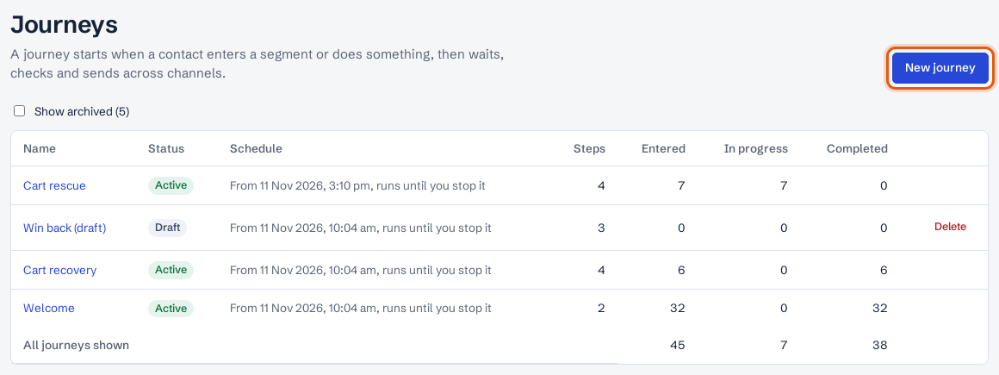

2. Click **New journey**. The editor opens with three columns:

   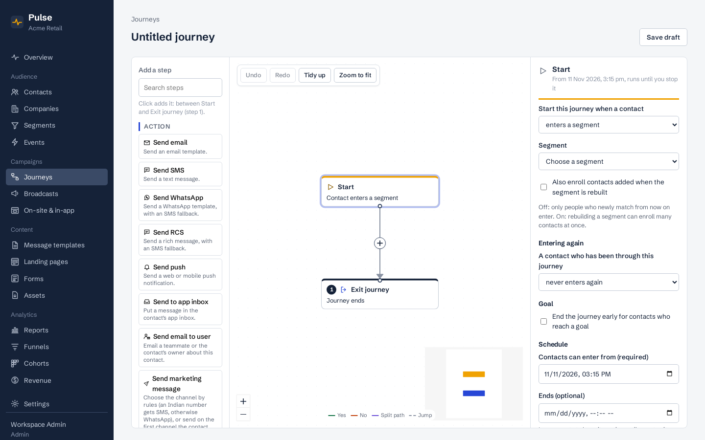

   | Part | What it's for |
   |---|---|
   | **Add a step** (left) | Every step, by kind, with a search box. Click one to add it after the selected step, or drag it onto the canvas |
   | Canvas (middle) | The journey. It starts as **Start → Exit journey** |
   | Inspector (right) | The settings of the selected step. **Start** is selected first |

3. Click the title **Untitled journey** and type a name: `Welcome series`.

## 3. Choose the trigger

With **Start** selected, the inspector asks when contacts enter:

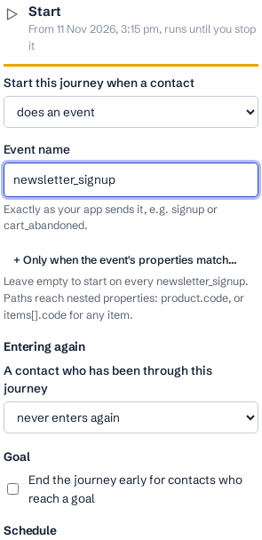

1. **Start this journey when a contact**: choose **does an event**.
2. **Event name**: `newsletter_signup`, exactly as your website or app sends it (for example
   `Pulse.track("newsletter_signup")`, see tutorial 1).
3. Leave **Entering again** on **never enters again**.

The Start card on the canvas now reads *Contact does ‘newsletter_signup’*.

<br clear="right">

The three kinds of trigger:

| Start this journey when a contact | Use it for | Notes |
|---|---|---|
| **enters a segment** | "Became a Pro customer", "Abandoned cart" (tutorial 3) | Only people who newly match from now on enter. Tick **Also enroll contacts added when the segment is rebuilt** to include those too; rebuilding a segment can then enroll many contacts at once |
| **does an event** | A sign-up, a purchase, any event your site or app sends | Type the event name exactly |
| **submits a form** | A webinar sign-up, a "contact us" form (tutorial 5) | Choose the **Form**, or leave **Any form**. Each submission starts the journey for the person who sent it, so **Form field value** conditions can check their answers. Inside a journey, the **Submits form** decision waits for a form instead |

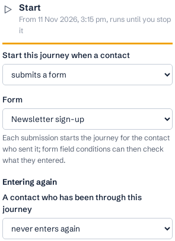

**Entering again** decides what happens when someone who has already been through the journey
triggers it again: **never enters again**, **can enter again after finishing**, or **can enter again
after some days** (1 to 3650). A contact is never in the same journey twice at once.

**Goal** (optional): tick **End the journey early for contacts who reach a goal** and give an event,
such as `purchase`. A contact who does it leaves the journey at once and counts as converted in the
report.

## 4. Add the welcome email: "+" → Action → Send email

Every line on the canvas has a **+** in the middle, and every free path has a **+** at its end.

1. Click the **+** between **Start** and **Exit journey**.

   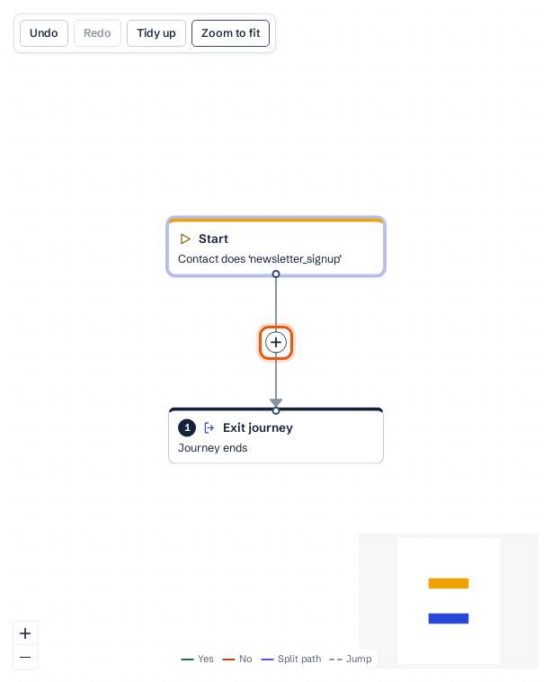

2. **Add a step** opens. It says where the step goes (*Between Start and Exit journey*) and asks what
   kind of step:

   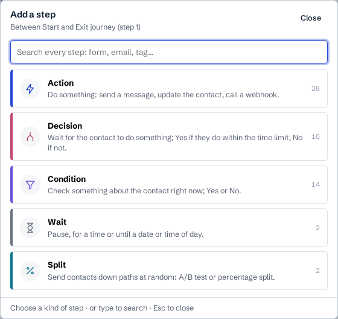

   | Kind | Means |
   |---|---|
   | **Action** | Do something: send a message, update the contact, call a webhook |
   | **Decision** | Wait for the contact to do something; Yes if they do within the time limit, No if not |
   | **Condition** | Check something about the contact right now; Yes or No |
   | **Wait** | Pause, for a time or until a date or time of day |
   | **Split** | Send contacts down paths at random: A/B test or percentage split |

   You can also type straight away to search every step ("form", "email", "tag"…).
3. Click **Action**. The list shows every action with what it does. Use ↑ ↓ and Enter, or click.

   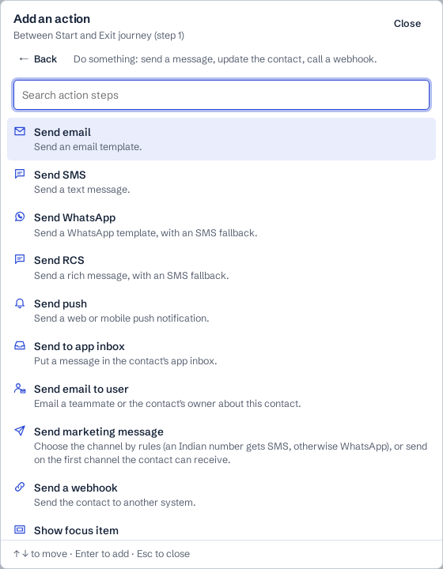

4. Click **Send email**. The step appears as **1 Send email**, selected, and the inspector shows its
   settings.
5. **Email template**: choose **Welcome email**. **Preview** shows it as a contact would get it;
   **Send a test** sends it to one contact (tutorial 4).

   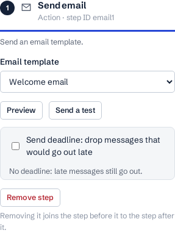

Steps are numbered from Start, level by level (Yes before No), so a number can change as you add
steps. The number is how the issues list, the report and **Jump to step** refer to a step.

## 5. Add a decision: did they open it?

1. Click the **+** under **1 Send email**, then **Decision**.

   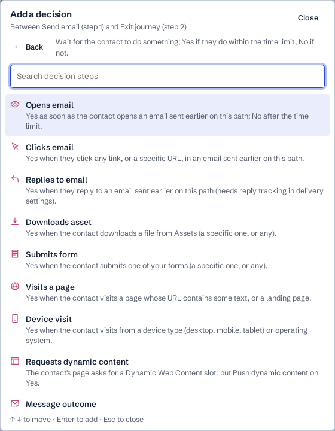

2. Click **Opens email**. Pulse picks the email to watch for you: the nearest **Send email** above
   it.

   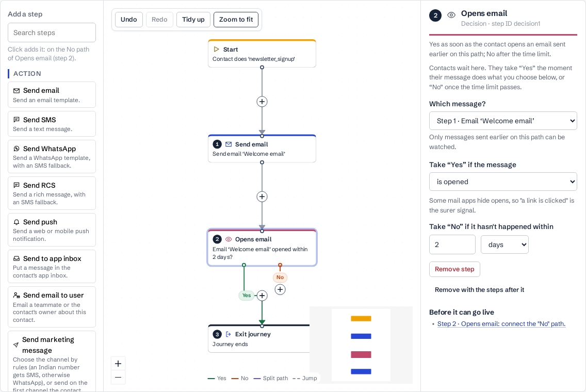

The decision has two paths: **Yes** (green) and **No** (red). The step that was after the + (Exit
journey) now hangs on **Yes**; **No** is free, with its own **+**. In the inspector:

| Setting | Here |
|---|---|
| **Which message?** | **Step 1 · Email ‘Welcome email’**. Only messages sent earlier on this path can be watched |
| **Take “Yes” if the message** | **is opened** (for email you can also pick a link click, or a reply) |
| **Take “No” if it hasn't happened within** | `2` **days** (1 minute to 365 days) |

Contacts wait at a decision. They take **Yes** the moment their email is opened, or **No** once the 2
days are up; the No line is labelled **No — after 2 days**.

> Some mail apps hide opens, so **Clicks email** (a link is clicked) is the surer signal when your
> email has a link.

Decisions that need an earlier message are greyed out until there is one: before step 1 existed,
**Opens email** said *"Opens email: add a Send email step above it first"*.

## 6. Add a wait on the Yes path

1. Click the **+** on the green **Yes** line, then **Wait**, then **Wait**.
2. The default is **Wait for** `1` **days**. Keep it. (Units: minutes, hours, days, weeks; up to 365
   days.)

   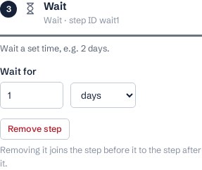

The other wait, **Wait until**, continues at a date and time, or at the next time of day (say
09:00) in a time zone you choose; a contact with a `timezone` attribute gets their own local time.

## 7. Add a condition

A condition checks the contact the moment they reach it and sends them down **Yes** or **No** straight
away.

1. Click the **+** under **3 Wait**, then **Condition**, then **Contact segments**.
2. **Is the contact in this segment?**: choose **Repeat buyers in Pune**.

   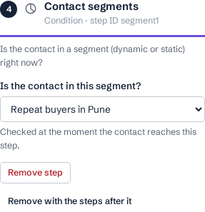

Exit journey stays on **Yes** (they already buy from you); **No** is free.

To check a contact field instead (for example *city is Pune*, or *plan is pro*), pick **Contact field
value**: it uses the same filters as the segment builder (tutorial 3), including event counts such as
*did email_opened at least 1 time in 3 days*. **Contact tags**, **Contact stages**, **Contact points**,
**Contact owner** and **Contact device** are quicker versions of the same thing.

## 8. Close every path: the issues list

Under the inspector, **Before it can go live** lists what is still missing:

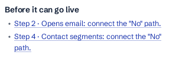

Click an item to jump to that step. The journey can be saved as a draft at any time, but it can't go
live until the list is empty. Close the two open paths:

1. On the red **No** under **4 Contact segments**, click **+** → **Action** → **Send email**, and
   choose **Weekend sale**. Then click the **+** under it → **Action** → **Exit journey**.
2. On the red **No — after 2 days** under **2 Opens email**, click **+** → **Action**, type `tags`
   and pick **Modify contact's tags**. In **Add tags** type `welcome-unopened`. Then **+** under it →
   **Action** → **Exit journey**.

The list disappears when nothing is missing. Other things it checks: a send step without a template,
a decision without a time limit, a condition without a segment, a trigger without its segment or
event, and an end date before the start.

A journey created through the API may end a path with a step that has no next step (for example
**Delete contact**); the editor shows it as the end of that path.

## 9. Tidy up and find your way around the canvas

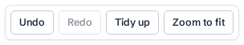

| Tool | Does |
|---|---|
| **Undo** / **Redo** | Undo or redo the last change (Ctrl+Z, and Ctrl+Shift+Z or Ctrl+Y; ⌘ on a Mac) |
| **Tidy up** | Lays the steps out again in neat rows and columns |
| **Zoom to fit** | Fits the whole journey in the canvas |
| **+** and **–** (bottom left) | Zoom in and out. You can also scroll to zoom and drag the background to move around |
| Minimap (bottom right) | The whole journey in small; drag in it to move the view. Colours: Start yellow, actions blue, decisions red, conditions purple, waits grey, splits teal |
| **Show stats** (once saved) | The numbers on each step, see step 13 |

Click **Tidy up**, then **Zoom to fit**:

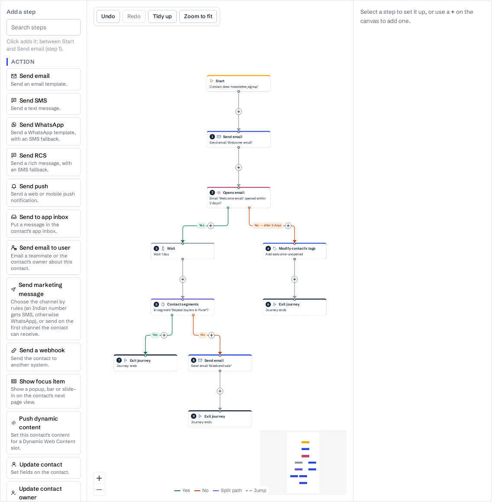

More ways to edit:

- **Move** a step by dragging it. **Connect** two steps by dragging from the dot at the bottom of one
  onto the other. Select a line and press Backspace to remove it.
- **Remove** a step: select it and click **Remove step** in the inspector (or press Backspace or
  Delete). The step before it is joined to the step after it. On a step with Yes/No paths, **Remove
  with the steps after it** also removes everything below it.
- **Palette** (left): click a step to add it after the selected step (it says where: *Click adds it:
  between Start and Send email (step 1)*), or drag it onto the canvas and connect it yourself.

## 10. Schedule

Click **Start** and scroll to **Schedule**:

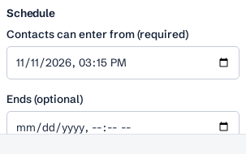

- **Contacts can enter from (required)**: when the journey starts taking contacts. It is filled in
  with now.
- **Ends (optional)**: leave it empty to keep the journey running until you stop it. With an end,
  nobody new enters after it; **contacts already inside keep going after the end**.

Times are in your browser's time zone. The line below the fields says what you chose, e.g. *From 11
Nov 2026, 10:48 am, runs until you stop it*.

## 11. Save and go live

1. Click **Save draft**. The journey gets its own address and a **Draft** status.
2. Click **Save and go live**. (It is greyed out while **Before it can go live** lists anything.)

   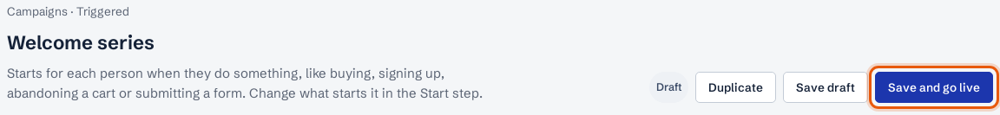

The status turns **Active**. While a journey is live its steps are locked:

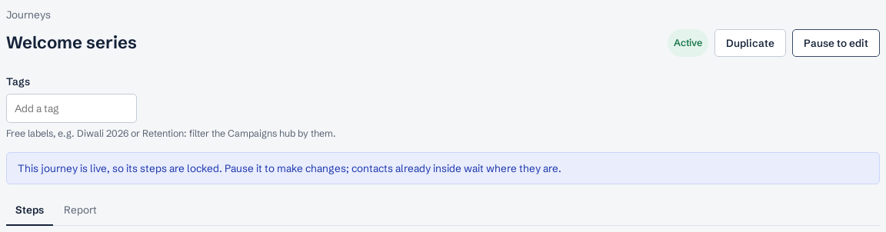

New matches enter it immediately: going live tells the journey workers at once.

## 12. Try it with a test contact

Use the SDK test page from tutorial 1 (**Settings → Sign-in & keys → Your website → Open the test
page**), or your own site. In the browser's developer console on that page, sign a test person up:

```js
Pulse.identify("meera-test", { email: "meera.iyer@example.com", first_name: "Meera", city: "Bengaluru" });
Pulse.track("newsletter_signup", { source: "footer" });
```

Within seconds the welcome email goes out. On the local development stack every email lands in
Mailpit (`http://localhost:18025`):

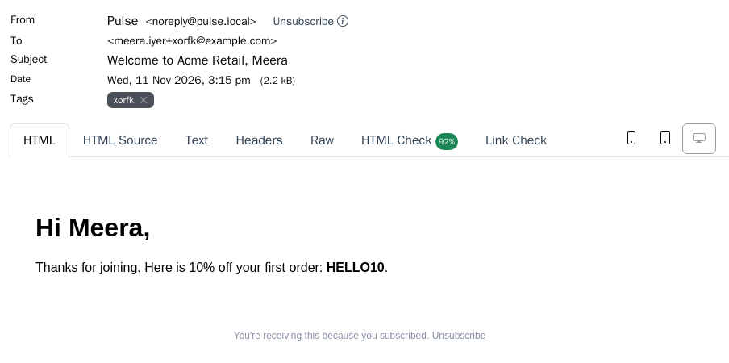

The subject and greeting are personalised from the contact's `first_name`. Opening the email in
Mailpit loads its tracking image, which counts as an open, so the contact takes **Yes** at step 2 and
moves on to the 1-day wait.

## 13. Per-step stats and the report

Back on the journey, **Show stats** (in the toolbar) is on. Each step shows:

- **Entered**: contacts who reached it
- **Here now**: contacts waiting at it (decisions and waits)
- **Yes · No**: how many went each way (decisions and conditions; split steps show each path)
- **Sent · Opened** (or Read, or Delivered, by channel): messages from send steps

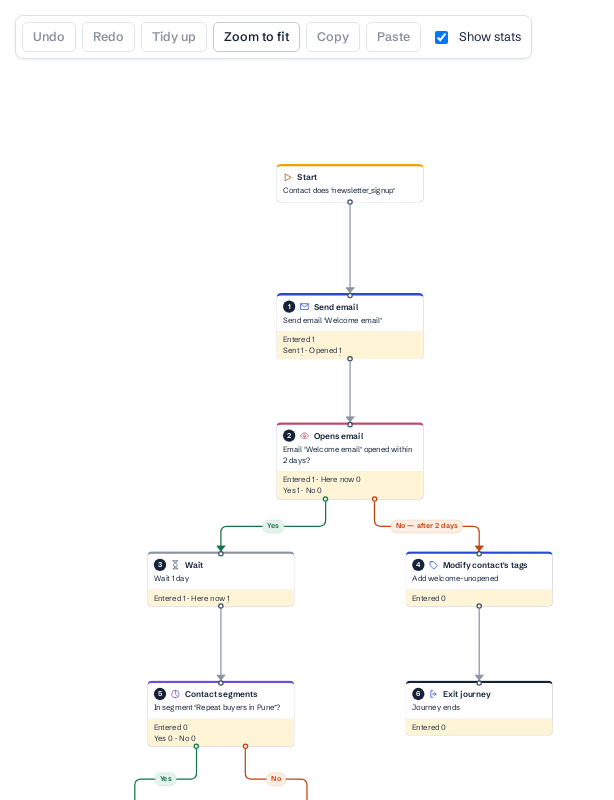

The **Report** tab has the totals:

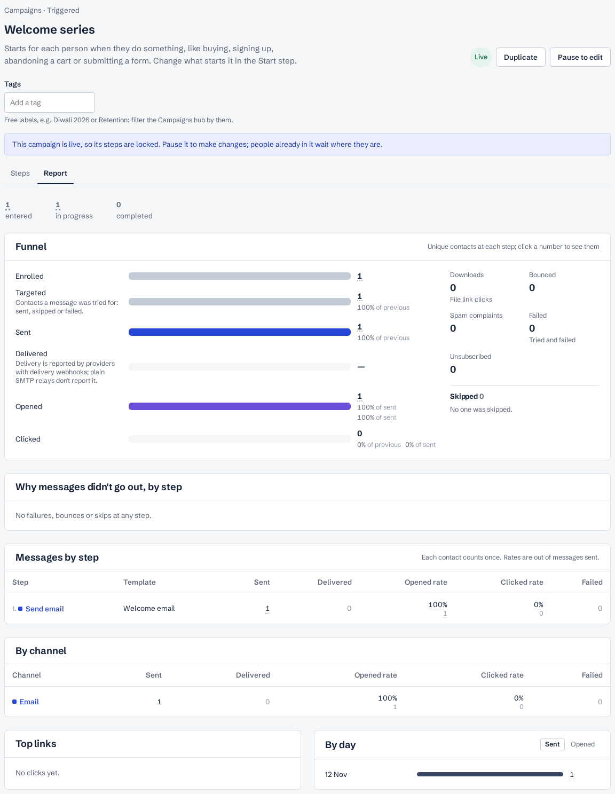

| Part | Shows |
|---|---|
| Figures | **entered**, **in progress**, **completed**, and **reached the goal** / **left early** when there are any |
| Revenue | When contacts buy after a message: revenue, orders and buyers |
| Split steps | Contacts per path, the rate it is judged by, and the winner |
| **Messages by step** | Sent, delivered, opened, clicked, failed… per send step. Click a row to jump to the step |
| **By channel** | The same per channel |
| **Top links**, **By day** | Most-clicked links; sends and opens per day |

Each contact counts once, and rates are out of messages sent. *Delivered* stays at 0 for email sent
through plain SMTP (as in local development): only providers that report delivery (SendGrid,
Postmark, Mailgun, SES) fill it in.

## 14. Pause it

1. Click **Pause to edit** (top right).

   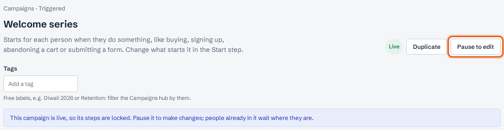

2. The status turns **Paused** and the steps unlock: change what you need, then **Save and go live**
   again.

While a journey is paused, nobody new enters, and contacts already inside wait where they are. A wait
or decision that comes due while it is paused moves on when the journey goes live again.

Leave this one paused.

## 15. Delete or archive a journey

The **Journeys** list has a button at the end of each row that isn't live:

- **Delete**, for a journey nobody has entered yet (a draft you no longer need). It asks first and
  can't be undone.
- **Archive**, for a journey that has had contacts in it: those can't be deleted, because their
  history and reports are kept. An archived journey disappears from the list and can't go live.
  Tick **Show archived** above the list to see archived journeys, and click **Restore** (in the list
  or on the journey's page) to bring one back as a paused journey.

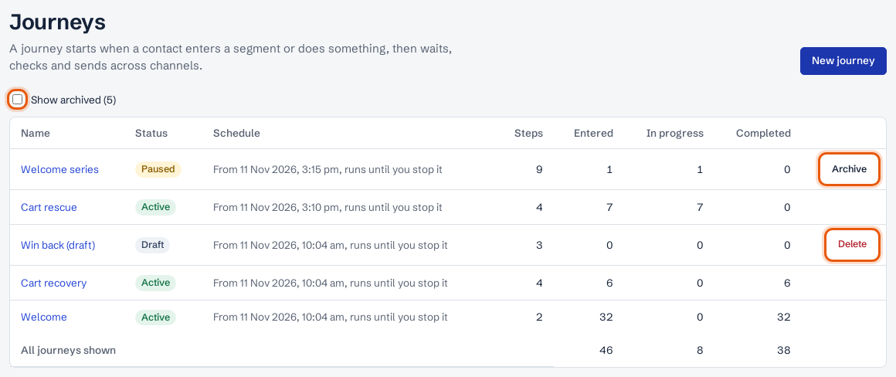

Pause a live journey before archiving it. Deleting needs **Journeys: Edit**; archiving and restoring
need **Journeys: Publish**, like going live. Through the API: `DELETE /v1/journeys/{id}`,
`POST /v1/journeys/{id}/archive` and `POST /v1/journeys/{id}/unarchive`.

## Every step, at a glance

Each one is in the **+** chooser and the palette, under its kind. Steps marked *needs Contacts: Edit*
can only be added, saved or taken live by someone whose role has **Contacts: Edit** (they change
consent or CRM data); the chooser greys them out with *Needs edit access to contacts*.

**Decisions** wait for the contact (Yes when it happens; No at the time limit, 1 minute to 365 days):

| Step | Yes when the contact… |
|---|---|
| **Opens email** | Opens an email sent earlier on this path (needs a Send email above it) |
| **Clicks email** | Clicks any link, or a link containing some text, in an earlier email |
| **Replies to email** | Replies to an earlier email (needs a reply tracking address under Settings → Channels → Delivery rules) |
| **Downloads asset** | Downloads a file from Assets (one, or any) |
| **Submits form** | Submits one of your forms (one, or any) |
| **Visits a page** | Visits a page whose URL contains some text, or one of your landing pages (needs the web SDK) |
| **Device visit** | Visits from a device type (desktop, mobile, tablet) or operating system |
| **Requests dynamic content** | Loads a page with a dynamic web content slot (put **Push dynamic content** on Yes) |
| **Message outcome** | An earlier SMS, WhatsApp, RCS, push or inbox message is delivered or read, or an RCS message gets a reply |
| **Does an event** | Does an event, e.g. `purchase` (time limit from 1 second) |

**Conditions** check right now (Yes or No):

| Step | Yes if the contact… |
|---|---|
| **Contact field value** | Matches any contact field or behaviour rule, e.g. city is Pune |
| **Contact segments** | Is in a segment (dynamic or static) |
| **Contact tags** | Has any (or all) of some tags |
| **Contact stages** | Is in one of some lifecycle stages |
| **Contact points** | Has at least, more than, at most, less than, exactly or not a number of points |
| **Contact owner** | Is owned by some teammates, by anyone, or by no one |
| **Contact device** | Was last seen on a device type or OS |
| **Contact campaigns** | Is in, has finished, or has ever entered other journeys |
| **Form field value** | Gave an answer on the form submission that brought them here (or their latest) |
| **Has active notification** | Can get push, or has an unread app inbox message |
| **Has valid email address** | Has a well-formed address on a domain that takes mail (optionally rejecting disposable addresses) |
| **Marked as Do Not Contact** | Unsubscribed from, or bounced on, a channel (or any) |
| **Prevent action after date** | Yes until a date, No after it: put the time-limited action on Yes |
| **Visited page** | Has visited a page (ever, or in the last N days) |

**Actions** do something, then continue:

| Step | Does |
|---|---|
| **Send email**, **Send SMS**, **Send push**, **Send to app inbox** | Send a template on that channel |
| **Send WhatsApp**, **Send RCS** | Send a template, with an optional SMS if it can't be delivered |
| **Send email to user** | Email a teammate, the contact's owner or other addresses about this contact (not a marketing email) |
| **Send marketing message** | Choose the channel by rules, e.g. an Indian number gets SMS, otherwise WhatsApp ([tutorial 13](13-personalising-messages.md#8-choose-the-channel-by-rule)); without conditions, send on the first channel in your order that the contact can receive and has agreed to |
| **Send a webhook** | POST the contact as JSON to a public https:// address, or your own JSON body with variables (`{{contact.x \| json}}`) |
| **Show focus item** | Show a pop-up, bar or slide-in on the contact's next page view (tutorial 8) |
| **Push dynamic content** | Set this contact's content for a dynamic web content slot, for some days |
| **Update contact** | Set contact fields (values can use variables such as `{{contact.city}}` or the trigger event's `{{event.product_name}}`, or dates like `now+3days`) |
| **Update contact owner** | Assign the contact to a teammate, or unassign (needs Contacts: Edit) |
| **Update company** | Set fields on the contact's company (needs Contacts: Edit) |
| **Add to company**, **Update contact's primary company** | Link the contact to a company; a contact has one (needs Contacts: Edit) |
| **Add to company's score** | Add points to the company (needs Contacts: Edit) |
| **Adjust contact points** | Add or take away points |
| **Change contact's stage** | Move the contact to a lifecycle stage |
| **Modify contact's tags** | Add or remove tags |
| **Modify contact's segments** | Add to or remove from static segments |
| **Change campaigns** | Add the contact to other journeys, or take them out |
| **Jump to step** | Continue from another step (ends the path; at most 25 jumps per contact) |
| **Add Do Not Contact** | Stop a channel, or everything, for this contact |
| **Remove Do Not Contact** | Allow a channel again (needs Contacts: Edit) |
| **Delete contact** | Permanently delete the contact; you type DELETE to confirm (ends the path; needs Contacts: Edit) |
| **Push contact to integration** | Send the contact to HubSpot or Salesforce (tutorial 9) |
| **Exit journey** | End the journey here |

**Waits**:

| Step | Does |
|---|---|
| **Wait** | Wait a set time, e.g. 2 days |
| **Wait until** | Wait for a date and time, or the next time of day in the contact's time zone |

**Splits** send each contact down one path at random (always the same one for a contact):

| Step | Does |
|---|---|
| **A/B split** | 2 to 5 paths by share; optionally picks a winner automatically (open, click or goal conversion rate, after a test period and a minimum of contacts per path) and sends everyone after down it |
| **Percentage split** | 2 to 5 paths by share, e.g. 70% and 30% |

> Also good to know: contacts don't leave a journey when they leave its trigger segment (use a
> condition, a goal or **Change campaigns**), and a decision can't watch a **Send marketing
> message** step, because its channel is chosen per contact.

## What you have now

- A **Welcome series** journey: a welcome email, an open decision, a wait, a segment condition and a
  follow-up, with every path closed
- A test contact who went through it, the email in your test inbox, and the stats to show it
- The journey paused, ready to edit

**Next:** Tutorial 7, Broadcasts: send one message to a whole segment, once or on a repeat, with an
A/B test.
