# Tutorial 7: Broadcasts

In about 15 minutes you will send one email to a whole segment, with an A/B test of two subject lines,
pick the winner, and read the results. Then you will schedule a weekly broadcast and cancel it.

**You need:** a segment to send to and a template on the channel you want (tutorials 3 and 5). To
schedule or cancel you need **Broadcasts: Publish** (Admins and Editors have it).

> **Try it on a small segment first.** Here we use **Sale preview testers**, a static segment of six
> test contacts with `@example.com` addresses. On the local development stack every email lands in
> Mailpit (`http://localhost:18025`) and SMS, WhatsApp, RCS and push go to the sandbox providers, so
> nothing reaches a real person.

---

## 1. Broadcasts or journeys?

| | Broadcast | Journey (tutorial 6) |
|---|---|---|
| Who | Everyone in one segment at send time | Each contact as they enter a segment or do something |
| When | At a set time, once or on a repeat | Whenever a contact triggers it |
| Steps | One message (with an optional A/B test) | Waits, decisions, conditions, many messages |
| Good for | A newsletter, a sale announcement, a festive offer | Welcome series, cart recovery, win-back |

## 2. Create the broadcast

1. Go to **Campaigns → Broadcasts**. The list shows each broadcast's **Channel**, who it goes **To**,
   whether it **Repeats**, the **Next send** for scheduled ones, and its **Status**.

   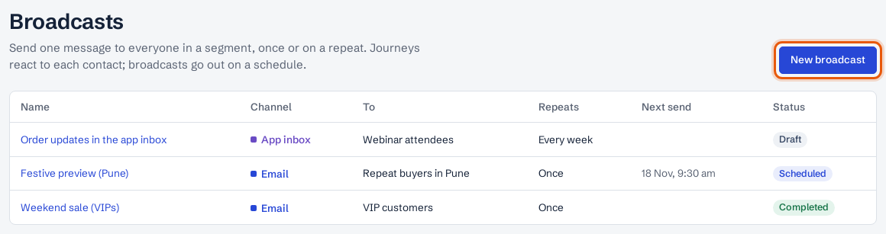

2. Click **New broadcast** and fill in:
   - **Name**: `Weekend sale preview`. Only your team sees it.
   - **Send to**: the segment, here **Sale preview testers**. Pulse shows how many contacts are in it
     now (*About 6 contacts are in it right now*). Membership is taken at send time, so people who join
     or leave the segment before then are counted then.
   - **Leave out members of (optional)**: one or more segments whose members get nothing, even if
     they are in **Send to**. Choose them from **Add a segment**; × removes one. For example, leave out
     *Bought this week* so recent buyers don't get the sale email.
   - **Channel**: **Email**, SMS, WhatsApp, RCS, Push or App inbox.
   - **Template**: lists only the chosen channel's templates. Pick **Weekend sale**.

   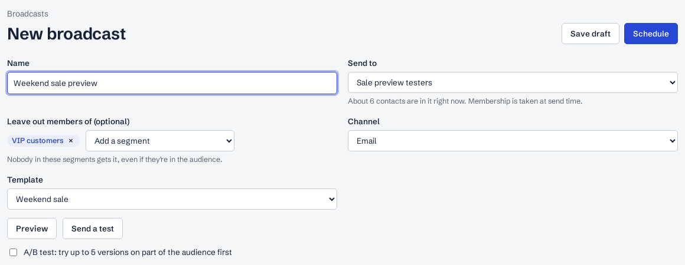

   (The picture leaves out *VIP customers* to show the field; this tutorial removes it again with ×
   and sends to all six testers.)

A broadcast goes to one segment, minus everyone in the segments you leave out. Both are taken at
send time.

For **WhatsApp** and **RCS** a further field appears: **If it can't be delivered, send this SMS
instead**. It is used when a number isn't on WhatsApp or RCS, or delivery fails, at most once per
contact.

Pulse skips contacts it can't or mustn't reach on the channel: no address, unsubscribed from that
channel (or from everything), or an email address or phone number that bounced. Frequency caps and
quiet hours (**Settings → Channels**, **Delivery rules**) apply to broadcasts as well.

## 3. Preview and send a test

Under the template:

1. Click **Preview**. Pulse renders the email the way it will be sent, with a sample contact (Asha from
   Pune). Type a contact's external ID and click **Preview as contact** to see it with their data. For
   email, **Plain text** shows the text part.

   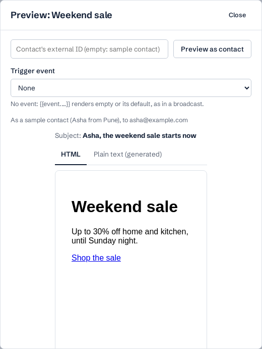

2. Click **Send a test**, enter a **Contact's external ID** (here `docs-test-inbox`, a test contact
   with a test address) and click **Send test**. It goes through your real email provider,
   personalised with that contact's data. A broadcast isn't started by an event, so `{{event.…}}`
   variables are empty (or their default) in broadcasts; `{{campaign.name}}` is the broadcast's name
   ([tutorial 13](13-personalising-messages.md)).

   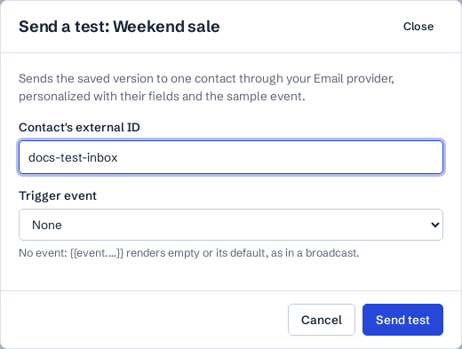

The test lands in the test inbox:

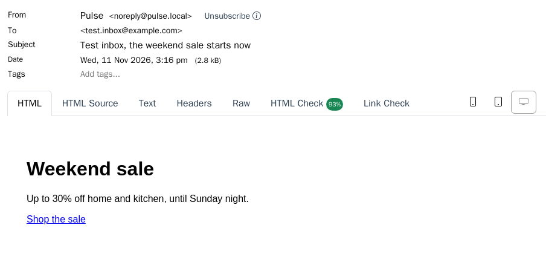

## 4. A/B test two subject lines

1. Tick **A/B test: try up to 5 versions on part of the audience first**.
2. **Variants**: **A** keeps the template you chose. For **B**, choose **Weekend sale (subject B)**,
   the same email with another subject line. **Add variant** adds C, D and E. Each variant has its own
   **Preview** and **Send a test**.
3. **Test group**: drag the slider or type `50`. The line below says what that means: *50% get a
   variant (split evenly, about 25% each), the other 50% get the winner.*
4. **Pick the winner by**:

   | Choice | What happens |
   |---|---|
   | **Open rate** / **Click rate** (email only) | Pulse picks the variant with the best rate **After** a number of hours (1 to 72) and sends it to the rest |
   | **By hand** | You pick the winner on the broadcast's page; the rest of the audience waits until you do |

   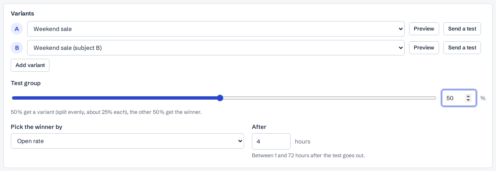

For this walk-through choose **By hand**, so you can pick the winner straight away.

With **Test group** at **100%**, everyone gets a variant (split evenly) and there's no winner: a plain
split test.

Contacts are placed in the test group at random, so on a small segment the numbers are only roughly
the percentage you set (here 2 or 4 of the 6).

## 5. When to send

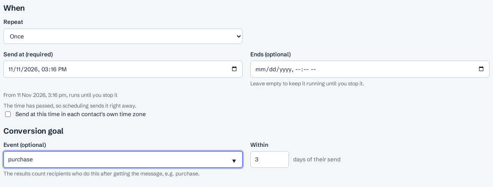

| Field | |
|---|---|
| **Repeat** | **Once**, **Every day**, **Every week** or **Every month** |
| **Send at (required)** | The date and time (it reads **First send** for a repeating broadcast). It starts as now; a time that has passed means *send right away* |
| **Ends (optional)** | For repeating broadcasts: the last time it may send. Leave it empty to keep it going until you cancel it |

Times are in your browser's time zone, and a broadcast goes to everyone at that time. (Quiet hours, if
you turn them on under Delivery rules, hold SMS, WhatsApp, RCS and push until they end in each
contact's own time zone.)

**Send at this time in each contact's own time zone** (one-time broadcasts only): tick it and each
contact gets the message at the chosen clock time where they are, e.g. 9:00 am in Mumbai and 9:00 am
in London. Their zone comes from the contact's `timezone` attribute (an IANA name such as
`Asia/Kolkata`, sent by your app or server), else the zone located from their IP address
(`geo_timezone`, when GeoIP is set up); contacts with neither get it at that time in your browser's
time zone, which the line under the box names. Sending starts when the time comes in the first time
zone (UTC+14), up to a day before, and each message waits until it is due; the contact's activity
shows a *deferred* entry meanwhile. Anyone whose time has already passed when you schedule gets it
right away.

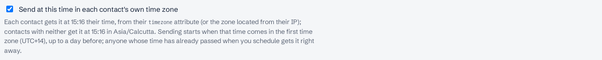

This tutorial leaves the box unticked.

**Conversion goal** (optional): type an event, e.g. `purchase`, and **Within** `3` days (1 to 30). The
results then count recipients who did it within that many days of their send, and show the revenue
from them.

## 6. Schedule it

Click **Schedule** (top right).

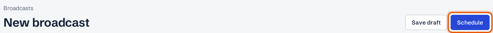

**Schedule** stays greyed out until the form is complete; point at it to see what is missing (*Name
the broadcast*, *Choose who receives it*, *Choose a template for each variant*…). **Save draft** keeps
it without scheduling.

Pulse confirms *Scheduled. First send …*. As the send time has passed, it goes out within seconds. The
status moves on by itself:

| Status | Means |
|---|---|
| **Draft** | Saved, not scheduled |
| **Scheduled** | Waiting for its next send |
| **Running** | Sending now |
| **A/B testing** | The test group has its variants; the rest waits for the winner |
| **Completed** | Everything sent (a repeating broadcast stays Scheduled until its end) |
| **Cancelled** | Stopped by you; nothing more is sent |

While a broadcast is scheduled, sending or testing, the form is locked:

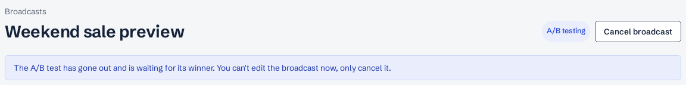

## 7. Pick the winner

Below the form, **Sends** lists each send: **Scheduled for**, **Sent** (*sending…* until it has
finished), the **Test group**, the **Winner** (*Waiting for your pick*) and the **Recipients**.

**Results** fill in as messages go out and are opened and clicked. In **Variants**, compare the rates
and click **Pick A as winner** (or B). Pulse asks you to confirm (*Send A to the other 50% of the
audience? This can't be undone.*).

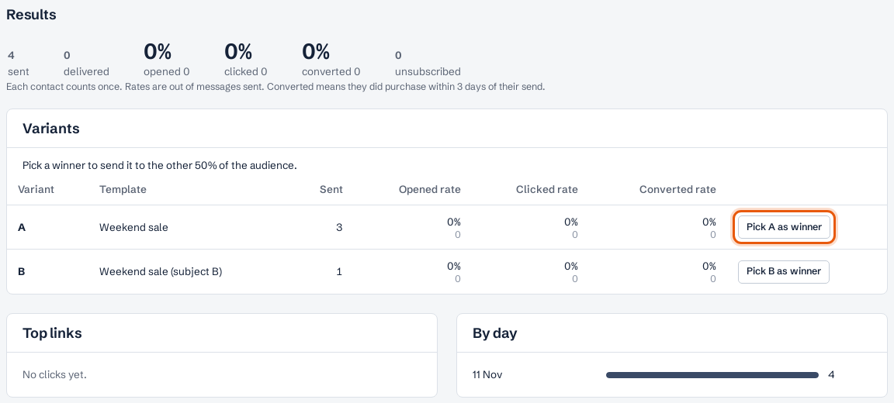

The winner goes to the rest of the segment within seconds, and the status turns **Completed**:

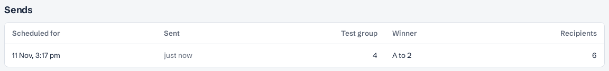

With **Open rate** or **Click rate**, the Variants panel says when the winner will be picked (*The
variant with the best open rate is picked 11 Nov, 3:02 pm and sent to the other 50%. You can pick one
yourself before then.*).

## 8. Read the report

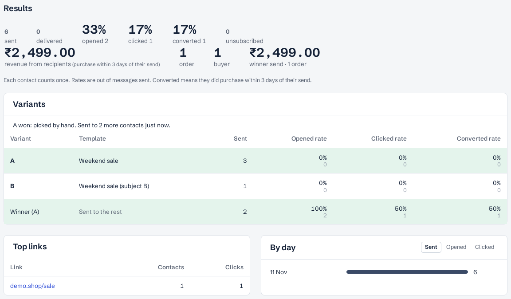

| Part | Shows |
|---|---|
| Top figures | **sent** and **delivered** as counts; **opened**, **clicked**, **converted** as rates (out of messages sent) with the count under each; **unsubscribed** |
| Revenue | With a conversion goal, once someone buys: **revenue from recipients**, **orders**, **buyers**, and the revenue per variant |
| **Variants** | Each variant and the winner send: sent, opened, clicked and converted rates. The winning variant is highlighted, with how it was picked (*A won: picked by hand*) |
| **By send** | For a repeating broadcast, one row per send; choose a send in the list at the top right to see only its results |
| **By channel** | When some WhatsApp or RCS messages fell back to SMS |
| **Top links** | Links clicked most, with contacts and clicks |
| **By day** | Sent, opened and clicked per day |

Each contact counts once. *Delivered* stays at 0 for email sent through plain SMTP (as in local
development); providers that report delivery (SendGrid, Postmark, Mailgun, SES) fill it in.

To send a completed broadcast again, change what you need and click **Schedule** again; each send is
listed under **Sends**.

## 9. A weekly broadcast, and cancelling it

1. **New broadcast**: **Name** `Weekly picks, VIP customers`, **Send to** **VIP customers**,
   **Template** **Weekend sale**.
2. **Repeat**: **Every week**. **First send**: next Monday, 10:00. **Ends**: about two months later.
   The line below sums it up: *Starts 16 Nov 2026, 10:00 am, ends 11 Jan 2027, 11:00 pm. Sends every
   week at the same time.*

   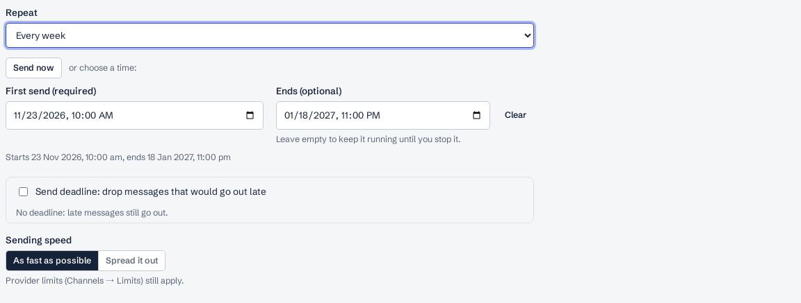

3. Click **Schedule**. It says when the next send is:

   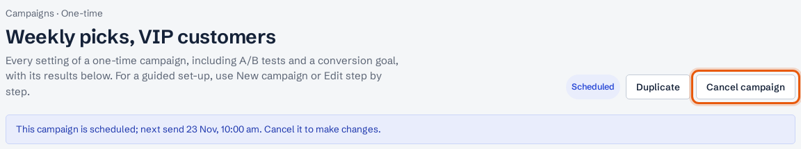

4. To stop it, click **Cancel broadcast** and confirm (*Cancel all future sends of this broadcast?*).
   Pulse says *Broadcast cancelled. Nothing more will be sent.*

   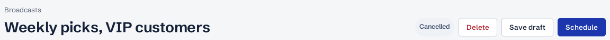

A cancelled broadcast can be changed and scheduled again, or removed with **Delete**. Cancelling during
an A/B test means the winner is never sent to the rest of the audience. Messages already sent stay
sent.

To change a scheduled broadcast (another template, a later time), cancel it, make the change, and
schedule it again.

## What you have now

- A sent broadcast with an A/B test, a winner picked by hand and a report with opens, clicks, a
  conversion and revenue
- A way to test safely: a small segment of test contacts, **Preview** and **Send a test**
- A repeating broadcast scheduled, then cancelled and deleted

**Next:** Tutorial 8, On-site & in-app: a website pop-up, dynamic web content and a mobile in-app
message.
