# Tutorial 7: One-time campaigns, all settings and results

In about 15 minutes you will send one email to a whole segment with an A/B test of two subject lines,
pick the winner, and read the results: the funnel, why some messages didn't go out, the chart over
time, and the people behind every number. Then you will schedule a weekly campaign and cancel it, and
turn your blog's feed into a newsletter with a public archive.

A one-time campaign sends **one message to everyone in your chosen segments, sent once or repeated
daily, weekly or monthly**. [Tutorial 14](14-campaigns-hub-and-one-time-campaigns.md) shows the quick
way to make one, the step-by-step wizard. This tutorial uses the other editor, **All settings and
results**, which has every setting (A/B tests, more segments, a conversion goal) and the results.

**You need:** a segment to send to and a template on the channel you want (tutorials 3 and 5). To
schedule or cancel you need **One-time campaigns: Publish** (Admins and Editors have it).

> **Try it on a small segment first.** Here we use **Sale preview testers**, a static segment of six
> test contacts with `@example.com` addresses. On the local development stack every email lands in
> Mailpit (`http://localhost:18025`) and SMS, WhatsApp, RCS and push go to the sandbox providers, so
> nothing reaches a real person.

---

## 1. One-time, triggered or automation?

| | One-time | Triggered or Automation ([tutorial 6](06-triggered-and-automation-campaigns.md)) |
|---|---|---|
| Who | Everyone in the chosen segments at send time | Each person as they do something (Triggered) or join a segment (Automation) |
| When | At a set time, once or on a repeat | Whenever a person starts it |
| Steps | One message (with an optional A/B test) | Waits, decisions, conditions, many messages |
| Good for | A newsletter, a sale announcement, a festive offer | Welcome series, cart recovery, win-back |

## 2. Create the campaign

1. Click **Campaigns** in the sidebar and open the **One-time** tab. Each row shows the campaign's
   channel, status, when it sends, its **Audience now** and how many it was **Sent to**.

   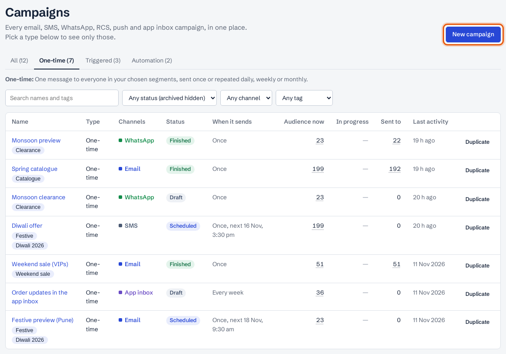

2. Click **New campaign** → **Send a message to a segment** → **Email**. The wizard opens.
3. **Campaign name**: `Weekend sale preview`. **Send to members of**: **Sale preview testers**.
4. **Next: Content**, choose **Use a saved template**, and pick **Weekend sale** as the **Template**.
5. Click **Save draft**. Then click **All settings and results** (top right):

   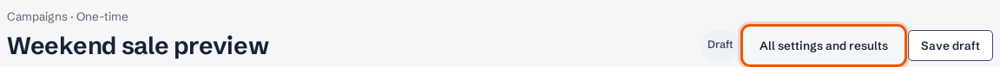

The **All settings and results** page has every setting of a one-time campaign, with its results
below once it has sent. (To open it later, click the campaign's name on the Campaigns page. **Edit
step by step** takes you back to the wizard.)

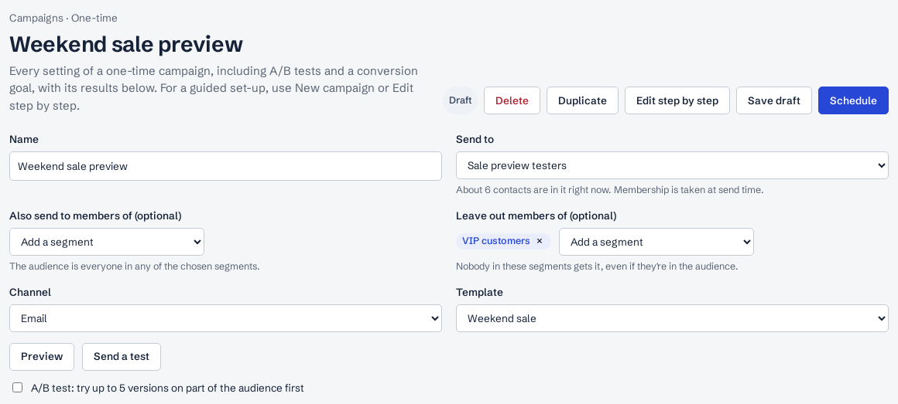

| Field | |
|---|---|
| **Name** | Only your team sees it |
| **Send to** | The segment it goes to. Pulse shows how many contacts are in it now (*About 6 contacts are in it right now*). Membership is taken at send time, so people who join or leave before then are counted then |
| **Also send to members of (optional)** | More segments: the audience is everyone in any of them |
| **Leave out members of (optional)** | Segments whose members get nothing, even if they are in the audience. Choose them from **Add a segment**; × removes one. For example, leave out *Bought this week* so recent buyers don't get the sale email |
| **Channel** | **Email**, **SMS**, **WhatsApp**, **RCS**, **Push** or **App inbox** |
| **Template** | Lists only the chosen channel's templates. A message written in the wizard shows as **Written in this campaign** |

(The picture leaves out *VIP customers* to show the field; this tutorial removes it again with × and
sends to all six testers.)

For **WhatsApp** and **RCS** a further field appears: **If it can't be delivered, send this SMS
instead**. It is used when a number isn't on WhatsApp or RCS, or delivery fails, at most once per
contact.

When the channel has more than one provider, **Send through** picks the one that delivers this
campaign. The channel's default is preselected; choose another, such as a standby route, to send this
campaign through it ([tutorial 4](04-channels.md#choose-the-provider-for-a-campaign-send-through)).
With a single provider the field isn't shown.

When your workspace has topics (**Settings → Bounces & unsubscribes**, [tutorial 4](04-channels.md#the-unsubscribes-panel)),
**Topic** says which one the campaign belongs to. **No topic** is the default; with no topics at
all, the field isn't shown.

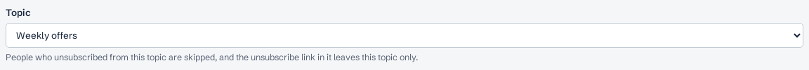

People who unsubscribed from that topic are skipped, and the unsubscribe link (and the mail app's
one-click button) in this campaign's emails unsubscribes them from the topic only: they keep getting
your other emails.

Pulse skips contacts it can't or mustn't reach on the channel: no address, unsubscribed from that
channel (or from everything), unsubscribed from the campaign's topic, or an address or number the
bounce rules stopped. Frequency caps and quiet hours (**Settings → Channels**, **Delivery rules**)
apply to one-time campaigns as well.

## 3. Preview and send a test

Under the template:

1. Click **Preview**. Pulse renders the email the way it will be sent, with a sample contact (Asha from
   Pune). Type a contact's external ID and click **Preview as contact** to see it with their data. For
   email, **Plain text** shows the text part.

   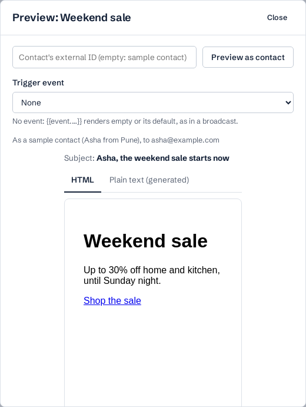

2. Click **Send a test**, enter a **Contact's external ID** (here `docs-test-inbox`, a test contact
   with a test address) and click **Send test**. It goes through your real email provider,
   personalised with that contact's data. A one-time campaign isn't started by an event, so
   `{{event.…}}` variables are empty (or their default); `{{campaign.name}}` is the campaign's name
   ([tutorial 13](13-personalising-messages.md)).

   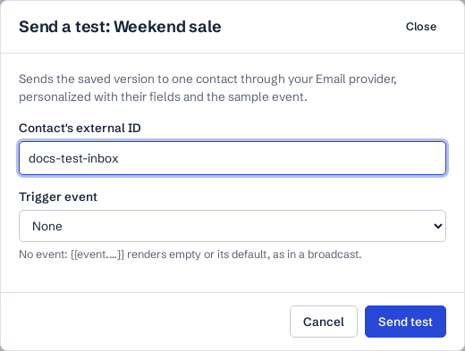

The test lands in the test inbox:

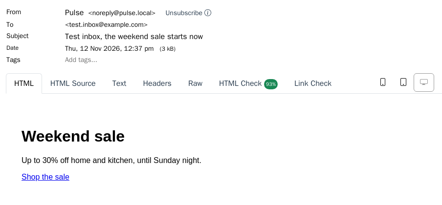

## 4. A/B test two subject lines

1. Tick **A/B test: try up to 5 versions on part of the audience first**.
2. **Variants**: **A** keeps the template you chose. For **B**, choose **Weekend sale (subject B)**,
   the same email with another subject line. **Add variant** adds C, D and E. Each variant has its own
   **Preview** and **Send a test**.
3. **Test group**: drag the slider or type `50`. The line below says what that means: *50% get a
   variant (split evenly, about 25% each), the other 50% get the winner.*
4. **Pick the winner by**:

   | Choice | What happens |
   |---|---|
   | **Open rate** / **Click rate** (email only) | Pulse picks the variant with the best rate **After** a number of hours (1 to 72) and sends it to the rest |
   | **By hand** | You pick the winner on this page; the rest of the audience waits until you do |

   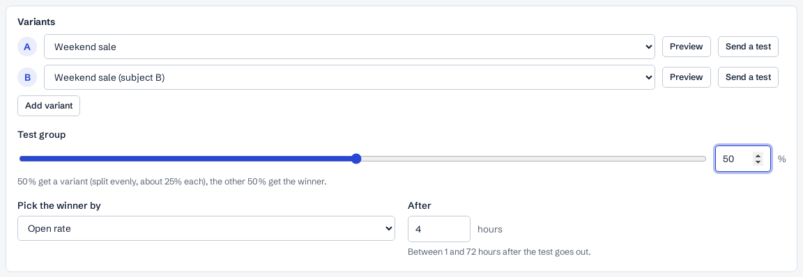

For this walk-through choose **By hand**, so you can pick the winner straight away.

With **Test group** at **100%**, everyone gets a variant (split evenly) and there's no winner: a plain
split test.

Contacts are placed in the test group at random, so on a small segment the numbers are only roughly
the percentage you set (here 2 or 4 of the 6).

## 5. When to send

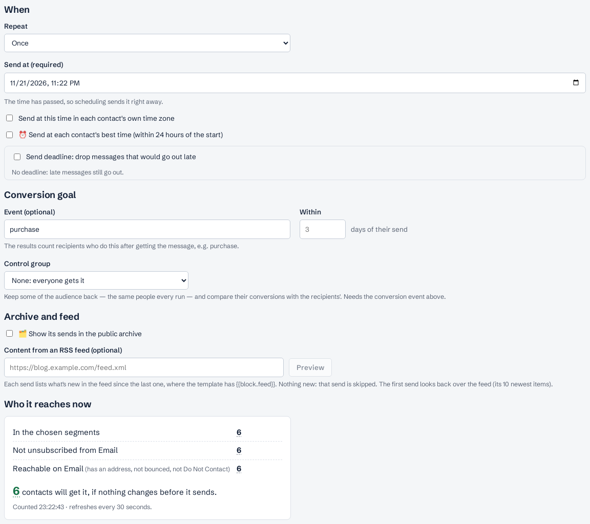

| Field | |
|---|---|
| **Repeat** | **Once**, **Every day**, **Every week** or **Every month** |
| **Send at (required)** | The date and time (it reads **First send** for a repeating campaign). It starts as now; a time that has passed means *send right away* |
| **Ends (optional)** | Repeating campaigns only (a **Once** campaign has no end): the last time it may send. Leave it empty to keep it going until you cancel it |

Times are in your browser's time zone, and the campaign goes to everyone at that time. (Quiet hours, if
you turn them on under Delivery rules, hold SMS, WhatsApp, RCS and push until they end in each
contact's own time zone.)

**Send at this time in each contact's own time zone** (**Once** only): tick it and each contact gets
the message at the chosen clock time where they are, e.g. 9:00 am in Mumbai and 9:00 am in London.
Their zone comes from the contact's `timezone` attribute (an IANA name such as `Asia/Kolkata`, sent by
your app or server), else the zone located from their IP address (`geo_timezone`, when GeoIP is set
up); contacts with neither get it at that time in your browser's time zone, which the line under the
box names. Sending starts when the time comes in the first time zone (UTC+14), up to a day before, and
each message waits until it is due; the contact's activity shows a *deferred* entry meanwhile. Anyone
whose time has already passed when you schedule gets it right away.

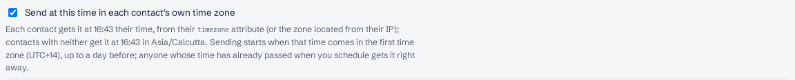

This tutorial leaves the box unticked.

**⏰ Send at each contact's best time (within 24 hours of the start)** (**Once** only): each person
gets it at the hour they usually open, click or read, worked out from the last 90 days; people with no
history get the hour your audience is busiest. It turns own-time-zone sending off.
[Tutorial 14](14-campaigns-hub-and-one-time-campaigns.md#at-each-contacts-best-time) has the details.
A **sending speed** (spreading a big send over hours) is set in the step-by-step wizard
([tutorial 14](14-campaigns-hub-and-one-time-campaigns.md#sending-speed)).

**Send deadline** (optional): tick **Send deadline: drop messages that would go out late** and fill
**Don't send after** (a time of day: the first time it comes after the send starts, in the zone named
under it, or in each contact's own zone for a local-time send) and/or **...or more than** a number of
hours late (1 to 168). Quiet hours, a provider's daily quota (tutorial 4) or retries can hold messages
back; with a deadline, those that can't go out in time are dropped instead of arriving late (recorded
as failed with the reason *Send deadline passed*, and counted in the results).

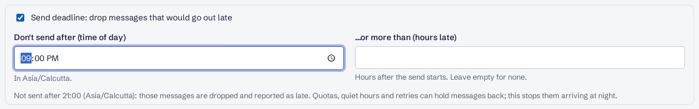

**Conversion goal** (optional): type an event, e.g. `purchase`, and **Within** `3` **days of their
send** (1 to 30). The results then count recipients who did it within that many days of their send,
and show the revenue from them.

**Control group** (optional): did the campaign make people buy, or would they have bought anyway? To
find out, keep some of the audience back. Choose **Keep back 10% to measure the effect** (5% to 50%;
the default is **None: everyone gets it**). Pulse picks the same people for every send of this
campaign (and keeps them out of the A/B winner send too). They get nothing, and the results show them
as skipped, *Kept back: campaign control group*. A control group needs a conversion event above: if
there is none, a note asks you to choose one. The results then compare the two groups (step 8,
**Uplift**).

A workspace can also keep a share of all contacts away from every campaign, for a long-term view of
what your marketing adds: see [tutorial 11](11-admin-and-privacy.md#5-automation--limits)
(**Workspace control group**).

Below the conversion goal, an email campaign has **Archive and feed**: the public archive and
RSS-to-email (step 10).

**Who it reaches now**, at the bottom of the form, counts exactly who would get it if it went now: in
the segments, after the left-out ones, not unsubscribed from the channel, reachable on it (an address
that hasn't bounced, not Do Not Contact) and under the frequency cap. [Tutorial 14](14-campaigns-hub-and-one-time-campaigns.md#3-audience-with-the-exact-count)
explains each step. Each number is a link to exactly those contacts:

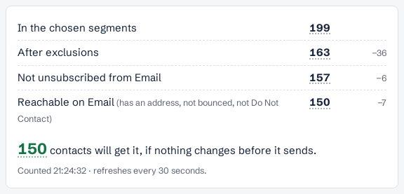

The count doesn't leave out people who unsubscribed from the campaign's **Topic**: they are skipped
when it sends, and show as *Opted out* in the results.

If your workspace leaves email unsubscribers to segment filters (**People who unsubscribed from
email** → **Leave them out with segment filters**, [tutorial 4](04-channels.md#the-unsubscribes-panel)),
an email campaign keeps them in **Not unsubscribed from Email**, and a warning says how many there
are:

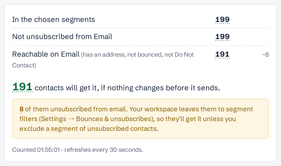

Click the number to see them. To leave them out, add a segment of unsubscribed contacts (the filter
*Unsubscribed from email*, [tutorial 2](02-contacts.md#7-filter-your-contacts)) under **Leave out
members of**.

## 6. Schedule it

Click **Schedule** (top right).

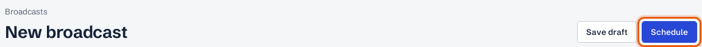

**Schedule** stays greyed out until the form is complete; point at it to see what is missing (*Name
the campaign.*, *Choose who receives it.*, *Choose a template for each variant.*…). **Save draft**
keeps it without scheduling.

Pulse confirms *Scheduled. First send …*. As the send time has passed, it goes out within seconds. The
status moves on by itself:

| Status | Means |
|---|---|
| **Draft** | Saved, not scheduled |
| **Scheduled** | Waiting for its next send |
| **Sending** | Sending now |
| **A/B test: waiting for winner** | The test group has its variants; the rest waits for the winner |
| **Finished** | Everything sent (a repeating campaign stays **Scheduled** until its end) |
| **Cancelled** | Stopped by you; nothing more is sent |

While a campaign is scheduled, sending or testing, the form is locked:

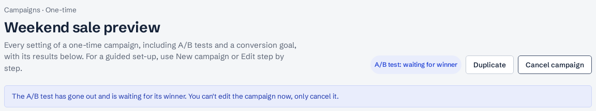

## 7. Pick the winner

Below the form, **Sends** lists each send: **Scheduled for**, **Sent** (*sending…* until it has
finished), the **Test group**, the **Winner** (*Waiting for your pick*) and the **Recipients**.

**Results** fill in as messages go out and are opened and clicked. In **Variants**, compare the rates
and click **Pick A as winner** (or B). Pulse asks you to confirm (*Send A to the other 50% of the
audience? This can't be undone.*).

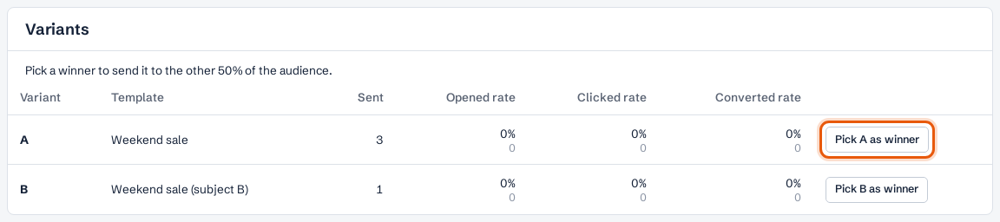

The winner goes to the rest of the segment within seconds, and the status turns **Finished**:

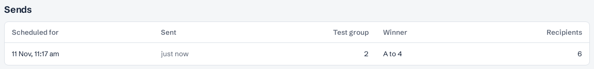

With **Open rate** or **Click rate**, the Variants panel says when the winner will be picked (*The
variant with the best open rate is picked 11 Nov, 3:02 pm and sent to the other 50%. You can pick one
yourself before then.*).

## 8. Read the results

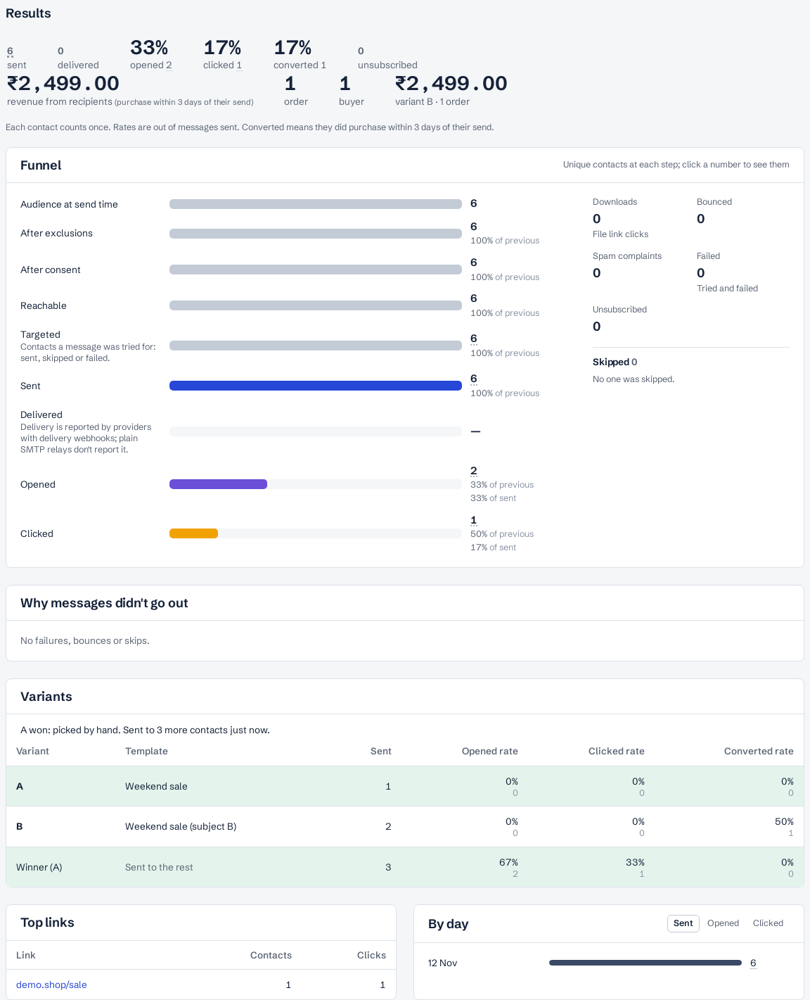

| Part | Shows |
|---|---|
| Top figures | **sent** and **delivered** as counts; **opened**, **clicked**, **converted** as rates (out of messages sent) with the count under each; **unsubscribed** |
| Revenue | With a conversion goal, once someone buys: **revenue from recipients**, **orders**, **buyers**, and the revenue per variant |
| **Funnel** | Unique contacts at each step: **Audience at send time**, **After exclusions**, **After consent**, **Reachable** (the count taken when each send started), then **Targeted** (a message was tried: sent, skipped or failed), **Sent**, **Delivered**, **Opened** (or **Read** for WhatsApp and RCS) and **Clicked**, each with its share of the step before (Targeted's is of **After exclusions**, since it includes people skipped for consent or reachability) and of sent. Beside it: **Downloads** (file link clicks), **Bounced** (hard and soft) and **Spam complaints** on every channel (an SMS to an invalid number is a hard bounce, a blocked WhatsApp message a complaint), **Failed**, **Unsubscribed**, and **Skipped** by reason group (consent, reachability, frequency cap, missing value, deadline) |
| **Why messages didn't go out** | Each reason (*Hard bounce*, *Opted out*, *Undeliverable (possibly blocked)*, *Send deadline passed*…), its kind (**Failed**, **Bounced**, **Spam complaint**, **Opted out**, **Over limit**), how many contacts and their share |
| **Variants** | Each variant and the winner send: sent, opened, clicked and converted rates. The winning variant is highlighted, with how it was picked (*A won: picked by hand*) |
| **By send** | For a repeating campaign, one row per send; choose a send in the list at the top right (**All sends**) to see only its results |
| **By channel** | When some WhatsApp or RCS messages fell back to SMS |
| **Top links** | Links clicked most, with contacts and clicks |
| **By day** | Sent, opened and clicked per day |
| **Over time** | A chart of **Sent**, **Delivered**, **Failed**, **Bounced**, **Opened**, **Clicked** (and **Read**) by day, or by hour for 14 days or fewer. **Period** picks the days; click a name in the legend to switch its line on or off. Times are in your browser's time zone |

**Uplift.** With a control group and a conversion goal, a box in the results compares them, e.g.
*📈 Uplift: +3.2 points — recipients did purchase 8.1% of the time, the control group (120 people kept
back) 4.9%. About 96 conversions came from the campaign itself.* The number of people kept back is a
link to them. If recipients didn't do better, it says *So far the campaign hasn't beaten doing
nothing.* Give it the full conversion window before you judge.

In **Why messages didn't go out**, the people kept back show as *Kept back: campaign control group*
(and *Kept back: workspace control group* for the workspace one). They aren't failures.

Each contact counts once. **Delivered** shows "—" when the provider doesn't report delivery: plain
SMTP relays (as in local development), Gmail and Google Workspace don't; sending services with
delivery webhooks (SendGrid, Postmark, Mailgun, Amazon SES, SparkPost) fill it in
([tutorial 4](04-channels.md)). When the send deadline dropped messages, a note above the funnel says
how many (they are part of **Failed**).

**Every number opens the people behind it.** Click **2** under *opened*, a funnel step, a reason's
**Contacts**, a variant's count or a day in **By day**, and the Contacts page opens with exactly those
contacts, as filter chips such as *Campaign “Weekend sale preview”* and *Opened*. With a send chosen
in **All sends**, the lists are of that send only. From there you can export the list or click
**Create segment from this list**, for example to send a follow-up to everyone who clicked
([tutorial 18](18-contacts-behind-a-number.md)). The funnel's first four steps (*Audience at send
time* to *Reachable*) are a count taken when the send started, not a list of people, so they aren't
links.

**Duplicate** (top right) makes a draft copy, "… (copy)", and opens it. **Tags**, below the form,
label the campaign on the Campaigns page (tutorial 14) and can change at any time, even while it
sends.

### Send it again

A finished campaign shows **Send again** instead of **Schedule**:

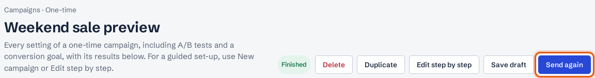

Change what you need (a new **Send at**, another template), then click **Send again**. Pulse asks
first (*This campaign already went out. Schedule it again? Everyone in its audience then gets it again
at the time set below.*). Each send is listed under **Sends**, and **All sends** shows them together
or one at a time.

## 9. A weekly campaign, and cancelling it

1. **New campaign** → **Send a message to a segment** → **Email**. **Campaign name** `Weekly picks, VIP
   customers`, **Send to members of** **VIP customers**; **Next: Content**, **Use a saved template**
   **Weekend sale**.
2. **Next: Schedule**. **Repeat**: **Every week**. **First send**: next Monday, 10:00. **Ends**: about
   two months later. The line below sums it up: *Starts 16 Nov 2026, 10:00 am, ends 11 Jan 2027, 11:00
   pm*.

   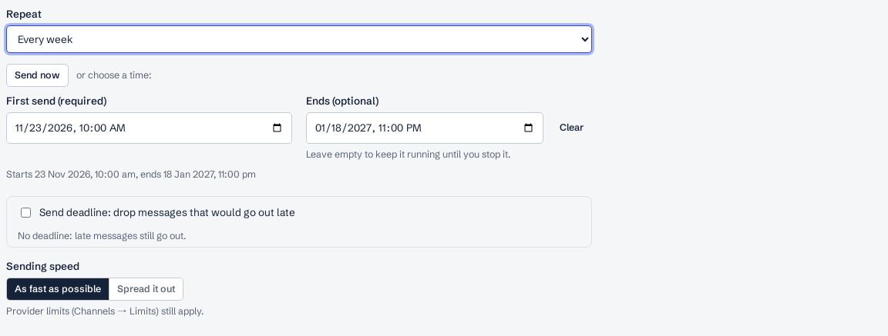

3. **Next: Review**, then **Schedule**. The campaign's page says when the next send is:

   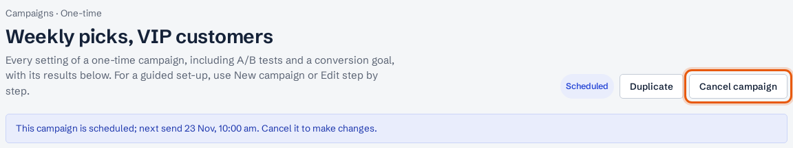

4. To stop it, click **Cancel campaign** and confirm (*Cancel all future sends of this campaign?*).
   Pulse confirms that nothing more will be sent.

   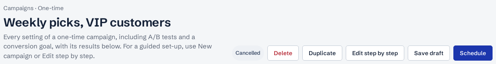

A cancelled campaign can be changed and scheduled again, or removed with **Delete** (you return to
the Campaigns page). Cancelling during an A/B test means the winner is never sent to the rest of the
audience. Messages already sent stay sent.

To change a scheduled campaign (another template, a later time), cancel it, make the change, and
schedule it again.

## 10. A newsletter from your blog: the archive and RSS-to-email

An email campaign can do two more things, under **Archive and feed** on its **All settings and
results** page.

### The public archive

Tick **🗂️ Show its sends in the public archive**. Anyone can then read the campaign's sends on your
workspace's archive page, `http://localhost:7080/p/<workspace>/archive`; the line under the box
links to it.

- The archive lists the sends of every campaign that has the box ticked, newest first. Each send has
  its own page.
- There is an RSS feed of the archive at `/p/<workspace>/archive.rss`, so people can follow your
  newsletter in a feed reader.
- Each page shows the email as a contact with no details would see it: `{{contact.first_name |
  default:"there"}}` shows "there". Write the template so it reads well that way.
- The page shows the template as it is now, not a frozen copy of what was sent: if you change the
  template, old sends in the archive change too (within 5 minutes; pages are kept that long).
- Archive pages are cleaned like landing pages: they run no scripts and show no embedded frames.

### RSS-to-email: send what's new on your blog

With **Content from an RSS feed (optional)**, each send lists what's new in a feed (your blog, a news
page) since the last send.

1. Make a **repeating** email campaign, e.g. **Every week** (step 9).
2. In its template, put `{{block.feed}}` where the new items should go. Each item shows its title (a
   link), a summary and its image; up to 10 items.
3. In **Content from an RSS feed (optional)**, paste the feed's address, e.g.
   `https://blog.example.com/feed.xml`.
4. Click **Preview**. Pulse reads the feed and shows its title, how many items it has, and which ones
   *would go in the next send*. If nothing is new: *Nothing new in the last week: the next send would
   be skipped.*

What happens at each send:

- Pulse reads the feed and sends the items published since the last send, up to the time of this
  send. A post dated in the future (scheduled on your blog) waits for the first send after its date.
- Nothing new: that send is skipped, so nobody gets an empty newsletter.
- The first send looks back one repeat (a day, a week or a month), and also includes items that have
  no date. Later sends never include undated items, so they can't repeat every time.
- Everyone in one send gets the same list of items.
- If the feed can't be read, that send is skipped too.
- The feed's text is shown as written. Something like `{{contact.first_name}}` in a post title
  appears as those characters; it is never filled in as a variable.

Limits: RSS-to-email and the archive are for email campaigns only, and RSS-to-email doesn't work with
A/B tests. Items without a date count only on the first send.

## What you have now

- A sent one-time campaign with an A/B test, a winner picked by hand and results with a funnel,
  opens, clicks, a conversion and revenue, each number opening the people behind it
- A way to test safely: a small segment of test contacts, **Preview** and **Send a test**
- A repeating campaign scheduled, then cancelled and deleted
- A control group to prove a campaign's effect, and the chart of a campaign over time
- A newsletter that sends what's new on your blog, with a public archive

**Next:** [Tutorial 8](08-website-and-app-messages.md), Website & app messages: a website pop-up,
dynamic web content and a mobile in-app message.
