# Tutorial 8: Website & app messages

In about 25 minutes you will put a slide-in on your website and decide which pop-up wins when several
could show, make a part of a page show different content to different people (and check who sees
which version), and set up an in-app message for your mobile app.

**You need:** the Pulse web SDK on your site, or the SDK test page (tutorial 1, step 6), and a segment
or two (tutorial 3). Creating and publishing these needs **Content: Edit**.

---

## 1. Three kinds of message

| Kind | Where | What it is |
|---|---|---|
| **Pop-up, banner bar or slide-in** (a *focus item*) | Website | A message over the page: shown on load, after a delay, on scroll, or when the visitor is about to leave |
| **Dynamic web content** | Website | A placeholder in your page that shows different content to different segments |
| **In-app message** | Mobile app | A pop-up, banner or full-screen message in your Android or iOS app, when an app event happens |

In the sidebar, under **Campaigns**, click **Website & app messages**. All three kinds are listed
together, with their **Channel** (**Website** or **Mobile app**), **Type**, **Schedule** and **Status**
(**Live** or **Draft**). For in-app messages, **Seen by · clicked** counts the people who saw it (each
once) and the share who tapped a button. Filter with **All / Website / Mobile app**, the type list, or
**Find by name**.

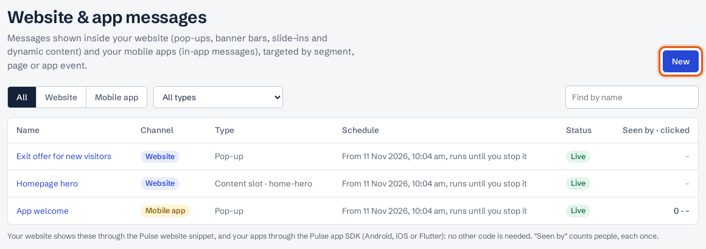

Click **New**. Pulse asks where it should show; choose **Website**, then what kind:

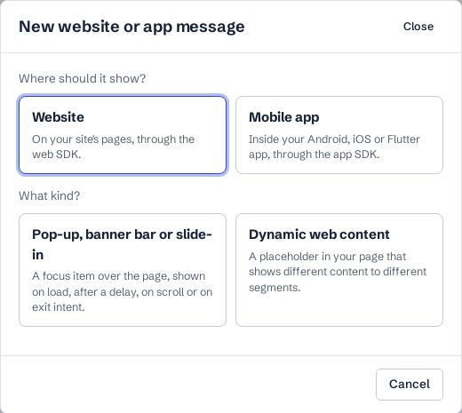

## 2. A slide-in on your website

Choose **Pop-up, banner bar or slide-in**.

### The message

1. **Name**: `Newsletter slide-in` (only your team sees it).
2. **Type**: **Pop-up** (in the middle, over a darkened page), **Banner bar** (across the top or
   bottom; choose which next to the colours), or **Slide-in** (a card in the bottom-right corner).
   Choose **Slide-in**.
3. **Headline**: `Get 10% off your first order`.
4. **Body**: `Join the newsletter for new arrivals and members-only sales.` The editor has bold,
   links, lists, images and more; **Source** lets you write your own HTML.
5. **Button text** `Sign me up` and **Button link** `https://demo.shop/newsletter`. The button shows
   only with a link that starts with `https://` or `http://`.
6. **Background**, **Text** and **Button** colours.

**Preview on a page** (right) updates as you type.

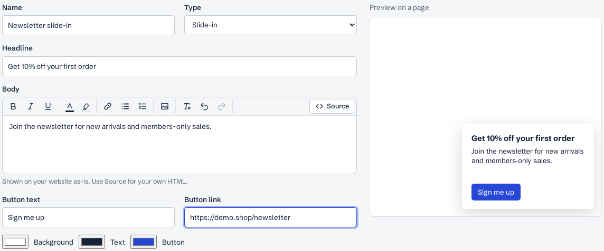

### Who sees it, and when

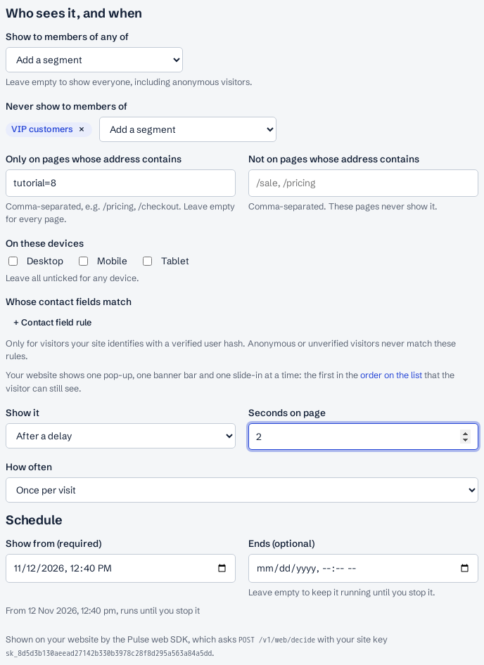

| Field | Here | Notes |
|---|---|---|
| **Show to members of any of** | (empty) | Pick segments from **Add a segment**. Empty shows everyone, including anonymous visitors |
| **Never show to members of** | **VIP customers** | They already get offers. Remove a segment with its **×** |
| **Only on pages whose address contains** | `tutorial=8` | Comma-separated, e.g. `/pricing, /checkout`. Empty: every page. (Here it keeps the slide-in to the test page; on your site you might use `/blog`) |
| **Not on pages whose address contains** | (empty) | Comma-separated. These pages never show it, e.g. `/checkout` |
| **On these devices** | (none ticked) | **Desktop**, **Mobile**, **Tablet**. Leave all unticked for any device |
| **Whose contact fields match** | (none) | **+ Contact field rule**: a field, a comparison and a value, e.g. `city` **is** `Pune`. All rules must match. Only visitors your site identifies with a verified user hash can match these; anonymous visitors never do |
| **Show it** | **After a delay**, **Seconds on page** `2` | Or **As the page loads**, **When they're about to leave** (the mouse leaves the top of the window; desktop only), **After scrolling** (**Percent of page scrolled**) |
| **How often** | **Once per visit** | Or **Once per visitor**, **At most once a day**, **On every matching page**. Counted in the visitor's browser |

**Schedule**: **Show from (required)** starts as now; **Ends (optional)** empty keeps it showing until
you unpublish it.

### Publish and check

1. Click **Publish** (top right). Pulse says *Published. Visitors see it within seconds.*

   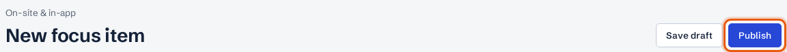

2. Scroll to **Check what a visitor sees**: it asks Pulse exactly what the website would. Leave
   **Contact's external ID** empty for an anonymous visitor (or enter one), type a **Page address**
   and click **Check**.

   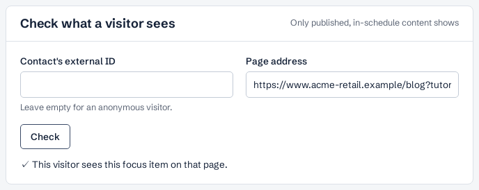

3. Open your site, or the test page with `&tutorial=8` added to its address. After two seconds the
   slide-in appears in the corner:

   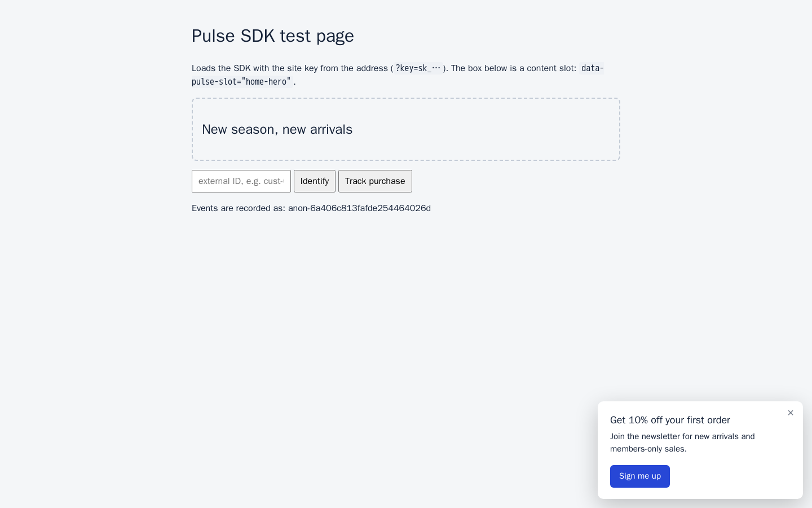

The SDK records `focus_shown`, `focus_clicked` (the button) and `focus_closed` events on the contact,
so you can build segments and campaigns on them.

To take it down, click **Unpublish** (the button that was **Save draft**); **Delete** removes it. A
triggered or automation campaign can also show a focus item to one contact on their next page view,
whatever its targeting, with the **Show focus item** action (tutorial 6).

### When several could show: the order

A visitor sees at most one pop-up, one banner bar and one slide-in on a page: the first one in your
order that they can still see. If they aren't in its audience, have already seen it as often as it
allows, or it's outside its schedule, the next one is shown instead.

1. On the **Website & app messages** list, click **Order of pop-ups, bars and slide-ins** (it shows
   once you have two or more).

   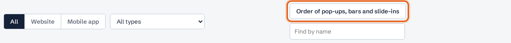

2. Each kind has its own list. Drag an item by its handle (**⋮⋮**), or use the **↑** and **↓**
   arrows, to put the most important one first.
3. **Check overlap** counts, for the published items of that kind, how many of your known contacts
   match each one and how many would actually see it in this order. Click a number to open those
   contacts. Counts use segments only (marked **\***): page, device and contact-field rules depend
   on the visit.
4. Click **Save order**. *Order saved. Visitors see it within seconds.* **Undo changes** puts the
   saved order back.

   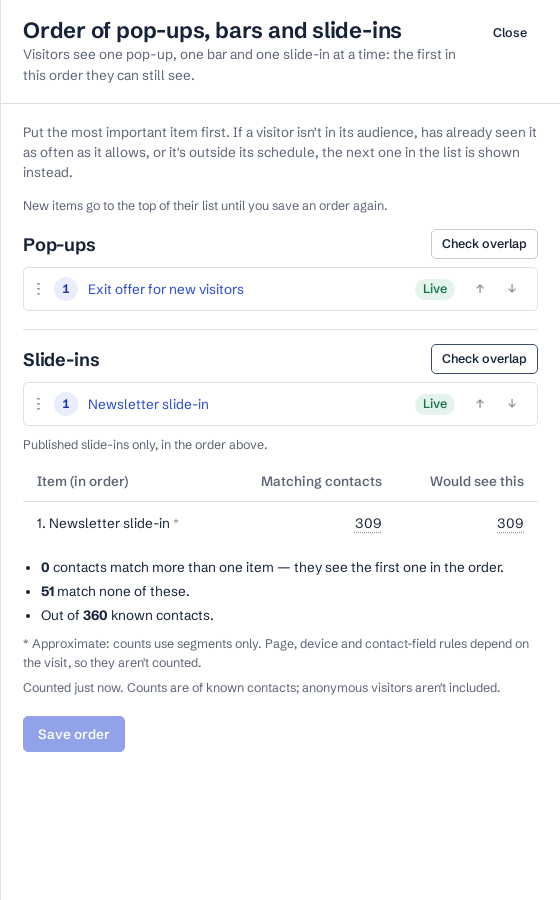

New items go to the top of their list until you save an order again.

## 3. Dynamic web content

A content slot is a placeholder in your page. Pulse fills it with the first **variant** whose
audience the visitor matches, or with what **Everyone else** sees.

### Put the slot in your page

Where the content should go, add an element with `data-pulse-slot`, and keep a default inside it for
when Pulse has nothing to show:

```html
<div data-pulse-slot="sale-banner">Our weekend sale starts Saturday.</div>
```

The page needs the Pulse web SDK (tutorial 1). It asks for the page's slots when the page loads.

### Set up the content

1. **New → Website → Dynamic web content**.
2. **Name**: `Sale banner`. **Slot key**: `sale-banner`, the same as in your page (lowercase letters,
   digits, `-` and `_`; one slot per key).
3. Click **Add a variant**. Give it a name, `Sale testers` (only your team sees it). Under
   **Audience rules**, pick **Sale preview testers** in **Show to members of any of**, and type its
   content: `Testers: the weekend sale is open to you a day early. Use code PREVIEW15.`

   The line **Who sees it** says in words who gets this variant: *Members of Sale preview testers.*

   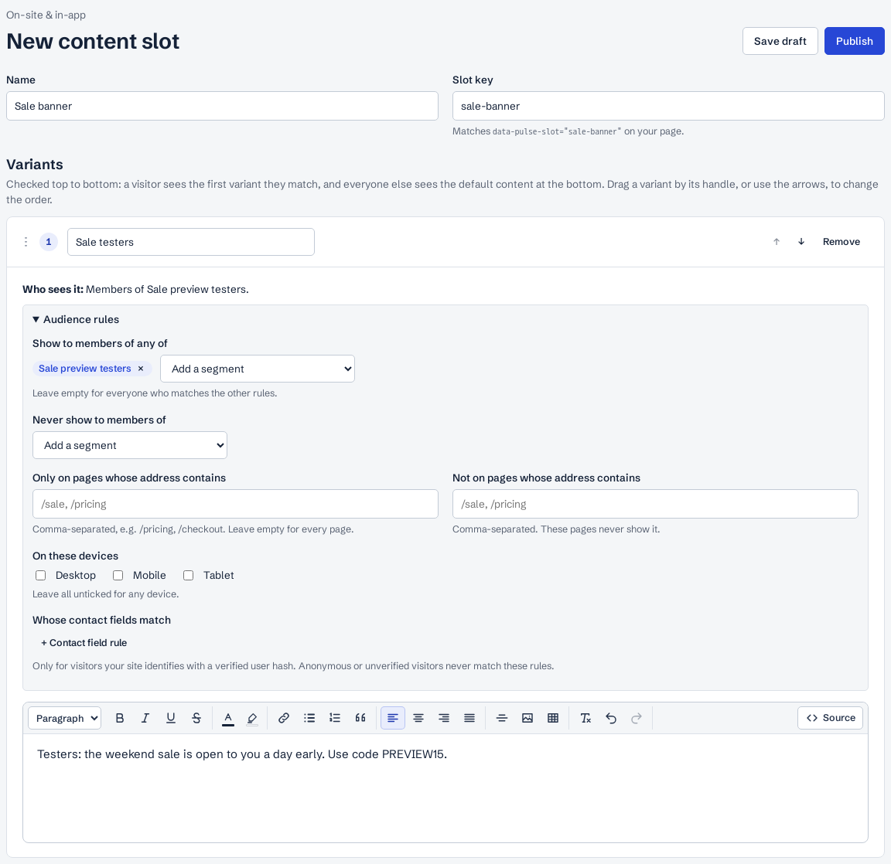

4. Click **Add a variant** again: `VIPs on their phone`, for members of **VIP customers**, with
   **Mobile** ticked under **On these devices**, and the content `VIPs: tap to see your early-access
   sale picks.`

   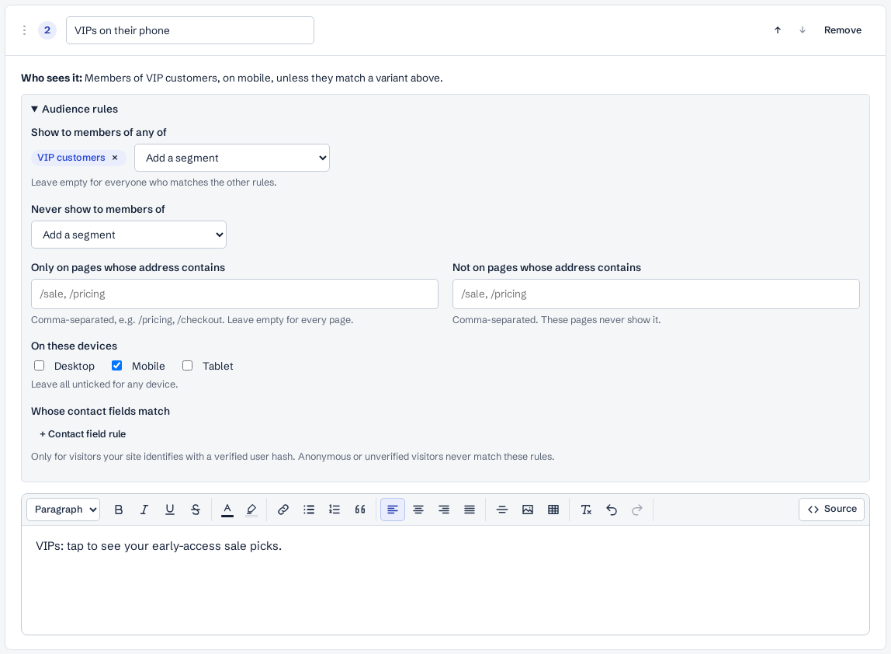

   A variant's **Audience rules** are the same as a pop-up's: segments to show to and never show
   to, pages it shows on or not, devices, and contact-field rules. Leave the segments empty for
   everyone who matches the other rules. Click **Audience rules** to fold them away.
5. **Everyone else sees**: `Weekend sale: up to 30% off home and kitchen, until Sunday night.` This
   goes to visitors who match no variant, including anonymous visitors. Leave it empty to show
   nothing.

A slot can have up to 20 variants, and a variant up to 5 contact-field rules.

### The order of variants, and variants that can never show

Variants are checked top to bottom, and a visitor sees the **first** one they match. Change the order
by dragging a variant by its handle (**⋮⋮**), or with its **↑** and **↓** arrows. **Remove** deletes
a variant.

Pulse warns you when a variant can never be shown because a variant above it already takes everyone
it targets. Here a third variant, *Testers on their phone*, would never show: every tester matches
*Sale testers* first.

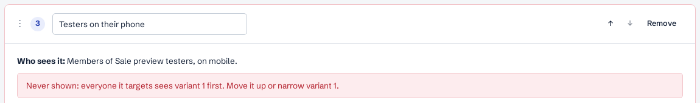

Move it above variant 1, narrow variant 1, or remove it (here, remove it). In the same way, a variant
with no rules at all shows to everyone, so the variants below it and **Everyone else** are never
shown; Pulse says so on that variant.

### Check the overlap before you publish

Under **Overlap**, click **Check overlap**. Pulse counts how many of your known contacts match each
variant (**Matching contacts**), how many would actually see it in this order (**Would see this**),
how many match more than one variant, and how many get the default content. Click a number to open
those contacts in **Contacts**.

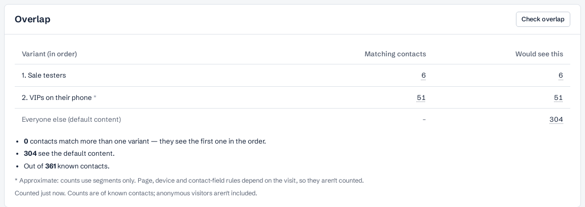

Counts marked **\*** are approximate: they use segments only, because page, device and contact-field
rules depend on the visit. Anonymous visitors aren't counted. If you change the variants afterwards,
Pulse asks you to check again.

**Schedule** works as for pop-ups.

### Publish and check

Click **Publish**, then use **Check what a visitor sees** with a contact's external ID:

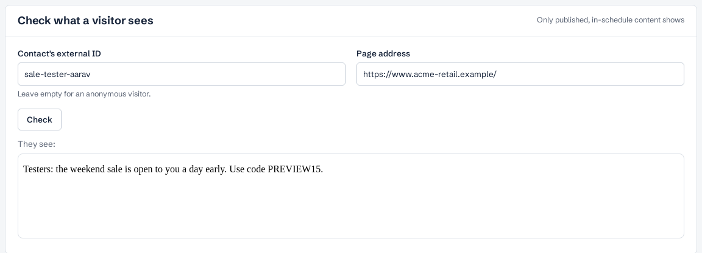

### See it on a page

An anonymous visitor gets what everyone else sees:

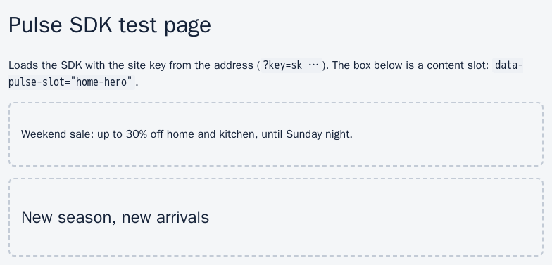

The same page for `sale-tester-aarav`, a member of *Sale preview testers*, after they identify and
the page loads again:

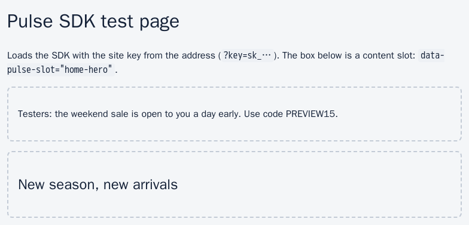

(The SDK test page has one slot, `home-hero`; the seeded *Homepage hero* fills it with "New season,
new arrivals". For these pictures a `sale-banner` slot was added above it, as your own page would
have.)

A triggered or automation campaign can give one contact their own content for a slot with **Push
dynamic content**, which takes priority over the variants; the **Requests dynamic content** decision
fires when their page asks for the slot (tutorial 6).

## 4. An in-app message in your mobile app

In-app messages show inside your Android or iOS app. The Pulse Flutter, Android and iOS SDKs fetch
the live messages and show each one when its trigger happens in the app; Pulse itself only stores and
targets them. So here you set one up and preview it; you see it for real in an app that uses a Pulse
SDK (see the developer docs).

**New → Mobile app** opens the editor.

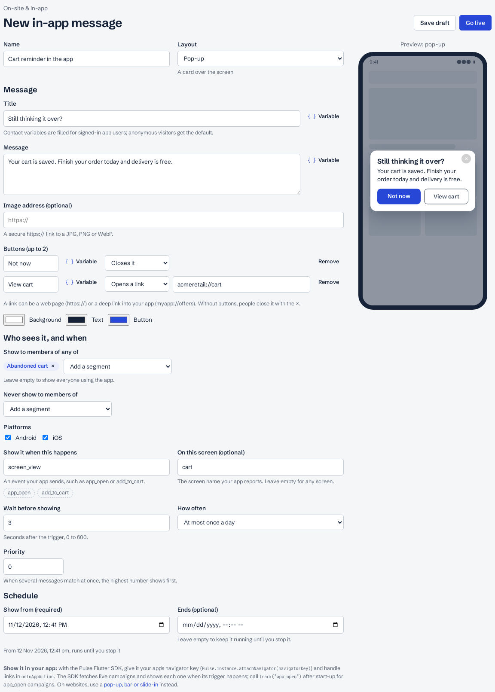

### The message

1. **Name**: `Cart reminder in the app`.
2. **Layout**:

   | Layout | Looks like |
   |---|---|
   | **Pop-up** | A card over the screen |
   | **Banner** | A strip at the top or bottom (choose **Top of the screen** or **Bottom of the screen** next to the colours) |
   | **Full screen** | Takes over the whole screen |

3. **Title** `Still thinking it over?` and **Message** `Your cart is saved. Finish your order today
   and delivery is free.` Title, message and button labels can use contact variables with the
   **{ } Variable** button, e.g. `{{contact.first_name | default:"there"}}`. Only app users whose
   identity is verified (identity secret and user hash) get their own value; everyone else gets the
   default ([tutorial 13](13-personalising-messages.md#9-other-places-variables-work)).
4. **Image address (optional)**: an `https://` link to a JPG, PNG or WebP.
5. **Buttons (up to 2)**: each **Closes it** or **Opens a link**. A link can be a web page
   (`https://…`) or a deep link into your app (`acmeretail://cart`). Here: **Not now** (closes it)
   and **View cart** (opens `acmeretail://cart`). Without buttons, people close it with the ×.
6. Colours for **Background**, **Text** and **Button**.

The phone on the right previews it:

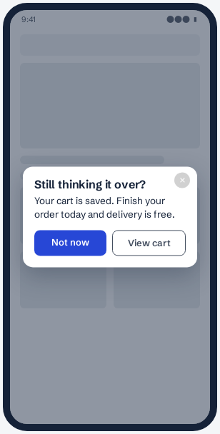 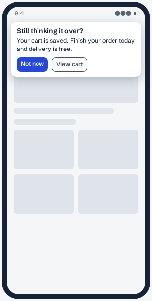 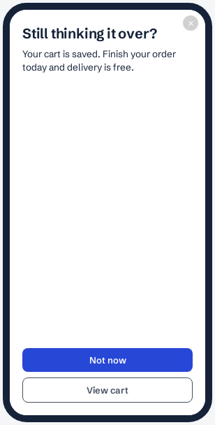

### Who sees it, and when

| Field | Here | Notes |
|---|---|---|
| **Show to members of any of** | **Abandoned cart** | Empty: everyone using the app |
| **Never show to members of** | (empty) | |
| **Platforms** | **Android**, **iOS** | Untick one to target only the other |
| **Show it when this happens** | `screen_view` | An event your app sends. Quick picks: `app_open`, `screen_view`, `add_to_cart`; your own events are suggested as you type |
| **On this screen (optional)** | `cart` | Only for `screen_view`: the screen name your app reports. Empty: any screen |
| **Wait before showing** | `3` | Seconds after the trigger, 0 to 600 |
| **How often** | **At most once a day** | Or **Once per contact**, **Once per app session**, **Every time it's triggered** |
| **Priority** | `0` | When several messages match at once, the highest number shows first |

**Schedule**: **Show from (required)** and **Ends (optional)**, as everywhere in Pulse.

### Save, try, go live

1. Click **Save draft**. (While something is missing, **Go live** is greyed out and a line under the
   title says what, e.g. *To go live: Choose the event that shows it.*)
2. **Try it with a contact**: enter a **Contact external ID**, choose **Android** or **iOS**, and
   click **See what they get** to list the live messages that would reach them, in order:

   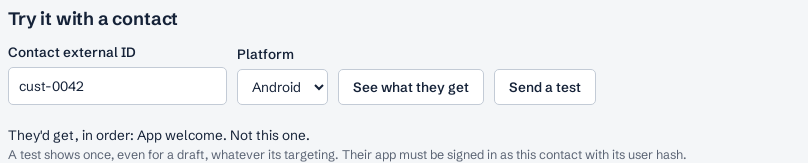

   **Send a test** sends this message to that contact's app once, even as a draft and whatever its
   targeting. It shows the next time their app checks for messages (within 15 minutes); the app must
   be signed in as that contact.
3. Click **Go live**. Apps pick it up the next time they fetch messages. **Back to draft** takes it
   down again.

The app SDKs report when a message is shown, tapped and dismissed; the list's **Seen by · clicked**
column counts each person once. On websites, use a pop-up, bar or slide-in instead.

## What you have now

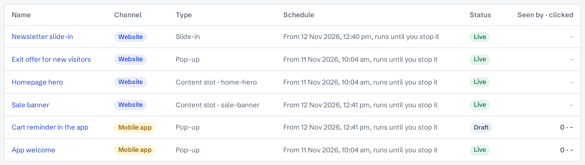

- **Newsletter slide-in**: a slide-in for visitors who aren't VIPs, after 2 seconds, once per visit,
  ordered against your other slide-ins
- **Sale banner**: a content slot with two variants (testers; VIPs on their phone), checked for
  overlap, and a default for everyone else
- **Cart reminder in the app**: an in-app banner for contacts with an abandoned cart, saved as a draft

**Next:** Tutorial 9, Integrations: HubSpot or Salesforce, Shopify, Zapier and ad audiences.
