# Tutorial 9: Integrations

In about 30 minutes you will connect Pulse to the other tools your team uses: a CRM (HubSpot or
Salesforce), your Shopify store, Zapier or Make, and your Facebook and Google ad accounts. At the end
you will send Pulse events to your own systems with a webhook.

**You need:** an admin account in Pulse (integrations and webhooks are workspace settings), and for each
tool you connect, an admin account there to create a key. The screenshots use made-up keys: a local
Pulse can't reach HubSpot, Salesforce, Shopify, Facebook or Google, so they show the forms filled in
and, where it is safe, saved.

---

## 1. Find the Integrations page

Go to **Settings → Integrations** (under *Connections*). The page lists one card per tool, grouped
**CRM**, **E-commerce**, **Automation** and **Ads**, each with a **Connect** button.

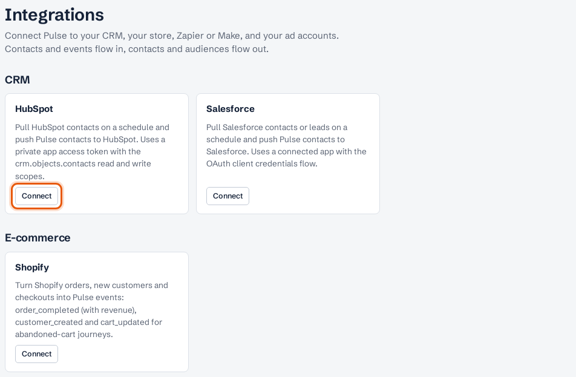

Once you have connected something, a table at the top lists your integrations with their **Status**
and **Last sync**:

| Status | Means |
|---|---|
| **Not synced yet** | Saved, nothing has run yet |
| **Connected** | The last sync, push or webhook worked |
| **Syncing** | A pull is running |
| **Error** | The last attempt failed; the error is shown under the badge |
| **Paused** | **Active** is turned off: nothing syncs |

Every integration page has the same parts: **Settings** (secrets are stored encrypted and only the
last four characters are ever shown again), a **Test connection** button, a preview, and the
**Sync log**. Only admins can connect or change integrations; other roles can open the page and see
the list.

## 2. Connect HubSpot

Pulse pulls HubSpot contacts on a schedule and pushes Pulse contacts to HubSpot, one at a time or
from a journey.

**In HubSpot** create a private app (*Settings → Integrations → Private Apps*) with the scopes
`crm.objects.contacts.read` and `crm.objects.contacts.write`, and copy its access token
(`pat-…`).

**In Pulse:**

1. On the **HubSpot** card click **Connect**. The page is **Connect HubSpot**.
2. Fill in:
   - **Name**: how the integration appears in lists and journeys, e.g. `HubSpot`.
   - **Private app access token**: the token you copied.
   - **Pull contacts**: how often Pulse asks HubSpot for contacts changed since the last pull:
     **Every 15 minutes**, **Every 30 minutes**, **Every hour** (the default), **Every 4 hours**,
     **Once a day**, or **Never (push only)**.
   - Leave **API base URL (optional)** empty. It is only for testing.

   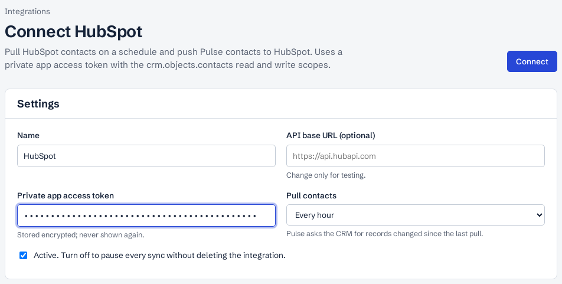

3. Check the **Field mapping** (next step), then click **Connect** at the top right.

You land on the integration's page. The status is **Not synced yet**, with the panels **Test
connection**, **Pull contacts** and **Push a contact** below the mapping.

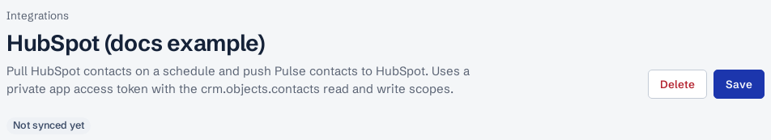

### The field mapping

Each row joins a HubSpot field to a Pulse attribute. HubSpot starts with five rows:
`email`, `firstname` → `first_name`, `lastname` → `last_name`, `phone` and `city`.

| Direction | What happens |
|---|---|
| **Both ways** | Pulls write the HubSpot value into the attribute; pushes write the attribute into HubSpot |
| **Into Pulse** | Pulls only |
| **Out to HubSpot** | Pushes only |

- **Add field** adds a row; **×** removes one. Typing in a column suggests names: Pulse attributes
  in the right column and, after **Load fields from HubSpot** (on a saved integration), HubSpot's
  own properties in the left one.
- Attributes Pulse keeps itself (tags, points, stage, consent, owner, `first_seen` and similar) can
  only go **Out to HubSpot**. The example below sends the lead score to a HubSpot property
  `pulse_points`.
- Pulse keeps the HubSpot record ID on the contact as `hubspot_id`.
- If a row has a problem (an empty field, an attribute filled by two rows, a reserved attribute coming
  in) the message shows under it and **Connect** / **Save** stays disabled until it is fixed.

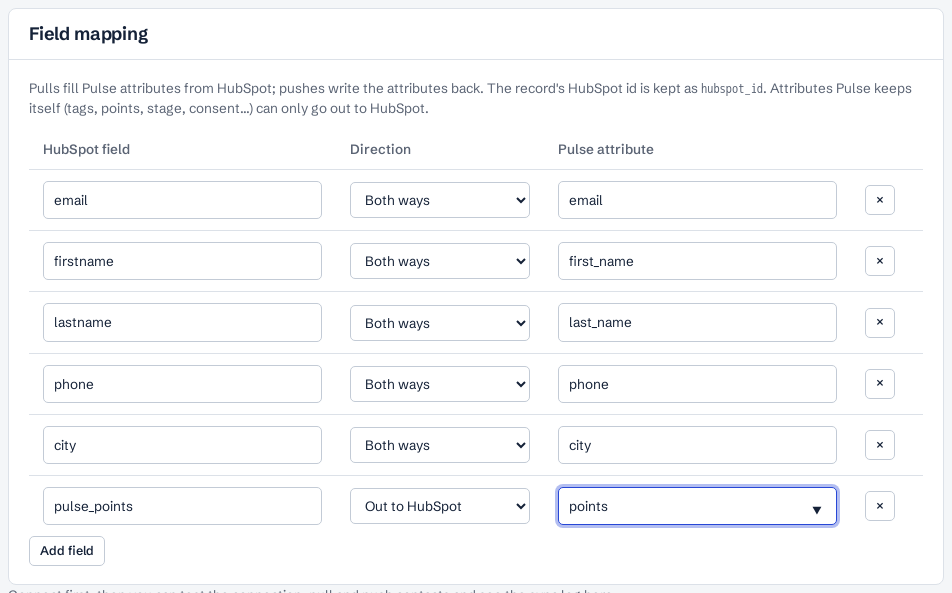

### Test, pull and push

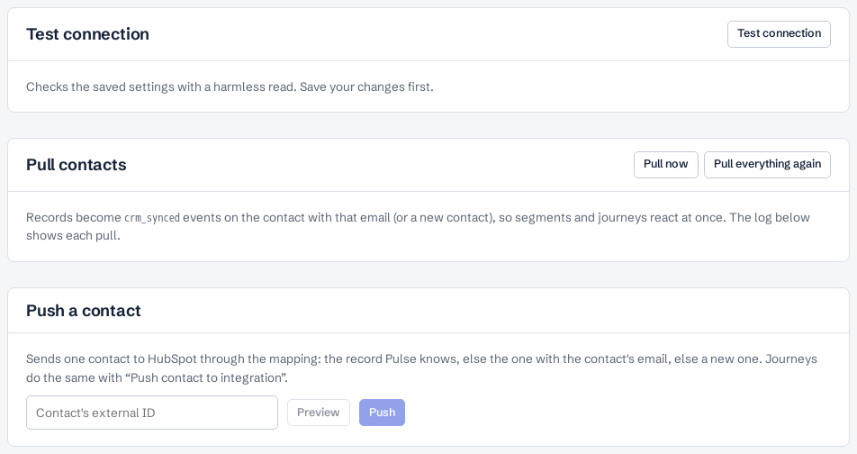

- **Test connection** checks the saved settings with a harmless read and shows **It works (… ms)**
  or **It didn't work** with HubSpot's error. Save your changes first.
- **Pull now** asks for changes since the last pull right away (*Pull starts within a few seconds*).
  **Pull everything again** starts from the beginning; unchanged contacts stay as they are.
  Each record becomes a `crm_synced` event on the contact with the same email, or on a new contact,
  so segments and journeys react straight away.
- **Push a contact**: type a contact's external ID and click **Preview** to see exactly which fields
  Pulse would send. **Push** sends them: to the HubSpot record Pulse already knows (`hubspot_id`),
  else the one with the contact's email, else a new record. Empty Pulse values never blank a HubSpot
  field.

  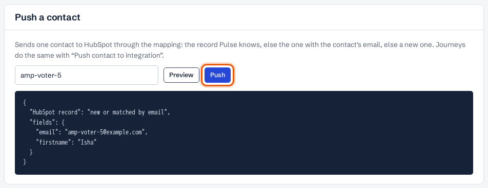

> **What isn't synced:** HubSpot companies, deals and deleted contacts, and HubSpot's email opt-out
> (to keep it, map `hs_email_optout` to a plain attribute). Pulse uses a private app token, not a
> HubSpot marketplace app.

## 3. Connect Salesforce

Salesforce works like HubSpot, with Contacts or Leads.

**In Salesforce** create a connected app with OAuth, turn on the *client credentials flow* and
choose a *Run As* user, then copy its **Consumer Key** and **Consumer Secret**. You also need your
**My Domain** URL (*Setup → My Domain*), e.g. `https://yourcompany.my.salesforce.com`.

**In Pulse:** on the **Salesforce** card click **Connect** and fill in:

| Field | Value |
|---|---|
| **My Domain URL** | `https://yourcompany.my.salesforce.com`. The client credentials flow doesn't work with `login.salesforce.com` |
| **Object (optional)** | `Contact` (the default) or `Lead` |
| **API version (optional)** | `v60.0` unless you need another |
| **Consumer key**, **Consumer secret** | From the connected app |
| **Pull contacts** | As for HubSpot |

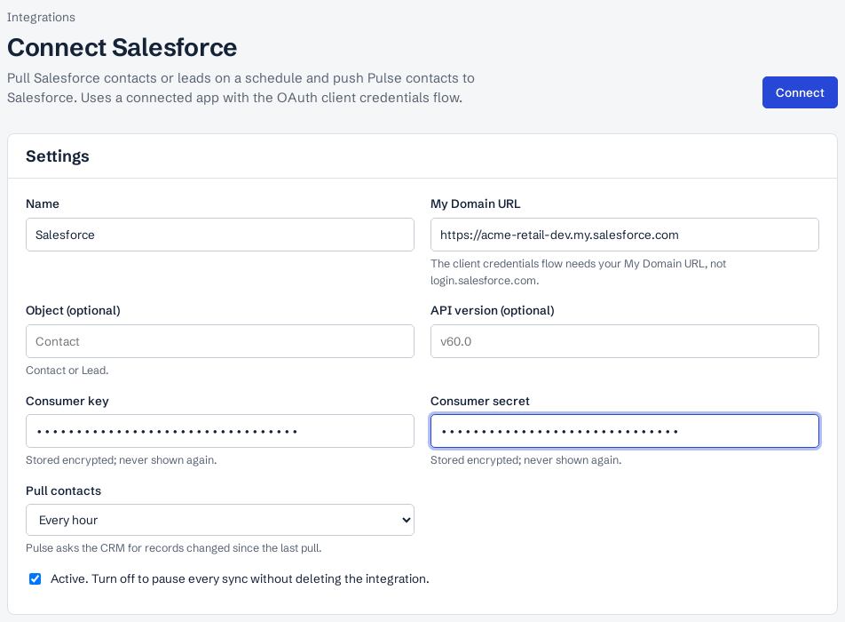

The default mapping is `Email`, `FirstName`, `LastName`, `Phone` and `MailingCity`. Field names must
be Salesforce API names (letters, digits and `_`). Pulse keeps the record ID as `salesforce_id`.
When a push creates a record without a last name, Pulse sends `[not provided]` (and the same for a
lead's company), because Salesforce requires them.

## 4. Push contacts to your CRM from a journey

Once HubSpot or Salesforce is connected, journeys can send contacts to it: in the journey editor,
click a **+**, choose **Action → Push contact to integration**, and pick the integration under
**CRM**.

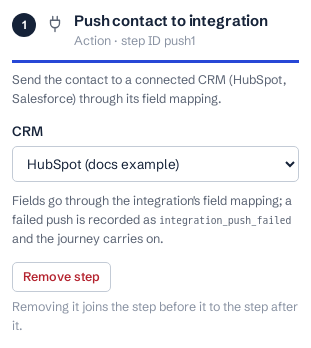

The fields go through the integration's field mapping. If a push fails, Pulse records an
`integration_push_failed` event on the contact and the journey carries on. Building journeys is
covered in [tutorial 6](06-journeys.md).

## 5. Connect Shopify

Shopify sends Pulse a webhook for each new order, new customer and checkout. Pulse turns them into
events you can use in segments, journeys and revenue reports.

**In Pulse:**

1. On the **Shopify** card click **Connect**.
2. Fill in **Shop domain** (`your-store.myshopify.com`) and **Webhook signing secret**. You find the
   secret in Shopify in the next step; you can save first and fill it in afterwards.
   **Admin API access token (optional)** (`shpat_…`) is only used by **Test connection**.

   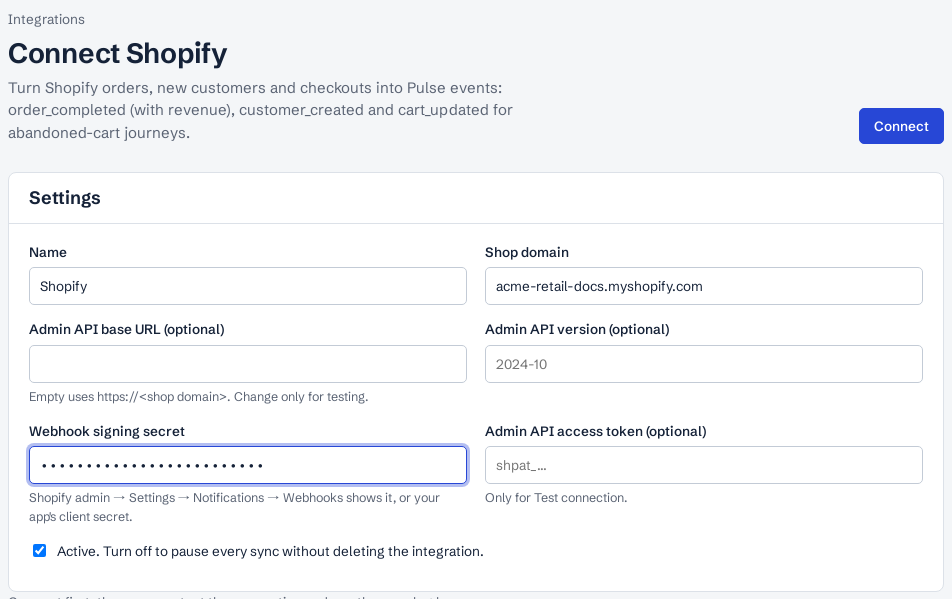

3. Click **Connect**. The page now has a **Shopify webhooks** panel with your **webhook URL**
   (`…/v1/webhooks/shopify/<number>`) and a **Copy** button.

   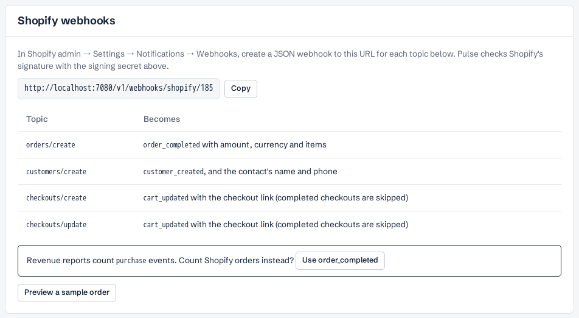

**In Shopify admin** go to *Settings → Notifications → Webhooks* and create one webhook per topic,
each with format **JSON** and the URL you copied:

| Topic | Becomes in Pulse |
|---|---|
| `orders/create` | `order_completed`, with order ID and number, amount, revenue, currency, discount and items |
| `customers/create` | `customer_created`; the customer's name and phone go on the contact |
| `checkouts/create`, `checkouts/update` | `cart_updated` with the checkout link (completed checkouts are skipped: the order arrives on its own) |

Shopify shows the signing secret on the same page ("Your webhooks will be signed with…"); paste it in
Pulse's **Webhook signing secret** and **Save**. Pulse refuses deliveries with a wrong signature or
from another shop. Each event lands on the contact with the same email (else the same phone, else a
new contact), with `shopify_customer_id`, order count and total spent. Shopify's retries are
recorded once.

**Revenue.** Revenue reports count `purchase` events by default. If Shopify is where your orders
come from, click **Use order_completed** in the panel: revenue then counts `order_completed` events
and their `amount` (see [tutorial 10](10-analytics.md#6-revenue)).

**Preview a sample order** shows what Pulse would record for an order, without saving anything:

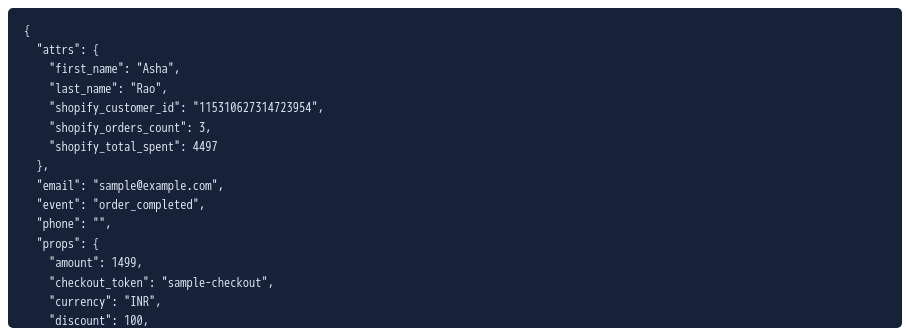

> Shopify's marketing consent isn't copied into Pulse consent, and refunds and fulfilments aren't
> used. Webhooks are added by hand in Shopify; there is no Shopify app to install.

## 6. Read the sync log

Every integration page ends with the **Sync log**: the latest 100 pulls, pushes, webhooks, audience
uploads, full syncs and tests, with **Result** (**OK** or **Failed**), a **Count** and the details.
It refreshes every few seconds and keeps a week.

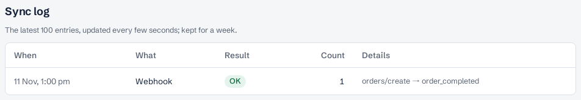

When something fails, the error is also shown at the top of the page next to the **Error** badge.
To stop everything for a while without losing the settings, untick **Active** and **Save**.
**Delete** removes the integration, its log and its audience links; contacts already synced stay.

## 7. Connect Zapier or Make

**Zapier / Make** gives Zapier, Make and similar tools their own API key (`pzk_…`), so you don't
hand them the workspace's server key.

1. On the **Zapier / Make** card click **Connect**, give it a **Name** and click **Connect**.
2. Pulse shows **Your API key. Copy it now: Pulse won't show it again.** Copy it into Zapier or Make.
   Later, **Rotate key** makes a new one (the old one stops at once).
3. The **API key and endpoints** panel lists the base URL (`…/v1/hooks`) and what you can call with
   `Authorization: Bearer pzk_…`:

   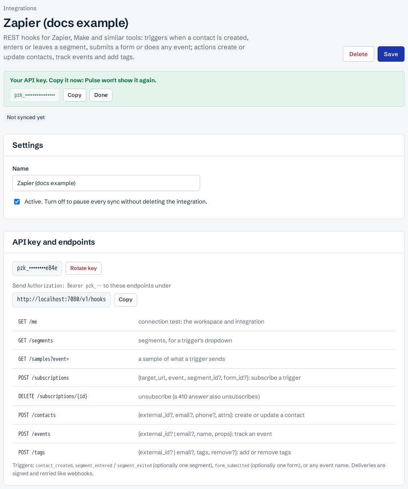

| Call | Does |
|---|---|
| `GET /me` | Connection test: the workspace and integration |
| `GET /segments` | Segments, for a trigger's dropdown |
| `GET /samples?event=` | A sample of what a trigger sends |
| `POST /subscriptions` | `{target_url, event, segment_id?, form_id?}`: subscribe a trigger |
| `DELETE /subscriptions/{id}` | Unsubscribe (answering 410 to a delivery also unsubscribes) |
| `POST /contacts` | `{external_id?, email?, phone?, attrs}`: create or update a contact |
| `POST /events` | `{external_id? or email?, name, props}`: track an event |
| `POST /tags` | `{external_id? or email?, tags, remove?}`: add or remove tags |

**Triggers** are `contact_created`, `segment_entered` / `segment_exited` (optionally for one
segment), `form_submitted` (optionally for one form), or any event name. When a Zap or scenario
using a Pulse trigger is turned on, it subscribes and appears under **Subscriptions**; **Remove**
stops it. Deliveries are signed and retried like webhooks (step 9) and listed under **Recent
deliveries**.

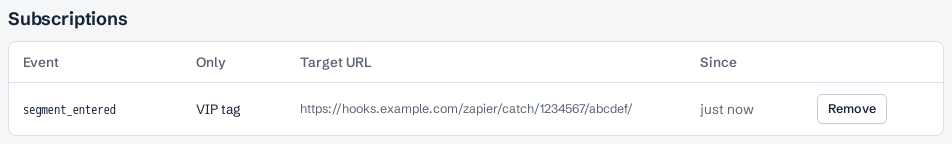

There is no published Pulse app in Zapier or Make yet: use their *Webhooks* / *HTTP* modules with
the calls above. To check the key, `GET /v1/hooks/me` with `Authorization: Bearer pzk_…` answers with
your workspace.

## 8. Sync a segment to Facebook or Google Ads

Keep an ad audience in step with a segment, for retargeting or lookalikes: Pulse uploads members as
they join and removes them as they leave.

### Facebook Custom Audiences

**In Meta Business Manager** create a system user with `ads_management` on your ad account and
generate its access token.

1. On the **Facebook Custom Audiences** card click **Connect** and fill in **Ad account ID**
   (`act_1234567890` or just the number), **System user access token** and, if some phone numbers
   are saved without a country code, **Default country calling code (optional)** (e.g. `91`).

   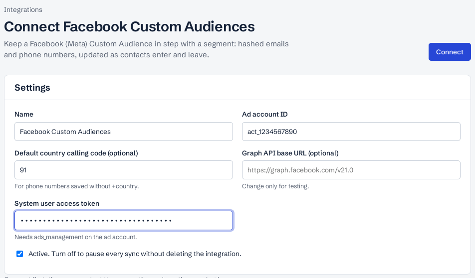

2. Click **Connect**, then use **Test connection** to check the token.

### Google Ads Customer Match

You need a Google Ads **developer token**, an OAuth **client ID** and **client secret**, and a
**refresh token** for a user with access to the account. Fill in **Customer ID** (`123-456-7890`),
those four secrets, and **Manager account ID** if you reach the account through a manager account.

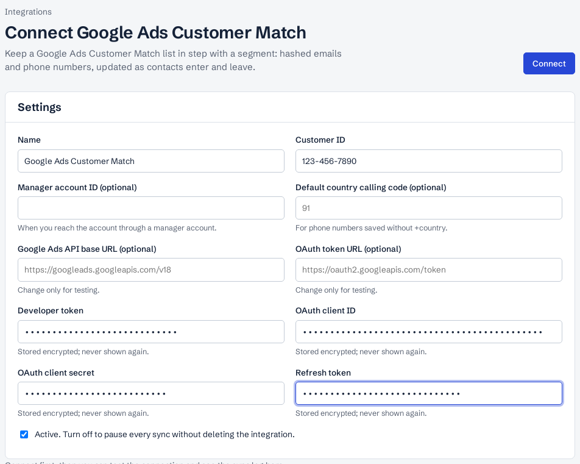

### Link a segment

On the saved integration, under **Link a segment**:

1. Choose the **Segment**.
2. Under **Audience** choose **Create a new audience** (Pulse names it after the segment, e.g.
   `VIP customers (Pulse)`, unless you type a **New audience name**) or **Use an existing
   audience** and paste its **Audience ID** (Facebook: the custom audience ID; Google: the user list
   ID or `customers/…/userLists/…`).
3. Click **Link segment**. The first upload starts within seconds.

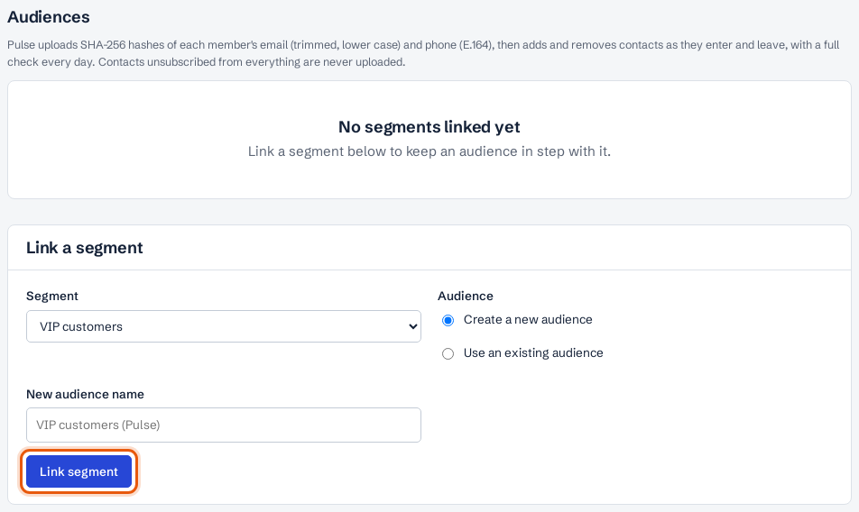

Linking a segment needs edit access to segments as well as admin access.

**Sync status.** Each linked segment is a row under **Audiences**:

| Column | Shows |
|---|---|
| **Status** | **Syncing**, **In sync**, **Error** (with the platform's message) or **Paused** |
| **In audience** | Members uploaded so far |
| **Added**, **Removed** | Changes sent since linking |
| **Left out** | Members skipped at the last full sync: no consent, or no email or phone |
| **Waiting** | Changes queued for the next upload |
| **Last sync** | When Pulse last sent something |

**Sync now** runs a full check right away (one also runs every day), **Pause** / **Resume** stops
and restarts uploads, and **Unlink** stops updating the audience (it keeps the people already in
it).

**What is uploaded.** Only SHA-256 hashes of each member's email (trimmed, lower case; for Google,
Gmail dots removed) and phone number (international format). Contacts unsubscribed from everything
are never uploaded. **Check a contact** shows whether a contact would be included and the exact
hashes, without sending anything:

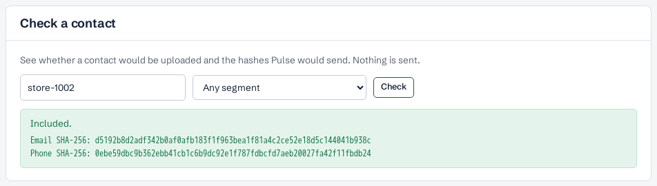

> Facebook and Google match the hashes in the background, so audience sizes show up in Ads Manager
> or Google Ads, not in Pulse. Google's EEA consent signals aren't sent yet.

## 9. Send events to your own systems: webhooks

A webhook posts a JSON message to your URL each time a chosen event happens: a purchase, a form
sign-up, a contact entering a segment.

1. Go to **Settings → Webhooks** and click **New webhook**.
2. Fill in **Name** (e.g. `Purchases to CRM`) and **URL** (`https://…`).
3. Under **Events**, type an event name in **Add an event** and press Enter (or click **Add**). Any
   event name works, including ones you haven't sent yet. `segment_entered` and `segment_exited`
   fire when a contact joins or leaves any segment. Or tick **Send every event**.

   The **+ event** suggestions under the box add that event with one click.

   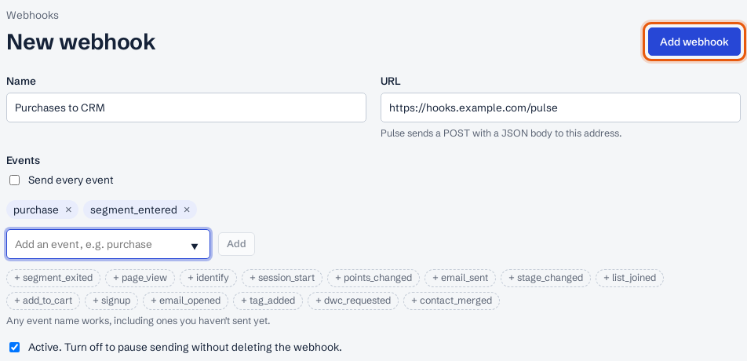

4. Click **Add webhook**. Pulse creates its **Signing secret** and the page shows it hidden, with
   **Reveal**, **Copy** and **Rotate secret**.
5. Click **Send test**. Pulse sends a `webhook_test` event to the saved URL straight away and shows
   the answer: **Your server answered 200 in … ms**, or what went wrong. In the picture the address
   doesn't exist, so the error says so.

   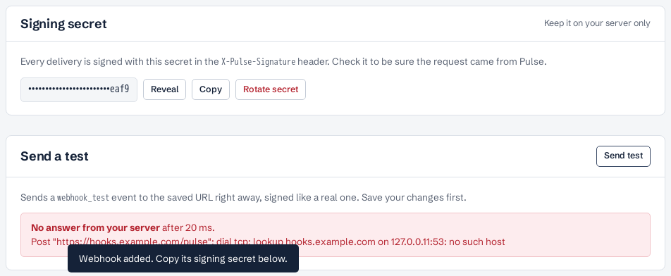

Each delivery is a POST with this body:

```json
{
  "id": "…", "event": "purchase", "ts": "2026-11-11T10:52:00Z", "workspace_id": 3166,
  "contact": { "id": 1042, "external_id": "store-1002", "attributes": { "email": "…", "city": "Pune" } },
  "props": { "amount": 1499 }
}
```

`attributes` are the profile after the event. `segment_entered` and `segment_exited` deliveries also
carry `segment_id`. The headers
`X-Pulse-Event`, `X-Pulse-Delivery` (the same on retries, so you can skip duplicates) and
`X-Pulse-Signature` (`t=<unix time>,v1=<hex>`) come with it. The **Verify the signature** panel at
the bottom of the page has Node.js and Python code to check it: Pulse signs `<t>.<raw body>` with
HMAC-SHA256 and your secret; reject requests whose signature doesn't match or whose time is more than
5 minutes off.

**Deliveries** lists the latest 100 attempts with the answer, time and error. Any 2xx answer counts
as delivered. A failed attempt is retried after 30 seconds, 2 minutes, 10 minutes, 1 hour and 6
hours; then Pulse gives up (**Gave up**). **Send test** results are listed too, marked **test**
(**Test delivered** or **Test failed**); a test is never retried.

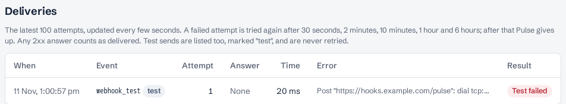

The webhook list shows each webhook's events, **Active** / **Paused**, and its last delivery:

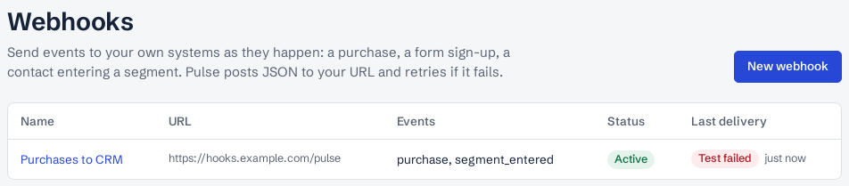

To pause sending, untick **Active** and **Save**. **Delete** stops it at once.

## What you have now

- A CRM connected: contacts pulled on a schedule, pushed on demand or from a journey
- Shopify orders, customers and checkouts arriving as events
- A key for Zapier or Make, and segments kept in step with ad audiences
- A webhook telling your own systems about purchases

**Next:** [Tutorial 10, Analytics](10-analytics.md): reports, funnels, cohorts and revenue.
