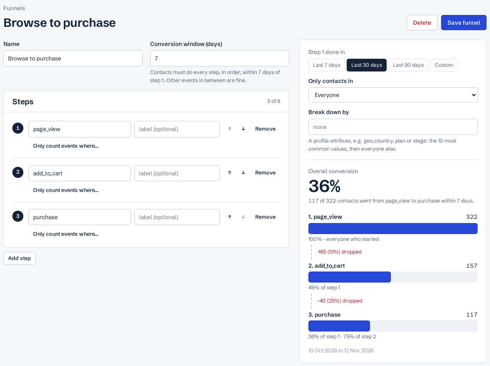
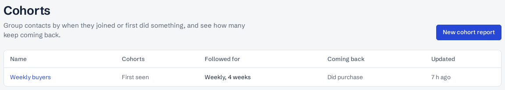
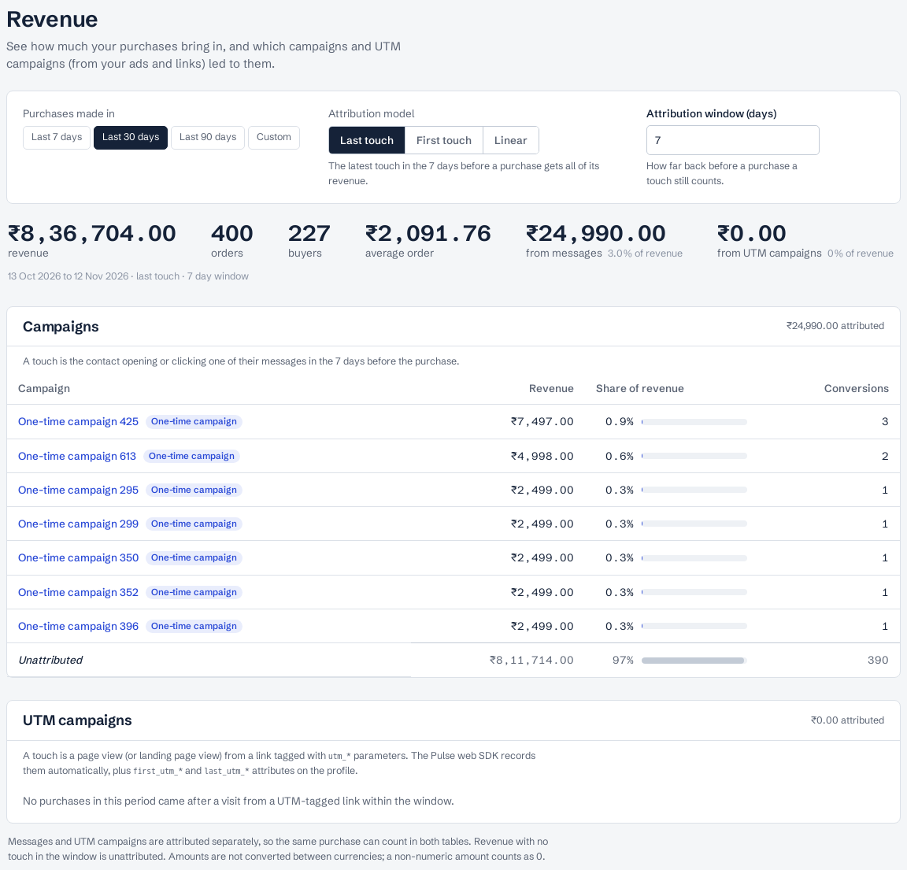
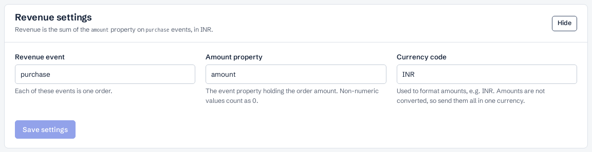

# Tutorial 10: Analytics

In about 20 minutes you will read the live Overview, build your own report, follow contacts through a
funnel, see who comes back with a cohort report, and find out which campaigns bring in revenue.

**You need:** a workspace with some activity. The pictures use the **Acme Retail** example workspace:
300 contacts with page views, carts and purchases over the last 30 days. Anyone with **Reports:
View** can run everything here; saving a report, funnel or cohort needs **Reports: Edit**, and
changing the revenue settings needs **Settings: Edit** (see roles in [tutorial 1](01-getting-started.md#5-make-a-custom-role-optional)).

Everything under **Analytics** updates as you change it: there is no "Run" button.

---

## 1. The Overview

**Overview** (top of the sidebar) is the live view of your workspace. It refreshes every 5 seconds.

| Part | Shows |
|---|---|
| **Live** | Events this minute, the last 60 minutes as a line, and totals for the last hour and today |
| Counts | Contacts, segments, journeys running, templates |
| **Most frequent events** | The top events of the last 14 days |
| **Messages** | Per channel: **Sent**, **Delivered**, **Opened**, **Clicked**, **Failed**, **Opted out** and **To SMS** (WhatsApp messages that fell back to SMS) |

## 2. Build a report

**Analytics → Reports** lists saved reports with what each one shows. Acme Retail has one,
**Revenue by category**.

1. Click **New report**. Under **Start from** pick a ready-made report to change, or build from
   scratch:

   

   | Start from | Counts |
   |---|---|
   | **Revenue by product** | Sum of `amount` of `purchase` events, by `sku`, as bars |
   | **Purchases per day** | `purchase` events each day, as a line |
   | **Email outcomes by broadcast** | Email messages of each broadcast |
   | **Contacts by country** | All contacts by `geo_country` (needs GeoIP, [tutorial 11](11-admin-and-privacy.md#4-data--privacy-tracking-and-retention)) |

2. Click **Purchases per day**. The left side is the report's settings, the right side the result.

   

3. Under **What to count**:
   - **Source**: **Events** (what contacts did), **Messages** (what happened to broadcast and journey
     messages; test sends aren't counted) or **Contacts** (profiles and their attributes).
   - **Measure**: for events, **Number of events**, **Unique contacts**, **Sum of a property** or
     **Average of a property** (then type the **Property**, e.g. `amount`). Messages count messages or
     unique contacts; contacts count contacts, or sum or average an attribute.
   - **Group by**: **Nothing (one total)**, **Event name**, **Event property**, **Contact
     attribute**, or **Day**, **Week**, **Month**. Messages group by **Outcome**, **Channel** or
     **Broadcast or journey**; contacts by an **Attribute** or the day, week or month they were first
     seen.
   - **Show as**: **Table**, **Bars** or **Line** (a line needs grouping by day, week or month).
     The table is always shown under a chart.
4. Pick the period on the right under **Date range**: **Last 7 days**, **Last 30 days**, **Last 90
   days** or **Custom** (up to a year back).

A report shows at most 100 groups (the largest first). Grouping by a property such as `category`
gives bars like the seeded report:

### Filter a report

- **Only these events** (events): add up to 10 event names; with none, all events count.
- **Only count events where…**: up to 5 conditions on event properties (for contacts, **Only count
  contacts where…** on attributes), e.g. `amount` **is at least** `1000`.
- For messages: **From** (broadcasts, journeys or both), **Channels** and **Outcomes**
  (Sent, Delivered, Opened, Clicked, Bounced, Unsubscribed and more).
- **Only contacts in** (right side): only contacts who are in a segment right now.

### Save it

Enter a **Name** and click **Create report** (on a saved one, **Save report**; **Delete** removes
it). A saved report opens on its saved period (7, 30 or 90 days); custom dates aren't saved.

### Export it

**Export CSV** at the top of the results downloads what the report shows now as a CSV file named
after the report and today's date (e.g. `revenue-by-category-2026-11-11.csv`): a header row, then one
row per group with the raw numbers (sums and averages to 2 decimals, dates as `YYYY-MM-DD`). It opens
in Excel, Google Sheets or Numbers; cells that could be read as formulas are quoted so they stay text.
Anyone who can see the report can export it. Developers can get the same numbers as JSON from
`POST /v1/reports/run`.

## 3. Funnels

A funnel counts how many contacts go from one event to the next, in order, and where they drop off.

1. Go to **Analytics → Funnels**. Open **Browse to purchase** (or click **New funnel**: it starts
   with `page_view → signup → purchase`).
2. **Steps**: each step is an event, with an optional **label** shown in results. **Add step** adds
   one (2 to 8 steps); the arrows reorder them and **Remove** deletes one. **Only count events
   where…** adds up to 5 property conditions to a step, e.g. `amount` **is at least** `1000`.
3. **Conversion window (days)**: 1 to 90. Contacts must do every step, in order, within this many
   days of step 1. Other events in between are fine.
4. On the right choose **Step 1 done in** (the period) and, if you like, **Only contacts in** a
   segment.

The result shows the **Overall conversion**, each step's contacts as a bar with the share of step 1
and of the step before, and how many dropped between steps.

**Break down by** splits the funnel by a profile attribute, e.g. `plan`, `geo_country` or `stage`:
the 10 most common values, then **Everyone else**, and **(not set)** for contacts without it.

Click **Create funnel** / **Save funnel** to keep it. Only the name, steps and window are saved; the
period, segment and breakdown are chosen each time you open it.

## 4. Cohorts

A cohort report groups contacts by when they started (first seen, or the first time they did
something) and shows how many come back in each following period.

1. Go to **Analytics → Cohorts** and open **Weekly buyers**, or click **New cohort report**.

   

2. **Group contacts by**: **When they were first seen**, or **The first time they did an event**
   (type the event, e.g. `signup`, with optional conditions).
3. **Counts as coming back**: **Any activity**, or **Doing an event** (e.g. `purchase`).
4. On the right: **Period** (**Daily**, **Weekly** or **Monthly**), **Follow each cohort for**
   (up to 60 days, 26 weeks or 12 months), and **Cohorts to show**: the **Most recent** N, or those
   **Starting between dates** (a year at most). **Only contacts in** limits it to a segment.

Read the table row by row: each row is a cohort (e.g. **Week of 26 Oct**) with its number of
**Contacts**, then the share who came back in **Week 0** (the week they started), **Week 1** and so
on; the darker the cell, the higher the share. **All cohorts** at the top is the average. A **–**
means that period hasn't happened yet, or the cohort is empty. Weeks start on Monday, in UTC.

Click **Create report** / **Save report** to keep it.

## 5. Journey and broadcast reports

Each journey and broadcast has its own report (sent, delivered, opened, clicked, converted, per
step or A/B variant, top links, by day). See [tutorial 6](06-journeys.md#13-per-step-stats-and-the-report)
for journeys and [tutorial 7](07-broadcasts.md) for broadcasts. To compare campaigns side by side,
build a **Messages** report grouped by **Broadcast or journey** (step 2).

## 6. Revenue

**Analytics → Revenue** adds up your purchases and credits them to the broadcasts, journeys and UTM
campaigns that came before them.

1. Choose **Purchases made in** (the period).
2. Choose the **Attribution model**:

   | Model | The purchase's revenue goes to |
   |---|---|
   | **Last touch** | The latest touch in the window |
   | **First touch** | The earliest touch in the window |
   | **Linear** | Every source touched in the window, in equal shares |

3. **Attribution window (days)**, 1 to 90 (7 by default): how far back before a purchase a touch
   still counts.

The figures at the top are **revenue**, **orders**, **buyers**, **average order**, and the revenue
**from messages** and **from UTM campaigns**. Below:

- **Broadcasts and journeys**: a touch is the buyer opening or clicking one of their messages. Each
  name links to the broadcast or journey.
- **UTM campaigns**: a touch is a visit from a link with `utm_*` parameters. The Pulse web SDK
  records them on page views, and keeps `first_utm_*` and `last_utm_*` on the profile.

Messages and UTM campaigns are counted separately, so one purchase can appear in both tables.
Revenue with no touch in the window is **Unattributed**. In the picture nothing is attributed: the
example purchases didn't follow an opened message or a tagged link.

### Revenue settings

At the bottom, **Revenue settings** says which events count. Click **Change**:

- **Revenue event**: each of these events is one order (`purchase` by default; `order_completed`
  if your orders come from Shopify, [tutorial 9](09-integrations.md#5-connect-shopify)).
- **Amount property**: the event property with the order amount (`amount`). Non-numeric values count
  as 0.
- **Currency code**: used to show amounts, e.g. `INR`. Amounts aren't converted, so send them all in
  one currency.

Click **Save settings**. Broadcast and journey reports use the same settings for their revenue.

## What you have now

- The live Overview and a report of your own, filtered and charted
- A funnel with its drop-offs, broken down by plan
- A cohort report of who comes back
- Revenue, and which campaigns earned it

**Next:** [Tutorial 11, Admin and privacy](11-admin-and-privacy.md): consent, data retention, the
audit log and single sign-on.
