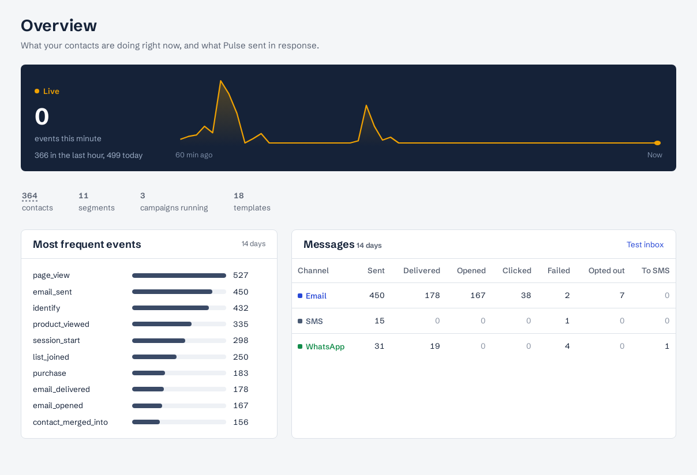
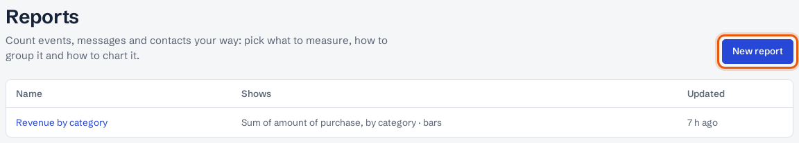
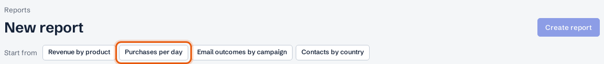
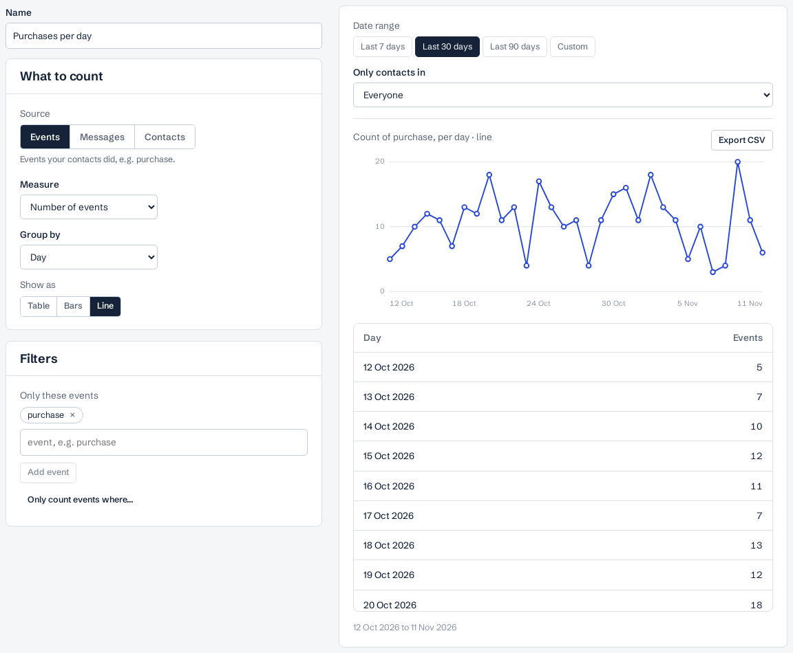
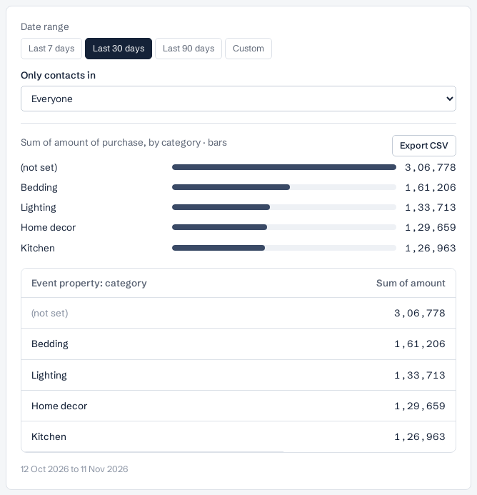
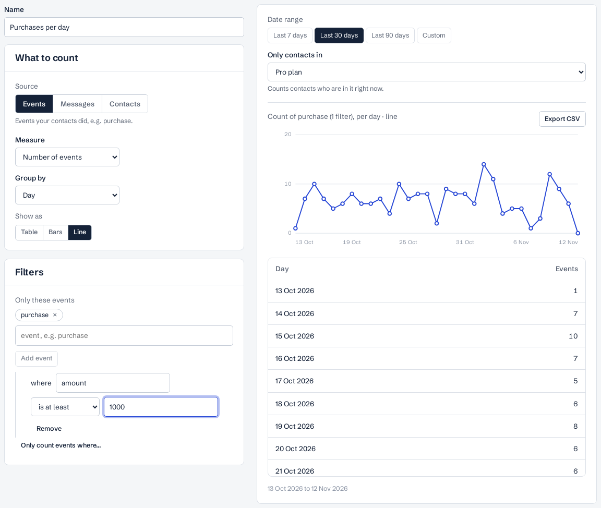
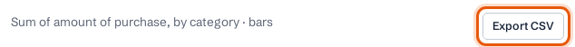
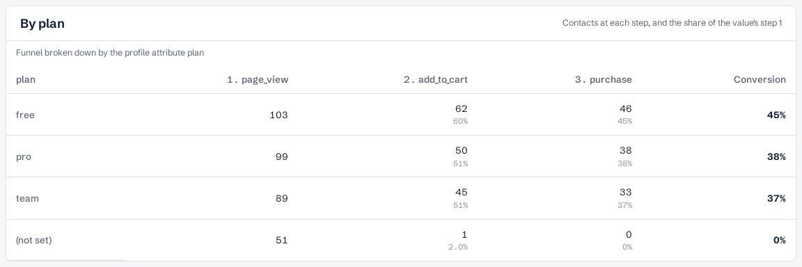
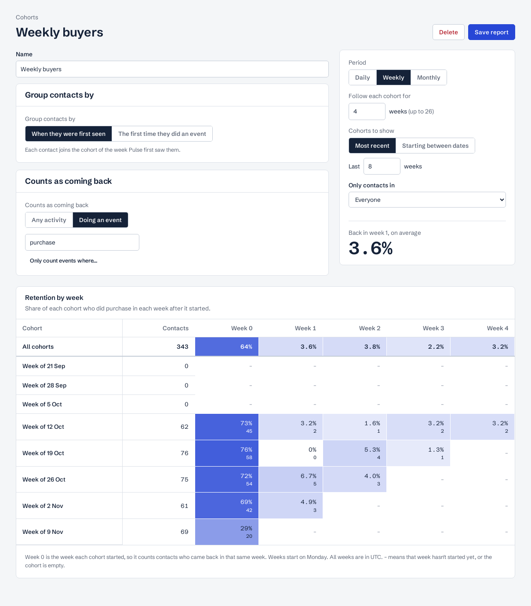

# Tutorial 10: Analytics

In about 20 minutes you will read the live Overview, build your own report, follow contacts through a
funnel, see who comes back with a cohort report, find out which campaigns bring in revenue, group
your buyers by their value and churn risk, and follow the paths people take before and after an
event.

The ready-made dashboards (**Users**, **Campaign performance**, **Products** and **Live events**) and
how messages are delivered, bounced or skipped have their own tutorial:
[Tutorial 15, Delivery and dashboards](15-delivery-and-dashboards.md).

**You need:** a workspace with some activity. The pictures use the **Acme Retail** example workspace:
300 contacts with page views, carts and purchases over the last 30 days. Anyone with **Reports:
View** can run everything here; saving a report, funnel or cohort needs **Reports: Edit**, and
changing the revenue settings needs **Settings: Edit** (see roles in [tutorial 1](01-getting-started.md#5-make-a-custom-role-optional)).

Everything under **Analytics** updates as you change it: there is no "Run" button.

---

## 1. The Overview

**Overview** (top of the sidebar) is the first page you see after signing in: what needs your
attention, what your contacts are doing right now, and how your campaigns are going. The live
numbers come first and refresh every 5 seconds; the summary below them fills in a moment later and
refreshes once a minute (only while the page is open in a visible tab). You see only the parts your
role can view: for example, a role without access to reports sees no revenue.

| Part | Shows |
|---|---|
| **Needs attention** | Shown only when something's wrong, with a link to fix it: an email or SMS provider that used up (or nearly used up) its daily quota, a channel where at least 1 in 10 messages failed in the last hour, a spike in email bounces today, or a one-time campaign where at least 1 in 10 messages failed |
| **Live** | Events this minute, the last 60 minutes as a line, and totals for the last hour and today |
| Counts | **contacts**, **segments**, **campaigns running** (triggered and automation campaigns that are live) and **templates**. Click the number of contacts to open the Contacts list |
| **Audience** | **Contacts added** in the last 7 days (and today), and the contacts who **unsubscribed** from any channel, each with the change against the 7 days before. Click the number of unsubscribes to see those contacts |
| **Revenue** | Revenue, orders and buyers of the last 7 days against the 7 before, from your revenue event (set on the **Revenue** page). Hidden until there are revenue events |
| **One-time campaigns** | **Sending now** (with how many were sent so far), **Coming up** (the next scheduled sends, and how often a repeating one runs) and **Recently sent** (the last 30 days, with the open rate for email or the click rate for other channels). Click a campaign to open it, or **Campaign performance** to compare them all |
| **Most frequent events** | The top events of the last 14 days |
| **Messages** (14 days) | Per channel: **Sent**, **Delivered**, **Opened**, **Clicked**, **Failed**, **Opted out** and **To SMS** (WhatsApp messages that fell back to SMS). **Test inbox** opens the messages sent through sandbox providers |

Days in the summary are UTC days, like the Analytics dashboards. The summary's numbers can be up to
a minute old; open a campaign or a dashboard for the exact figures.

## 2. Build a report

**Analytics → Reports** lists saved reports with what each one shows. Acme Retail has one,
**Revenue by category**.

1. Click **New report**. Under **Start from** pick a ready-made report to change, or build from
   scratch:

   

   | Start from | Counts |
   |---|---|
   | **Revenue by product** | Sum of `amount` of `purchase` events, by `sku`, as bars |
   | **Purchases per day** | `purchase` events each day, as a line |
   | **Email outcomes by campaign** | Email messages of each one-time campaign |
   | **Contacts by country** | All contacts by `geo_country` (needs GeoIP, [tutorial 11](11-admin-and-privacy.md#4-data--privacy-tracking-and-retention)) |

2. Click **Purchases per day**. The left side is the report's settings, the right side the result.

   

3. Under **What to count**:
   - **Source**: **Events** (what contacts did), **Messages** (what happened to campaign messages;
     test sends aren't counted) or **Contacts** (profiles and their attributes).
   - **Measure**: for events, **Number of events**, **Unique contacts**, **Sum of a property** or
     **Average of a property** (then type the **Property**, e.g. `amount`). Messages count messages or
     unique contacts; contacts count contacts, or sum or average an attribute.
   - **Group by**: **Nothing (one total)**, **Event name**, **Event property**, **Contact
     attribute**, or **Day**, **Week**, **Month**. Messages group by **Outcome**, **Channel** or
     **Campaign**; contacts by an **Attribute** or the day, week or month they were first
     seen.
   - **Show as**: **Table**, **Bars** or **Line** (a line needs grouping by day, week or month).
     The table is always shown under a chart.
4. Pick the period on the right under **Date range**: **Last 7 days**, **Last 30 days**, **Last 90
   days** or **Custom** (up to a year back).

A report shows at most 100 groups (the largest first). Grouping by a property such as `category`
gives bars like the seeded report:

### Filter a report

- **Only these events** (events): add up to 10 event names; with none, all events count.
- **Only count events where…**: up to 5 conditions on event properties (for contacts, **Only count
  contacts where…** on attributes), e.g. `amount` **is at least** `1000`.
- For messages: **From** (**Every campaign**, **One-time campaigns**, or **Triggered and automation
  campaigns (journeys)**), **Channels** and **Outcomes**
  (Sent, Delivered, Opened, Clicked, Bounced, Unsubscribed and more).
- **Only contacts in** (right side): only contacts who are in a segment right now.

### Save it

Enter a **Name** and click **Create report** (on a saved one, **Save report**; **Delete** removes
it). A saved report opens on its saved period (7, 30 or 90 days); custom dates aren't saved.

### Export it

**Export CSV** at the top of the results downloads what the report shows now as a CSV file named
after the report and today's date (e.g. `revenue-by-category-2026-11-11.csv`): a header row, then one
row per group with the raw numbers (sums and averages to 2 decimals, dates as `YYYY-MM-DD`). It opens
in Excel, Google Sheets or Numbers; cells that could be read as formulas are quoted so they stay text.
Anyone who can see the report can export it. Developers can get the same numbers as JSON from
`POST /v1/reports/run`.

## 3. Funnels

A funnel counts how many contacts go from one event to the next, in order, and where they drop off.

1. Go to **Analytics → Funnels**. Open **Browse to purchase** (or click **New funnel**: it starts
   with `page_view → signup → purchase`).
2. **Steps**: each step is an event, with an optional **label** shown in results. **Add step** adds
   one (2 to 8 steps); the arrows reorder them and **Remove** deletes one. **Only count events
   where…** adds up to 5 property conditions to a step, e.g. `amount` **is at least** `1000`.
3. **Conversion window (days)**: 1 to 90. Contacts must do every step, in order, within this many
   days of step 1. Other events in between are fine.
4. On the right choose **Step 1 done in** (the period) and, if you like, **Only contacts in** a
   segment.

The result shows the **Overall conversion**, each step's contacts as a bar with the share of step 1
and of the step before, and how many dropped between steps.

**Break down by** splits the funnel by a profile attribute, e.g. `plan`, `geo_country` or `stage`:
the 10 most common values, then **Everyone else**, and **(not set)** for contacts without it.

Click **Create funnel** / **Save funnel** to keep it. Only the name, steps and window are saved; the
period, segment and breakdown are chosen each time you open it.

## 4. Cohorts

A cohort report groups contacts by when they started (first seen, or the first time they did
something) and shows how many come back in each following period.

1. Go to **Analytics → Cohorts** and open **Weekly buyers**, or click **New cohort report**.

   

2. **Group contacts by**: **When they were first seen**, or **The first time they did an event**
   (type the event, e.g. `signup`, with optional conditions).
3. **Counts as coming back**: **Any activity**, or **Doing an event** (e.g. `purchase`).
4. On the right: **Period** (**Daily**, **Weekly** or **Monthly**), **Follow each cohort for**
   (up to 60 days, 26 weeks or 12 months), and **Cohorts to show**: the **Most recent** N, or those
   **Starting between dates** (a year at most). **Only contacts in** limits it to a segment.

Read the table row by row: each row is a cohort (e.g. **Week of 26 Oct**) with its number of
**Contacts**, then the share who came back in **Week 0** (the week they started), **Week 1** and so
on; the darker the cell, the higher the share. **All cohorts** at the top is the average. A **–**
means that period hasn't happened yet, or the cohort is empty. Weeks start on Monday, in UTC.

Click **Create report** / **Save report** to keep it.

## 5. Campaign reports

Each campaign has its own report (a funnel from audience to clicks, why messages didn't go out, A/B
variants or steps, top links, by day). Its numbers open the contacts behind them. See
[tutorial 6](06-triggered-and-automation-campaigns.md) for triggered and automation campaigns,
[tutorial 7](07-one-time-campaigns.md) for one-time campaigns, and
[tutorial 15](15-delivery-and-dashboards.md) for how to read a funnel. To compare campaigns side by
side, open **Analytics → Campaign performance** (tutorial 15), or build a **Messages** report grouped
by **Campaign** (step 2).

## 6. Revenue

**Analytics → Revenue** adds up your purchases and credits them to the campaigns and UTM campaigns
(from your ads and links) that came before them.

1. Choose **Purchases made in** (the period).
2. Choose the **Attribution model**:

   | Model | The purchase's revenue goes to |
   |---|---|
   | **Last touch** | The latest touch in the window |
   | **First touch** | The earliest touch in the window |
   | **Linear** | Every source touched in the window, in equal shares |

3. **Attribution window (days)**, 1 to 90 (7 by default): how far back before a purchase a touch
   still counts.

The figures at the top are **revenue**, **orders**, **buyers**, **average order**, and the revenue
**from messages** and **from UTM campaigns**. Below:

- **Campaigns**: a touch is the buyer opening or clicking one of their messages. Each name links to
  the campaign, with its type (**One-time campaign**, or a triggered or automation campaign). A
  campaign deleted since shows as its type and number, e.g. *One-time campaign 425*.
- **UTM campaigns**: a touch is a visit from a link with `utm_*` parameters. The Pulse web SDK
  records them on page views, and keeps `first_utm_*` and `last_utm_*` on the profile.

Messages and UTM campaigns are counted separately, so one purchase can appear in both tables.
Revenue with no touch in the window is **Unattributed**. In the picture most revenue is
unattributed: few of the example purchases followed an opened message, and none a tagged link.

### Revenue settings

At the bottom, **Revenue settings** says which events count. Click **Change**:

- **Revenue event**: each of these events is one order (`purchase` by default; `order_completed`
  if your orders come from Shopify, [tutorial 9](09-integrations.md#5-connect-shopify)).
- **Amount property**: the event property with the order amount (`amount`). Non-numeric values count
  as 0.
- **Currency code**: used to show amounts, e.g. `INR`. Amounts aren't converted, so send them all in
  one currency.

Click **Save settings**. Campaign reports and **Campaign performance** use the same settings for their
revenue.

## 7. Customer value: your best buyers, and who is slipping away

**Analytics → Customer value** groups your buyers by three things (RFM): how **recently** they bought,
how **often**, and how much they **spend**. It also gives each buyer a **churn risk**: how likely they
are to stop buying. Pulse works it out every day from the last two years of purchases, using the
revenue event and amount from the **Revenue settings** (section 6).

At the top: **buyers scored**, **their revenue (2 years)**, how many are **at high churn risk**, and the
**revenue from them**. Below, one row per group, best first:

| Group | Who, and what to do |
|---|---|
| **Champions** | Bought recently, buy often and spend the most. Reward them; ask for reviews and referrals |
| **Loyal** | Buy often. Offer loyalty perks and upsell |
| **Potential loyalists** | Recent buyers with a few orders. Offer membership or a reason to come back |
| **New customers** | First purchase just now. Welcome and onboard them |
| **Promising** | Recent, but bought once. Build the habit with a timely follow-up |
| **Need attention** | Middling recency and frequency. Limited-time offers and recommendations |
| **About to sleep** | Haven't bought for a while and bought little. Re-engage before they lapse |
| **At risk** | Used to buy often, not lately. Win them back with something personal |
| **Can't lose them** | Were among the best, gone quiet. Reach out now, by more than one channel |
| **Hibernating** | Long gone, bought little. Low-cost reminders only |
| **Lost** | The longest gone. Leave them or try one last win-back |

Each row shows its **Buyers** (and their share), **Revenue**, **Avg orders**, **Days since last**
order, and its **Churn risk** split into **Low**, **Medium**, **High** and **Lost**.

**Every count opens those contacts**, as filter chips (*value* and *churn*) on the Contacts page. To
reach a group in a campaign, click **Make a segment** on its row: Pulse creates the dynamic segment
*Customer value: At risk* and opens it. It stays up to date as buyers move.

How the scores work:

- Recency, frequency and spend are each scored 1 to 5 against your own buyers (in fifths), so the
  groups adjust as your business grows.
- Churn risk compares the time since each buyer's last order with their own usual gap between
  orders: 1.5 times overdue is **Medium**, 3 times is **High**. One-time buyers go **Medium** after 90
  days and **High** after 180. A year without an order is **Lost**.
- Groups compare buyers with each other, while churn risk uses time. So a fast-growing shop can have
  buyers in the *Lost* group whose churn risk is still low.

**Score now** (top right) scores again straight away, for example after you change the revenue
settings; it can run once every 5 minutes. Without any purchases, the page says *No buyers scored
yet* and which event it reads.

**Act the day someone slips.** When a buyer moves to another group, Pulse records an `rfm_changed`
event on them (with the new `group` and the `previous_group`) and updates their fields `rfm_group`,
`rfm_score` and `churn_risk`. Start a triggered campaign on `rfm_changed` where `group` is *At risk*
to win people back the day they slip ([tutorial 6](06-triggered-and-automation-campaigns.md)), or
write `{{contact.rfm_group}}` in a message. There is no machine-learning churn prediction: the risk
comes from each buyer's own rhythm.

## 8. Paths: what people do before and after an event

**Analytics → Paths** shows what people did after an event, step by step, or what they did before
one. For example: what do new sign-ups do next? What did people do just before they bought?

1. **Show what people did**: **After** or **Before**.
2. **Event**: type or pick one, e.g. `signup`.
3. **Steps**: 2 to 6 (4 by default).
4. **In the last**: 7, 30 or 90 days.
5. **Leave out**: events to skip. Page views (`page_view`, `session_start`) are left out at first,
   because they fill every path; click one to put it back, or **+ event** to leave out another.

The page updates as you change it. At the top, *1,240 people did signup*, and a flow chart: one column
per step, a box per event with how many people, and bands between them. Each step shows the 7 biggest
events; the rest are grouped as *Other*, and *(stopped)* counts people who did nothing more. Point at a
band to read it (*signup → add_to_cart: 310 people*).

Below, **Most common paths** lists whole paths with how many people took them and their share, e.g.
`signup → product_view → add_to_cart → purchase`.

What to know:

- Pulse's own events (messages sent, campaign steps, tags) are left out, so you see what people did.
- The same event several times in a row counts once.
- A path starts at a person's first time doing the event (or, for **Before**, ends at the last time).
- Pulse looks at up to 300,000 people and keeps the 500 most common paths. Paths can't be split by
  segment yet.

Paths include app events such as `app_uninstalled`: put it as the event with **Before** to see what
people did before they removed your app ([tutorial 4](04-channels.md#mobile-push-firebase-cloud-messaging)).

## What you have now

- The live Overview and a report of your own, filtered and charted
- A funnel with its drop-offs, broken down by plan
- A cohort report of who comes back
- Revenue, and which campaigns earned it
- Your buyers grouped by value and churn risk, with segments to act on
- The paths people take before and after an event

For the dashboards, delivery and the contacts behind each number, go on to
[tutorial 15](15-delivery-and-dashboards.md).

**Next:** [Tutorial 11, Admin and privacy](11-admin-and-privacy.md): consent, data retention, the
audit log and single sign-on.
