# Tutorial 11: Admin and privacy

In about 30 minutes you will see how Pulse keeps track of what each contact agreed to, give contacts
their own unsubscribe and preference pages, decide what Pulse records and for how long (and the other
things it does on its own), answer a request to see or erase someone's data, check who changed what,
and set up single sign-on and two-step sign-in for your team.

**You need:** an admin account. Most pages here are under **Settings**, and several (Sign-in & keys,
Audit log, Webhooks) need the full **Admin** role, not just settings access.

---

## 1. What each contact agreed to

Pulse keeps consent per channel: **Email**, **SMS**, **WhatsApp**, **RCS**, **Push** and **App
inbox**, plus "everything". Every send checks it first; a message to someone who opted out is not
sent and counts as *suppressed* in reports.

To see or change it for one person, open the contact (**Contacts**, click the row) and find
**Messages they agreed to**:

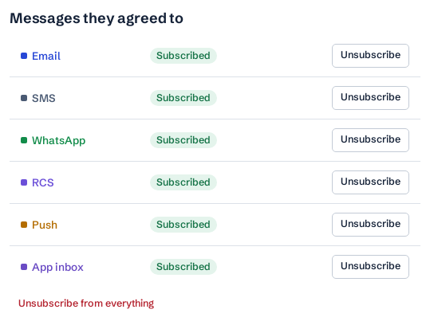

- **Unsubscribe** / **Subscribe** changes one channel.
- **Unsubscribe from everything** (it asks you to confirm) stops every channel. Subscribing to one
  channel again lifts it.

Each change is recorded as an `unsubscribed` or `resubscribed` event in the contact's **Activity**,
so you can always see when and how consent changed. Changing consent needs **Contacts: Edit**. To
list everyone who opted out, filter **Contacts** with `is:unsubscribed` (or `is:dnc` for
unsubscribed or bounced), as in [tutorial 2](02-contacts.md#7-filter-your-contacts).

How contacts opt out on each channel (unsubscribe links, SMS and WhatsApp reply keywords such as
STOP, bounces and complaints) is in [tutorial 4](04-channels.md#6-how-unsubscribes-work-on-each-channel).

## 2. Unsubscribe links and the preference center

Contacts change their own consent on two public pages. You don't build them: Pulse makes a personal
link for each message.

**The unsubscribe page.** Every email gets an unsubscribe link: in the footer Pulse adds
(*You're receiving this because you subscribed. Unsubscribe*), or wherever you place
`{{links.unsubscribe}}` (or the older `{{.UnsubscribeURL}}`) in the template. It opens:

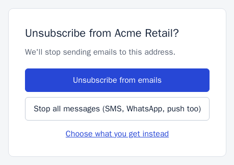

- **Unsubscribe from emails**: email only.
- **Stop all messages (SMS, WhatsApp, push too)**: everything.
- After either, **Subscribe again** undoes it.
- **Choose what you get instead** opens the preference center.

**One-click unsubscribe.** Every email also carries the `List-Unsubscribe` and
`List-Unsubscribe-Post` headers (RFC 8058), so Gmail, Yahoo and other mail apps show their own
**Unsubscribe** button; it unsubscribes from email without opening any page. Nothing to set up.

**The preference center** lists the channels Pulse can reach the contact on (email if it has an
address, SMS / WhatsApp / RCS if it has a phone number, push if it has a device), each with a
switch, then **Save preferences**, or **Unsubscribe from everything**:

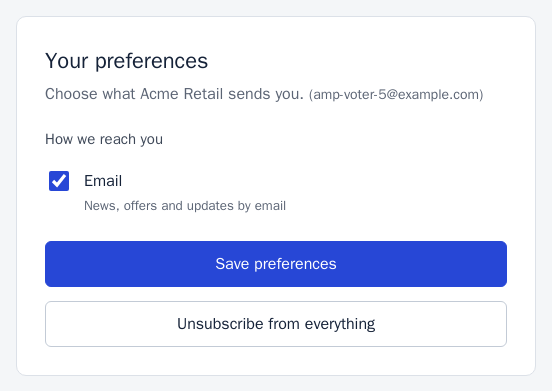

Ways to send contacts there:

- `{{links.preferences}}` (or the older `{{.PreferencesURL}}`) in an email template (for example "Manage your preferences" in the footer).
- The **Choose what you get instead** link on the unsubscribe page.
- A personal link from the API, e.g. for your account page or an SMS:
  `GET /v1/contacts/{external_id}/preferences-link` with your server API key returns `{"url": …}`.
  Anyone holding it can change that contact's subscriptions, so send it only to them.

**Subscription lists.** To let contacts join or leave a static segment there (say "Monthly
newsletter"), open the static segment and, under **Preference center**, tick **Let contacts join or
leave this segment from their preference center**, add **What subscribers get**, and **Save**. It
then appears under *What you get* (see [tutorial 3](03-segments.md#5-static-segments)).

## 3. Consent in campaigns

Triggered and automation campaigns can change consent too: **Add Do Not Contact** (for a channel or
all) and **Remove Do Not Contact**, and the condition **Marked as Do Not Contact** checks it. **Remove
Do Not Contact** needs **Contacts: Edit** as well as access to triggered and automation campaigns. See [tutorial 6](06-triggered-and-automation-campaigns.md#every-step-at-a-glance).

## 4. Data & privacy: tracking and retention

Go to **Settings → Data & privacy** (under *Contact data*).

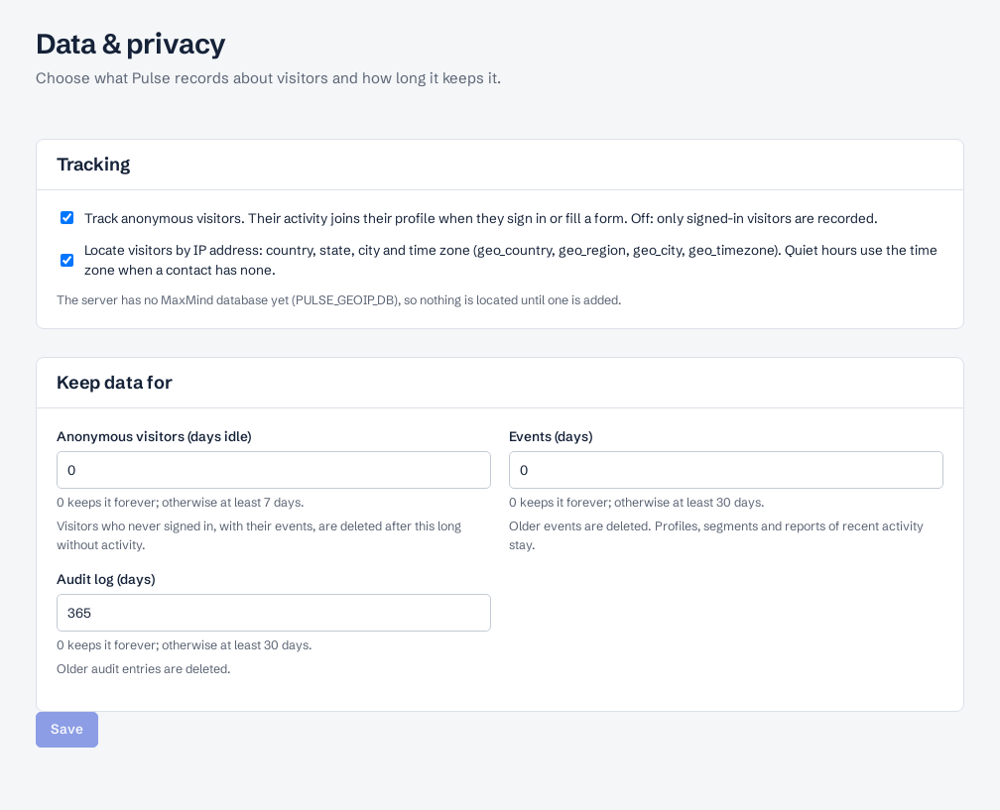

**Tracking**

- **Track anonymous visitors** (on by default): page views and events from visitors who haven't
  signed in are recorded and join their profile when they identify or fill a form. Off: only
  signed-in visitors are recorded.
- **Locate visitors by IP address** (on by default): sets `geo_country`, `geo_region`, `geo_city`
  and `geo_timezone`. Quiet hours use that time zone when a contact has none. It needs a free MaxMind
  location database on the server (`PULSE_GEOIP_DB`); until your server administrator adds one, the
  page says so and nothing is located (as in the picture).

Click **Save**. Changing these needs **Settings: Edit**; others can see them.

**Keep data for** shows how long events, anonymous visitors and the audit log are kept now. You
change those on **Settings → Automation & limits** (the link on the page), next.

## 5. Automation & limits

**Settings → Automation & limits** (under *Workspace*) lists everything Pulse does on its own for
your workspace: how long it keeps data, how it retries failed sends, when it refreshes segments, and
the limits new providers start with. Each setting shows its value, what it does, its allowed range
and its **Default** (what Pulse has always done). Anyone with **Settings: View** can see the page;
changing it needs **Settings: Edit**. Change what you need and click **Save** at the bottom
(**Discard changes** undoes your edits); every change is in the audit log.

### Keep data for


Days; **0 keeps forever**. Cleanup runs once a day for your workspace (the page says at about what
time, and when it last ran). Contacts themselves are never deleted, except anonymous visitors.

| Setting | Keeps | Default | Range |
|---|---|---|---|
| **Events** | The event log behind segments, timelines and reports | forever | 30–3,650 |
| **Message events** | Sends, deliveries, opens and clicks behind campaign reports and dashboards | **Same as events** | untick to set its own |
| **Page and screen views** | `page_view`, `screen_view`, `landing_page_viewed`: usually the largest | **Same as events** | untick to set its own |
| **By event name** | **Add event name** for a name and its days, e.g. `page_view` 90 and `purchase` 0 (forever); wins over the settings above | none | up to 100 names |
| **Anonymous visitors** | Tick **Delete idle visitors** to delete visitors who never signed in, with their events, after this many **days idle** | off | 7–3,650 |
| **Audit log** | Who changed what (step 7) | 365 days | 30–3,650 |
| **Import history** | Finished imports on the import page (the contacts stay) | forever | 7–3,650 |
| **Webhook deliveries** | The attempts shown on each webhook's page | 7 days | 1–90 |
| **Integration log** | What each integration did | 7 days | 1–90 |
| **Test inbox** | Messages sent through sandbox providers | forever | 1–3,650 |
| **Live event feed** | How many recent events **Analytics → Live events** keeps (a number of events, not days) | 1,000 events | 100–10,000 |

**What will be deleted.** When a change keeps something for less time than before, **Save** first
counts what would go and asks you to confirm:

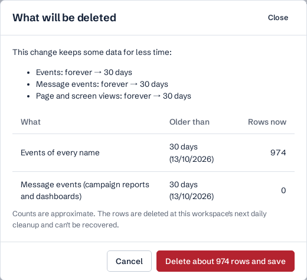

The table shows, for each kind of data, the cut-off date and about how many rows are older than it
now. The red button says how many rows will go (*Delete about … rows and save*), or just **Save**
when nothing is old enough yet. The rows are deleted at your workspace's next daily cleanup and
**can't be recovered**; **Cancel** keeps everything as it was.

> Deleted anonymous visitors drop out of dynamic segments at their next refresh. Deleting events
> can't be undone: reports and funnels then start from the oldest event kept.

### Retries, schedules and messages

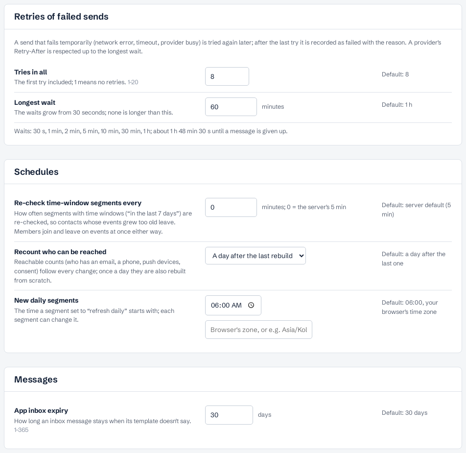

| Setting | What it does | Default |
|---|---|---|
| **Tries in all** | A send that fails for a passing reason (network error, timeout, provider busy) is tried again; after the last try it counts as failed, with the reason. 1 means no retries | 8 (1–20) |
| **Longest wait** | The waits grow from 30 seconds; none is longer than this. The line under it lists the waits and how long until a message is given up | 60 minutes |
| **Re-check time-window segments every** | How often segments with a time window ("in the last 7 days") are checked again, so people whose events grew too old leave. People still join and leave on new events at once | 0 = the server's interval (5 minutes here) |
| **Recount who can be reached** | Who has an email, a phone, push devices and consent is counted as things change, and rebuilt once a day: **A day after the last rebuild**, or **Daily at** an hour (UTC) | A day after the last rebuild |
| **New daily segments** | The time (and time zone) a segment set to "refresh daily" starts with; each segment can change it ([tutorial 3](03-segments.md)) | 06:00, your browser's time zone |
| **App inbox expiry** | How long an app inbox message stays when its template doesn't say | 30 days (1–365) |

### Default limits of new providers, and what's fixed

**Default limits of new providers** sets, per channel (**Email**, **SMS**, **WhatsApp**, **RCS**,
**Push**), the messages per second, the daily quota and its time zone that a provider added from now
on starts with, unless its kind has its own (Gmail's daily quota, for one). Existing providers keep
theirs: change them with **Limits** on the Channels page, or under **Sending limits** when you edit
the provider ([tutorial 4](04-channels.md#9-sending-limits-and-daily-quotas)).

**Fixed by the platform** lists what is the same for every workspace on the server, because it
protects shared capacity or correct sending: the workspace's sending speed per channel (set by
whoever runs the server), a message
never being sent twice (sends remembered for 7 days), held messages released every few seconds,
deleted inbox messages purged after 7 days, SMS short links working for 30 days, the live feed's 50
events a second, and webhook retries.

<a id="5-a-persons-data-see-it-export-it-erase-it"></a>

## 6. A person's data: see it, export it, erase it

When someone asks what you hold about them, or asks to be forgotten:

**See it.** Open the contact: the profile shows their attributes, segments, consent, tags and points,
and the **Activity** list of their events.

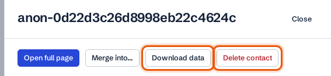

**Export it.** Open the contact and click **Download data** at the top of the profile. Pulse
downloads `contact-<external ID>.json` with everything it keeps about them: the profile (every
attribute), consent per channel, the segments they are in, and their event history (newest first,
up to 100,000 events; events already removed by your retention settings aren't in it). It needs
**Contacts: Edit**, and each download is in the audit log as *Downloaded a contact's data*. From
your server: `GET /v1/contacts/{external_id}/data`.

**Erase it.** Open the contact, click **Delete contact**, type `DELETE` and click **Delete contact**.
Pulse deletes the contact with their attributes, events, segment memberships, devices, inbox
messages, campaign progress and files they uploaded through forms; it can't be undone. Download their
data first if you need a copy. It needs **Contacts: Edit** and is in the audit log as *Deleted a
contact*. From your server: `DELETE /v1/contacts/{external_id}`. If your site or app sends new events
for that ID later, a new contact is created, so stop tracking them too.

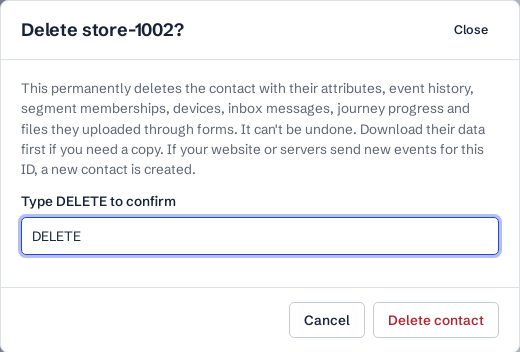

To make erasure an automatic process instead, use a campaign step:

1. Create a triggered campaign (**Campaigns → New campaign → React when someone does something**)
   whose trigger is the event `erasure_requested`.
2. Add **Action → Delete contact**. It warns *Permanently deletes the contact and all their data.
   This can't be undone.* Type `DELETE` in **Type DELETE to confirm**.

   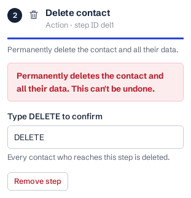

3. Click **Save and go live**. Setting up this step or putting it live needs **Contacts: Edit**.
4. When a request comes in, send the event for that person from your server:

   ```bash
   curl -s -X POST http://localhost:7080/v1/events \
     -H "Authorization: Bearer pk_…" \
     -d '{"events":[{"external_id":"cust-0001","name":"erasure_requested"}]}'
   ```

Either way, the contact, their events and their campaign history are deleted. Static segments may keep the
ID until they next change, but it no longer matches anyone. Audience uploads to Facebook or Google
aren't recalled automatically: if the person was in a linked segment, remove them in the ad platform
too.

## 7. The audit log

**Settings → Audit log** lists every change made in the app or through the API, and every sign-in,
newest first. Only admins can see it.

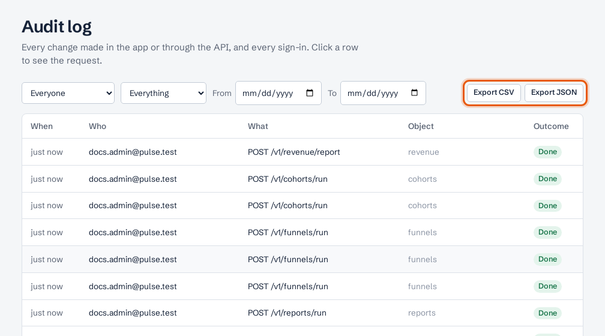

- Each row shows **When**, **Who**, **What** (e.g. *Created a template*, *Changed single sign-on*),
  the **Object** (a link when it can be opened) and the **Outcome**: **Done**, **Failed** or
  **Refused** (not allowed).
- Narrow it down with **Everyone** / a person, **Everything** / an object type (**Sign-ins**,
  **Triggered & automation campaigns**, **Settings**, **Team**, **Roles**…), and **From** / **To** dates. **Clear filters**
  resets them. **Load older** fetches more.
- Click a row to see the request: time, request, response, IP address and the body that was sent.
  Passwords, keys and secrets in it are redacted.

  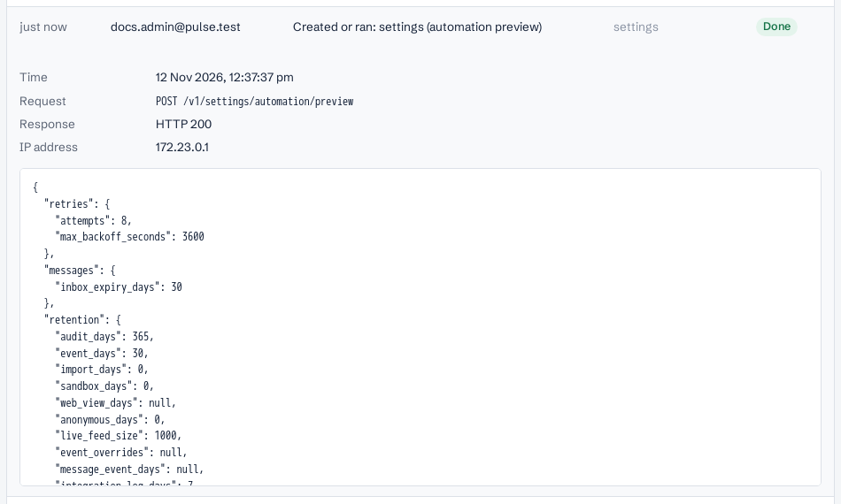

- **Export CSV** or **Export JSON** downloads every entry that matches the current filters (not only
  the ones on screen). Use it for a security review or to keep records longer than the retention
  setting.

## 8. Single sign-on (OIDC)

With single sign-on your team signs in through your identity provider (Keycloak, Microsoft Entra
ID, Google Workspace, Okta or any OpenID Connect provider) instead of Pulse passwords.

**At your provider**, register Pulse as an OpenID Connect client (confidential, authorization code
flow) with the redirect URI shown on the page: `http://localhost:7080/v1/auth/sso/callback` (your
Pulse address + `/v1/auth/sso/callback`). Note the issuer URL, client ID and client secret.

**In Pulse**, go to **Settings → Sign-in & keys → Single sign-on (OIDC)** and fill in:

| Field | Example (the local Keycloak from [deploy/dev-seed.md](../../deploy/dev-seed.md)) |
|---|---|
| **Issuer URL** | `http://localhost:8180/realms/pulse` |
| **Discovery URL (optional)** | `http://keycloak:8180/realms/pulse`: only when Pulse reaches the provider at another address than browsers do (here, inside Docker) |
| **Client ID** | `pulse-app` |
| **Client secret** | the client's secret (stored encrypted; leave empty later to keep it) |

Then:

- **Give anyone your provider signs in access to this workspace**: on, anyone who can sign in at
  your provider gets an account here with **Their role** (Editor by default). Off, only teammates
  you added on **Settings → Team** can sign in.
- **Allow signing in with SSO** turns it on. Click **Save sign-on settings**; the badge says **On**.

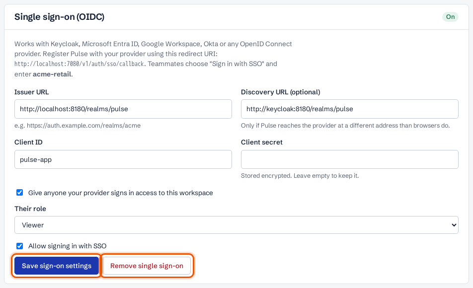

**Signing in.** On the sign-in page teammates type the **Workspace ID** and click **Sign in with
SSO**; Pulse sends them to your provider and back.

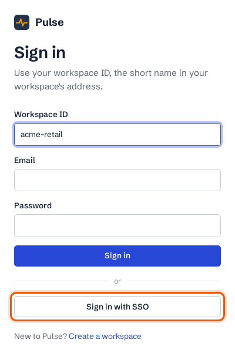 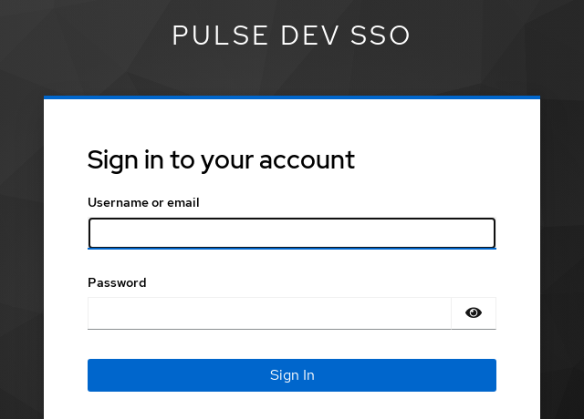

- Pulse matches people by their verified email address. If the provider doesn't share one, or the
  person isn't a teammate and access isn't given to everyone, the sign-in page says why.
- **Settings → Team** shows how each teammate signs in (**Password**, **SSO**, or **Password or
  SSO**). A teammate added without a password can only use SSO.
- To turn it off, untick **Allow signing in with SSO** and save. Pulse keeps the settings for next
  time; teammates with a password can still use it.
- To remove it completely, click **Remove single sign-on** and confirm. Pulse deletes the provider
  settings and the stored client secret; teammates then sign in with a password, so anyone who only
  used SSO needs a password reset or a new invitation (**Settings → Team**).

Every change here is in the audit log as *Changed single sign-on* or *Removed single sign-on*.

## 9. Two-step sign-in with an authenticator app

Two-step sign-in protects accounts even if a password leaks: after the password, Pulse asks for the
six-digit code an authenticator app on the person's phone shows (Google Authenticator, Microsoft
Authenticator, Authy, 1Password and others). It applies to password sign-ins only; people who sign
in with SSO get whatever extra checks your identity provider asks for.

**Turn it on for yourself.** At the bottom of the menu, click **Your account**. Under
**Two-step sign-in** click **Set up the app**, then:

1. In the authenticator app, add an account and scan the QR code. (Can't scan it? Click **Can't
   scan it? Type a key instead** and type the key into the app.)
2. Type the code the app shows and click **Turn on two-step sign-in**.
3. Pulse shows ten **recovery codes**, once. **Download** or **Copy** them and keep them somewhere
   safe, like a password manager. Each one lets you sign in once without your phone. Tick
   **I've saved my recovery codes** and click **Done**.

From then on, after your password the sign-in page asks **Enter your code**. Lost your phone? Type a
recovery code in the same box. On **Your account** you can also:

- **Use a new phone**: confirm it's you (a code from the current app, a recovery code, or your
  password), then scan a new QR code. The old phone keeps working until the new one is set up.
- **New recovery codes**: makes ten new ones; the old ones stop working.
- **Turn off**: needs a code or your password (not offered when your workspace requires it).

**Require it for your team.** On **Settings → Sign-in & keys → Two-step sign-in** (full **Admin**
role) choose:

| Option | Who must use it |
|---|---|
| **Optional: each person decides** | Nobody (the default) |
| **Required for everyone** | Everyone who signs in with a password |
| **Required for some roles or people** | The roles and teammates you tick |

Click **Save two-step sign-in**. The panel says how many of the people covered haven't set it up
yet. They're not locked out: the next time they sign in with their password, Pulse walks them
through the same setup (QR code, code, recovery codes) before they can use the app.

**A teammate lost their phone and their recovery codes?** On **Settings → Team** the **Two-step
sign-in** column shows who has it **On**. Click **Reset two-step** on their row and confirm. They
sign in with their password alone until they set it up again (straight away, if your workspace
requires it). The reset is in the audit log, like every change.

## 10. Identity verification

Your website's site key (`sk_…`) is public, so anyone could call `Pulse.identify()` with someone
else's user ID and read or pollute their profile. Identity verification stops that.

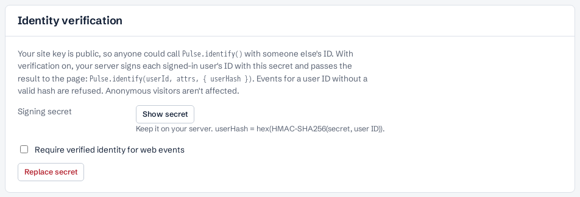

1. On **Settings → Sign-in & keys → Identity verification** click **Show secret** and put it in your
   server's configuration (never in a web page).
2. When a user signs in to your site, your server computes the user's hash:
   `userHash = hex(HMAC-SHA256(secret, user ID))`, e.g. in Node.js
   `crypto.createHmac("sha256", secret).update(userId).digest("hex")`.
3. Your page passes it: `Pulse.identify(userId, { email, name }, { userHash })`.
4. When your site sends the hash for everyone, tick **Require verified identity for web events**
   (Pulse asks you to confirm). From then on, web events for a user ID without a valid hash are
   refused. Anonymous visitors aren't affected.

**Replace secret** makes a new one; hashes made with the old one stop working at once, so update
your server first.

## 11. Replace the server API key

The server API key (`pk_…`) lets your servers send events and manage data; it acts as an admin.
Replace it if it leaks or someone who knew it leaves:

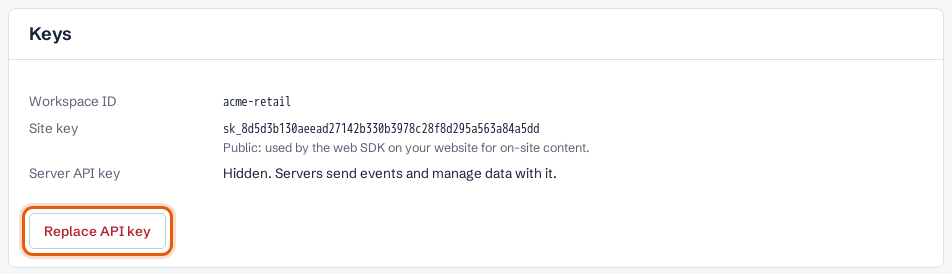

1. **Settings → Sign-in & keys → Keys → Replace API key**. Pulse asks you to confirm.
2. The new key is shown **only now**. Copy it.
3. The old key stops working right away (within a minute if you run several Pulse servers), so put the
   new one on your servers straight away.

Zapier / Make connectors have their own keys, rotated on their integration page
([tutorial 9](09-integrations.md#7-connect-zapier-or-make)); webhooks have their own signing secrets.

## 12. Roles, a recap

Who can do what is set on **Settings → Team** and **Settings → Roles**
([tutorial 1](01-getting-started.md#4-add-your-teammates)). For the pages in this tutorial:

The areas on **Settings → Roles** are **Contacts**, **Segments**, **Triggered & automation
campaigns**, **One-time campaigns**, **Content**, **Reports**, **Channels** and **Settings**. In the two
campaign areas, **Publish** is more than **Edit**: it lets someone put campaigns live, pause,
schedule and cancel them, and pick A/B winners.

| Page or action | Needs |
|---|---|
| Change a contact's consent, export contacts, **Download data** and **Delete contact** on a profile, the **Delete contact** and **Remove Do Not Contact** campaign steps | **Contacts: Edit** |
| See **Data & privacy** and **Automation & limits** | **Settings: View** (changing them: **Settings: Edit**) |
| **Web push** settings (tutorial 4) | **Channels: View** (changing them: **Channels: Edit**) |
| **Sign-in & keys** (including the two-step sign-in policy), **Audit log**, **Webhooks** | The full **Admin** role |
| **Reset two-step** on **Settings → Team** | **Settings: Edit** (and at least the teammate's access) |
| **Your account** (your own two-step sign-in) | Everyone |
| **Integrations** | Seen with **Settings: View**; connected and changed by admins |
| Revenue settings | **Settings: Edit** |

Nobody can give a teammate (or SSO newcomers, through **Their role**) a role with more access than
they have themselves.

## What you have now

- Per-channel consent, with unsubscribe and preference pages your contacts use themselves
- Retention rules that clean up anonymous visitors, old events and old logs, with a preview of what
  a shorter setting deletes
- Retries, segment schedules and default provider limits that fit your workspace
- A repeatable way to export or erase one person's data
- An audit trail you can filter and export
- Single sign-on, two-step sign-in, identity verification and a fresh API key

That's the end of the tutorials. For installing, configuring and integrating Pulse, see the
[developer docs](../developer/README.md).
