# Tutorial 12: Events and their properties

In about 25 minutes you will see which events your website, apps and servers send, describe them
with a **schema** (which properties each event carries, and of what type), send events with
properties from a web page and from a server, find events that don't fit, and use the properties in
segments and journeys.

**You need:** a workspace that receives events (tutorial 1 connects a website), and access to edit
contacts (the **Admin** or **Editor** role) to change schemas. Turning on **Enforce** also needs
access to change workspace settings (**Admin**). The examples use the seeded Acme Retail workspace,
which already has the suggested schemas and two months of shop events.

---

## 1. Why describe your events

Pulse records any event and any properties you send, without setup. A `purchase` can carry the
product, the order value, the payment method and a list of items. Describing the event with a schema
adds three things:

- **Typed filters.** Segments and journeys know that `value` is a number, `payment_method` is one of
  `upi`, `card`, `netbanking`…, and `items[].product_code` is text in each item, so they offer the
  right comparisons and a drop-down of allowed values.
- **Checks.** Events that don't fit (a missing order ID, a value sent as text) are counted and shown
  with examples, so you find a broken tracking call the day it ships, not a month later.
- **Lists on the contact.** A property can add its value to a list field of the contact, such as the
  product codes they bought (section 11).

A schema has one of three **Checking** modes:

| Mode | What happens to an event that doesn't fit |
|---|---|
| **Off** | Nothing: the schema only documents the event and types its filters |
| **Warn** (the default) | It is kept; the problem is counted and the latest examples are shown under **Problems** |
| **Enforce** | The server API (`POST /v1/events`) refuses it with a `400` saying what's wrong. Events from the browser and app SDKs are never refused; their problems are still counted |

## 2. The Events page

Go to **Audience → Events**. Every event sent in the last 30 days (and every described event) is
listed, busiest first:

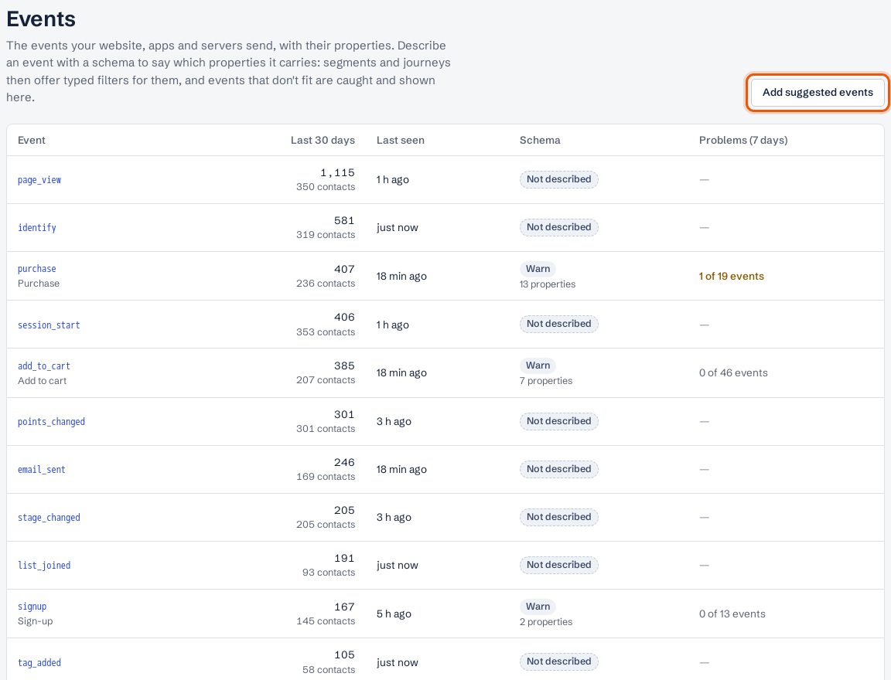

| Column | What it shows |
|---|---|
| **Event** | The name your code sends, and the label from its schema (e.g. **Purchase**). Click it to open the event |
| **Last 30 days** | How many events, and from how many contacts |
| **Last seen** | When the latest one arrived |
| **Schema** | **Not described**, **Off**, **Warn** or **Enforce**, and how many properties the schema describes |
| **Problems (7 days)** | For checked events: how many of the events in the last 7 days didn't fit, e.g. **1 of 19 events** |

Events Pulse records itself (`page_view`, `email_opened`, `points_changed`, …) are listed too; you
don't need to describe them.

## 3. Add suggested events

Pulse has ready-made schemas for six common shop events. Click **Add suggested events**:

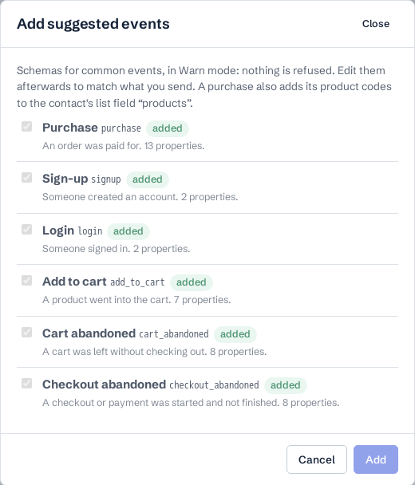

| Event | Properties |
|---|---|
| **Purchase** (`purchase`) | `product_code`, `product_name`, `product_category`, `value` (number, required), `currency`, `quantity`, `source`, `affiliation`, `order_id` (required), and `items`: a list with `items[].product_code`, `items[].quantity`, `items[].price` |
| **Sign-up** (`signup`), **Login** (`login`) | `method` (social, OTP or password, required), `social_provider` (Google, Facebook, Apple or LinkedIn, required only when the method is social) |
| **Add to cart** (`add_to_cart`) | the product, `price`, `quantity`, `source`, `landing_page` |
| **Cart abandoned** (`cart_abandoned`), **Checkout abandoned** (`checkout_abandoned`) | the product, `price`, `cart_value`, `payment_method` (UPI, card, net banking, wallet, cash on delivery, EMI, other), `payment_gateway` (e.g. razorpay, payu), `failure_reason` |

Tick the ones you want and click **Add N events**. They start in **Warn** mode, so adding them never
refuses an event; edit them afterwards to match what you send. Events already described show
**added** and can't be ticked (in Acme Retail all six are there already, so click **Cancel**). A
purchase's product codes also go into the contact's list field **Products** (section 11).

## 4. Look at an event

Click an event's name, here `purchase`. The page has four tabs: **Volume and properties**,
**Schema**, **Problems** (with the number of problems in the last 14 days) and **Sending this
event**.

**Volume** shows a bar per day for the last 30 days (days in UTC), the total, and the busiest day:

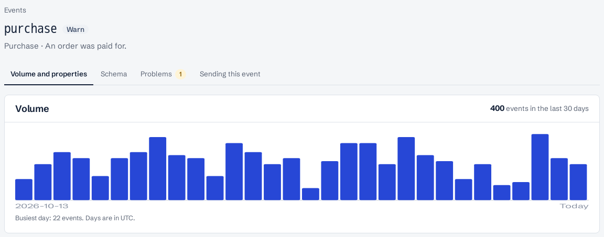

**Properties** lists what the latest events (up to a few hundred) actually carried, next to what the
schema describes:

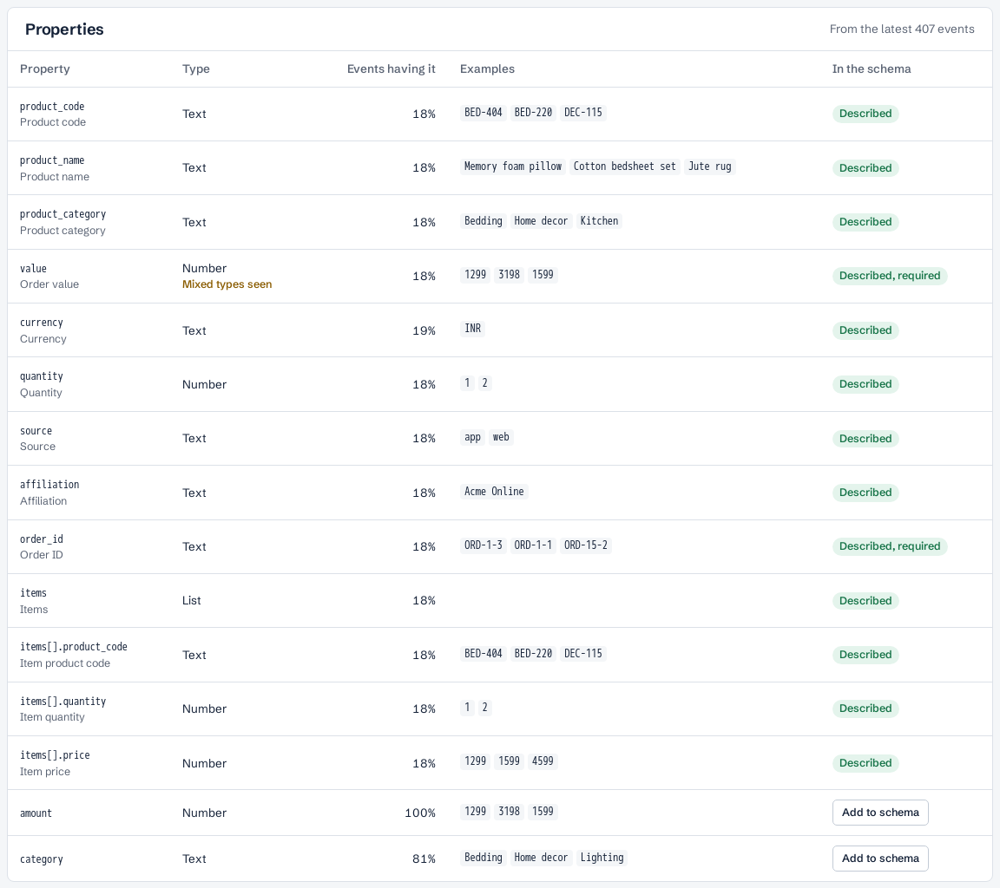

| Column | What it shows |
|---|---|
| **Property** | Its path in the event: `value`, `items[].product_code` (inside each item of the `items` list), and the schema's label |
| **Type** | The schema's type, or the type seen. **Mixed types seen** or **Seen as …** in orange means some events send another type, e.g. `value` as text |
| **Events having it** | The share of sampled events that carry it |
| **Examples** | A few values seen. Properties marked as personal data show **Personal data, hidden** |
| **In the schema** | **Described** (and **required**), or **Add to schema** for a property your code sends that the schema doesn't describe yet |

**Add to schema** adds the property, with the type seen, to the schema editor and opens the
**Schema** tab, where you check it and save.

## 5. Describe an event: the schema

Open the **Schema** tab. For an event without a schema, click **Describe this event** (an empty
schema) or **Start from the N properties seen** (one property per path seen in recent events).

### About this event

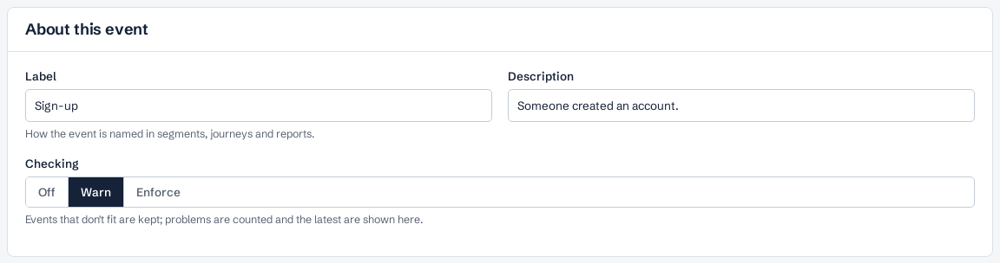

- **Label**: how the event is named in segments, journeys and reports, e.g. `Sign-up`.
- **Description**: one line for your team.
- **Checking**: **Off**, **Warn** or **Enforce** (section 8). The line under it explains the mode.

### Properties

Each property is a numbered card. **Add property** adds one at the end; **↑** and **↓** reorder;
**Remove** deletes one.

| Field | What to enter |
|---|---|
| **Key** | The property's name in Pulse: letters, digits and `_`, e.g. `payment_method` |
| **Path in the event (optional)** | Where the value is, when it isn't at the top level under the key: `product.code` for a nested object, or `items[].code` for the `code` of **each item** of a list. Empty means "same as key". Typing a path in an empty card suggests a key (`items[].product_code` → `item_product_code`) |
| **Label** | The name people see, e.g. `Payment method` |
| **Type** | **Text**, **Number**, **Yes / no**, **Date** (`2026-11-30` or an RFC 3339 time), **One of a list**, **List** or **Object** |
| **Required** | Events without it are a problem |
| **Personal data** | Hidden in problem samples and value suggestions, never copied into messages. Tick it for emails, phone numbers, addresses |

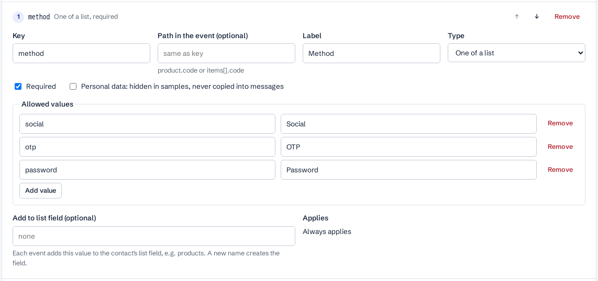

A **One of a list** property has **Allowed values**: on each line the value your code sends (`upi`)
and, optionally, a label people see (`UPI`). **Add value** adds a line. Segment filters then offer a
drop-down such as **UPI (upi)**, and any other value is a problem (**not an allowed value**).

### A property that applies only sometimes

A sign-up through Google has a `social_provider`; a sign-up with a password doesn't. Under
**Applies**, a property is **Always applies** until you click **Only when…**: choose the property it
depends on and tick its values.

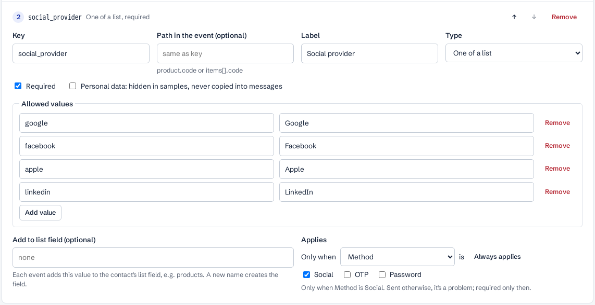

Here `social_provider` (Google, Facebook, Apple, LinkedIn) is required **only when Method is
Social**. A social sign-up without a provider is a problem (**missing**), and so is a password
sign-up that sends one (**sent when it doesn't apply**). **Always applies** removes the condition.
The property it depends on can't itself depend on another, and neither can use an `items[]` path.

### Save

Click **Create schema** (or **Save schema**). A dot on the **Schema** tab means unsaved changes;
**Discard changes** goes back to the saved schema. If something is wrong, a red box lists it under
**Fix these before saving** (a key used twice, an allowed value left empty, a dependency without
values…). **Delete schema** removes the description; the events stay, but they are no longer
checked and segments lose the typed filters.

## 6. Send events with properties

Open the **Sending this event** tab: it shows a call for your website and a request for your server,
with example values built from the schema (the dependent `social_provider` appears because the
example method is `social`).

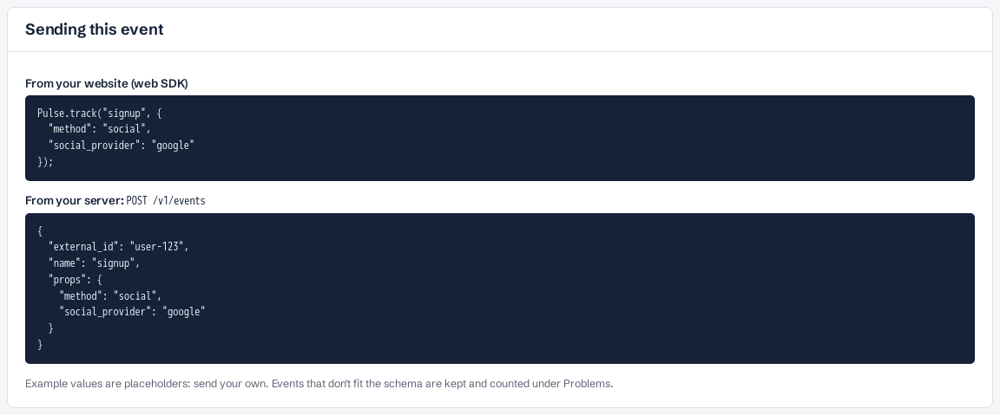

### From your website

With the Pulse snippet on the page (tutorial 1), call `Pulse.track(name, properties)`:

```js
// A product goes into the cart
Pulse.track("add_to_cart", {
  product_code: "KIT-101", product_name: "Cast iron skillet", product_category: "Kitchen",
  price: 1899, quantity: 1, source: "web", landing_page: "/kitchen"
});

// Someone signs up with Google
Pulse.track("signup", { method: "social", social_provider: "google" });
```

The event is recorded for the current visitor (or the signed-in contact after `Pulse.identify`).
Events from the browser are never refused, even in Enforce mode: their problems are counted.

### From your server

Send `POST /v1/events` with your server API key (`Authorization: Bearer pk_…`; see the
[API guide](../developer/03-api.md)). One event:

```bash
curl -s -X POST http://localhost:7080/v1/events \
  -H "Authorization: Bearer $KEY" -H "Content-Type: application/json" -d '{
  "external_id": "cust-1001",
  "name": "purchase",
  "id": "order-ORD-1001",
  "props": {
    "order_id": "ORD-1001", "value": 3798, "currency": "INR",
    "product_code": "KIT-101", "product_name": "Cast iron skillet", "product_category": "Kitchen",
    "quantity": 2, "source": "web", "affiliation": "Acme Online",
    "items": [
      {"product_code": "KIT-101", "quantity": 1, "price": 1899},
      {"product_code": "BED-404", "quantity": 1, "price": 1899}
    ]
  }}'
# 202 {"accepted":1,"ids":["order-ORD-1001"]}
```

Several at once (up to 1,000), as `{"events": [...]}`:

```json
{"events": [
  {"external_id": "cust-1002", "name": "signup",
   "props": {"method": "social", "social_provider": "apple"}},
  {"external_id": "cust-1002", "name": "add_to_cart",
   "props": {"product_code": "DEC-310", "product_name": "Brass table lamp", "price": 3299, "quantity": 1}},
  {"external_id": "cust-1002", "name": "cart_abandoned",
   "props": {"product_code": "DEC-310", "price": 3299, "cart_value": 3299}},
  {"external_id": "cust-1003", "name": "checkout_abandoned",
   "props": {"product_code": "KIT-204", "price": 2499, "cart_value": 2499,
             "payment_method": "upi", "payment_gateway": "razorpay", "failure_reason": "OTP timeout"}}
]}
```

Tips:

- Send numbers as numbers (`3798`, not `"3798"`) and dates as `2026-11-30` or a full RFC 3339 time.
- Send values of a **One of a list** property exactly as listed (`upi`, not `UPI`).
- Give an `id` to events you may retry (an order ID): Pulse skips an ID it saw in the last 24 hours.

## 7. Problems and samples

Open the **Problems** tab. It covers the events checked in the last 14 days (counted on the day Pulse received them):

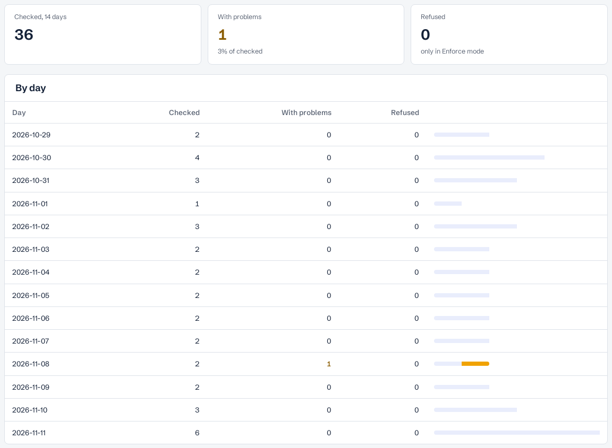

- **Checked, 14 days**, **With problems** (and the share of checked events), **Refused** (only in
  Enforce mode, by the server API).
- **By day**: checked, with problems and refused, per day, with a bar.
- **Most common problems**: the property, what's wrong (**missing**, **wrong type**, **not an
  allowed value**, **sent when it doesn't apply**) and how many events.
- **Latest events with problems**: when, which contact, each problem in words (e.g. *value wrong
  type: value should be a number*), and **Properties sent** to see the event's properties
  (personal properties are removed).

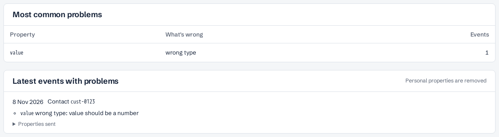

Fix the sending code, and watch the next days' rows go back to zero. In **Off** mode this tab says
**Checks are off**.

## 8. Enforce: refuse events that don't fit

When the Problems tab has stayed clean for a while, you can make the server API refuse bad events,
so a broken integration fails loudly instead of filling your data with wrong values.

1. On the **Schema** tab, click **Enforce** under **Checking**.
2. A window explains what changes. Type `ENFORCE` and click **Turn on Enforce**.

   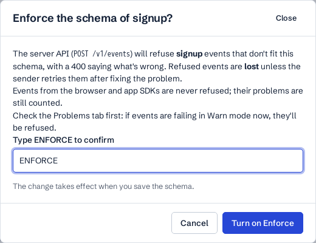
3. Click **Save schema**. The change takes effect then.

From then on, a request to `POST /v1/events` with an event that doesn't fit is refused with `400`,
and **none of the events in that request** is recorded. The answer says which event (counted from
0) and why:

```json
{"error": "event 0: signup doesn't fit its schema: social_provider is required"}
```

Your server should log it, fix the event and send the request again; refused events are otherwise
lost. They are counted under **Refused** on the Problems tab. Events from the browser and app SDKs
are never refused, only counted. **Cancel** in the window keeps the mode as it was; to go back
later, choose **Warn** and save.

## 9. Use properties in segments

In a dynamic segment (tutorial 3), add **Did an event** and type the event name, here `purchase`.
Then click **+ Only count events where…**:

![A segment rule: purchase at least 1 time between two dates where items[].product_code is KIT-101; 10 contacts would match](img/12-segment-items.png)

- **The property**: type it, or pick from the suggestions (the schema's properties with their
  labels, then others seen). Use a dotted path for nested values (`product.code`) and `items[].…`
  for lists: `items[].product_code` **is** `KIT-101` counts purchases where **any** item has that
  code.
- **The comparison follows the schema's type**: a **One of a list** property gets a drop-down of
  its allowed values (**UPI (upi)**), a number gets *is greater than*, *is between*…, a date gets
  *is on*, *is before*, *is after*, *is between*. Text gets *is*, *contains*, *is one of*… and *is
  set*. Without a schema, Pulse guesses from the name.
- Up to 5 property filters per event filter; they must all match.

The **When** drop-down after the count sets the period:

| Choice | Counts events |
|---|---|
| **in the last** N **days** | in a rolling window of 1 to 365 days |
| **between** a first and a last day | on those days, both included (days in UTC) |
| **since** a day | from that day until now |

A range that starts more than a year ago shows a note: it is checked by the periodic sweep (every
few minutes) rather than the moment an event arrives. See
[tutorial 3](03-segments.md#dates-and-periods) for date fields and more.

## 10. Use properties to start journeys

A journey can start on an event only when its properties match (tutorial 6). On the **Start** step,
choose **does an event**, type the **Event name**, and click **+ Only when the event's properties
match…**. The rows work as in segments.

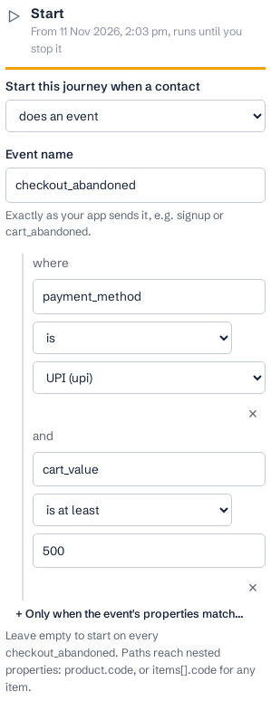

For example, a recovery message for UPI payments that failed on bigger carts: `checkout_abandoned`
where `payment_method` **is** **UPI (upi)** and `cart_value` **is at least** `500`. Leave the rows
out to start on every `checkout_abandoned`.

## 11. Fill a contact's list from events

A property can add its value to a **list field** of the contact, such as **Products**, so segments
can ask "has bought KIT-101" without counting events.

![The item_product_code property of purchase: path items[].product_code, Text, Add to list field products](img/12-schema-items.png)

In a property card, type the field in **Add to list field (optional)**, e.g. `products` (a new name
creates the list field). Each event then adds its value; for an `items[]` path, every item's value.
The suggested **Purchase** schema does this for `product_code` and `items[].product_code`.

The list appears in the contact's profile under **Lists and choices**, and in segments as
**Products** **has** / **doesn't have** `KIT-101` (tutorial 2, step 5 and tutorial 3). Only single
values (text, numbers, one of a list) can be added, and not to fields Pulse keeps itself (`tags`,
`stage`, `phone_country`, …).

## What you have now

- Your events described: labels, typed properties, allowed values, a dependent property
- Events sent with properties from the website and the server, and the problems they cause shown
- A way to refuse bad server events with Enforce
- Segments, journeys and contact lists that use event properties

**Next:** back to [Segments](03-segments.md) to combine property filters with list fields, date
ranges and Exclude groups.
