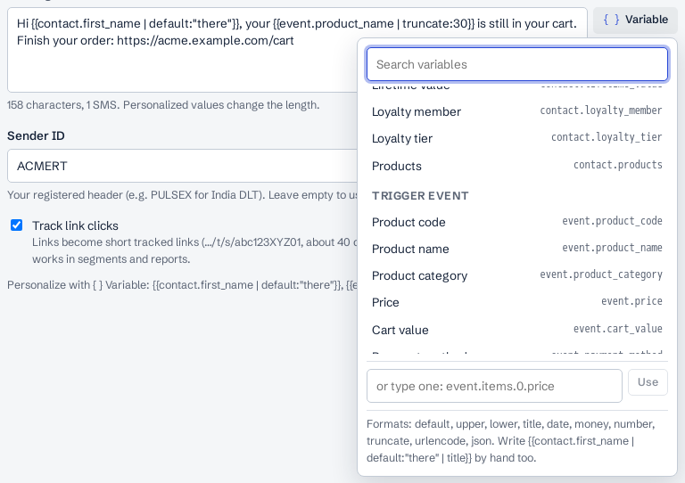
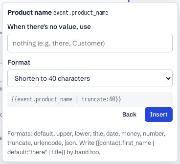
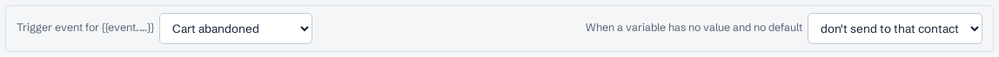
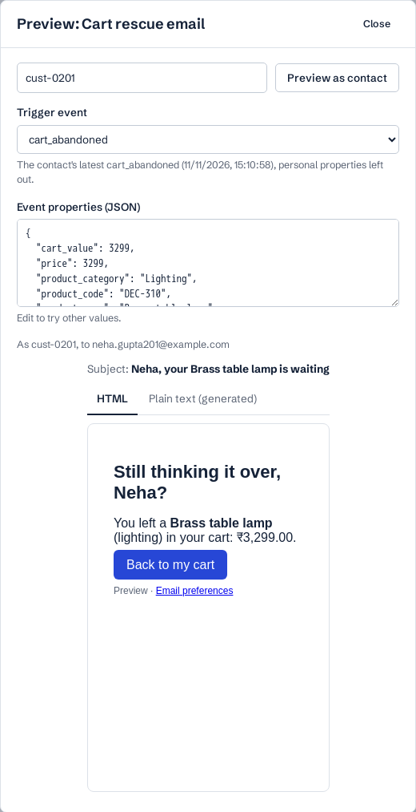
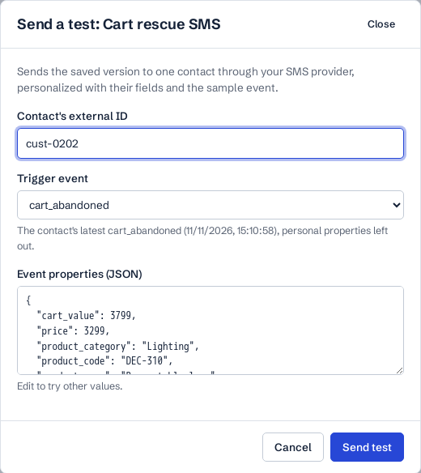
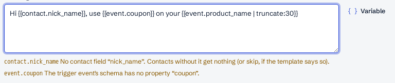
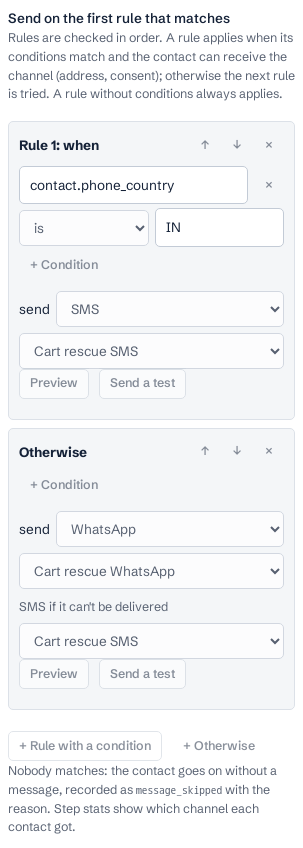
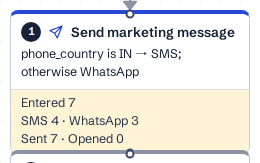

# Tutorial 13: Personalising messages

In about 20 minutes you will personalise messages with the contact's details and with the event that
started the journey (the product left in a cart), add defaults and formats, decide what happens when
a value is missing, preview and test with a real contact and event, and let a journey choose the
channel by rule: an Indian number gets an SMS, anyone else a WhatsApp message.

**You need:** access to edit content (the **Admin** or **Editor** role) for templates, and to edit
journeys for section 8. Previewing with a contact's real event also needs access to view contacts.
The examples use the seeded Acme Retail workspace, which has the `cart_abandoned` event schema
(tutorial 12), the **Cart rescue** templates and an active **Cart rescue** journey.

---

## 1. Variables

Every field of a template that is sent (an email's subject and body, an SMS, WhatsApp variables, RCS
text, cards and buttons, push and app inbox titles, messages and links) can hold **variables** in
double braces. Pulse fills them for each contact when the message goes out.

| Variable | What it is | Example |
|---|---|---|
| `{{contact.x}}` | Any contact field: `first_name`, `email`, `phone`, `phone_country`, `city`, your own fields, list fields (joined with commas) | `{{contact.first_name}}` → Asha |
| `{{event.x}}` | A property of the event that started the journey. Dots go into objects and lists: `items.0.name` is the first item's name, `items[].name` every item's, joined | `{{event.product_name}}` → Brass table lamp |
| `{{campaign.x}}` | `name`, `id`, `type` (journey, broadcast, test), `step` (the journey step), `channel`, `template` | `{{campaign.name}}` → Cart rescue |
| `{{links.x}}` | Email only: `unsubscribe` and `preferences` (the contact's preference center) | `<a href="{{links.unsubscribe}}">` |

Broadcasts aren't started by an event, so `{{event.x}}` is empty in them (or its default, section 3).

> Templates written with the older syntax (`{{.Attrs.first_name}}`, `{{.Contact.Email}}`,
> `{{.UnsubscribeURL}}`, `{{if …}}`) keep working, and both can be used in one template. New
> templates and the picker use the variables above.

## 2. Insert a variable

Go to **Content → Templates** and open **Cart rescue SMS**. Every templated field has a
**{ } Variable** button. Click it in the **Message** field:

The list has four groups: **Contact** (the built-in fields and your workspace's contact fields),
**Trigger event** (the properties of the event chosen above the editor, section 5), **Campaign**
and, in emails, **Links**. Type to search, or enter any variable by hand at the bottom
(`event.items.0.price`).

Choose a variable to set what it should say when the contact has no value, and how to format it:

**Insert** puts the tag at the cursor. In the **Visual builder** of an email, the picker copies the
tag instead: paste it into a text block. In **Rich text**, the **Personalize…** menu of the toolbar
offers the same variables.

## 3. Defaults and formats

A variable can go through **pipes**, written after `|`, left to right:

| Pipe | Does | Example → result |
|---|---|---|
| `default:"…"` | Used when there is no value | `{{contact.first_name \| default:"there"}}` → there |
| `upper`, `lower`, `title` | Case | `{{contact.city \| upper}}` → PUNE |
| `date:"…"` | A date in the contact's time zone, in a [Go layout](https://pkg.go.dev/time#pkg-constants) (`2 Jan 2006`, `02/01/2006 15:04`); no layout means `2 Jan 2006` | `{{event.delivery_date \| date:"Mon 2 Jan"}}` → Wed 12 Nov |
| `money:"…"` | An amount with its currency (INR when none; ₹ uses lakh grouping) | `{{event.cart_value \| money:"INR"}}` → ₹1,23,456.00 |
| `number`, `number:2` | Thousands separators; `:2` keeps 2 decimals | `{{event.points \| number}}` → 12,500 |
| `truncate:40` | At most 40 characters, ending with … | `{{event.product_name \| truncate:12}}` → Brass table… |
| `urlencode` | Safe inside a link's query string | `https://shop.example.com/search?q={{event.product_name \| urlencode}}` |
| `json` | A JSON value, for webhook bodies | `{"name": {{contact.first_name \| json}}}` |

Pipes chain: `{{contact.first_name | default:"friend" | title}}`. A misspelt pipe can't be saved:
**Save template** says which one and lists the others.

In email HTML every value is escaped for where it lands, so a product called `<b>Lamp</b>` shows as
text, and links you put in the body are still click-tracked: Pulse fills the variables first, then
turns each link into a tracked one.

## 4. When a value is missing

Above the editor, **When a variable has no value and no default** decides what happens:

| Choice | What happens |
|---|---|
| **leave it empty** (the default) | The variable is left out: "Hi ," if a first name is missing |
| **don't send to that contact** | Nobody gets a half-filled message: the contact gets nothing from this template, and the send is recorded as failed with the reason `skipped: no value for event.product_name` (in reports and the contact's activity) |

A variable with a `default` is never missing. **Cart rescue SMS** uses **don't send**: an SMS without
the product would make no sense.

## 5. The event that started the journey

When an event (or a form submission) starts a journey, Pulse keeps that event's properties with the
contact's place in the journey. **Every** message the journey sends afterwards can use them, on any
channel and after any wait: a reminder sent a day later still knows which lamp was left in the cart.

What is kept:

- the event's properties, up to **16 KB** (when an event carries more, its largest properties are
  left out first);
- **without** the properties its schema marks **personal** (tutorial 12, section 5): they never reach
  a message.

The template editor doesn't know which journey will send it, so choose the event above the editor
(**Trigger event for {{event.…}}**, section 4): the picker then lists its properties and the preview
fills them. Open **Cart rescue email**, choose **HTML**:

The preview on the right fills the variables with a sample contact (Asha from Pune) and an example
event built from the schema.

## 6. Preview and send a test with a real contact and event

Click **Preview as contact**, enter `cust-0201` and click **Preview as contact**. Under
**Trigger event**, Pulse loads that contact's latest `cart_abandoned` (personal properties left out),
or, if they have none, the schema's example. Edit the JSON to try other values:

When a variable has no value, the preview says so, and whether the contact would get nothing.
Choose **None** to see the message as a broadcast sends it.

**Send a test** works the same way: the test message carries the event you choose, through the
channel's real delivery path (the test inbox for sandbox providers).

## 7. Check your variables

Under each field, Pulse lists variables it can't fill:

- **A contact field or event property it doesn't know** is a warning (in amber): the template can be
  saved, as the value may still arrive, but check the spelling. **Save template** says how many
  variables to check.
- **A mistake** (an unknown pipe, `campaign.owner`, a quote left open) is shown in red, and the
  template can't be saved until it's fixed.
- `{{links.…}}` outside an email is flagged: only emails have those links.

## 8. Choose the channel by rule

**Send marketing message** (journeys → **+** → **Action**) can choose the channel per contact.
Open **Journeys → Cart rescue** and select its first step:

Rules are checked in order:

1. A rule **applies** when every condition matches and the contact can receive the channel (they
   have the address and haven't opted out). Conditions read `contact.<field>` or
   `event.<property>` and compare like segment filters: **is**, **is not**, **contains**, **starts
   with**, **is more than**, **is less than**, **is set**, **is not set**. Here: `contact.phone_country`
   **is** `IN`.
2. The first rule that applies sends; the others are skipped.
3. A rule **without conditions** always applies: put it last as **Otherwise**. WhatsApp and RCS rules
   can name an SMS fallback, sent if the message can't be delivered.
4. If no rule applies, the contact goes on without a message, recorded as `message_skipped` with the
   reason (`message_unreachable` when rules matched but the contact had no address on any of them).

`phone_country` comes from the contact's phone number (`+91…` → `IN`, tutorial 12), so the rule
needs numbers in international format.

With **Show stats** on, the step shows which channel each contact got:

Without any conditions, the step works as before: it sends on the first channel in the list that
the contact can receive.

## 9. Other places variables work

| Where | What |
|---|---|
| Journeys → **Send a webhook** → Body | Contact, event and campaign variables; use `\| json` to put a value in JSON: `{"cart": {{event.cart_id \| json}}}` |
| Journeys → **Push dynamic content** | The HTML for the slot, filled (and escaped) when the step runs. Contact values show only to visitors whose identity is verified (below); others see the defaults |
| Journeys → **Update contact** | Values such as `{{event.product_name}}` copy a property onto the contact |
| **On-site & in-app → In-app** | Title, message and buttons take contact variables, for verified app users (below); everyone else gets the defaults |

Focus items and dynamic web content defaults on your website aren't personalised per contact.

**Verified identity.** Your website and app ask for this content with the person's ID, and anyone can
send any ID. So Pulse fills in a contact's own data (name, email, phone, any field) only when the
request proves who it is: the workspace has an identity secret (**Settings → Sign-in & keys → Identity verification**)
and the request carries the matching user hash for that ID (the SDK's
`user_hash`, [web SDK guide](../developer/04-web-sdk.md#identity-verification)). Anonymous visitors, unverified IDs and
workspaces without a secret get every variable's default, so give public-facing variables a
`default`.

## Troubleshooting

| Problem | Fix |
|---|---|
| `{{event.x}}` is empty | The journey must start with **does an event** or **submits a form**; segment-started journeys and broadcasts have no event. Check the property name on the event's page (Audience → Events) and that it isn't marked personal |
| "Unknown format" on save | Use one of the pipes in section 3; values with spaces need quotes: `default:"dear customer"` |
| Everyone gets WhatsApp, nobody SMS | The contacts' `phone_country` is empty: their numbers lack `+` and the country code |
| A message wasn't sent | Open the contact's activity: `…_failed` with `skipped: no value for …` means the template skips missing values (section 4) |

Next: [Analytics](10-analytics.md) to see how the journey performs.
