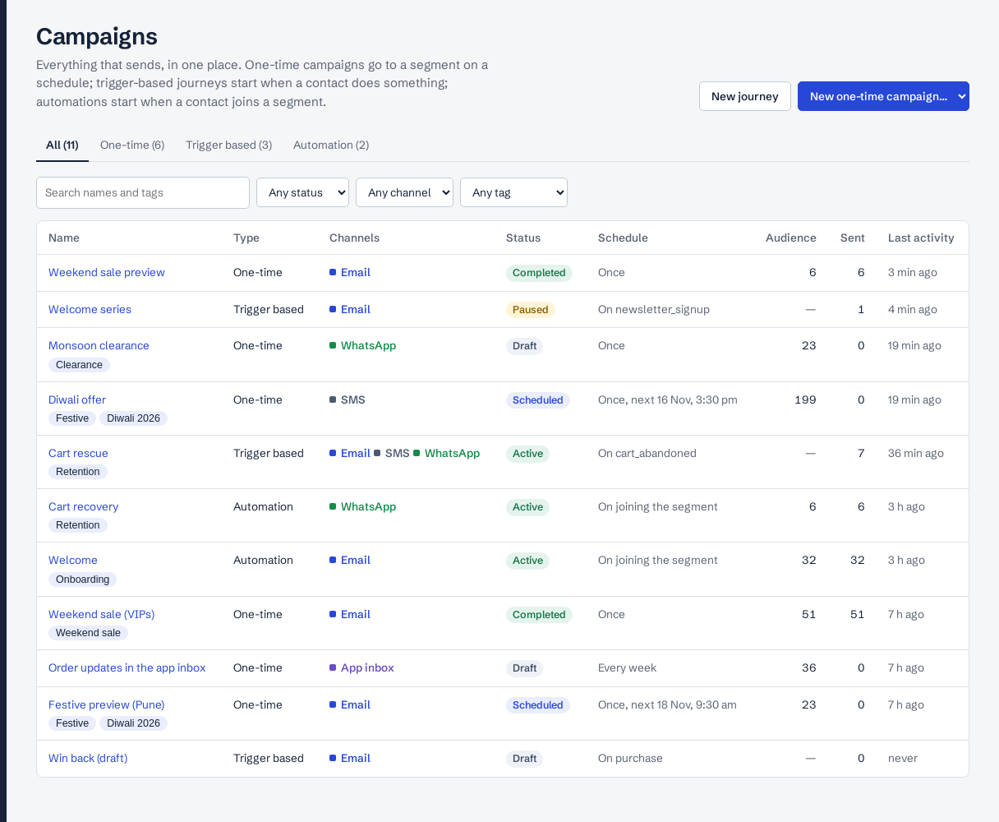
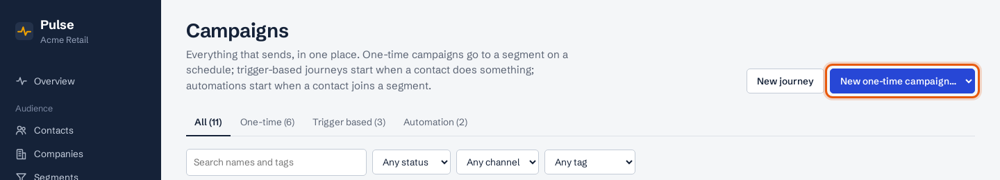
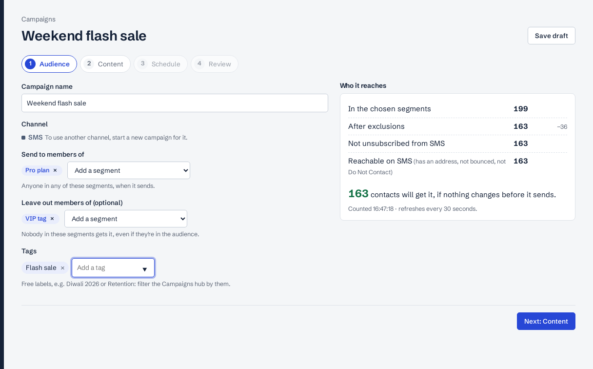
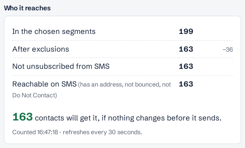
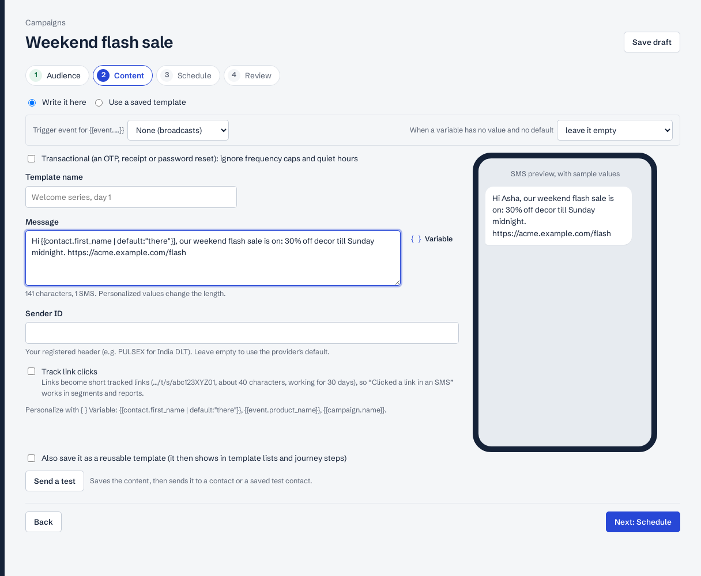

# Tutorial 14: The Campaigns hub and one-time campaigns

In about 15 minutes you will find every campaign in one list (one-time campaigns, trigger-based and
automation journeys), filter it by tag, and send a one-time SMS with the step-by-step wizard: choose
who gets it (and who doesn't), write the message right there, schedule it with a send deadline, and
check the exact number of contacts it will reach before you send.

**You need:** access to view broadcasts or journeys to see the hub, and to publish broadcasts to send
(the **Admin** or **Editor** role). The examples use the seeded Acme Retail workspace.

---

## 1. Everything that sends, in one list

Open **Campaigns → All campaigns**.

Each row is a campaign, sorted by its latest activity:

| Column | What it shows |
|---|---|
| **Name** | Opens the campaign (a broadcast's page, or the journey editor). Its tags are under the name; click one to filter by it |
| **Type** | Set by Pulse from how the campaign starts, never by hand: **One-time** (a broadcast: one message to a segment, once or on a repeat), **Trigger based** (a journey started by an event or a form), **Automation** (a journey contacts enter when they join a segment) |
| **Channels** | The channels it sends on (a journey's send steps, a broadcast's channel and its SMS fallback) |
| **Status** | Draft, scheduled, sending, completed, cancelled for one-time campaigns; draft, active, paused for journeys (archived journeys show when you filter by **Archived**) |
| **Schedule** | When a one-time campaign sends (next send for repeats); what starts a journey |
| **Audience** | How many contacts are in the audience segment now. Trigger-based journeys show a dash: contacts enter when they do the event |
| **Sent** | Contacts who have been sent a message by it |

The tabs show one type each, with their counts. Search matches names and tags; the lists filter by
status, channel and tag. The **Journeys** and **Broadcasts** pages are still there, with the same
campaigns.

### Tags

Tags are free labels, such as *Diwali 2026* or *Retention*. Add them on a broadcast's page or the
journey editor (under the name; type a tag and press Enter, or pick one Pulse suggests from the tags
already used), or in the wizard below. A campaign has up to 20 tags of up to 40 characters; capital
letters don't make a different tag (*festive* and *Festive* are one). Tags can change at any time,
even while a campaign is sending.

## 2. Start a one-time campaign

Choose the channel from **New one-time campaign…** (email, SMS, WhatsApp, RCS, push or app inbox).

The wizard has four steps; the numbers at the top show where you are, and you can go back to any
step you've finished. **Save draft** keeps what you have so far (it then shows in the hub as a
draft, and **Open in the wizard** on its page brings you back).

## 3. Audience, with the exact count

1. Name the campaign, e.g. *Weekend flash sale*.
2. Under **Send to members of**, add one or more segments: everyone in any of them gets it.
3. Under **Leave out members of**, add segments whose members must not get it, even if they're in the
   audience (here, **VIP tag**: they had their own offer).
4. Add tags if you like.

**Who it reaches** counts, exactly and right now, how many contacts are left after each step:

| Step | Who is left |
|---|---|
| In the chosen segments | Members of any segment you send to |
| After exclusions | ...who are in none of the left-out segments |
| Not unsubscribed from *channel* | ...who haven't opted out of the channel, or of everything (Do Not Contact) |
| Reachable on *channel* | ...who have somewhere to send it: an email address that hasn't bounced, a valid phone number with its country code (for SMS, one that hasn't bounced either), a push device for push |
| Under the frequency cap | ...who haven't already had as many marketing messages on the channel as your cap allows (only when Settings → Channels → Delivery rules sets one). Above 50,000 contacts this step is estimated from a sample, and says so |

The bold number is how many will get it if nothing changes before it sends: segment membership is
taken when it sends, so people who join or leave in between are counted then. The count is redone
every 30 seconds while you work. It is the same count the broadcast page shows under **Who it reaches
now**, and segments show it per channel (tutorial 3).

## 4. Content, written right here

**Next: Content** opens the same editor as Content → Message templates for this channel: the
variable picker, defaults and formats (tutorial 13), and a live preview with sample values.

- **Write it here** keeps the message with the campaign: it doesn't appear in your template lists.
  Tick **Also save it as a reusable template** to add it to them (for journeys and other
  campaigns), or do that later from the template's page.
- **Use a saved template** picks one of your templates instead.
- **Send a test** saves the content, then sends it to a contact or a saved test contact (tutorial 4).
- WhatsApp and RCS campaigns can name an SMS sent instead when the message can't be delivered.

## 5. Schedule and a send deadline

**Next: Schedule**: send now, at a date and time, or on a repeat (every day, week or month), and, for
a one-time send, at that time in each contact's own time zone (tutorial 7).

A **send deadline** stops messages arriving late. Quiet hours, a provider's daily quota (tutorial 4)
or retries can hold messages back; without a deadline they go out whenever they can, even at night.
With one, a message that can't go out in time is dropped instead:

- **Don't send after** a time of day: the first time it comes after the send starts (in each
  contact's time zone for a local-time send).
- **…or more than** a number of hours late (1 to 168), counted from when the send starts.

With both, the earlier wins. Dropped messages are recorded as failed with the reason `deadline`, and
the campaign's results say how many were late.

## 6. Review and send

**Next: Review** lists everything in words, with the exact count again.

**Send now** (or **Schedule**, for a later time) saves the campaign and its message and sends it; you
land on its page, where the results arrive as it sends (tutorial 7). To change a scheduled campaign,
cancel it on its page first.

## 7. Duplicate

**Duplicate** on a broadcast's page, a journey (its page or the journeys list), a template or a
dynamic segment makes a draft copy named "… (copy)" and opens it. A campaign's own message is copied
too, so changing one doesn't change the other. Nobody is in a copied journey, and a copied segment is
built from scratch.

## Troubleshooting

| What you see | Why, and what to do |
|---|---|
| The hub lists only broadcasts, or only journeys | Your role can view only one of them |
| "Reachability is still being computed" under the count | Pulse builds the reachability counts for a workspace in the background when it is new (and refreshes them daily); give it a few minutes |
| "Too many estimates; try again in a minute" | Counts are limited to 60 a minute per workspace (repeats within 30 seconds are free) |
| Fewer messages went out than the count | Contacts left the segments, unsubscribed or bounced between the count and the send, the frequency cap held some back, or the send deadline dropped late ones (see the campaign's results) |
| **Next** stays disabled | The red text next to it says what's missing |
