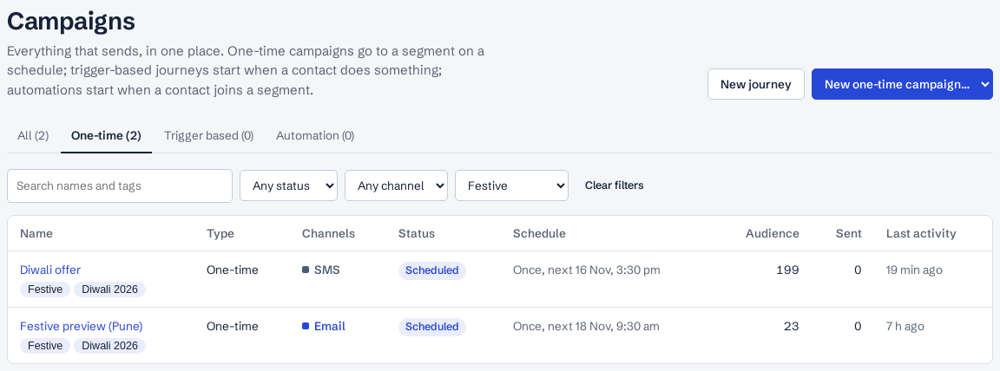
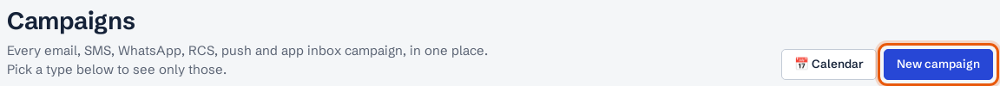
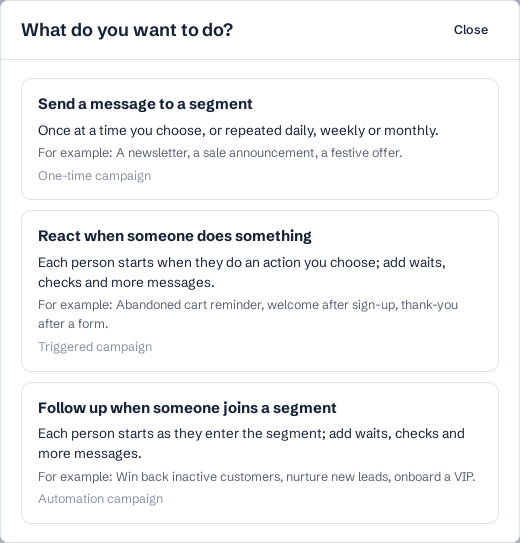
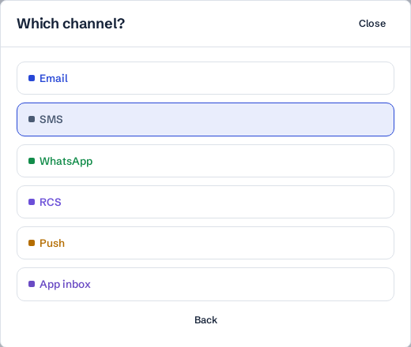
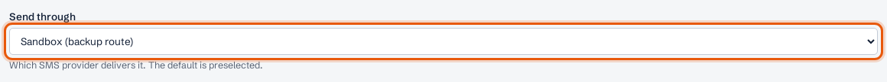
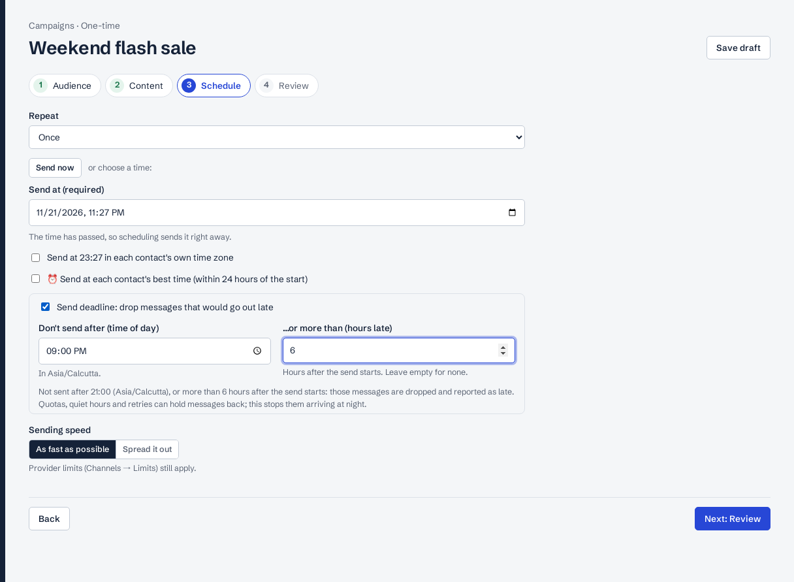
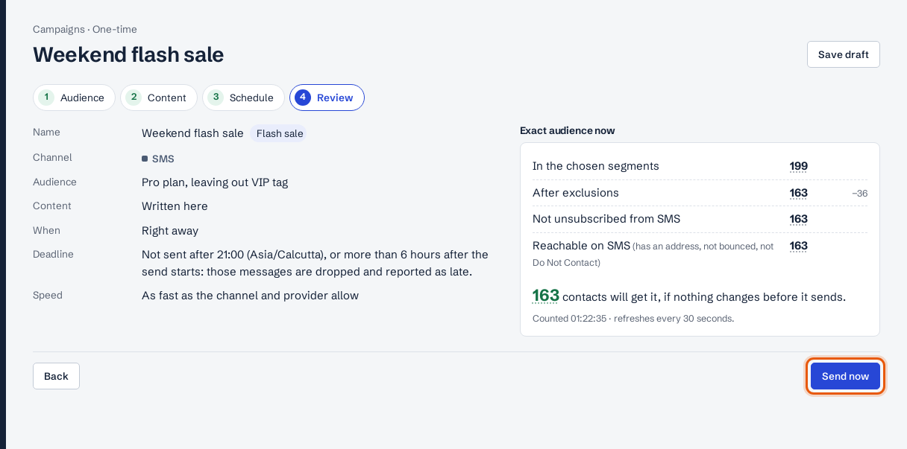
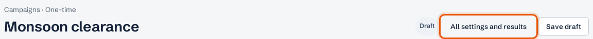
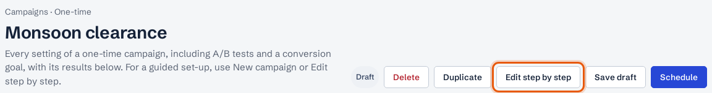

# Tutorial 14: The Campaigns page, New campaign and the step-by-step wizard

In about 15 minutes you will find every campaign in one list, learn the three types of campaign,
filter the list by type and tag, start a new campaign by saying what you want to do, and send a
one-time SMS with the step-by-step wizard: choose who gets it (and who doesn't), write the message
right there, schedule it with a send deadline (or at each contact's best time, or spread out over
hours), and check the exact number of contacts it will reach before you send. At the end: approvals
before a campaign goes live, and the calendar of every send.

**You need:** access to view one-time campaigns or triggered & automation campaigns to see the list,
and to publish one-time campaigns to send one (the **Admin** or **Editor** role). The examples use the
seeded Acme Retail workspace.

---

## 1. Everything that sends, in one list

Click **Campaigns** in the sidebar (under *Campaigns*, above **Website & app messages**).

### The three types of campaign

Every campaign is one of three types, named by **when it sends**. Pulse sets the type from how the
campaign starts; you never pick it by hand.

| Type | What the app says | Good for |
|---|---|---|
| **One-time** | One message to everyone in your chosen segments, sent once or repeated daily, weekly or monthly | A newsletter, a sale announcement, a festive offer |
| **Triggered** | Starts for each person when they do something, like buying, signing up, abandoning a cart or submitting a form | Abandoned cart reminder, welcome after sign-up, thank-you after a form |
| **Automation** | Starts for each person when they join a segment, then follows up step by step | Win back inactive customers, nurture new leads, onboard a VIP |

Triggered campaigns and automations are built as **journeys**: a flow of messages, waits and checks,
drawn in the step builder ([tutorial 6](06-triggered-and-automation-campaigns.md)). A one-time
campaign is one message (with an optional A/B test, [tutorial 7](07-one-time-campaigns.md)).

### The columns

| Column | What it shows |
|---|---|
| **Name** | Opens the campaign. Its tags are under the name; click one to show only campaigns with that tag |
| **Type** | **One-time**, **Triggered** or **Automation**. Point at it to read what the type means |
| **Channels** | The channels it sends on (every send step of a journey; a one-time campaign's channel) |
| **Status** | One word: **Draft**, **Scheduled**, **Sending**, **Live**, **Ended**, **Paused**, **Finished**, **Cancelled** or **Archived** (more below) |
| **When it sends** | A one-time campaign's repeat and next send (*Once, next 16 Nov, 3:30 pm*); what starts a triggered campaign (*When someone does cart_abandoned*) or an automation (*When someone joins the segment*) |
| **Audience now** | How many people are in the campaign's segment right now. Triggered campaigns show a dash: they have no fixed audience, people start when they do the trigger |
| **In progress** | Triggered and automation campaigns: people still going through the steps |
| **Sent to** | People sent at least one message by it, ever |
| **Last activity** | When it last sent or changed |

**Numbers are links.** A number with a dotted underline opens the Contacts page filtered to exactly
those people: click **199** under *Audience now* and you see the 199 members of the segment; click a
*Sent to* number and you see who got the campaign ([tutorial 2](02-contacts.md)). Zero isn't a link
(there's nobody to show), and a number your role can't open is plain; point at it to see which
access is missing.

### Statuses

| Status | Means |
|---|---|
| **Draft** | Saved, never sent or started |
| **Scheduled** | A one-time campaign waiting for its next send, or a published triggered or automation campaign whose publish window hasn't started |
| **Sending** | A one-time campaign going out right now |
| **A/B test: waiting for winner** | A one-time A/B test went to the test group; the rest wait for the winner ([tutorial 7](07-one-time-campaigns.md#7-pick-the-winner)) |
| **Finished** | A one-time campaign that has sent everything |
| **Cancelled** | A one-time campaign you stopped |
| **Live** | A triggered or automation campaign that is taking people in |
| **Ended** | A triggered or automation campaign whose publish window is over (or that was unpublished with **Let them finish**): nobody new enters, people inside finish its steps |
| **Paused** | A triggered or automation campaign unpublished with **Hold them where they are**: nobody new starts, people inside wait, its steps can change |
| **Archived** | A triggered or automation campaign put away; hidden unless you filter by **Archived** |

A live campaign can show **Not running: needs a fix** under **Live**. Its saved steps no longer pass
Pulse's checks (for example a step that sets **stage** directly, which Pulse now only changes
through its own steps), so nobody moves through it. Hover over the words for the reason; the
campaign's page shows it in red. Choose **Unpublish**, hold the people in it, change that step, and
publish it again.

### Tabs, search and filters

The tabs **All**, **One-time**, **Triggered** and **Automation** show one type each, with their
counts; the line under them explains the chosen type. **Search names and tags** finds campaigns by
name or tag; the lists filter by status (**Any status (archived hidden)**), channel and tag. **Clear
filters** shows everything again.

### Row buttons

At the end of each row:

- **Duplicate** makes a draft copy, "… (copy)", and opens it (see [step 9](#9-duplicate-archive-and-delete)).
- **Archive** (a triggered or automation campaign that has had people in it and isn't live) and
  **Delete** (one nobody has entered yet) put it away; **Restore** brings an archived one back.
  Live campaigns have neither: pause them first.

### Tags

Tags are free labels, such as *Diwali 2026* or *Retention*. Add them in the wizard below, under a
one-time campaign's settings, or under a triggered or automation campaign's name in the step
builder: type a tag and press Enter, or pick one Pulse suggests from the tags already used. A
campaign has up to 20 tags of up to 40 characters; capital letters don't make a different tag
(*festive* and *Festive* are one). Tags can change at any time, even while a campaign is sending.

## 2. New campaign: say what you want to do

Click **New campaign** (top right).

Pulse asks **What do you want to do?**

| Choice | Opens | Type |
|---|---|---|
| **Send a message to a segment** | **Which channel?**, then the step-by-step wizard (below) | One-time |
| **React when someone does something** | The step builder, starting when a contact does an event | Triggered |
| **Follow up when someone joins a segment** | The step builder, starting when a contact joins a segment | Automation |

For a campaign that starts when someone submits a form, choose **React when someone does
something** and change the Start step to **submit a form** ([tutorial 6](06-triggered-and-automation-campaigns.md#3-choose-what-starts-it)).
If your role can create only some types, the others aren't offered (*Your role can't create the
other types*).

For this tutorial choose **Send a message to a segment**, then the channel: **SMS**.

The wizard has four steps: **Audience**, **Content**, **Schedule**, **Review**. The numbers at the
top show where you are, and you can go back to any step you've finished. **Save draft** keeps what
you have so far (it then shows on the Campaigns page as a **Draft**).

## 3. Audience, with the exact count

1. **Campaign name**: *Weekend flash sale*. Only your team sees it.
2. **Channel** is the one you chose. To use another channel, start a new campaign for it.
3. Under **Send to members of**, add one or more segments: everyone in any of them gets it.
4. Under **Leave out members of (optional)**, add segments whose members must not get it, even if
   they're in the audience (here, **VIP tag**: they had their own offer).
5. Add tags if you like (here *Flash sale*).

**Who it reaches** counts, exactly and right now, how many contacts are left after each step:

| Step | Who is left |
|---|---|
| **In the chosen segments** | Members of any segment you send to |
| **After exclusions** | ...who are in none of the left-out segments (shown only when you leave some out) |
| **Not unsubscribed from** *channel* | ...who haven't opted out of the channel, or of everything (Do Not Contact). If your workspace leaves email unsubscribers to segment filters, they stay in for email and a warning says how many ([tutorial 7](07-one-time-campaigns.md#5-when-to-send)) |
| **Reachable on** *channel* | ...who have somewhere to send it: an email address that hasn't bounced, a valid phone number with its country code (for SMS, WhatsApp and RCS, one the bounce rules haven't stopped on that channel), a push device for push |
| **Under the frequency cap** | ...who haven't already had as many marketing messages on the channel as your cap allows (only when Settings → Channels → Delivery rules sets one). Above 50,000 contacts this step is estimated from a sample, and says so |

The big number is how many will get it if nothing changes before it sends: segment membership is
taken when it sends, so people who join or leave in between are counted then. The count is redone
every 30 seconds while you work.

Every number in the count is a link: click **163** next to *Reachable on SMS* and the Contacts page
opens with exactly those 163 people (as filter chips such as *In segment “Pro plan”*, *Not in segment
“VIP tag”*, *Reachable by SMS*). That's the way to check who a campaign will reach before you send.

## 4. Content, written right here

**Next: Content** opens the same editor as **Content → Message templates** for this channel: the
variable picker, defaults and formats ([tutorial 13](13-personalising-messages.md)), and a live
preview with sample values.

- **Write it here** keeps the message with the campaign: it doesn't appear in your template lists.
  Tick **Also save it as a reusable template** to add it to them (for other campaigns and journey
  steps), or do that later from the template's page.
- **Use a saved template** picks one of your templates instead.
- **Send a test** saves the content, then sends it to a contact or a saved test contact
  ([tutorial 4](04-channels.md)).
- WhatsApp and RCS campaigns can name an SMS to send instead when the message can't be delivered
  (**If it can't be delivered, send this SMS instead (optional)**).
- **Send through** (only when the channel has more than one provider) picks the provider that delivers
  this campaign. The channel's default is preselected:

  

  If that provider is removed before the campaign sends, it goes through the channel's default
  ([tutorial 4](04-channels.md#choose-the-provider-for-a-campaign-send-through)).
- **Topic** (only when your workspace has topics, [tutorial 4](04-channels.md#the-unsubscribes-panel))
  says which topic the campaign belongs to, on any channel: people who left it are skipped, and
  for email the unsubscribe link leaves that topic only. The count in step 3 doesn't leave them out.

## 5. Schedule and a send deadline

**Next: Schedule**:

- **Repeat**: **Once**, **Every day**, **Every week** or **Every month**.
- **Send now**, or choose a time in **Send at (required)** (**First send** for a repeating campaign).
  **Ends (optional)** is the last time a repeating campaign may send; leave it empty to keep it going
  until you cancel it.
- **Send at … in each contact's own time zone** (Once only): each contact gets it at that clock time
  where they are ([tutorial 7](07-one-time-campaigns.md#5-when-to-send)).

A **send deadline** stops messages arriving late. Quiet hours, a provider's daily quota
([tutorial 4](04-channels.md)) or retries can hold messages back; without a deadline they go out
whenever they can, even at night. Tick **Send deadline: drop messages that would go out late**, then:

- **Don't send after (time of day)**: the first time it comes after the send starts (in each
  contact's time zone for a local-time send).
- **...or more than (hours late)**: a number of hours (1 to 168), counted from when the send starts.

With both, the earlier wins. Dropped messages are recorded as failed with the reason *Send deadline passed*,
and the campaign's results say how many were late.

### At each contact's best time

Tick **⏰ Send at each contact's best time (within 24 hours of the start)** (Once only). Instead of
sending to everyone at once, Pulse sends to each person at the hour they usually open, click or read
your messages, within 24 hours of **Send at**.

- Pulse works out each contact's best hour from their opens, clicks and reads over the last 90 days,
  and updates it every 6 hours.
- People with no history get the hour your whole audience is busiest.
- Each message waits until its hour comes. The results don't count these as held.
- It can't be combined with own-time-zone sending or a sending speed: ticking it turns those off.
  Repeating campaigns don't use it.

The review says *Each contact at their best time, within 24 hours of …*.

### Sending speed

**Sending speed** is **As fast as possible** (the default: as fast as the channel and provider allow)
or **Spread it out**. With **Spread it out**, enter how many **messages an hour** (60 to 10,000,000).
Pulse gives each message its own time and sends them evenly.

Spread out a big send to protect your website from a rush of visitors, to warm up a new sending
domain, or to stay under a provider's limits. Provider limits (**Channels → Limits**) still apply on
top. For a repeating campaign, each send is spread out from its own start. The review shows the speed
under **Speed**.

## 6. Review and send

**Next: Review** lists everything in words, with the **Exact audience now** beside it.

**Send now** (or **Schedule**, for a later time) saves the campaign and its message and sends it.
You land on the campaign's **All settings and results** page, where the results arrive as it sends
([tutorial 7](07-one-time-campaigns.md#8-read-the-results)). If something is missing, the button
is greyed out; point at it to see what.

## 7. Two ways to edit a one-time campaign

A one-time campaign has two editors, and each links to the other:

| Editor | Address | Use it for |
|---|---|---|
| **The wizard** ("Edit step by step") | `/campaigns/one-time/…` | The guided set-up above: audience, message, schedule, review |
| **All settings and results** | `/broadcasts/…` | Every setting, including A/B tests, more segments and a conversion goal, with the results below ([tutorial 7](07-one-time-campaigns.md)) |

In the wizard of a saved campaign, **All settings and results** is at the top right:

On the **All settings and results** page, **Edit step by step** goes back to the wizard (while the
campaign isn't scheduled or sending):

Clicking a one-time campaign's name on the Campaigns page opens **All settings and results**.
While a campaign is scheduled or sending, the wizard is read-only and says so: cancel it on its page
first to change anything.

## 8. Old addresses still work

Before this version, journeys and one-time campaigns (then called *broadcasts*) had their own lists.
Bookmarks to them still work: `/journeys` opens the Campaigns page and `/broadcasts` opens its
**One-time** tab. A campaign's own address (`/journeys/12`, `/broadcasts/7`) is unchanged.

## 9. Duplicate, archive and delete

**Duplicate** (on the Campaigns page, a one-time campaign's page or the step builder) makes a draft
copy named "… (copy)" and opens it. A campaign's own message is copied too, so changing one doesn't
change the other. Nobody is in a copied triggered or automation campaign. Templates and dynamic
segments have a **Duplicate** button too.

To put campaigns away:

- A **one-time campaign** that isn't scheduled or sending has **Delete** on its page. Its results go
  with it.
- A **triggered or automation campaign** that nobody has entered has **Delete** in its row; one that
  has had people in it has **Archive** instead (its history and reports are kept). Choose the
  **Archived** status to see archived ones, and click **Restore** to bring one back as **Paused**.
  See [tutorial 6](06-triggered-and-automation-campaigns.md#15-delete-or-archive-a-campaign).

## 10. Approvals: a second pair of eyes

Some teams want a second person to check a campaign before it goes out. Pulse has this built in, for
one-time, triggered and automation campaigns.

**Who asks.** On **Settings → Roles**, **Publish** lets someone launch campaigns ([tutorial 11](11-admin-and-privacy.md#12-roles-a-recap)).
Someone who can edit but not publish sees **Save and ask for approval** where the **Send now** /
**Schedule** (or **Save and go live**) button would be:

1. Click **Save and ask for approval**.
2. Add a **Note for the approver (optional)**, e.g. *Diwali send to all Pune customers, offer valid
   till Sunday.*
3. Click **Ask for approval**. Pulse says *Asked for approval. You'll see the answer here.*

The campaign shows a banner: **⏳ Waiting for approval**, who asked and when, and **Withdraw** to take
the request back.

**Who approves.** Everyone who may publish that kind of campaign sees, at the top of the **Campaigns**
page, *⏳ 2 campaigns waiting for your approval:* with a link to each and who asked. On the campaign,
the banner has:

- **✅ Approve and launch**: Pulse asks *Approve and launch …? It launches now, as it was when they
  asked.* The campaign is scheduled (or goes live) exactly as it was when they asked.
- **Send back**: write **What should change? They'll see this.** and click **Send back**. The banner
  turns to **↩️ Sent back** with your note.

Nobody can approve their own request. If the campaign, its templates or their content blocks change
after the request, the banner says *It changed after the request, so approving won't launch it: ask
again.*, and approving is refused. The list and banner refresh on their own; Pulse doesn't email
approvers yet, so tell them.

**Four-eyes: every launch needs a second person.** By default, people who may publish launch campaigns
themselves. To make everyone ask, an admin turns on **Settings → Automation & limits → Approvals →
Four-eyes launches** (*Every launch needs a second person*). Then when a publisher clicks **Send
now**, **Schedule** or **Save and go live**, Pulse opens the same **Ask for approval** window
(*This workspace needs a second person to approve every launch…*), and someone else who may publish
approves. Campaigns launched with an API key aren't affected.

While four-eyes is on, an approved campaign's words can't change behind the approval: saving a
template or content block that a scheduled or running campaign (or an active triggered campaign)
sends is refused, with the campaigns named. Pause them, make the change, then ask for approval
again.

Deleting a template that a live campaign sends is refused whether four-eyes is on or not, with the
campaigns named: pause or finish them first. And a triggered campaign that is archived while its
approval is pending can't be approved; restore it and ask again.

## 11. The campaign calendar

To see what goes out when, click **📅 Calendar** at the top of the **Campaigns** page.

The **Calendar** shows one month (**←** and **→** move a month, **Today** comes back):

- Every one-time send on its day, with its time and name, coloured by channel (email, SMS, WhatsApp,
  RCS, push, app inbox). A repeating campaign shows each of its sends. Drafts show dashed, at their
  planned time.
- **Running all month or part of it:** the live triggered and automation campaigns (⚡), and paused
  ones marked *(paused)*. They don't have a fixed time, so they are listed above the grid.
- A day with 3 or more sends gets **🔥** and the number: check they don't reach the same people too
  often. A day with more than four sends shows *+2 more*.

Click a send to open its campaign. The calendar shows only the kinds of campaign your role may view.
It doesn't work out whether two sends on the same day reach the same people: compare their segments,
or use a frequency cap ([tutorial 4](04-channels.md#4-set-delivery-rules)).

## Troubleshooting

| What you see | Why, and what to do |
|---|---|
| The Campaigns page lists only one-time campaigns, or only triggered and automation ones | Your role can view only one of them (Settings → Roles: **One-time campaigns**, **Triggered & automation campaigns**) |
| **New campaign** offers only some choices | Your role can create only those types |
| A number isn't a link | It's zero, or your role can't open that list of contacts (point at it to see why) |
| "Reachability is still being computed" under the count | Pulse builds the reachability counts for a workspace in the background when it is new (and refreshes them daily); give it a few minutes |
| "Too many estimates; try again in a minute" | Counts are limited to 60 a minute per workspace (repeats within 30 seconds are free) |
| Fewer messages went out than the count | Contacts left the segments, unsubscribed or bounced between the count and the send, the frequency cap held some back, or the send deadline dropped late ones (see the campaign's results) |
| **Next** stays greyed out | The red text next to it says what's missing |
| **Save and ask for approval** instead of **Send now** | Your role can't publish one-time campaigns (section 10) |
| **Send now** opens **Ask for approval** | The workspace has **Four-eyes launches** on (section 10) |
| A segment is greyed out in **Send to members of**, or **Send now** says *the segment … is unpublished* | The segment is unpublished, or its publish window has ended: new sends can't use it. Publish it, or move its end later ([tutorial 3](03-segments.md#11-publish-unpublish-and-the-publish-window)) |
