# Tutorial 15: Delivery and dashboards

In about 20 minutes you will read what happened to a campaign's messages (delivered, opened,
bounced, marked as spam, skipped and why), open the people behind any of those numbers, compare all
your campaigns side by side, and use the **Users**, **Products** and **Live events** dashboards.

**You need:** a workspace that has sent some messages. The pictures use the **Acme Retail** example
workspace and its *Spring catalogue* email and *Monsoon preview* WhatsApp campaigns. The dashboards
under **Analytics** need **Reports: View**; **Live events** needs **Contacts: View** (see roles in
[tutorial 1](01-getting-started.md)).

---

## 1. What Pulse records about each message

Every message a campaign tries to send ends up in one of these states. Pulse shows the furthest it
got:

| State | Means | Where it comes from |
|---|---|---|
| **Skipped** | Not sent at all: the person opted out of the channel or of the campaign's topic, a bounce rule stopped their address, they have no address or aren't on the channel, are over the frequency cap, a variable had no value, or the send deadline had passed | Pulse, before sending |
| **Failed** | Pulse tried, and the provider refused it (for example an invalid number, or WhatsApp's spam policy) | The provider's answer |
| **Sent** | The provider accepted it | The provider's answer |
| **Delivered** | It reached the inbox or phone | The provider's delivery report |
| **Opened** / **Read** | The email was opened, or the WhatsApp or RCS message read | Pulse's open tracking, or the provider's read receipt |
| **Clicked** | A tracked link was clicked. **Downloads** are clicks on file links (a PDF, a ZIP…), counted in Clicked too | Pulse's link tracking |
| **Bounced** | It couldn't be delivered: **hard** (the email address or phone number doesn't exist, the device token is gone) or **soft** (a full mailbox, a server down, a phone that's off, a number not on WhatsApp right now). Counted on every channel | The provider's report or error, or your bounce mailbox |
| **Spam complaint** | The person marked the email as spam, or blocked or reported you (WhatsApp) | The provider's report |
| **Unsubscribed** | The person used the unsubscribe link | Pulse |

**Delivered needs a delivery report.** Sending services such as SendGrid, Mailgun, Postmark, Amazon
SES and SparkPost, and WhatsApp, tell Pulse when a message is delivered, bounced or marked as spam,
once their webhook is set up. A plain SMTP relay (your own mail server, Gmail or Google Workspace)
doesn't report deliveries: Pulse then shows **—** with *Not reported by this provider*, and bounces
come only through a bounce mailbox. Setting up the webhooks and the bounce mailboxes:
[tutorial 4, Channels](04-channels.md#5-bounces-and-complaints).

**What a bounce or complaint does to the contact** is up to your workspace's **bounce rules**
(**Settings → Bounces & unsubscribes**): per channel, after how many hard bounces, soft bounces and
complaints Pulse stops sending to the address, unsubscribes the contact, takes them out of every
segment, marks them Do Not Contact or deletes them. By default an email hard bounce stops email to
the address, an email spam complaint unsubscribes the contact from email, and an SMS to an invalid
number stops SMS to it; everything else is only counted. Messages that later skip those contacts
show as **Skipped** (*Bounced earlier* or *Opted out*).

## 2. A campaign's funnel

Open a campaign: **Campaigns**, then the campaign's name (here the one-time campaign *Spring
catalogue*). Its results start with the **Funnel**: how many contacts reached each step, from the
audience to clicks.

Read it top to bottom:

- The grey steps are **before sending**. For a one-time campaign: **Audience at send time** (everyone
  in its segments when it started), **After exclusions** (minus the segments it leaves out),
  **After consent** (minus people who opted out), **Reachable** (minus people with no address on
  the channel), then **Targeted**: everyone a message was tried for, whether it was sent, skipped or
  failed. Targeted includes people skipped for consent or reachability, so its share is of
  **After exclusions** (it says **of after exclusions**), not of Reachable. For a triggered or
  automation campaign the first step is **Enrolled** instead.
- The coloured steps are **after sending**: **Sent**, **Delivered**, **Opened** (email) or **Read**
  (WhatsApp, RCS), **Clicked**. Under each number: its share of the step before (**of previous**)
  and of messages sent (**of sent**).
- On the right, the other outcomes: **Downloads**, **Bounced** (hard and soft) and **Spam
  complaints** on every channel (an SMS to an invalid number counts as a hard bounce, a WhatsApp
  message the person blocked as a complaint), **Failed** (tried and failed, as a share of targeted) and **Unsubscribed**, and
  under **Skipped** how many were skipped for each reason group (**Consent**, **Reachability**,
  **Frequency cap**, **Missing value**, **Deadline**).

Each contact counts once per step, however many messages they got.

## 3. Why messages didn't go out

Under the funnel, **Why messages didn't go out** lists every reason in plain words, with its kind,
the number of contacts and their share:

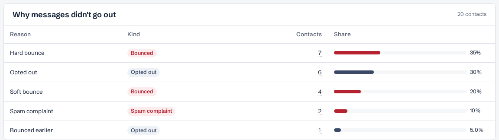

The kinds are **Failed**, **Bounced**, **Spam complaint**, **Opted out** and **Over limit**. Point at a
reason to see its code (for example `hard_bounce`), which developers see in the API and exports.
The WhatsApp campaign *Monsoon preview* shows **Read** instead of **Opened**, and reasons that come
from WhatsApp itself:

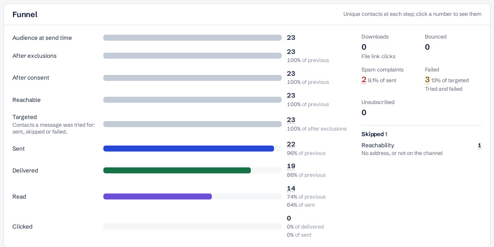

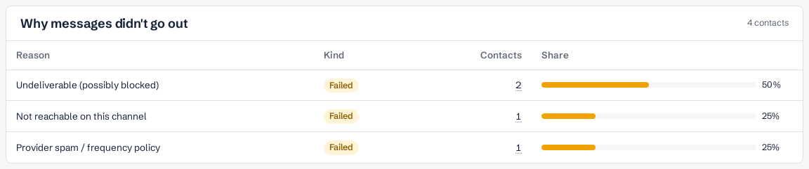

*Undeliverable (possibly blocked)* is WhatsApp's way of saying it won't deliver to that number, often
because the person blocked you, so it counts as a spam complaint (in the funnel, in Campaign
performance and for the bounce rules). *Provider spam / frequency policy* means WhatsApp held the
message back because the person got too many marketing messages; that is the provider's limit, not
the contact's, and isn't counted as a bounce.

Triggered and automation campaigns also have **Why messages didn't go out, by step**, with an
**Open step** button for each step.

## 4. Open the contacts behind a number

Almost every number of contacts in Pulse is a link (the aside says *click a number to see them*).
Click **11** next to **Bounced**:

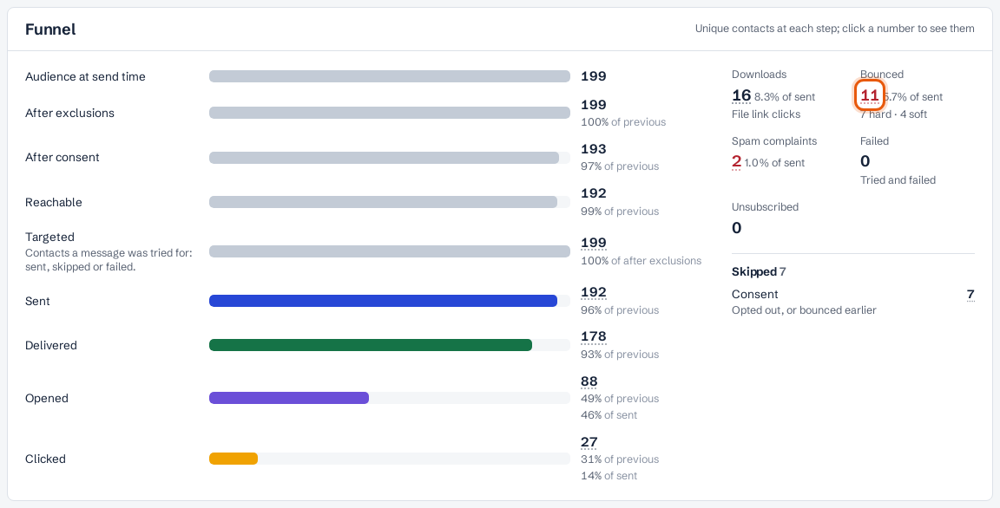

**Contacts** opens with exactly those people: the filters are shown as chips in the search box,
*Campaign "Spring catalogue"* and *Bounced*, and the count matches the number you clicked.

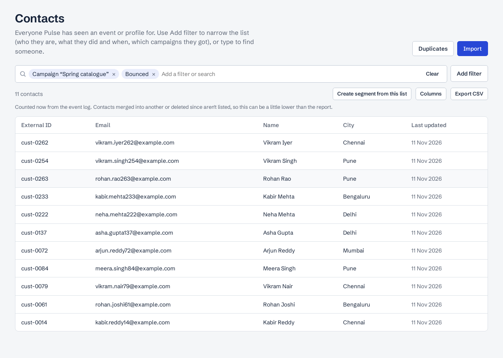

From here you can:

- click a contact to see their profile;
- remove a chip with its **×**, or add more filters, to change the list;
- **Export CSV** to download the list;
- **Create segment from this list**: makes a static segment of these contacts now, for example to
  send them a follow-up or to clean up their addresses. Give it a name and click **Create static
  segment**; the contacts are added within a few seconds.

When the list and the report can differ, a line under the count says why. Here: *Counted now from
the event log. Contacts merged into another or deleted since aren't listed, so this can be a little
lower than the report.* A triggered campaign counts entries, while the list counts people, so
someone who went through it twice is listed once.

If your role can't open a list (for example you may see reports but not contacts), the number shows
without a link, and pointing at it says which access is missing.

Finding the contacts behind any number, in more detail: [tutorial 18](18-contacts-behind-a-number.md).

## 5. One contact's messages

A contact's profile has a **Messages** tab: one row per message, newest first, with when it was
sent, the channel, the campaign, its **Status** (the furthest it got), the **Reason** if it didn't
go out, and whether it was opened or clicked.

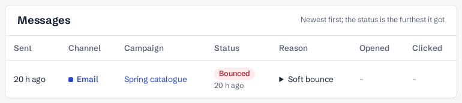

Click the reason to see the provider's own words. Campaign names show only to roles that may view
that type of campaign. The rest of the profile is in [tutorial 2](02-contacts.md).

## 6. Compare every campaign: Campaign performance

**Analytics → Campaign performance** puts every campaign that sent messages in a period side by side.

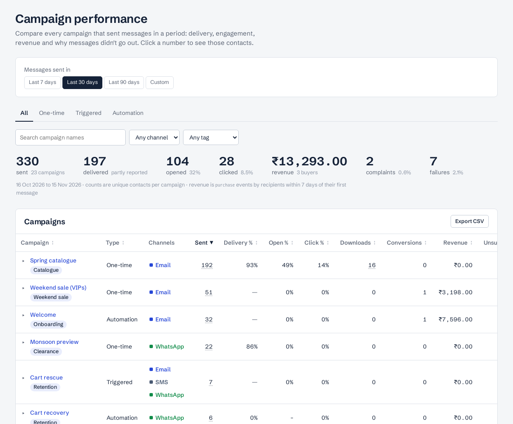

1. Choose **Messages sent in**: **Last 7 days**, **Last 30 days**, **Last 90 days** or **Custom**.
2. Pick a type tab: **All**, **One-time**, **Triggered** or **Automation**. Narrow it further with
   **Search campaign names**, **Any channel** and **Any tag**; **Clear filters** resets them.
3. The figures at the top are totals for the campaigns listed: **sent**, **delivered**, **opened**,
   **clicked**, **revenue** (with the number of buyers), **complaints** and **failures**, with their
   rates. Revenue is your revenue event by recipients within the revenue window of their first
   message (the line under the figures says which).
4. The **Campaigns** table has one row per campaign: **Type**, **Channels**, **Sent**, **Delivery %**,
   **Open %**, **Click %**, **Downloads**, **Conversions**, **Revenue**, **Unsubscribes**,
   **Complaints**, **Bounces** and **Failures**. **Complaints** and **Bounces** (and their rates)
   count every channel: an SMS to an invalid number is a bounce, a WhatsApp message the person
   blocked a complaint. Click a column heading to sort. **—** under
   Delivery % means the provider doesn't report deliveries and the campaign has no delivery reports
   (a campaign sent earlier through a provider that did report them shows its rate). **Export CSV** downloads the table,
   with **Hard bounces** and **Soft bounces** as columns of their own.
5. Click the **▸** next to a campaign to see why its messages didn't go out:

   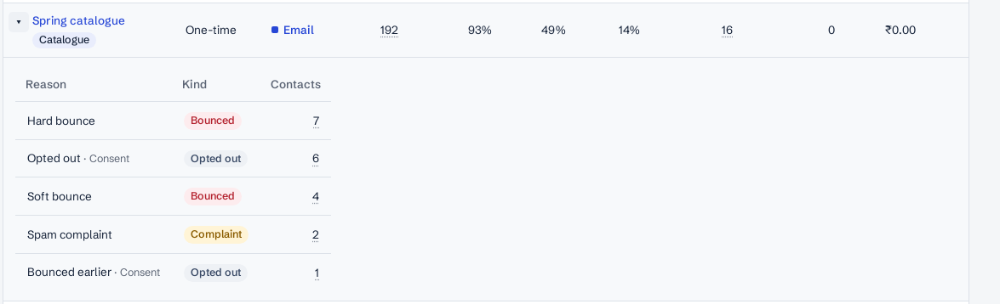

6. At the bottom, **Failures by reason** adds up the reasons across the campaigns above, in three
   groups: **Skipped**, **Bounced or complained** (bounces and complaints on any channel, also those
   the provider reported as failures, such as an invalid number) and **Failed when tried**.

   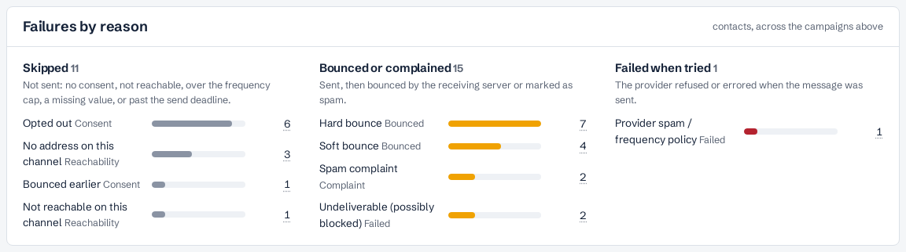

Each campaign's numbers and the reasons are links to their contacts. **The totals at the top aren't
links:** they add up each campaign's contacts, so a person who got two campaigns counts twice, and
no single list of people matches them. Pointing at them says so. Open a campaign's own number
instead.

## 7. Users: who is active

**Analytics → Users** shows how many people use your website and apps each day, week and month.

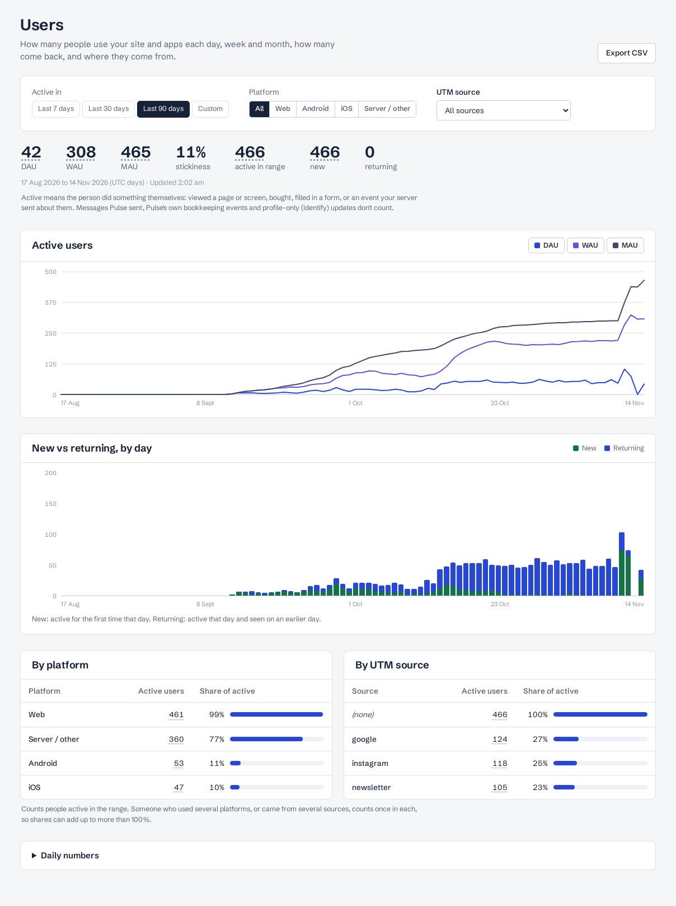

1. Choose **Active in** (the period), and if you like a **Platform** (**All**, **Web**, **Android**,
   **iOS**, **Server / other**) and a **UTM source**.
2. The figures:

   | Figure | Means |
   |---|---|
   | **DAU** | Active on the last day of the range |
   | **WAU** | Active in the 7 days ending on the last day |
   | **MAU** | Active in the 30 days ending on the last day |
   | **stickiness** | Average DAU over the last 30 days ÷ MAU: how often your monthly users come back |
   | **active in range** | Active at least once in the whole range |
   | **new** / **returning** | Active for the first time in the range / active in the range and seen before it |

   *Active* means the person did something themselves: viewed a page or screen, bought, filled in a
   form, or an event your server sent about them. Messages Pulse sent, Pulse's own bookkeeping events
   and profile-only updates don't count. New vs returning isn't split by platform or source.
3. **Active users** draws DAU, WAU and MAU per day (click **DAU**, **WAU** or **MAU** to hide or show a
   line). **New vs returning, by day** stacks the two per day.
4. **By platform** and **By UTM source** split the active users. Someone who used several platforms
   counts in each, so shares can add up to more than 100%.
5. **Daily numbers** opens the table behind the charts; **Export CSV** downloads it.

The figures and the breakdown rows are links to the contacts. Deleted contacts are still counted in
earlier days, so a list can be a little shorter than its number.

## 8. Products: views, carts and purchases

**Analytics → Products** shows which products people look at, add to their cart and buy, and who
leaves them in the cart.

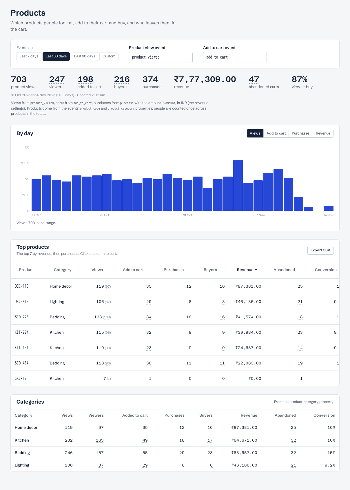

1. Choose **Events in** (the period). Pulse reads `product_viewed` as a view and `add_to_cart` as a
   cart; if your site sends other names, change **Product view event** and **Add to cart event**
   (press Enter to apply). Purchases are your revenue event (**Analytics → Revenue → Revenue
   settings**, [tutorial 10](10-analytics.md#revenue-settings)). Products come from the events'
   `product_code` and `product_category` properties.
2. The figures: **product views**, **viewers**, **added to cart**, **buyers**, **purchases**,
   **revenue**, **abandoned carts** (added to the cart but didn't buy it in the range) and **view →
   buy** (buyers ÷ viewers).
3. **By day** charts **Views**, **Add to cart**, **Purchases** or **Revenue** per day.
4. **Top products** lists the top products by revenue; click a column to sort, **Export CSV** to
   download. **Segment of buyers** on a row makes a segment of the people who bought that product
   in this period, ready for a cross-sell campaign.
5. **Categories** gives the same numbers per `product_category`.

Viewers, carts, buyers and abandoned carts open their contacts, for the whole range or one product.

## 9. Live events: check your tracking

**Analytics → Live events** shows events as they arrive from your website, apps and integrations,
newest first. Use it to check that a new tracking call works.

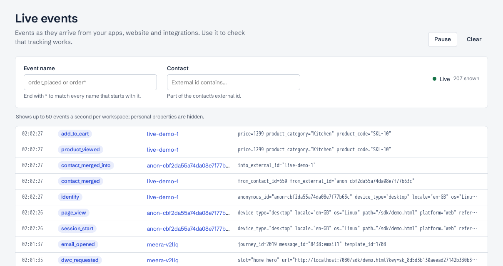

- It updates every two seconds while the page is open (**Live**). **Pause** stops it, **Resume**
  continues, **Clear** empties the list. It pauses while the browser tab is hidden.
- **Event name** filters by name; end with `*` to match every name that starts with it, e.g.
  `order*`. **Contact** filters by part of the contact's external ID.
- Click an event's properties to see them in full; click the contact to open their profile.
- It shows up to 50 events a second per workspace, and the last 1,000 or so (change the size under
  **Settings → Automation & limits**). Properties that your event schemas mark as personal are
  hidden.

## 10. Numbers that don't open a list

A few numbers aren't links, because no list of people matches them exactly:

- the totals at the top of **Campaign performance** (each person counts once per campaign);
- on a triggered or automation campaign's canvas, **Entered** and the Yes / No and split path counts
  (they count passes, not people);
- a one-time campaign's **Audience at send time** (a snapshot taken when it started);
- the live preview of a segment you haven't saved yet (save it, then its size is a link);
- **Funnels** and **Cohorts** reports (worked out for the range you choose);
- downloads of an asset, landing page visitors, an in-app message's "seen by", import rows, and
  messages per channel (these count messages or visits, not people).

## What you have now

- How to read a campaign's funnel and why its messages didn't go out
- The contacts behind a number, as a list you can export or turn into a segment
- Every campaign compared, and the reasons across them
- Active users, product performance and live events

**Next:** [Tutorial 16, Connecting any provider](16-connecting-any-provider.md): send through a
service Pulse has no preset for.
