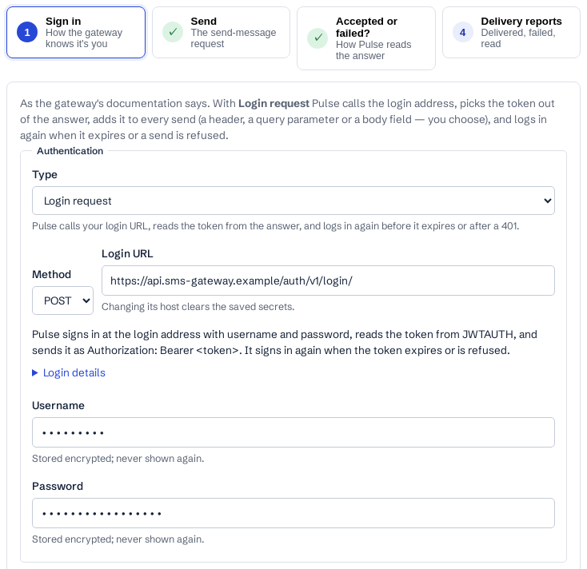
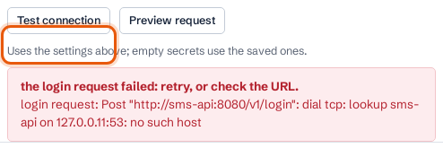
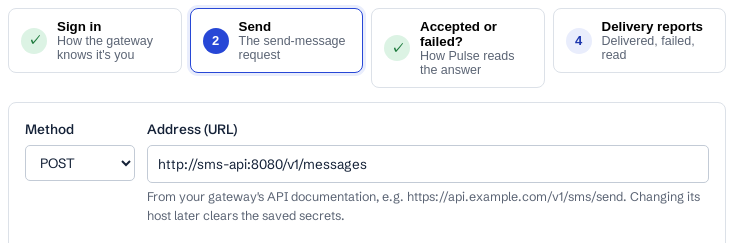
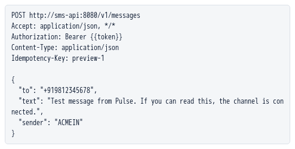

# Tutorial 16: Connecting any provider

In about 25 minutes you will connect an SMS company Pulse has no ready-made connection for, using
only its API documentation. The form walks you through it in four steps: **Sign in** (how the
gateway knows it's you), **Send** (the send-message request), **Accepted or failed?** (how Pulse reads
the answer) and **Delivery reports** (delivered, failed, read). Each step has a **Try it** box that
shows the real request or answer, so you can check your work before you save. If the documentation
has ready-made `curl` or Postman examples, paste them and Pulse fills in most of the steps for you.

The same steps work for email, WhatsApp, RCS and push gateways: every channel offers the **Custom
HTTP gateway**.

**You need:** the **Admin** role (adding providers needs it), and the provider's API documentation.
[Tutorial 4](04-channels.md) shows the Channels page and the ready-made providers; use one of those
when it exists, it needs less setting up.

In the pictures the provider is a pretend SMS company, "SMSCo", running on a local test address
(`http://sms-api:8080`). Your provider's addresses start with `https://`.

---

## 1. What to find in the provider's documentation

Before you start, look up these answers. A developer at your company or the provider's support team
can help with the words.

| You need | SMSCo's answer |
|---|---|
| How you sign in | A login request: `POST /v1/login` with a username and password returns a token, valid for an hour |
| Where the token goes | A header: `Authorization: Bearer <token>` |
| The address that sends a message, and its method | `POST https://api.smsco.example/v1/messages` |
| What the request's body looks like | JSON: `{"to": "+91…", "text": "…", "sender": "ACMEIN"}` |
| What a successful answer looks like | `{"status": "queued", "message_id": "a1b2c3"}` |
| What a refused message looks like | `{"status": "rejected", "error": "invalid number"}`, still with status 200 |
| How you learn what happened next | Delivery reports posted to your address: `{"message_id": "a1b2c3", "state": "DELIVRD"}`, with states `DELIVRD`, `UNDELIV`, `FAILED`. Some gateways have a status address you ask instead |

## 2. Add the gateway

1. Go to **Settings → Channels** and click **Add provider** in the **SMS** panel.
2. **Provider**: **Custom HTTP gateway**. Next to it, **Provider name**: `SMSCo`.
3. Click the card **Connect to a gateway's existing API**.

   

The other card, **Your developers build an endpoint for Pulse**, is for a gateway your own developers
write for Pulse: Pulse posts each message as JSON in its own format to one **Endpoint URL**, signed
with a **Signing secret**, and you only enter those two (the developer docs describe the format).
Everything below is about **Connect to a gateway's existing API**.

Under the cards comes a box for pasting the gateway's examples (next part), then the bar of four
steps: **1 Sign in**, **2 Send**, **3 Accepted or failed?** and **4 Delivery reports**. Click a step in
the bar to jump to it, or use **← Back** and **Next: … →** at the bottom (**Step 1 of 4**). A step
that has what it needs gets a ✓ in the bar. The sections after this one follow the steps.

### The quick way: paste the gateway's examples

Many gateways' documentation (or their Postman collection) shows ready-made examples: a `curl …` or
`postman request …` command that sends a message, and often one that logs in. Paste them into the box
at the top, **Have examples from the gateway's docs or Postman?**, and Pulse fills in the steps for
you:

| Box | What to paste |
|---|---|
| **Send-message request** | The command that sends one message |
| **Login request (optional)** | The command that logs in, if the gateway first gives you a token from a login address |
| **Login answer (optional)** | An example of what that login returns, so Pulse knows where the token is |

Click **Fill in the form**. Pulse reads the method, address, headers and body of each command:

- A login example becomes a **Login request** sign-in (step 1). The username and password in it go into
  the **Username** and **Password** fields, stored encrypted, and the login body gets
  `{{secrets.username}}` and `{{secrets.password}}` in their place. The token is read from where the
  example answer has it, and sent as `Authorization: Bearer <token>`.
- Without a login, a fixed `Bearer` token, basic auth or an API-key header in the send example becomes
  the sign-in, and its value goes into the secret field.
- In the body, the phone number (or address) becomes `{{message.to}}` and a message text
  `{{message.text}}`.

A green note says **Filled in** and lists anything left for you to do. Then go through the four steps
and use each step's **Try it**.

**Example: an RCS gateway.** Say its documentation logs in with
`POST https://api.sms-gateway.example/auth/v1/login/` and a username and password, answers
`{"JWTAUTH": "eyJ…", "user_data": {…}}`, and then sends an approved RCS template with
`POST https://api.sms-gateway.example/rcs/v1/message` and the header `Authorization: Bearer <token>`.
Add an **RCS** provider, choose **Custom HTTP gateway** and **Connect to a gateway's existing API**,
and paste the three examples:


Step 1 now reads *Pulse signs in at the login address with username and password, reads the token from
JWTAUTH, and sends it as Authorization: Bearer <token>*, with the details folded under **Login
details**:



In step 2 the body keeps the gateway's template message, with `"phone_no": "{{message.to}}"`. As the note
says, replace the template's sample values (`"name": "Asha"`) with placeholders such as
`{{contact.first_name}}`, then check the rest of the steps as described below.

## 3. Step 1: Sign in

**Type** sets how Pulse proves who it is. The line under it explains the type you pick:

| Type | Use it when the documentation says |
|---|---|
| **None** | Nothing: Pulse adds no login details to the request |
| **Basic** | "HTTP basic auth": a **User** and **Password** |
| **Bearer token** | A fixed token in the `Authorization` header: **Token** |
| **API key** | A key in a header or in the address: **Goes in** (**Header** or **Query parameter**), its **Name** (e.g. `X-API-Key`), and the **API key** |
| **OAuth2 client credentials** | "OAuth2", "client credentials": the **Token URL**, **Client ID**, **Client secret goes** (**In the form body** or **As basic auth**), **Scope (optional)**, **Audience (optional)** and the **Client secret**. Pulse gets a token and renews it before it expires |
| **Login request** | You first call a login address to get a token, as with SMSCo |

Pulse adds the sign-in to every request. If you save without a password, key or token the type needs,
Pulse tells you which, e.g. *enter the API key*.

For SMSCo, choose **Login request**. Under the **Login URL** Pulse sums up in one sentence what the
sign-in does (*Pulse signs in at the login address with username and password, reads the token from
data.access_token, and sends it as Authorization: Bearer <token>…*); the rest is folded under **Login
details**. Fill in:


1. **Method** and **Login URL**: `POST` and `https://api.smsco.example/v1/login`.
2. **Username** and **Password**, at the end of the step: SMSCo's username and password, stored
   encrypted and never shown again.
3. Click **Login details** to open the rest:
   - **Headers** if the login needs any, and the **Content type**.
   - **Body**: the login request's body. Write each password or key as `{{secrets.name}}`: Pulse
     starts you with
     `{"username": "{{secrets.username}}", "password": "{{secrets.password}}"}`. Every secret you
     name gets its own field at the end of the step (`{{secrets.api_key}}` becomes **Api key**),
     stored encrypted. Don't type passwords into the body itself.
   - **Read the token from**: **JSON path** (`data.access_token` here), **A response header** (its
     name; a leading `Bearer ` is removed), or **A regular expression** (the first group in brackets).
   - **Expiry**: when the token runs out. **From a JSON path** (`data.expires_in`: seconds left, a
     Unix time or a date), **Fixed lifetime** in seconds, or **Unknown (1 hour, renewed on 401)**.
   - **Token goes in**: **A header** (the default: `Authorization: Bearer <token>`), **A query
     parameter** or **A body field**, with its **Name** and a **Value template** in which `{{token}}`
     is the token. Leave them empty for `Authorization: Bearer {{token}}`.

What Pulse does with it: it logs in before the first message, keeps the token (encrypted, shared by
all Pulse servers) and logs in again shortly before it expires. If the provider answers a message
with 401 (not signed in), Pulse logs in again and retries once. When the provider refuses the login
(a wrong password), messages fail with the reason **Provider credentials refused** until you fix the
secrets and save.

### Try it: Test connection

The **⚡ Try it** box at the bottom of the step has **Test connection**. Pulse runs the login now,
with the settings and secrets you just typed (empty secret fields use the saved ones), and shows the
result:



- **Logged in. Token …, expires …**: the login works. Only the token's first and last four
  characters are shown.
- **Nothing to log in to: the credentials are sent with each request.**: for **Basic**, **Bearer
  token** and **API key**, which have no login step.
- A red box with the reason and the provider's answer: a wrong address, a wrong password, or a token
  that isn't where **Read the token from** says. Passwords never appear in it.

Test connection is limited to 20 a minute per workspace. (For an email provider such as SMTP, Gmail or
Google Workspace, tutorial 4, the same button connects to the mail server and logs in: **Logged in to
smtp.example.com:587.**)

## 4. Step 2: Send

This step is the send-message request: where it goes and what it carries.



1. **Method**: `POST` (or `PUT`, `PATCH`, `GET`, as the documentation says).
2. **Address (URL)**: the address that sends a message, e.g.
   `https://api.smsco.example/v1/messages`. Under it Pulse warns that changing its host later clears
   the saved secrets (section 8).

   The address's host (the `https://api.smsco.example` part) is fixed: contact data can never change
   where a message goes, only the path and query after it.
3. **Format**: **JSON (application/json)** for a JSON body; **Form fields
   (application/x-www-form-urlencoded)** for a form; also **Plain text** and **XML**.
4. **Body**: copy the example from the provider's documentation and put **placeholders** where each
   message's details go. Pulse starts you with an example; for SMSCo:

   ```json
   {
     "to": "{{message.to}}",
     "text": "{{message.text}}",
     "sender": "ACMEIN",
     "client_ref": "{{message.id}}"
   }
   ```

   You don't have to type the placeholders: click in the body where one goes, then click a button in
   the **Insert:** row (**Phone or address**, **Message text**, **First name**, **Sender ID**, **DLT
   template ID**, **Pulse message ID**; an email gateway offers **Email address**, **Subject**,
   **HTML** and **Plain text** instead).


5. **How placeholders work** (click to open) lists them. The common ones:

   | Placeholder | Is |
   |---|---|
   | `{{message.to}}` | The phone number (email address, device token) the message goes to |
   | `{{message.text}}` | An SMS's text; `{{message.subject}}` and `{{message.html}}` for email; `{{message.title}}` and `{{message.body}}` for push |
   | `{{message.sender_id}}`, `{{message.dlt_template_id}}`, `{{message.dlt_entity_id}}` | The SMS template's sender ID and DLT IDs (tutorial 5) |
   | `{{message.template_name}}`, `{{message.params}}` | A WhatsApp template's name and its variables |
   | `{{message.id}}` | Pulse's own ID for this message |
   | `{{message.ref}}` | A signed reference that holds the campaign and template the message came from |
   | `{{contact.first_name}}`, `{{event.x}}`, `{{campaign.name}}` | Contact fields, the event that started the campaign, the campaign, as in templates ([tutorial 13](13-personalising-messages.md)). Add a fallback with `{{contact.first_name \| default:'there'}}` |

   You don't need to worry about quotes or line breaks in the message: in a JSON body Pulse escapes
   every value for JSON (write `"text": "{{message.text}}"` with the quotes), and in a form or a
   URL it encodes each value. For a list, such as `{{message.params}}`, write
   `{{message.params | json}}` without quotes.
6. **Extra headers (optional)** (click to open): **Add header** for each header the documentation
   asks for. Not the login token: step 1 adds it.

**Tip: put Pulse's message ID where the gateway echoes it back.** Most gateways have a field they send
back unchanged in their delivery reports, often called *client reference*, *custom data* or *tags*.
Put `{{message.id}}` (or `{{message.ref}}`) there, as `client_ref` above. Then delivery reports can
name the exact message, campaign and template even when the gateway's own message ID is missing
(step 4, **Reports find their message by**).

### Try it: Preview request

The step's **⚡ Try it** box has **Preview request**: the exact request Pulse would send for a sample
message, with the sign-in added and secrets hidden. Nothing is sent.



Compare it with an example in the provider's documentation. Secrets show as `••••`, the whole
`Authorization` value is hidden for basic and API-key sign-ins, and the login token shows as
`{{token}}`.

## 5. Step 3: Accepted or failed?

This step tells Pulse how to read the gateway's answer to each send.

**Accepted.** The step starts with Pulse's rule: *Sent when the gateway answers with status 200–299*,
the usual "OK" answers. Most gateways need nothing more. SMSCo answers `{"status": "queued",
"message_id": "a1b2c3"}`, so tell Pulse to check that word too, and where the message ID is:


| Field | SMSCo |
|---|---|
| **Change this** (click to open) → **Status from** … **to** | 200 to 299 (the default): any other status is a failure |
| **And this field in the answer (optional)** and **Equals (optional)** | `status` = `queued`: the answer must also say this. With **Equals** empty, the value only has to be there and not be `false` |
| **The gateway's message ID is at (optional)** | `message_id`: the provider's ID, which its delivery reports name |

A field in the answer is named with dots: `data.id`, or `items[0].id` for the first item of a list.
The sentence at the top changes as you fill these in, e.g. *Sent when the gateway answers with status
200–299 and `status` is `queued`.*

**Failed.** Some gateways answer 200 even when they refuse a message. Name the field and the words that
mean "refused":

| Field | SMSCo |
|---|---|
| **Failed when this field** | `status` (or `error.code`) |
| **Is one of** | `rejected, failed`: comma-separated, any case |
| **It means the person can't get messages here** | Tick it when the refusal means the number can't be reached (not on WhatsApp, an invalid number). On a WhatsApp or RCS provider the box adds *(Pulse sends the SMS fallback instead)*: the message then goes by SMS, if the campaign has a fallback |

What Pulse does with each answer:

- **Accepted** (in the status range, the field matches, and it isn't a "failed" word): the message
  counts as sent.
- **A "failed" word**: failed, with the gateway's answer as the reason. With **It means the person
  can't get messages here** ticked, a WhatsApp or RCS message goes by SMS instead.
- **404 or 410**: the recipient can't be reached; a WhatsApp or RCS message with an SMS fallback
  goes by SMS.
- **429 or a 5xx** (the provider is busy or down) or no answer: tried again later, as set on
  **Settings → Automation & limits** ([tutorial 11](11-admin-and-privacy.md#5-automation--limits)).
- **Anything else**, or a 2xx whose answer doesn't match: failed, with the provider's answer as the
  reason.

### Try it: Check this answer

In the **⚡ Try it** box, enter a **Status** (200) and paste an **Answer body** from the gateway's
documentation, then click **Check this answer**. Nothing is sent. Pulse says how it reads it:

- **✅ Accepted.** with the **Gateway's message id** it found (or *Reports are matched by Pulse's
  message id.* when step 4 says so). A warning under it points out, for example, that no message ID
  was found.
- **❌ Refused**, with the reason. When the refusal means the person can't get it there, it adds
  *the person can't get it here, so the SMS fallback would run*.

Paste a success answer and a refusal from the documentation, one after the other, to check both.

## 6. Step 4: Delivery reports

After a gateway accepts a message, it usually learns later whether the message was delivered. Step 4
tells Pulse how to hear about it. Choose one of three cards:

| Card | Use it when |
|---|---|
| **No reports** | The gateway has no delivery reports. Pulse counts a message as sent when the gateway accepts it |
| **They call us** | The gateway posts each report to a Pulse address (a webhook or callback URL) |
| **We ask them** | The gateway has a status API: Pulse asks about each message until it's final |

SMSCo posts reports, so choose **They call us**.


**Reports find their message by**:

- **The gateway's message id (from the send answer, step 3)**: the usual choice.
- **Pulse's message id (`{{message.id}}` sent in a field the gateway echoes back)**: when you put
  `{{message.id}}` in the send body (step 2) and the gateway's reports carry it back.

### They call us

Under **Where the gateway posts**, Pulse shows the address to give the gateway, e.g.
`https://pulse.example.com/v1/webhooks/providers/42?token=<receipt token>`. For a new provider it says
*this provider's report address (shown after you save)*; after saving, the provider's row on the
Channels page shows it too, as **Delivery reports**.

| Field | SMSCo |
|---|---|
| **Reports prove they're genuine with** | How Pulse knows a report really comes from the provider: **The token in the address (?token=…)**, **The token in a header**, or **An HMAC-SHA256 of the body in a header** (the provider signs each report with the token) |
| **Parameter name** / **Header name** | Where the token is, e.g. `token` |
| **Receipt token** | Make up a long random string, enter it here, and give it to the provider. It is stored encrypted. **Reports without it are refused** |

### We ask them

When the gateway has a "get message status" address instead, choose **We ask them** and fill in the
**Status request**:

| Field | Example |
|---|---|
| **Method** | `GET` or `POST` (a **Body** box appears for POST, e.g. `{"message_id": "{{message.provider_id}}"}`) |
| **Address** | `https://api.smsco.example/v1/status?id={{message.provider_id}}`. Put `{{message.provider_id}}` (the gateway's ID) or `{{message.id}}` (Pulse's) where the message goes. It uses the same sign-in as sends (step 1) |
| **Ask every (minutes)** | How often Pulse asks about each message that isn't final yet: 1 to 1,440 (10 by default) |
| **For up to (hours)** | When Pulse stops asking: 1 to 72 (24 by default) |

Pulse asks about one message per request, and only about messages that aren't final yet: once a
report says delivered, failed, bounced or read, it stops.

### Reading a report

Both ways, tell Pulse where things are in a report (or a status answer):

| Field | SMSCo |
|---|---|
| **Message id at** | `message_id` (e.g. `msgid` or `data.id`) |
| **Status at** | `state` (e.g. `status` or `data.state`) |
| **List of reports at (optional)** | Empty: one report per post. If one post carries several, the path to the list |
| **Failure reason at (optional)** | `error`: shown as the reason in reports |

Then **The gateway's words**: a table of *When the report says* → *Pulse counts it as*. Pulse's
statuses are **Delivered**, **Read**, **Failed**, **Failed: can't get it here (send the SMS
fallback)**, **Bounced** and **Not final yet (ask again)**. Words not listed are ignored; "Not final
yet" words make Pulse ask again (status requests) or wait for the next report.

The quick way to fill the table: paste a sample report into the **Try it** box below, then click
**✨ Fill in common words**. Pulse finds the words in your sample and recognises the usual ones
(`DELIVRD`, `UNDELIV`, `REJECTD`, `SUBMITTED`, `read`, `failed`…). Check each row, change the ones it
got wrong, **Remove** the ones you don't need, or add your own with the box under the table and **Add
word**. For SMSCo:

| When the report says | Pulse counts it as |
|---|---|
| `DELIVRD` | Delivered |
| `UNDELIV` | Failed: can't get it here (send the SMS fallback) |
| `FAILED` | Failed |

### Try it: Check this report

Paste **A report** from the gateway's documentation (for **We ask them**: **A status answer**) and
click **Check this report**. Pulse lists what it understands: each message ID with its status (✅
delivered, 👀 read, ❌ failed, ↩️ bounced, ⏳ not final yet, and *(SMS fallback)* where it applies) and
the reason. Nothing is recorded. *Nothing understood: check the paths and the words above.* means a
path or a word doesn't match.

With **We ask them** you can also ask about a real message: enter its ID (the gateway's, or Pulse's,
as chosen above) and click **Ask the gateway now**. Pulse runs the status request with your sign-in and
shows the answer the same way.

The last step's footer says *Then Save provider, and Send test for a real message.*

## 7. Sending limits

The form ends with **Sending limits**, as every provider form does: **Messages per second**,
**Messages per day** and **A day starts at midnight in**. Enter what your SMSCo account allows, e.g.
`50` a second, so Pulse never sends faster. Empty means no limit.

The note under the fields shows the server's own speed for SMS (*This Pulse server also sends at most
100 SMS messages a second per workspace (PULSE_SMS_RATE)…*): whichever is slower wins. [Tutorial 4,
step 9](04-channels.md#9-sending-limits-and-daily-quotas) explains both.

## 8. Save, test, and change it later

1. Leave **Use for all SMS messages** ticked to make it the channel's default (or untick it to save
   it as a standby, which campaigns can still pick under **Send through**; tutorial 4, step 7), and
   click **Save provider**. New sends use it within 30 seconds.
2. On the provider's row, click **Send test** and enter a test number (tutorial 4, step 7). You see
   **Accepted by the provider** with the provider's message ID, or **Not sent:** with the reason.
3. Send a template to yourself with **Send a test** in the template editor (tutorial 5): that one is
   personalised and goes the normal way.
4. For **They call us**, give the provider the **Delivery reports** address with your receipt token
   (section 6).

When you edit the provider later, its secrets stay hidden: leave a secret field empty to keep its
saved value. Two rules keep saved passwords from being sent somewhere else:

- **Changing a host** (the address part of the URL, the login URL or the token URL): Pulse shows
  *An endpoint's host changed: the saved secrets will be cleared, so enter every secret again.*
- **Changing anything else that decides where or how secrets are sent** (paths, the body, the
  sign-in or request settings, the delivery report settings, user names, the card you chose):
  saving says *the authentication or request settings changed: enter every secret again to save
  them*. Fill in every secret field, then save again.

Harmless settings (sender names and numbers, pool sizes, DLT IDs) and the sending limits can change
without the secrets. **Test connection** with saved secrets works only for the saved settings: after
a change like these, enter the secrets to test.

**Limits to know.** Status requests ask about one message at a time (gateways' batch status APIs
aren't used). The ready-made SMS connections (MSG91, Gupshup) and Google RCS don't yet pass Pulse's
reference to the provider; Meta WhatsApp and Twilio do.

## What you have now

- An SMS provider connected with its own API, without any code
- Pulse logging in and renewing the token by itself
- Refusals read correctly, even when the gateway answers 200
- Delivery reports from the provider, posted to Pulse or fetched by Pulse, counted in your campaign
  reports ([tutorial 15](15-delivery-and-dashboards.md))

**Next:** [Tutorial 17, Interactive AMP emails](17-interactive-amp-emails.md): polls, forms and
carousels inside the email.
