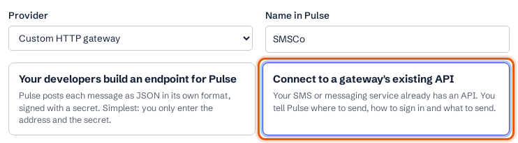
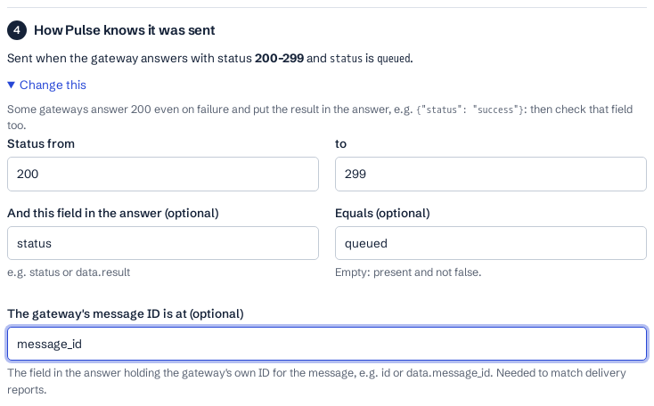

# Tutorial 16: Connecting any provider

In about 25 minutes you will connect an SMS company Pulse has no ready-made connection for, using
only its API documentation. The form walks you through it in six numbered steps: where Pulse sends
messages, how it signs in, what it sends, how it knows a message was sent, how the company's delivery
reports come back, and a check of the login and the exact request before you save.

The same steps work for email, WhatsApp, RCS and push gateways: every channel offers the **Custom
HTTP gateway**.

**You need:** the **Admin** role (adding providers needs it), and the provider's API documentation.
[Tutorial 4](04-channels.md) shows the Channels page and the ready-made providers; use one of those
when it exists, it needs less setting up.

In the pictures the provider is a pretend SMS company, "SMSCo", running on a local test address
(`http://sms-api:8080`). Your provider's addresses start with `https://`.

---

## 1. What to find in the provider's documentation

Before you start, look up these answers. A developer at your company or the provider's support team
can help with the words.

| You need | SMSCo's answer |
|---|---|
| The address that sends a message, and its method | `POST https://api.smsco.example/v1/messages` |
| What the request's body looks like | JSON: `{"to": "+91…", "text": "…", "sender": "ACMEIN"}` |
| How you sign in | A login request: `POST /v1/login` with a username and password returns a token, valid for an hour |
| Where the token goes | A header: `Authorization: Bearer <token>` |
| What a successful answer looks like | `{"status": "queued", "message_id": "a1b2c3"}` |
| Whether it sends delivery reports, and what they look like | Yes: `{"message_id": "a1b2c3", "state": "DELIVRD"}`, with states `DELIVRD`, `UNDELIV`, `FAILED` |

## 2. Add the gateway

1. Go to **Settings → Channels** and click **Add provider** in the **SMS** panel.
2. **Provider**: **Custom HTTP gateway**. Next to it, **Name in Pulse**: `SMSCo`.
3. Click the card **Connect to a gateway's existing API**.

   

The other card, **Your developers build an endpoint for Pulse**, is for a gateway your own developers
write for Pulse: Pulse posts each message as JSON in its own format to one **Endpoint URL**, signed
with a **Signing secret**, and you only enter those two (the developer docs describe the format).
Everything below is about **Connect to a gateway's existing API**.

Under the cards the form shows six numbered steps. The sections below follow them.

## 3. Where to send (step 1)


1. **Method**: `POST` (or `PUT`, `PATCH`, `GET`, as the documentation says).
2. **Address (URL)**: the address that sends a message, e.g.
   `https://api.smsco.example/v1/messages`. Under it Pulse warns that changing its host later clears
   the saved secrets (section 10).

The address's host (the `https://api.smsco.example` part) is fixed: contact data can never change
where a message goes, only the path and query after it.

## 4. How Pulse signs in (step 2)

**Type** sets how Pulse proves who it is. The line under it explains the type you pick:

| Type | Use it when the documentation says |
|---|---|
| **None** | Nothing: Pulse adds no login details to the request |
| **Basic** | "HTTP basic auth": a **User** and **Password** |
| **Bearer token** | A fixed token in the `Authorization` header: **Token** |
| **API key** | A key in a header or in the address: **Goes in** (**Header** or **Query parameter**), its **Name** (e.g. `X-API-Key`), and the **API key** |
| **OAuth2 client credentials** | "OAuth2", "client credentials": the **Token URL**, **Client ID**, **Client secret goes** (**In the form body** or **As basic auth**), **Scope (optional)**, **Audience (optional)** and the **Client secret**. Pulse gets a token and renews it before it expires |
| **Login request** | You first call a login address to get a token, as with SMSCo |

Pulse adds the sign-in to every request. If you save without a password, key or token the type needs,
Pulse tells you which, e.g. *enter the API key*.

For SMSCo, choose **Login request** and fill in:


1. **Method** and **Login URL**: `POST` and `https://api.smsco.example/v1/login`.
2. **Headers** if the login needs any, and the **Content type**.
3. **Body**: the login request's body. Write each password or key as `{{secrets.name}}`: Pulse
   starts you with
   `{"username": "{{secrets.username}}", "password": "{{secrets.password}}"}`. Every secret you name
   gets its own field at the end of the step (`Secret "password"`, `Secret "username"`), stored
   encrypted and never shown again. Don't type passwords into the body itself.
4. **Read the token from**: **JSON path** (`data.access_token` here), **A response header** (its
   name; a leading `Bearer ` is removed), or **A regular expression** (the first group in brackets).
5. **Expiry**: when the token runs out. **From a JSON path** (`data.expires_in`: seconds left, a Unix
   time or a date), **Fixed lifetime** in seconds, or **Unknown (1 hour, renewed on 401)**.
6. **Token goes in**: **A header** (the default: `Authorization: Bearer <token>`), **A query
   parameter** or **A body field**, with its **Name** and a **Value template** in which `{{token}}`
   is the token. Leave them empty for `Authorization: Bearer {{token}}`.
7. Fill in the secrets: `Secret "username"` and `Secret "password"`.

What Pulse does with it: it logs in before the first message, keeps the token (encrypted, shared by
all Pulse servers) and logs in again shortly before it expires. If the provider answers a message
with 401 (not signed in), Pulse logs in again and retries once. When the provider refuses the login
(a wrong password), messages fail with the reason **Provider credentials refused** until you fix the
secrets and save.

## 5. What to send (step 3)


1. **Format**: **JSON (application/json)** for a JSON body; **Form fields
   (application/x-www-form-urlencoded)** for a form; also **Plain text** and **XML**.
2. **Body**: copy the example from the provider's documentation and put **placeholders** where each
   message's details go. Pulse starts you with an example; for SMSCo:

   ```json
   {
     "to": "{{message.to}}",
     "text": "{{message.text}}",
     "sender": "ACMEIN"
   }
   ```

   You don't have to type the placeholders: click in the body where one goes, then click a button in
   the **Insert:** row (**Phone or address**, **Message text**, **First name**, **Sender ID**, **DLT
   template ID**, **Pulse message ID**; an email gateway offers **Email address**, **Subject**,
   **HTML** and **Plain text** instead).
3. **How placeholders work** (click to open) lists them. The common ones:

   | Placeholder | Is |
   |---|---|
   | `{{message.to}}` | The phone number (email address, device token) the message goes to |
   | `{{message.text}}` | An SMS's text; `{{message.subject}}` and `{{message.html}}` for email; `{{message.title}}` and `{{message.body}}` for push |
   | `{{message.sender_id}}`, `{{message.dlt_template_id}}`, `{{message.dlt_entity_id}}` | The SMS template's sender ID and DLT IDs (tutorial 5) |
   | `{{message.template_name}}`, `{{message.params}}` | A WhatsApp template's name and its variables |
   | `{{message.id}}`, `{{message.ref}}` | Pulse's own message ID and reference |
   | `{{contact.first_name}}`, `{{event.x}}`, `{{campaign.name}}` | Contact fields, the event that started the campaign, the campaign, as in templates ([tutorial 13](13-personalising-messages.md)). Add a fallback with `{{contact.first_name \| default:'there'}}` |

   You don't need to worry about quotes or line breaks in the message: in a JSON body Pulse escapes
   every value for JSON (write `"text": "{{message.text}}"` with the quotes), and in a form or a
   URL it encodes each value. For a list, such as `{{message.params}}`, write
   `{{message.params | json}}` without quotes.
4. **Extra headers (optional)** (click to open): **Add header** for each header the documentation
   asks for. Not the login token: step 2 adds it.

## 6. How Pulse knows it was sent (step 4)

The step starts with Pulse's rule: *Sent when the gateway answers with status 200–299*, the usual
"OK" answers. Most gateways need nothing more. SMSCo answers `{"status": "queued", "message_id":
"a1b2c3"}`, so tell Pulse to check that word too, and where the message ID is:



| Field | SMSCo |
|---|---|
| **Change this** (click to open) → **Status from** … **to** | 200 to 299 (the default): any other status is a failure |
| **And this field in the answer (optional)** and **Equals (optional)** | `status` = `queued`: the answer must also say this. With **Equals** empty, the value only has to be there and not be `false`. Use it for gateways that answer 200 even when they fail |
| **The gateway's message ID is at (optional)** | `message_id`: the provider's ID, which its delivery reports name |

A field in the answer is named with dots: `data.id`, or `items[0].id` for the first item of a list.
The sentence at the top of the step changes as you fill these in, e.g. *Sent when the gateway answers
with status 200–299 and `status` is `queued`.*

What Pulse does with each answer:

- **Accepted** (in the status range, and the field matches): the message counts as sent.
- **404 or 410**: the recipient can't be reached; a WhatsApp or RCS message with an SMS fallback
  goes by SMS.
- **429 or a 5xx** (the provider is busy or down) or no answer: tried again later, as set on
  **Settings → Automation & limits** ([tutorial 11](11-admin-and-privacy.md#5-automation--limits)).
- **Anything else**, or a 2xx whose answer doesn't match: failed, with the provider's answer as the
  reason.

## 7. Delivery reports (step 5, optional)

If the provider can post delivery reports to a web address, tick **The gateway sends delivery
reports** and describe them:


| Field | SMSCo |
|---|---|
| **Message ID at** | `message_id` |
| **Status at** | `state` |
| **Status values** | One per line, *the gateway's word = Pulse status*: `DELIVRD = delivered`, `UNDELIV = undeliverable`, `FAILED = failed`. Pulse's statuses are **delivered**, **read**, **failed**, **undeliverable** (failed, and a WhatsApp or RCS message goes by SMS instead) and **bounced**. Other words are ignored |
| **Reports prove they're genuine with** | How Pulse knows a report really comes from the provider: **The token in the address (?token=…)**, **The token in a header**, or **An HMAC-SHA256 of the body in a header** (the provider signs each report with the token) |
| **Parameter name** / **Header name** | Where the token is, e.g. `token` |
| **More fields (optional)** (click to open) → **List of reports at** | Empty: one report per post. If one post carries several, the path to the list |
| **Failure reason at**, **Error code at** | `error`: shown as the reason in reports |

The token is the **Receipt token** at the end of the step. Make up a long random string, enter it
there, and give it to the provider. **Without a receipt token every report is refused.**

After you save, the provider's row on the Channels page shows its **Delivery reports** address (when
you edit the provider, the step shows it too). Give the provider that address; for a token in the
address, add it to the end: `https://pulse.example.com/v1/webhooks/providers/42?token=<your receipt
token>`.

## 8. Check it (step 6)

### Test connection

Click **Test connection**. Pulse runs the login now, with the settings and secrets you just typed
(empty secret fields use the saved ones), and shows the result:


- **Logged in. Token …, expires …**: the login works. Only the token's first and last four
  characters are shown.
- **Nothing to log in to: the credentials are sent with each request.**: for **Basic**, **Bearer
  token** and **API key**, which have no login step.
- **Logged in to smtp.example.com:587.**: for an email (SMTP) provider, Pulse connected to the mail
  server and logged in, then disconnected. **Send test** then checks that a real message arrives.
- A red box with the reason and the provider's answer: a wrong address, a wrong password, or a token
  that isn't where **Read the token from** says. Passwords never appear in it.

Test connection is limited to 20 a minute per workspace.

### Preview request

Click **Preview request** to see exactly what Pulse would send for its test message:


Compare it with an example in the provider's documentation. Secrets show as `••••`, the whole
`Authorization` value is hidden for basic and API-key sign-ins, and the login token shows as
`{{token}}`. Nothing is sent.

## 9. Sending limits

The form ends with **Sending limits**, as every provider form does: **Messages per second**,
**Messages per day** and **A day starts at midnight in**. Enter what your SMSCo account allows, e.g.
`50` a second, so Pulse never sends faster. Empty means no limit.

The note under the fields shows the server's own speed for SMS (*This Pulse server also sends at most
100 SMS messages a second per workspace (PULSE_SMS_RATE)…*): whichever is slower wins. [Tutorial 4,
step 9](04-channels.md#9-sending-limits-and-daily-quotas) explains both.

## 10. Save, test, and change it later

1. Leave **Use for all SMS messages** ticked to make it the channel's default (or untick it to save
   it as a standby), and click **Save provider**. New sends use it within 30 seconds.
2. On the provider's row, click **Send test** and enter a test number (tutorial 4, step 7). You see
   **Accepted by the provider** with the provider's message ID, or **Not sent:** with the reason.
3. Send a template to yourself with **Send a test** in the template editor (tutorial 5): that one is
   personalised and goes the normal way.
4. Give the provider the **Delivery reports** address (section 7).

When you edit the provider later, its secrets stay hidden: leave a secret field empty to keep its
saved value. Two rules keep saved passwords from being sent somewhere else:

- **Changing a host** (the address part of the URL, the login URL or the token URL): Pulse shows
  *An endpoint's host changed: the saved secrets will be cleared, so enter every secret again.*
- **Changing anything else that decides where or how secrets are sent** (paths, the body, the
  sign-in or request settings, the delivery report settings, user names, the card you chose):
  saving says *the authentication or request settings changed: enter every secret again to save
  them*. Fill in every secret field, then save again.

Harmless settings (sender names and numbers, pool sizes, DLT IDs) and the sending limits can change
without the secrets. **Test connection** with saved secrets works only for the saved settings: after
a change like these, enter the secrets to test.

## What you have now

- An SMS provider connected with its own API, without any code
- Pulse logging in and renewing the token by itself
- Delivery reports from the provider counted in your campaign reports
  ([tutorial 15](15-delivery-and-dashboards.md))

**Next:** [Tutorial 17, Interactive AMP emails](17-interactive-amp-emails.md): polls, forms and
carousels inside the email.
