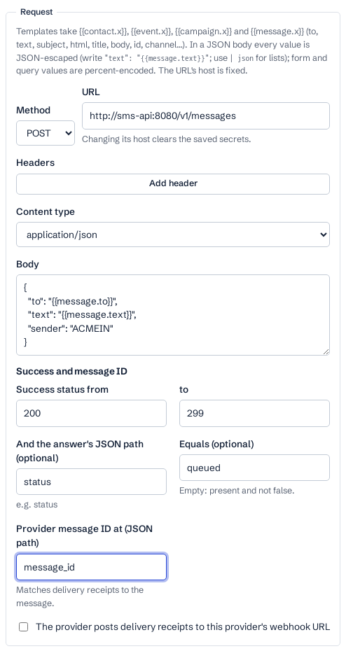
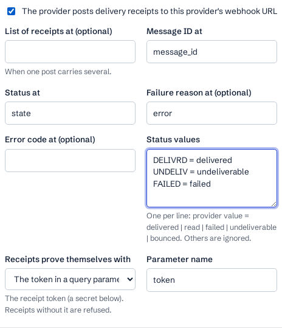
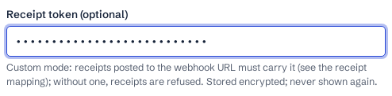

# Tutorial 16: Connecting any provider

In about 25 minutes you will connect an SMS company Pulse has no ready-made connection for, using
only its API documentation: you describe the request Pulse should send, how Pulse logs in, how it
knows a message was accepted, and how the company's delivery reports come back. Then you check the
login and look at the exact request before saving.

The same steps work for email, WhatsApp, RCS and push gateways: every channel offers the **Custom
HTTP gateway**.

**You need:** the **Admin** role (adding providers needs it), and the provider's API documentation.
[Tutorial 4](04-channels.md) shows the Channels page and the ready-made providers; use one of those
when it exists, it needs less setting up.

In the pictures the provider is a pretend SMS company, "SMSCo", running on a local test address
(`http://sms-api:8080`). Your provider's addresses start with `https://`.

---

## 1. What to find in the provider's documentation

Before you start, look up these answers. A developer at your company or the provider's support team
can help with the words.

| You need | SMSCo's answer |
|---|---|
| The address that sends a message, and its method | `POST https://api.smsco.example/v1/messages` |
| What the request's body looks like | JSON: `{"to": "+91…", "text": "…", "sender": "ACMEIN"}` |
| How you sign in | A login request: `POST /v1/login` with a username and password returns a token, valid for an hour |
| Where the token goes | A header: `Authorization: Bearer <token>` |
| What a successful answer looks like | `{"status": "queued", "message_id": "a1b2c3"}` |
| Whether it sends delivery reports, and what they look like | Yes: `{"message_id": "a1b2c3", "state": "DELIVRD"}`, with states `DELIVRD`, `UNDELIV`, `FAILED` |

## 2. Add the gateway

1. Go to **Settings → Channels** and click **Add provider** in the **SMS** panel.
2. **Provider**: **Custom HTTP gateway**.
3. **Name in Pulse**: `SMSCo`.
4. **How Pulse calls your gateway**: **My own request (method, address, headers, body)**.

   

The other choice, **Pulse's standard request (signed JSON)**, sends Pulse's own JSON format to one
**Endpoint URL**, signed with a **Signing secret**. Use it when your developers build the gateway
themselves (the developer docs describe the format). Everything below is about **My own request**.

## 3. Describe the request

The **Request** box describes the message request, one field per part of it:



1. **Method**: `POST` (or `PUT`, `PATCH`, `GET`, as the documentation says).
2. **URL**: the address that sends a message. Under it Pulse warns: *Changing its host clears the
   saved secrets* (step 8).
3. **Headers**: **Add header** for each header the documentation asks for (not the login token: step
   5 adds it).
4. **Content type**: `application/json` for a JSON body; `application/x-www-form-urlencoded` for a
   form; also `text/plain` and `application/xml`.
5. **Body**: the request body, with **variables** where the message's details go:

   ```json
   {
     "to": "{{message.to}}",
     "text": "{{message.text}}",
     "sender": "ACMEIN"
   }
   ```

   | Variable | Is |
   |---|---|
   | `{{message.to}}` | The phone number (email address, device token) the message goes to |
   | `{{message.text}}` | An SMS's text; `{{message.subject}}` and `{{message.html}}` for email; `{{message.title}}` and `{{message.body}}` for push |
   | `{{message.sender_id}}`, `{{message.dlt_template_id}}`, `{{message.dlt_entity_id}}` | The SMS template's sender ID and DLT IDs (tutorial 5) |
   | `{{message.template_name}}`, `{{message.params}}` | A WhatsApp template's name and its variables |
   | `{{message.id}}`, `{{message.ref}}` | Pulse's own message ID and reference |
   | `{{contact.first_name}}`, `{{event.x}}`, `{{campaign.name}}` | Contact fields, the event that started the campaign, the campaign, as in templates ([tutorial 13](13-personalising-messages.md)) |

   You don't need to worry about quotes or line breaks in the message: in a JSON body Pulse escapes
   every value for JSON (write `"text": "{{message.text}}"` with the quotes), and in a form or a
   URL it encodes each value. For a list, such as `{{message.params}}`, write
   `{{message.params | json}}` without quotes.

The URL's address (the `https://api.smsco.example` part) is fixed: contact data can never change
where a message goes, only the path and query after it.

**Success and message ID** tells Pulse how to read the answer:

| Field | SMSCo |
|---|---|
| **Success status from** … **to** | 200 to 299 (the default): any other status is a failure |
| **And the answer's JSON path (optional)** and **Equals (optional)** | `status` = `queued`: the answer must also say this. With **Equals** empty, the value only has to be there and not be `false` |
| **Provider message ID at (JSON path)** | `message_id`: the provider's ID, which its delivery reports name |

A JSON path names a value in the answer with dots: `data.id`, or `items[0].id` for the first item of
a list.

What Pulse does with each answer:

- **Accepted** (in the status range, and the JSON path matches): the message counts as sent.
- **404 or 410**: the recipient can't be reached; a WhatsApp or RCS message with an SMS fallback
  goes by SMS.
- **429 or a 5xx** (the provider is busy or down) or no answer: tried again later, as set on
  **Settings → Automation & limits** ([tutorial 11](11-admin-and-privacy.md#5-automation--limits)).
- **Anything else**, or a 2xx whose JSON doesn't match: failed, with the provider's answer as the
  reason.

## 4. Delivery reports

If the provider can post delivery reports to a web address, tick **The provider posts delivery
receipts to this provider's webhook URL** and describe them:



| Field | SMSCo |
|---|---|
| **List of receipts at (optional)** | Empty: one report per post. If one post carries several, the path to the list |
| **Message ID at** | `message_id` |
| **Status at** | `state` |
| **Failure reason at (optional)**, **Error code at (optional)** | `error`: shown as the reason in reports |
| **Status values** | One per line, *provider value = Pulse status*: `DELIVRD = delivered`, `UNDELIV = undeliverable`, `FAILED = failed`. Pulse's statuses are **delivered**, **read**, **failed**, **undeliverable** (failed, and a WhatsApp or RCS message goes by SMS instead) and **bounced**. Other values are ignored |
| **Receipts prove themselves with** | How Pulse knows a report really comes from the provider: **The token in a query parameter**, **The token in a header**, or **An HMAC-SHA256 of the body in a header** (the provider signs each report with the token) |
| **Parameter name** / **Header name** | Where the token is, e.g. `token` |

The token is the **Receipt token** further down the form (with the secrets). Make up a long random
string, enter it there, and give it to the provider. **Without a receipt token every report is
refused.**



After you save, the provider's row on the Channels page shows its **Delivery reports** address. Give
the provider that address; for a token in a query parameter, add it to the end:
`https://pulse.example.com/v1/webhooks/providers/42?token=<your receipt token>`.

## 5. How Pulse logs in

The **Authentication** box sets how Pulse proves who it is. **Type**:

| Type | Use it when the documentation says |
|---|---|
| **None** | No sign-in (in the standard request, Pulse still signs each request) |
| **Basic** | "HTTP basic auth": a **User** and **Password** |
| **Bearer token** | A fixed token in the `Authorization` header: **Token** |
| **API key** | A key in a header or in the address: **Goes in** (**Header** or **Query parameter**), its **Name** (e.g. `X-API-Key`), and the **API key** |
| **OAuth2 client credentials** | "OAuth2", "client credentials": the **Token URL**, **Client ID**, **Client secret goes** (**In the form body** or **As basic auth**), **Scope (optional)**, **Audience (optional)** and the **Client secret**. Pulse gets a token and renews it before it expires |
| **Login request** | You first call a login address to get a token, as with SMSCo |

For SMSCo, choose **Login request** and fill in:


1. **Method** and **Login URL**: `POST` and `https://api.smsco.example/v1/login`.
2. **Headers** if the login needs any, and the **Content type**.
3. **Body**: the login request's body. Write each password or key as `{{secrets.name}}`: Pulse
   starts you with
   `{"username": "{{secrets.username}}", "password": "{{secrets.password}}"}`. Every secret you name
   gets its own field at the bottom of the box (`Secret "password"`, `Secret "username"`), stored
   encrypted and never shown again. Don't type passwords into the body itself.
4. **Read the token from**: **JSON path** (`data.access_token` here), **A response header** (its
   name; a leading `Bearer ` is removed), or **A regular expression** (the first group in brackets).
5. **Expiry**: when the token runs out. **From a JSON path** (`data.expires_in`: seconds left, a Unix
   time or a date), **Fixed lifetime** in seconds, or **Unknown (1 hour, renewed on 401)**.
6. **Token goes in**: **A header** (the default: `Authorization: Bearer <token>`), **A query
   parameter** or **A body field**, with its **Name** and a **Value template** in which `{{token}}`
   is the token. Leave them empty for `Authorization: Bearer {{token}}`.
7. Fill in the secrets: `Secret "username"` and `Secret "password"`.

What Pulse does with it: it logs in before the first message, keeps the token (encrypted, shared by
all Pulse servers) and logs in again shortly before it expires. If the provider answers a message
with 401 (not signed in), Pulse logs in again and retries once. When the provider refuses the login
(a wrong password), messages fail with the reason **Provider credentials refused** until you fix the
secrets and save.

## 6. Test connection

Click **Test connection** under the form. Pulse runs the login now, with the settings and secrets
you just typed (empty secret fields use the saved ones), and shows the result:


- **Logged in. Token …, expires …**: the login works. Only the token's first and last four
  characters are shown.
- **Nothing to log in to: the credentials are sent with each request.**: for **Basic**, **Bearer
  token** and **API key**, which have no login step.
- **Logged in to smtp.example.com:587.**: for an email (SMTP) provider, Pulse connected to the mail
  server and logged in, then disconnected. **Send test** then checks that a real message arrives.
- A red box with the reason and the provider's answer: a wrong address, a wrong password, or a token
  that isn't where **Read the token from** says. Passwords never appear in it.

Test connection is limited to 20 a minute per workspace.

## 7. Preview request

Click **Preview request** to see exactly what Pulse would send for its test message:


Compare it with an example in the provider's documentation. Secrets show as `••••`, the whole
`Authorization` value is hidden for basic and API-key sign-ins, and the login token shows as
`{{token}}`. Nothing is sent.

## 8. Save, test, and change it later

1. Leave **Use for all SMS messages** ticked to make it the channel's default (or untick it to save
   it as a standby), and click **Save provider**. New sends use it within 30 seconds.
2. On the provider's row, click **Send test** and enter a test number (tutorial 4, step 7). You see
   **Accepted by the provider** with the provider's message ID, or **Not sent:** with the reason.
3. Send a template to yourself with **Send a test** in the template editor (tutorial 5): that one is
   personalised and goes the normal way.
4. Give the provider the **Delivery reports** address (step 4).

When you edit the provider later, its secrets stay hidden: leave a secret field empty to keep its
saved value. Two rules keep saved passwords from being sent somewhere else:

- **Changing a host** (the address part of the URL, the login URL or the token URL): Pulse shows
  *An endpoint's host changed: the saved secrets will be cleared, so enter every secret again.*
- **Changing anything else that decides where or how secrets are sent** (paths, the body, the
  authentication or request settings, the receipt mapping, user names, the mode): saving says *the
  authentication or request settings changed: enter every secret again to save them*. Fill in every
  secret field, then save again.

Harmless settings (sender names and numbers, pool sizes, DLT IDs) can change without the secrets.
**Test connection** with saved secrets works only for the saved settings: after a change like these,
enter the secrets to test.

## What you have now

- An SMS provider connected with its own API, without any code
- Pulse logging in and renewing the token by itself
- Delivery reports from the provider counted in your campaign reports
  ([tutorial 15](15-delivery-and-dashboards.md))

**Next:** [Tutorial 17, Interactive AMP emails](17-interactive-amp-emails.md): polls, forms and
carousels inside the email.
