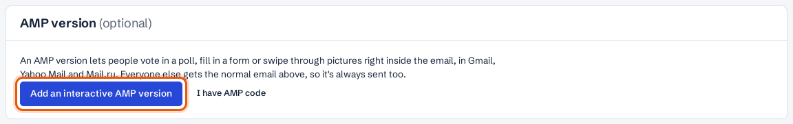
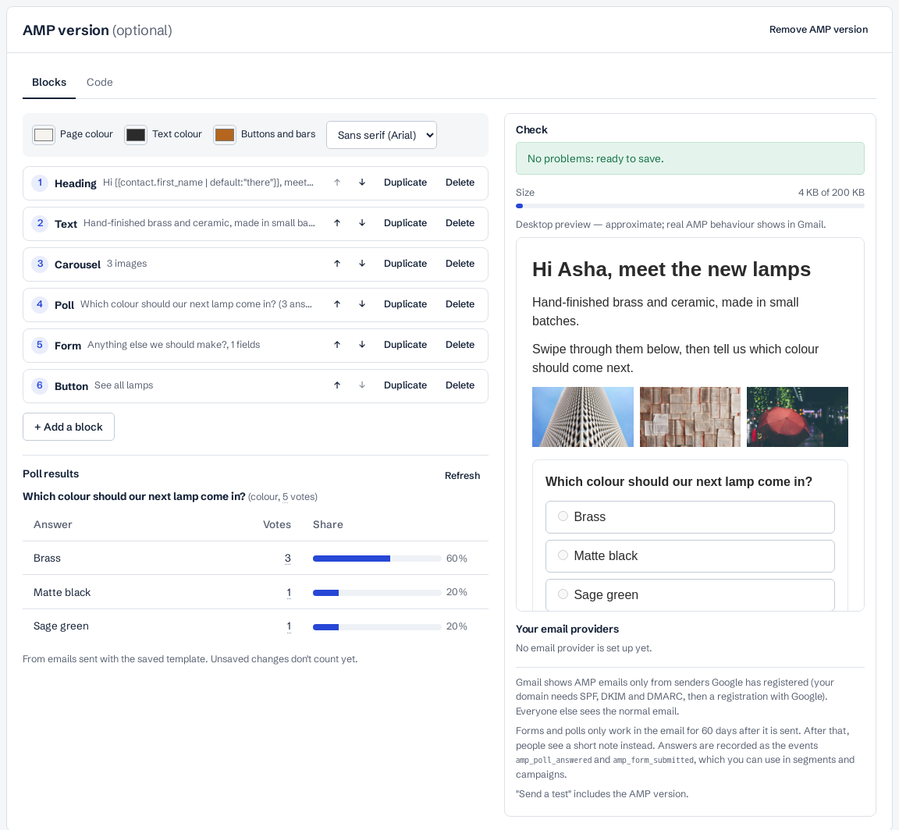
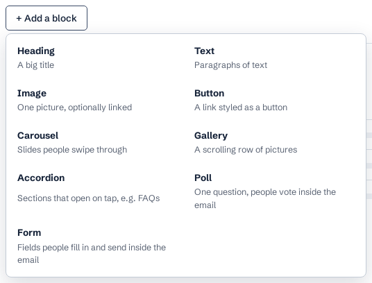
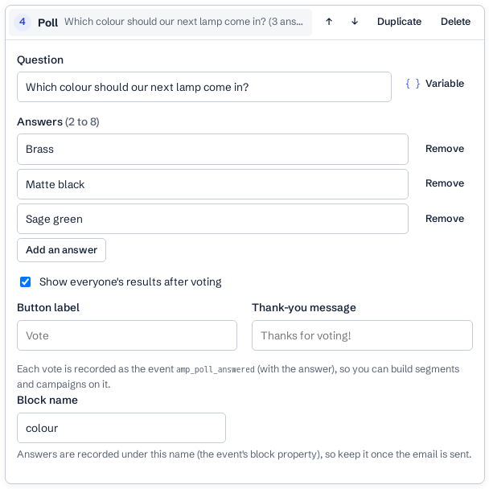
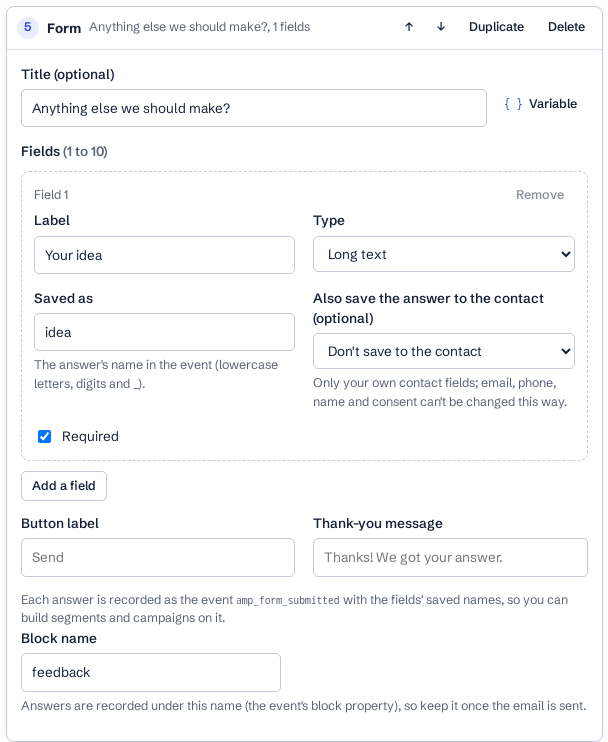
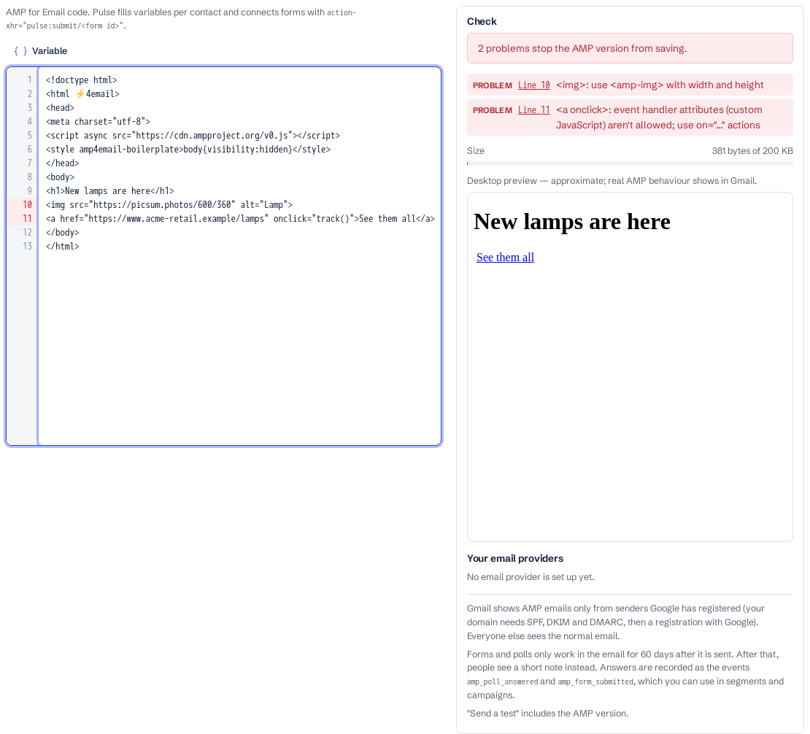
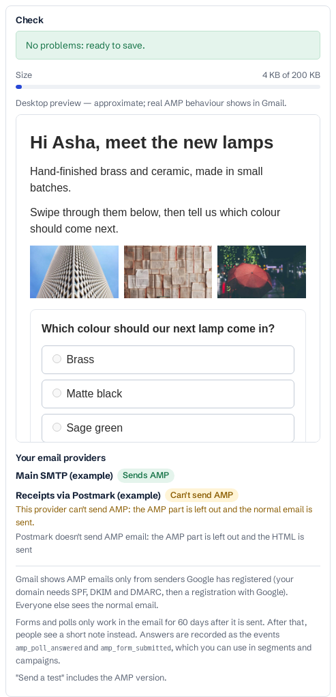
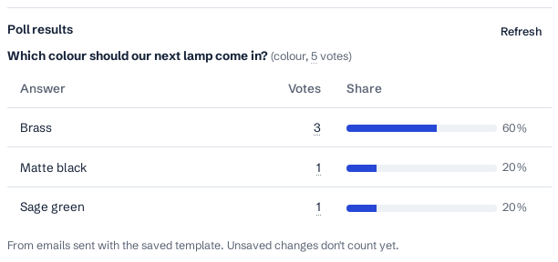

# Tutorial 17: Interactive AMP emails

In about 20 minutes you will add an interactive version to an email: a carousel people swipe through,
a poll they vote in and a form they fill in, all inside the email. Then you will check it, see the
votes come in, and use the answers in segments and campaigns.

**You need:** an email template ([tutorial 5](05-templates-and-content.md)) and **Content: Edit**.
To send it for real, an email provider that can send AMP (step 6).

---

## 1. What an AMP version is

AMP for Email is a format that Gmail, Yahoo Mail and Mail.ru show as a small interactive page inside
the email. Pulse sends it as an extra part of the same email: people whose email app shows AMP get
the interactive version, everyone else gets your normal email. So the normal email is always sent
too, and should make sense on its own.

| You can add | What people do |
|---|---|
| **Heading**, **Text**, **Image**, **Button** | Read, tap through to your site |
| **Carousel** | Swipe through slides (it can also move on by itself) |
| **Gallery** | Scroll sideways through a row of pictures |
| **Accordion** | Open sections, e.g. FAQs |
| **Poll** | Vote on one question; they can see everyone's results after voting |
| **Form** | Fill in fields and send them, without leaving the email |

## 2. Add an AMP version

1. Open an email template (**Content → Message templates**, then the template, or **New email
   template**).
2. Scroll down below the email and its attachments to **AMP version (optional)** and click **Add an
   interactive AMP version**.

   

   (**I have AMP code** is for developers who write AMP themselves; see step 5.)

The AMP version starts with three blocks you can change: a **Heading** (*Hi {{contact.first_name}},
quick question*), a **Text** and a **Poll**. The editor is on the left, the **Check** with a preview
on the right. Here the email has been built up to six blocks:

## 3. Build it from blocks

**The look** (at the top): **Page colour**, **Text colour**, **Buttons and bars**, and the font
(**Sans serif (Arial)** or **Serif (Georgia)**).

**Add a block**: click **+ Add a block** at the bottom and choose one. An email can have up to 40
blocks.

Click a block's title to open it, and again to close it. **↑** and **↓** move it, **Duplicate**
copies it, **Delete** removes it. What each block asks for:

| Block | Fields |
|---|---|
| **Heading** | The heading |
| **Text** | The text; leave a blank line between paragraphs |
| **Image** | **Image address** (a link starting with `https://`), **Description (for screen readers)**, and optionally where it opens when tapped |
| **Button** | **Button label** and **Opens this web address** |
| **Carousel** | 2 to 10 images (**Add an image**), **Height (pixels)** (slides are 600 pixels wide), and **Move to the next slide every (seconds)** (0 = only when swiped) |
| **Gallery** | 2 to 10 images and a height; the pictures scroll sideways |
| **Accordion** | Up to 10 sections, each with a **Title** and what's **Shown when opened** |
| **Poll** | A **Question** and 2 to 8 **Answers** |
| **Form** | An optional title and 1 to 10 fields |

Headings, text and labels can hold variables with **{ } Variable**, e.g.
`{{contact.first_name | default:"there"}}` ([tutorial 13](13-personalising-messages.md)).

### A poll

Open the **Poll** block:

- **Question** and **Answers (2 to 8)**; **Add an answer** adds one, **Remove** takes one away.
- **Show everyone's results after voting**: after they vote, people see how everyone voted.
- **Button label** (*Vote* if empty) and **Thank-you message** (*Thanks for voting!*).
- **Block name**: votes are recorded under this name, so keep it once the email has been sent.

Each person can vote once in a poll; a second vote gets *You already answered*.

### A form

Open the **Form** block:

For each field: **Label** (what people see), **Type** (**Short text**, **Long text**, **Email
address**, **Number**, **Drop-down list** with its **Choices**, or **Tick box**), **Saved as** (the
answer's name in the event), and **Required**.

**Also save the answer to the contact (optional)** copies the answer into one of your own contact
fields, for example a *favourite category* field. Email, phone, name and consent can't be changed
this way; add your own fields under **Settings → Contact fields** first.

### Problems

While a block is missing something (an image without an address, a poll with one answer), it is
marked and the **Check** says *Fix the problem in the blocks to update the check and preview.* Fix
it, and the check and preview update by themselves.

## 4. Check, preview and save

The **Check** panel on the right checks the AMP version as you work:

- **No problems: ready to save.** or the problems that stop it from saving (suggestions don't).
- **Size**: an AMP version can be at most 200 KB.
- **Desktop preview**, filled in for a sample contact. It's an approximation: carousels scroll, the
  accordion opens and closes, but forms can't be sent from it. Real AMP behaviour shows in Gmail.
- **Your email providers**: whether each one can send AMP (step 6).

Click **Save template** at the top. Pulse builds the AMP code from your blocks every time you save.

**Remove AMP version** takes it off the email again (after you save, everyone gets the normal email).

## 5. Writing AMP code yourself

Developers can write the AMP code by hand: click **Code** (Pulse copies in the code your blocks
make; the blocks are cleared and you can't turn code back into blocks), or **I have AMP code** on an
email without an AMP version.

Pulse checks the code as you type and lists each problem with its line. Click **Line 10** to jump to
that line:

A version with problems can't be saved. Forms must send to Pulse with
`action-xhr="pulse:submit/<form id>"`; Pulse fills in each person's own link when it sends.
Variables work as in the normal email, except inside `amp-mustache` templates, which the email app
fills in. Pulse's check covers the common rules; Google's AMP validator has the final word.

## 6. Who can send it, and who sees it

**Providers.** Most email providers send the AMP part as it is: SMTP relays, Amazon SES, SendGrid,
SparkPost, Mailgun, Gmail and Google Workspace. **Postmark can't send AMP**: through Postmark, the AMP
part is left out and only the normal email goes. A custom gateway gets it as `content.amp`, and must
put it in the email itself. The check panel shows this for each of your providers:

**Gmail.** Gmail shows AMP emails only from senders Google has registered. Your sending domain needs
SPF, DKIM and DMARC set up, and then a registration with Google (*AMP for Email sender
registration*). Until then, Gmail users see the normal email. Yahoo Mail and Mail.ru have their own
registrations.

**60 days.** Polls and forms work in the email for 60 days after it is sent. After that, people who
open the email see a short note instead.

**Test it.** **Send a test** (at the top of the template) includes the AMP version. To see it as
your customers will, send it to a Gmail address while your domain is registered, or paste the AMP
code into the AMP playground.

## 7. See the answers

**Poll results** appear under the blocks once people vote: the number of votes for each answer and
its share.

They count emails sent with the saved template; click **Refresh** for new votes. Click a number to
open those voters in **Contacts**, ready to export or turn into a segment
([tutorial 15](15-delivery-and-dashboards.md#4-open-the-contacts-behind-a-number)).

Every answer is also an event on the contact:

| Event | Properties |
|---|---|
| `amp_poll_answered` | `block` (the block name), `question`, `answer`, and the message it came from |
| `amp_form_submitted` | `block`, and one property per field, by its **Saved as** name (e.g. `idea`) |

So you can use them like any other event:

- **Segments**: *did `amp_poll_answered` where `answer` is `Brass`* for everyone who voted Brass
  ([tutorial 3](03-segments.md), [tutorial 12](12-events-and-properties.md)).
- **Campaigns**: a triggered campaign that starts on `amp_form_submitted` and thanks the person, or
  passes their idea to your team ([tutorial 6](06-triggered-and-automation-campaigns.md)).
- **Contact page**: the answers show in the contact's events.

Tests sent to a bare address (not a contact) can be answered, but nothing is recorded.

## What you have now

- An email with an interactive version: a carousel, a poll and a form, built from blocks
- A check that it's valid and small enough, and which providers will send it
- Votes and answers as events, in segments and campaigns

**Next:** go back to the [tutorials index](README.md) for any topic you haven't covered yet.
