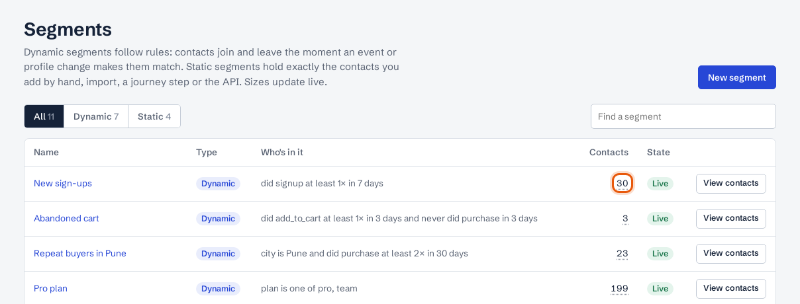
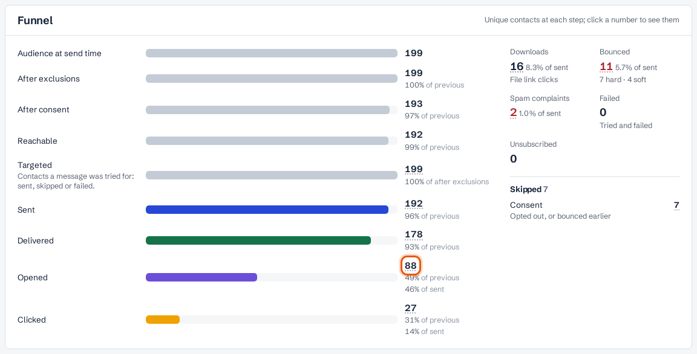
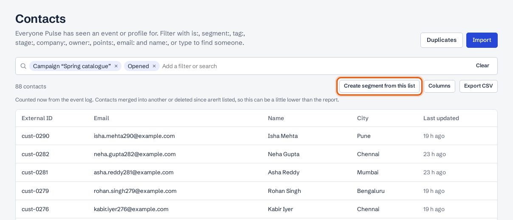
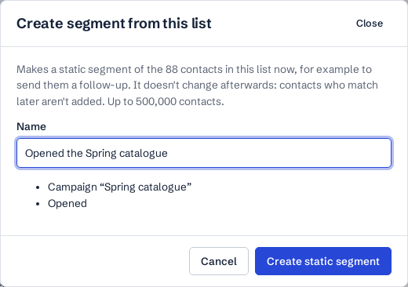
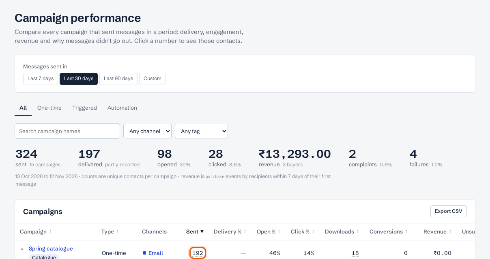

# Tutorial 18: Finding the contacts behind a number

In about 10 minutes you will learn to go from any number in Pulse (a segment's size, how many people
opened a campaign, a dashboard figure) to the list of exactly those people, read what the list
shows, and keep it as a segment for a follow-up.

**You need:** a workspace with a campaign that has sent something (tutorial 7 or 14), and a role
that can view contacts. The pictures use the **Spring catalogue** email campaign of the Acme Retail
demo workspace.

---

## 1. Numbers are links

Almost every count of people in Pulse is a link. You can tell by the dotted line under the number;
hovering shows **Show these contacts**. For example:

- **Segments**: the **Contacts** column, and **In segment now** on a segment's page.
- **Campaigns**: **Audience now** and **Sent to** in the list; on a campaign, every step of the
  **Funnel** (sent, delivered, opened, clicked…), the bounces, complaints and skips beside it, and
  each line of the reasons table.
- The **Who it reaches** / **Exact audience now** box of a one-time campaign: each step (in the
  segments, after exclusions, after consent, reachable, under the frequency cap), the total that
  will get it, and the number of email unsubscribers in its warning when your workspace leaves them
  to segment filters.
- **Reachable by channel** on a segment's page: who hasn't unsubscribed, and who can be reached.
- A triggered or automation campaign's builder: the people at each step now, and the messages
  each step sent.
- **Overview**: the number of contacts.
- **Users**, **Campaign performance** and **Products** dashboards: active, new and returning users,
  each campaign's numbers, product viewers, buyers and people who abandoned their cart.
- **Companies**, **Stages**, **Events**, **Forms**, AMP poll answers, and the overlap of website
  messages.

## 2. Open the list behind a number

Say you want to see who opened the Spring catalogue email.

1. Go to **Campaigns** and click **Spring catalogue**.
2. Scroll to **Results**. The **Funnel** shows how many people reached each step.
3. Click the number next to **Opened**.

   

**Contacts** opens with the list of exactly those people.

## 3. Read the list

- The search box holds the filters as **chips in words**: here **Campaign “Spring catalogue”** and
  **Opened**. Each chip narrows the list; together they mean "people who opened the Spring
  catalogue".
- The count (**88 contacts**) is the same number you clicked. Above 10,000 it may say **About …**:
  for very large lists Pulse estimates the count, but the list itself is complete.
- A short note under the bar says when the list can differ slightly from the number, for example
  when contacts were deleted or merged into another contact since the report counted them.
- Everything else works as usual: click a contact to open them, choose **Columns**, or
  **Export CSV** (needs contact edit access).

Chips you may meet, depending on where you clicked:

| Chip | Means |
|---|---|
| **In segment “VIPs”**, **In any of “A”, “B”** | In that segment (or any of them) now |
| **Not in segment “Staff”** | Left out: not in that segment |
| **Not unsubscribed from email** | Hasn't opted out of the channel |
| **Reachable by email** | Pulse can get a message to them on the channel now |
| **Not held back by the email frequency cap** | Hasn't hit the channel's message limit |
| **Campaign “…”** | Got a message from that campaign. **Send of …** narrows it to one send of a repeating campaign, **Step …** to one step |
| **Sent**, **Delivered**, **Opened**, **Clicked**, **Bounced**, **Bounced (hard)**, **Bounced (soft)**, **Complained (spam or blocked)**, **Failed**, **Unsubscribed**, **Skipped: unsubscribed**… | What happened to their message, on any channel |
| **By email** (or **By SMS**, **By WhatsApp**…) | Only messages on that channel, with a campaign or what happened (for example the Contacts filter **Bounced or complained on a channel**) |
| **Unsubscribed from email**, **Unsubscribed from everything**, **Unsubscribed from the topic weekly_offers** | Opted out of the channel (or of everything), or left that topic |
| **Reason: Hard bounce** (or another reason) | Why a message didn't arrive |
| **Entered “Welcome series”**, **Now at “…”**, **Still in the journey**, **Finished the journey**, **Reached the goal** | Where they are in a triggered or automation campaign |
| **Did product_viewed**, **Didn't do purchase**, **Product …**, **Category …** | What they did (and, for products, which one) |
| **Active**, **New (first active)**, **Returning**, **Active on Android**, **Came from newsletter** | When and where they were active |
| **Answered the poll in “…”**, **Answer …** | Answers to a poll in an interactive (AMP) email |
| A date range | The period the number covered (whole days, in UTC) |

## 4. Change or clear the filters

- Click **×** on a chip to remove that filter. The list and count change at once. Removing
  **Opened** above leaves everyone the campaign sent to.
- **Clear** removes every filter.
- You can add your own filters next to them: click **Add filter** next to the search box and answer a
  question (**Has a tag**, **In a segment**, **Did an event** between two dates…), or type one such as
  `tag:vip` ([tutorial 2](02-contacts.md#7-filter-your-contacts)).
- The address bar keeps the whole list (`/contacts?q=…`): bookmark it or send it to a teammate.
  They see it only if their role may open it (step 7).

## 5. Keep the list as a segment

A list like "people who opened the Spring catalogue" is a good audience for a follow-up. Because it
comes from what happened in the past, it can't be a dynamic segment (one that updates itself), so the
button is **Create segment from this list** instead of **Save as segment**:

1. Click **Create segment from this list**.
2. Check the **Name** (Pulse suggests one from the chips), here `Opened the Spring catalogue`.
3. Click **Create static segment**.

   

You land on the new **static** segment. Pulse adds the people in the list now (up to 500,000) within
a few seconds. It doesn't change afterwards: people who open the email later aren't added. Use it as
the audience of a one-time campaign (tutorial 14).

> **Save as segment or Create segment from this list?** A list made only of the filters you can type
> yourself (`tag:`, `points:`, `segment:`…) offers **Save as segment**: a dynamic segment whose
> members change as people start or stop matching. A list opened from a number offers **Create
> segment from this list**: a snapshot of who is in it now. Both need access to edit segments.

## 6. Numbers that aren't links

A few numbers have no list of people behind them. Hover over one and a tooltip says why:

- **Totals that add up several campaigns**, at the top of **Campaign performance**: someone who got
  two campaigns counts twice, so the total isn't one group of people. Click a campaign's own
  numbers in the table instead.

  

- **Entered** and the **Yes / No** and split counts on a triggered or automation campaign's steps:
  Pulse counts how many times people passed a step, not who. The people at a step *now* and the
  messages it sent are links.
- **Audience at send time** in a one-time campaign's funnel: a snapshot taken when it sent. The steps
  after it are links.
- The live preview of a segment you haven't saved yet: save it, then click **In segment now**.
- Funnel and cohort reports, asset downloads, landing page visitors, in-app "seen by", import rows and
  message totals per channel (these count messages or visits, not people).
- **0**: there is nobody to show.

## 7. When your role can't open a list

Lists show people, so they need **Contacts: View**. Some also show what a campaign did, so they
need more:

| List | Also needs view access to |
|---|---|
| A one-time campaign's results | One-time campaigns, or Reports |
| A triggered or automation campaign's results, or who is at a step | Triggered & automation campaigns, or Reports |
| Results across every campaign (the dashboards' reason lists) | Reports |
| AMP poll answers and form submissions | Content, or Reports |

When your role lacks one, the number shows without a link, and hovering it says which access is
missing, for example *Your role can't list these contacts (it needs view access to reports)*. Ask an admin to change your role (tutorial 1, step 5).

## What you have now

- You can open the people behind any number, from a segment's size to one step of a campaign
- You can read and change the chips, and keep a list as a static segment for a follow-up
- You know which numbers have no list, and why

**Next:** use the segment you made as the audience of a one-time campaign
([tutorial 14](14-campaigns-hub-and-one-time-campaigns.md)).
Or go on to [tutorial 19, Product recommendations](19-product-recommendations.md).
