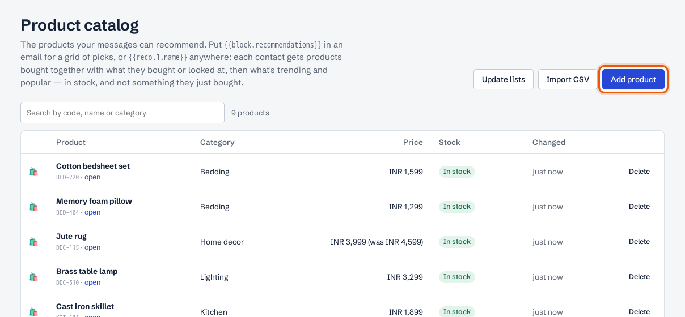
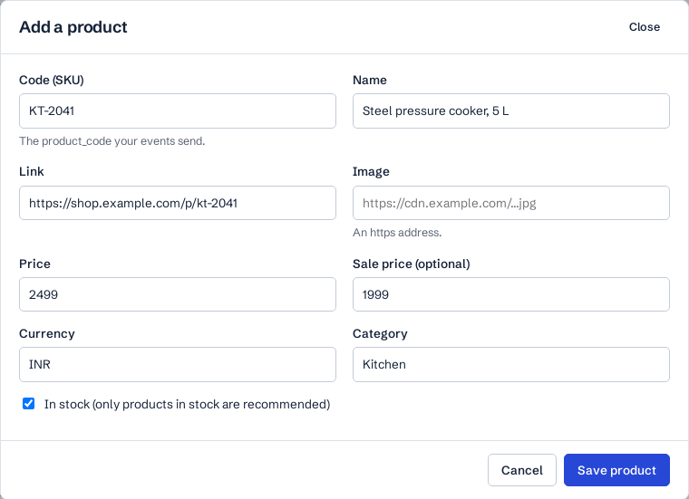
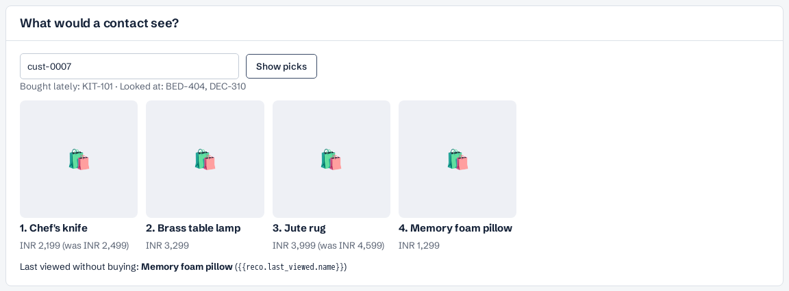

# Tutorial 19: Product recommendations

In about 15 minutes you will put your products into Pulse, and send an email where each contact sees
products picked for them: what goes with what they bought or looked at, then what's trending and
popular.

**You need:** a role that can edit **Content**, and events from your shop that name a product (your
developer sends them, see step 2). The examples use the Acme Retail workspace.

---

## 1. Add your products

Go to **Content → Product catalog**. The list shows each product's image, name and code, **Category**,
**Price**, **Stock** and when it **Changed**. **Search by code, name or category** finds one; long
catalogs have **Previous** and **Next**.



**One at a time.** Click **Add product** and fill in:

| Field | Example |
|---|---|
| **Code (SKU)** | `KT-2041`: the `product_code` your events send. It can't change later; add a new product instead |
| **Name** | `Steel pressure cooker, 5 L` |
| **Link** | `https://shop.example.com/p/kt-2041` |
| **Image** | `https://cdn.example.com/kt-2041.jpg` (an https address) |
| **Price**, **Sale price (optional)**, **Currency** | `2499`, `1999`, `INR` |
| **Category** | `Kitchen` |
| **In stock** | Ticked. Only products in stock are recommended |



Click **Save product**. Click a product's row to edit it; the delete button at the end of the row
deletes it (Pulse asks first).

**From a file.** Click **Import CSV**, then **Choose a file**. Pulse reads these columns: `code` (or
`sku`, `id`), `name` (or `title`), `url`, `image_url`, `price`, `sale_price`, `currency`, `category`,
`in_stock` (yes / no, or a quantity). An export of a Google Merchant product feed works as it is. Pulse
shows how many products are ready, the first few rows, and any columns it doesn't use. Click
**Import N products**. Products whose code is already in the catalog are replaced.

Your developers can also keep the catalog up to date from your shop's systems through the API, in
batches of up to 1,000 products ([developer docs](../developer/README.md)).

## 2. Tell Pulse what people look at and buy

Recommendations come from your events. Any event with a `product_code` property (or a list of
`items`, each with a `product_code`) counts:

- the **revenue event** (`purchase` by default, set under **Analytics → Revenue**, [tutorial 10](10-analytics.md#revenue-settings))
  counts as **bought**;
- any other event (a product view, add to cart) counts as **looked at**.

For example, from your website:

```js
Pulse.track("product_viewed", { product_code: "KT-2041" });
Pulse.track("purchase", { amount: 2499, items: [{ product_code: "KT-2041" }] });
```

Pulse remembers each contact's 30 latest product events (for up to 120 days). Every day it also works
out three lists for the whole workspace: **popular** (most bought, last 30 days), **trending** (most
looked at, last 7 days) and **bought together** (for each product, what its buyers also bought, last
90 days). **Update lists** (top right) works them out now, for example right after you import your
catalog.

## 3. Put recommendations in a message

Open an email template ([tutorial 5](05-templates-and-content.md)) and add one of these:

| Write | Gets |
|---|---|
| `{{block.recommendations}}` | A grid of product cards (image, name, price, link), two a row, 4 products. On SMS, WhatsApp and push it becomes a short list |
| `{{reco.1.name}}`, `{{reco.1.url}}`, `{{reco.1.image}}`, `{{reco.1.price}}` | One product's details, to lay out yourself. Also `sale_price`, `currency`, `category` and `code`; `reco.2.…` up to `reco.12.…` |
| `{{reco.last_viewed.name}}`, `{{reco.last_viewed.url}}` | The last product they looked at without buying ("Still thinking about …?") |
| `{{reco.count}}` | How many products were found |

The **{ } Variable** button lists them under **Recommended products**, and the block under **Filled
by Pulse** as **🛍️ Recommended products (cards)**.

Each contact's products are picked when the message is sent, in this order:

1. Products bought together with what they bought or looked at lately.
2. Products they looked at.
3. Trending products.
4. Popular products.

Only products in the catalog and in stock are picked, and never one the contact just bought. If you
use `{{reco.6.name}}`, Pulse picks six products for that message.

A contact with no history still gets trending and popular products. If nothing can be picked (an empty
catalog, no product events yet), the block is empty and the `reco` variables are empty: give them a
default, e.g. `{{reco.1.name | default:"our bestsellers"}}`.

## 4. Check what a contact would see

At the bottom of **Product catalog**, **What would a contact see?**: enter a contact's external ID and
click **Show picks**. Pulse lists what they **bought lately** and **looked at**, the products it would
recommend now, and their last viewed product (`{{reco.last_viewed.name}}`).


 *No products to recommend
yet* means the catalog needs products in stock, and the lists need product events.

**Preview as contact** and **Send a test** in the template editor show the real picks for that
contact too.

## 5. Limits

- Recommendations are "bought together", "viewed", "trending" and "popular". There is no
  machine-learning ranking.
- One message uses one way of picking (the order above) for all its products.
- The daily lists update once a day (or with **Update lists**); a contact's own views and purchases
  count as soon as they happen.

## What you have now

- Your products in Pulse, added by hand or from a CSV
- Product events that tell Pulse what each contact looks at and buys
- An email with products picked for each contact, and a way to check the picks

**Next:** [Tutorial 20, Surveys and NPS](20-surveys-and-nps.md): ask for a score and feed the answers
into segments and campaigns.
